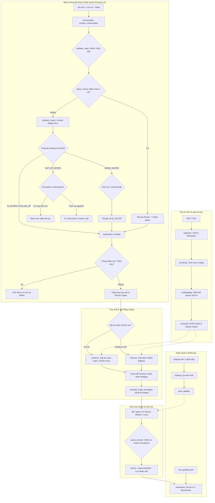

# Kiến trúc hệ thống ViGovBot

Tài liệu mô tả cấu trúc thành phần, ranh giới phụ thuộc và hợp đồng artifact của
pipeline ViGovBot. Nội dung phản ánh package `vigovbot` phiên bản 0.2.0.

## Mô hình thành phần

Mã chính nằm trong `src/vigovbot`. Package cài bằng pip và CLI `vigovbot`
không phụ thuộc thư mục làm việc của repository. Notebook cài package từ
checkout và sử dụng namespace `vigovbot.*`; lớp tương thích `src.*` đã được bỏ.

| Thành phần | Trách nhiệm |
|---|---|
| `ingestion` | Trích xuất PDF/OCR; đọc corpus dạng thư mục/ZIP |
| `chunking` | Phân tích cấu trúc mục TTHC, bảo toàn bảng biểu, chia chunk có prefix |
| `embeddings` | BGE-M3 tạo pack; nạp encoder câu hỏi 1024 chiều |
| `vectordb` | Kiểm tra/gộp pack, tạo FAISS IndexFlatIP và cache SQLite `metadata.sqlite` |
| `retrieval.retriever` | Chuẩn hóa vector câu hỏi, tra FAISS, lọc mã thủ tục và đọc payload SQLite |
| `retrieval.procedure_discovery` | Tìm kiếm hybrid BM25 + Cosine phục vụ xác nhận thủ tục mờ (`confirmation_candidates`) |
| `rag.conversation` | Điều phối hội thoại v2 (`answer_conversation`), quản lý HMAC state, phân nhánh thực đơn |
| `rag.phobert_router` | Suy luận 4-head PhoBERT CPU (phạm vi, mạch, trộn, 11 mục), trọng tài catalog |
| `rag.classification` | Schema JSON định tuyến LLM v2, 2-turn retry, extractive rewrite cho mixed-scope |
| `rag.sections` | Ánh xạ ý định người dùng sang chunk section taxonomy, fallback schema cũ |
| `rag.clarification` | Quản lý catalog thủ tục, phát hiện bí danh, sinh menu và đối soát lựa chọn |
| `rag.pipeline` | Khởi tạo corpus, quản lý phiên inference, giao diện CLI và bridge tương thích v1 |
| `prompts.evidence` | Đóng gói JSON envelope bảo vệ ngữ cảnh, ngân sách token, truncation an toàn |
| `prompts.prompt_templates` | Prompt tiếng Việt, hướng dẫn trình bày theo mục, định dạng JSON answer/evidence |
| `llm` | Giao tiếp Ollama (`ollama_answer`) và kiểm tra tính khả dụng của model nền |
| `server` | Web UI/API FastAPI, quản lý luồng streaming, GPU switching và đo lường telemetry |
| `training` | SFT QLoRA 4-bit, chat template, loss masking, checkpoint/resume và inference adapter |
| `evaluation` | Bộ test Golden v2, đo lexical/semantic/retrieval metrics; độc lập với inference |
| `schemas.py` | Hợp đồng dữ liệu, model/kích thước vector, version artifact/cache |
| `artifacts.py` | Checksum SHA-256, revision, khóa ghi và công bố artifact |

## Ranh giới phụ thuộc

`vectordb` không phụ thuộc vào pipeline tạo embedding hoặc version của `rag`.
Hợp đồng corpus dùng `schemas.py`; version cache độc lập với version pipeline đánh giá.
`utils` chỉ giữ helper nhỏ và re-export tương thích. Notebook không chứa
bản sao logic embedding/RAG; sinh lại bằng `python scripts/build_colab_notebooks.py`.

`prepare` phụ thuộc corpus; `ask` phụ thuộc corpus và mô hình. Các lệnh
`smoke`, `evaluate`, `run`, `report` phụ thuộc thêm bộ test. API Python
`answer_question()` nhận retriever/tokenizer/settings, không nhận đáp án chuẩn.

Manifest thí nghiệm lưu cấu hình, fingerprint mã xử lý, checksum bộ test/corpus,
revision embedding, digest Ollama và phiên bản runtime Python/thư viện chính.
Giữ model/tokenizer revision cố định trong cấu hình khi chốt benchmark; ghi
commit repository trong báo cáo để liên kết kết quả với lần phát hành.

## Hợp đồng artifact và tính toàn vẹn

- Corpus: `tthc_unified.index`, `tthc_unified_metadata.json`, `corpus_manifest.json`.
- Manifest: phiên bản định dạng, số dòng, SHA-256 từng file, model BGE-M3,
  commit SHA của model, kích thước 1024 và phiên bản cách ghép prefix.
- Pipeline embedding phân giải revision thành commit bất biến trước khi nạp mô hình.
- Pipeline kiểm tra metadata và vector trước khi công bố corpus hoàn chỉnh.
- RAG kiểm tra checksum trước khi FAISS đọc index, rồi kiểm tra encoder.
  `embedding.revision: null` chọn revision từ manifest; giá trị khác bị từ chối.
- FAISS dùng inner product sau chuẩn hóa L2; thứ tự metadata là ID SQLite.

Manifest được ghi cuối. Lỗi Python trong lúc công bố sẽ dọn các file vừa công bố;
mất điện/kill tiến trình có thể để lại file dở dang nhưng thiếu manifest nên bị
từ chối ở chế độ mặc định. Không ghi đè artifact đã có; chọn thư mục đầu ra mới.

Khóa file bảo vệ việc công bố artifact, tạo cache và ghi kết quả trong một
filesystem hỗ trợ khóa hệ điều hành. Khóa này không phải cơ chế khóa phân tán
giữa nhiều phiên Colab qua Drive. Mỗi lần tạo corpus và benchmark phải sử dụng
thư mục đầu ra riêng.

Checksum xác minh tính nhất quán, không xác minh tác giả. Chỉ nạp index FAISS
từ nguồn đáng tin cậy. Chế độ legacy không thể chứng minh model tạo vector.

## Phạm vi hệ thống

Hiện phục vụ nghiên cứu qua CLI, notebook Colab và web UI/API cục bộ. Web dùng
FastAPI trên Uvicorn (ASGI), nạp một encoder/FAISS/SQLite dùng chung; các tác vụ
inference đồng bộ được chuyển sang worker thread để không chặn event loop, encoder và SQLite
có khóa riêng. PhoBERT router chạy trên CPU với 2 intra-op threads và khóa đồng bộ hóa.
Ollama/QLoRA tuần tự hóa theo model call để bảo vệ GPU và switching;
API ngoài không dùng khóa GPU. SQLite mở read-only để truy hồi từ thread request.

Về quản lý phiên, hệ thống sử dụng cache trạng thái hội thoại trong RAM (`_STATES`
dưới dạng `OrderedDict` tối đa 256 phiên) được ký bằng HMAC-SHA256 để chống can
thiệp dữ liệu từ client. Mỗi state gắn liền với `history_fingerprint`, `corpus_hash`,
thực đơn hiện hành và danh sách mã thủ tục đã chọn (`selected`). Client không gửi state
vẫn có thể dựa vào lịch sử để tra cứu lại state trong cache server; restart tiến trình web
sẽ xóa bộ nhớ đệm này. Chưa có hệ thống quản lý người dùng, cơ sở dữ liệu session phân tán
(Redis) hoặc xác thực người dùng ngoài server.

Pipeline fine-tuning nằm tại `src/vigovbot/training/`, gọi qua `vigov train`.
Training dùng quantization 4-bit, chat template và loss masking; checkpoint
resume kiểm tra trạng thái optimizer/scheduler/RNG và dữ liệu trước khi tiếp tục.
Artifact nằm trong `outputs/qlora/`; web có chế độ QLoRA qua local Transformers.
QLoRA trực tiếp không truy hồi nguồn như RAG. Đây là pipeline nghiên cứu có
kiểm tra tính toàn vẹn, chưa phải chứng nhận vận hành production.
Các nội dung liên quan được quy định tại [migration](migration.md),
[môi trường](../setup/environments.md) và [quy trình phát triển](../../CONTRIBUTING.md).

## Ranh giới orchestration và routing v2 (2026-10-29)

- `rag/conversation.py`: điều phối luồng hội thoại v2 (`answer_conversation`),
  kiểm tra chữ ký số HMAC của state (`validate_state`), ngắt luồng khi chọn menu
  trực tiếp (`direct_choice`), và bảo lưu kết quả tìm kiếm ngữ nghĩa (`unresolved_semantic_hits`)
  làm bằng chứng khi danh mục chưa nhận diện được mã thủ tục chính xác.
- `rag/phobert_router.py`: định tuyến 4 head bằng PhoBERT fine-tuned chạy CPU local;
  thực hiện trọng tài phạm vi (`catalog_scope_arbitration`) và phát hiện câu hỏi
  hỗn hợp (`MIXED_SCOPE`). Khi vế độc lập không thể tách tự động, adapter kích hoạt
  fallback extractive rewrite bằng LLM và yêu cầu PhoBERT kiểm chứng lại. FastText
  đã được gỡ bỏ hoàn toàn khỏi codebase.
- `rag/clarification.py`: quản lý catalog thủ tục SQLite, phát hiện bí danh (`procedure-aliases.yaml`),
  tạo thực đơn phân định thủ tục trùng tên và thực đơn chọn mục (`available_sections`).
- `retrieval/procedure_discovery.py`: cơ chế phát hiện thủ tục mờ bằng hybrid normalized BM25
  và exact cosine BGE-M3 kèm phạt định lượng tiêu cực (`NEGATIVE_QUALIFIERS`), phục vụ
  menu xác nhận khi câu hỏi ngắn bị phân loại nhầm là ngoài phạm vi.
- `chunking/markdown.py`: schema, metadata/heading, chia section và lắp chunk.
  `chunking/tables.py`: hàm thuần sửa continuation, tìm/lặp header và flatten
  cell; gọi trực tiếp không cần tạo chunker. Method cũ giữ alias tương thích.
  `repair_table_continuations` vốn đã là hàm độc lập trước refactor.
- `rag/pipeline.py`: điều phối route → retrieval → budget/prompt → kết quả;
  `rag/response.py`: routing retry/fallback và generation JSON/citation retry.
  Helper nhận tokenizer/settings/answer_fn, không sở hữu FAISS hay dataset nhãn.
- `training/train.py`: điều phối vòng đời; `_prepare_training_data` giữ gate
  resume/hash/run identity, `_prepare_model` cấu hình quantization/LoRA,
  `_training_arguments` xây Trainer arguments, `_finalize_training` đánh giá
  best-restored model và xuất báo cáo. Stop/interruption vẫn thuộc orchestration.

### Các tên module cùng basename không cùng trách nhiệm

| Module | Hợp đồng |
|---|---|
| `artifacts` | Checksum, corpus provenance, publication/lock |
| `training.artifacts` | Thư mục run training, config snapshot, đường dẫn báo cáo |
| `evaluation.report` | Báo cáo baseline notebook với metric legacy |
| `evaluation.benchmark_report` | Báo cáo benchmark QA và provenance |
| `training.report` | Báo cáo trạng thái/artifact training |
| `evaluation.metrics` | Metric baseline notebook legacy |
| `evaluation.lexical` | Hợp đồng lexical hiện đại dùng chung |
| `training.metrics` | Metric generation/loss training; lexical dùng module chung |

Dùng import đầy đủ namespace tại ranh giới subsystem. Không đổi tên hàng loạt
các module public chỉ vì cùng basename; chúng không ghi đè nhau trong Python.
