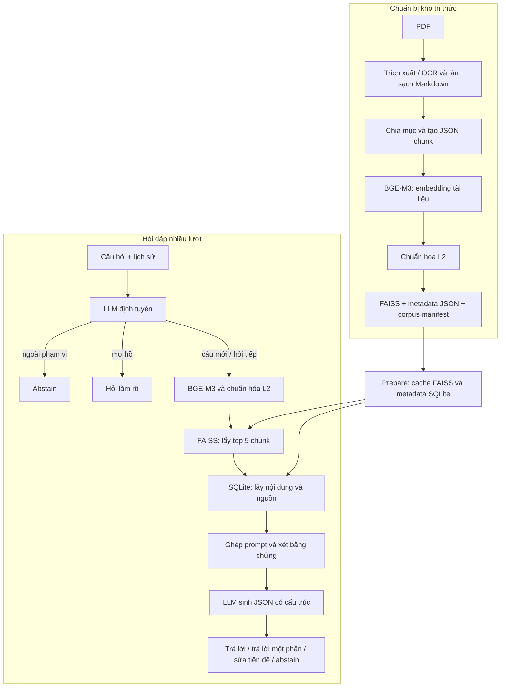

# Hướng dẫn vận hành pipeline RAG

Tài liệu quy định quy trình tạo corpus, khởi tạo hệ thống truy hồi, thực hiện truy
vấn và chạy đánh giá đối với package `vigovbot` phiên bản 0.2.0. Các lệnh được
thực thi từ thư mục gốc repository.

## 1. Tổng quan

ViGovBot là pipeline tra cứu thủ tục hành chính tiếng Việt theo mô hình **Retrieval-Augmented Generation (RAG)**: tìm các đoạn tài liệu liên quan trước, sau đó đưa chúng cùng câu hỏi vào mô hình sinh câu trả lời.

Hệ thống chạy bằng CLI Python, giao diện web cục bộ hoặc notebook Colab; hỗ trợ
hỏi đáp một lượt, hội thoại nhiều lượt và đánh giá theo bộ câu hỏi. Mã xử lý chính
nằm trong `src/vigovbot/`. Notebook cài package và dùng namespace `vigovbot.*`.

| Thành phần | Cách sử dụng hiện tại |
|---|---|
| Nguồn tri thức | PDF thủ tục hành chính, trích xuất thành Markdown; hỗ trợ OCR |
| Chia tài liệu | Chia theo cấu trúc mục, sau đó tách thành các chunk nhỏ có thông tin thủ tục |
| Mô hình embedding | `BAAI/bge-m3`, dùng `SentenceTransformer`, vector dense 1024 chiều |
| Chỉ mục tìm kiếm | FAISS `IndexFlatIP`, vector chuẩn hóa L2 |
| Nội dung và metadata khi truy vấn | SQLite, tra theo vị trí vector trong FAISS |
| Mô hình sinh | `qwen2.5:7b` chạy qua Ollama |
| Tokenizer tính ngân sách prompt | `Qwen/Qwen2.5-7B-Instruct` |
| Cách giao tiếp với LLM | HTTP `POST /api/chat`, `stream: false` |
| Điều hướng hội thoại | LLM phân loại phạm vi và quan hệ câu hỏi, đồng thời viết lại câu hỏi nối tiếp |
| Đầu ra câu trả lời | JSON có câu trả lời, hành động và trạng thái bằng chứng |

Đây là RAG truy hồi dense có lớp điều hướng nhiều lượt. Mặc định mỗi câu hỏi được
phân loại trước khi truy hồi; câu hỏi nối tiếp được viết lại thành truy vấn độc lập,
còn câu hỏi mới không kế thừa chủ đề cũ. Hệ thống không dùng BM25/hybrid search,
reranker hay agent, và không có bước huấn luyện, fine-tune hoặc QLoRA. Lịch sử do
client cung cấp cho từng lượt, chưa có kho hội thoại hoặc tài khoản người dùng ở
phía server.

## 2. Kiến trúc và luồng dữ liệu



### 2.1. Trích xuất và chia chunk

Lệnh `ingest` đọc PDF theo `configs/ingestion/pipeline.yaml`, dùng cấu hình trích xuất tại `configs/ingestion/ingestion.yaml` và cấu hình chia đoạn tại `configs/ingestion/chunking.yaml`.

- PDF đầu vào mặc định: `Data/pdf`; giới hạn kích thước mỗi PDF: 20 MB.
- OCR được bật, ngôn ngữ `vie+eng`, DPI 300, chế độ `full: true`; cần Tesseract/tessdata tương ứng khi thực hiện OCR.
- Markdown được làm sạch rồi chia theo các mục như trình tự thực hiện, thành phần hồ sơ, cách thức/thời hạn/phí và căn cứ pháp lý.
- Cấu hình chunk: mục tiêu 1.200 ký tự, tối đa 1.500 ký tự, overlap 100 ký tự và nội dung tối thiểu 10 ký tự. Việc chia còn phụ thuộc ranh giới mục, khối văn bản và bảng; không phải mọi chunk đều có cùng độ dài.
- Chunk có prefix dạng `[Thủ tục: ... | Mã TTHC: ... | Mục: ...]`. Giới hạn tối đa tính cả prefix; prefix có thể được rút gọn để vừa ngân sách.

Mỗi chunk gồm `chunk_id`, `source_file`, `source_code`, `procedure_name`, `section_type`, `context_prefix`, `text_content` và `parent_section`. Nội dung `text_content` đã chứa prefix. Pipeline embedding chỉ bổ sung prefix nếu chưa có, tránh lặp lại.

Đầu ra bình thường là `outputs/metadata/<tên-PDF>.json`. Báo cáo xử lý nằm trong `outputs/metadata/reports/`; tài liệu cần rà soát được đưa vào `outputs/metadata/review/`. Cần đọc báo cáo và kiểm tra các trường hợp thiếu trang hoặc metadata trước khi đưa vào kho tri thức.

### 2.2. Embedding và tạo chỉ mục

Lệnh `embed` đọc toàn bộ JSON chunk từ một thư mục hoặc ZIP, tạo vector BGE-M3,
chuẩn hóa L2 và xây dựng FAISS `IndexFlatIP` trong cùng một pipeline. Corpus gồm:

```text
Data/vector/unified/
    tthc_unified.index
    tthc_unified_metadata.json
    corpus_manifest.json
```

Với vector tài liệu và câu hỏi đều có độ dài L2 bằng 1, tích vô hướng mà FAISS trả về tương đương cosine similarity. Điểm càng lớn thì vector càng gần nhau; đây không phải xác suất câu trả lời đúng. `IndexFlatIP` thực hiện tìm kiếm chính xác trên các vector trong chỉ mục.

Manifest ghi model, revision thực tế được phân giải thành commit SHA, số bản ghi và
checksum. Ba artifact chỉ được công bố sau khi toàn bộ pipeline hoàn thành.

### 2.3. Chuẩn bị cache truy vấn

Lệnh `rag prepare` xác minh corpus, sao chép index vào cache và chuyển metadata JSON sang SQLite bằng cách đọc theo luồng. Cache nằm dưới `outputs/rag_cache/<định-danh>/`, gồm index, `metadata.sqlite` và `ready.json`.

`row_id` trong SQLite chính là vị trí vector, bắt đầu từ 0. Hệ thống kiểm tra số dòng, chiều vector, loại metric và checksum để tránh dùng nhầm index với metadata. SQLite chỉ giữ các trường cần truy hồi; `parent_section` không được đưa vào cache, nên luồng hỏi đáp không tự mở rộng chunk thành toàn bộ mục cha.

### 2.4. Xử lý câu hỏi và lịch sử hội thoại

1. Nạp BGE-M3 cùng model/revision với corpus. Nếu `embedding.revision: null` và
   corpus có manifest hợp lệ, hệ thống lấy revision từ manifest.
2. Kiểm tra lịch sử `user`/`assistant`, rồi gọi LLM định tuyến để trả JSON gồm
   `scope`, `relation`, `query` và `clarification`, ràng buộc bằng JSON Schema
   theo nhánh; không có lịch sử thì không cho chọn `follow_up`. Nếu JSON sai,
   thử lại một lần với lỗi validator và JSON bị từ chối. Hai lần sai trả câu
   mặc định, ghi `routing_fallback`, không truy hồi.
3. Nếu ngoài phạm vi, trả thông báo phạm vi hỗ trợ; nếu mơ hồ, trả câu hỏi làm rõ.
   Hai nhánh này không truy hồi và không gọi lần sinh câu trả lời.
4. Câu hỏi mới dùng nguyên văn câu hiện tại. Câu hỏi nối tiếp dùng `query` độc lập
   do router tạo từ lịch sử; lịch sử và câu trả lời cũ không được đưa vào prompt
   sinh cuối để tránh mang theo khẳng định chưa được kiểm chứng.
5. Encode truy vấn thành vector 1024 chiều, chuẩn hóa L2, lấy trực tiếp
   `top_k = 5` kết quả từ FAISS rồi tra nội dung trong SQLite. Runtime online
   không chạy reranker.
6. Ghép prompt trong ngân sách token. Nếu không có chunk nào thực sự vừa vào
   prompt, trả `abstain` mà không gọi sinh.
7. LLM xét bằng chứng và sinh JSON gồm `answer`, `action`, `evidence_status`.
   Pipeline kiểm tra schema và ánh xạ kết quả vào response cùng nguồn/thời gian.

Các cặp kết quả hợp lệ gồm: `answer/sufficient`, `partial/partial`,
`abstain/missing`, `correct_premise/contradictory_premise` và
`clarify/ambiguous`. Đây vẫn là tự đánh giá của cùng model sinh, không phải judge
độc lập và không bảo đảm nội dung luôn đúng. System prompt yêu cầu chỉ dựa trên
trích đoạn, không suy đoán phí/thời hạn/cơ quan/quy định và bỏ qua chỉ dẫn nằm
trong tài liệu. Chi tiết về luồng nhiều lượt và cách đánh giá nằm tại
[RAG nhiều lượt](rag-multi-turn.md).

## 3. Tham số RAG đang dùng

`configs/rag/inference.yaml` dùng cho hỏi đáp; các tham số không khai báo lấy mặc định từ `src/vigovbot/rag/config.py`. `configs/rag/evaluation.yaml` khai báo thêm dữ liệu và đầu ra đánh giá.

| Tham số | Giá trị mặc định / cấu hình hiện tại | Ý nghĩa |
|---|---|---|
| `embedding.model` | `BAAI/bge-m3` | Encoder cho câu hỏi |
| `embedding.device` | `cpu` | Dành VRAM cho Qwen; có thể đổi khi đủ tài nguyên |
| `llm.model` | `qwen2.5:7b` | Tên model trong Ollama |
| `llm.ollama_url` | `http://localhost:11434` | Địa chỉ Ollama |
| `llm.temperature` | `0.0` | Giảm tính ngẫu nhiên |
| `llm.seed` | `42` | Seed gửi cho Ollama |
| `llm.num_ctx` | `8192` | Cửa sổ ngữ cảnh yêu cầu |
| `llm.num_predict` | `512` | Số token sinh tối đa |
| `llm.routing_num_ctx` | `4096` | Cửa sổ ngữ cảnh riêng cho routing |
| `llm.routing_num_predict` | `128` | Số token routing sinh tối đa |
| `llm.timeout` | `300` giây | Timeout HTTP khi sinh câu trả lời |
| `llm.keep_alive` | `10m` | Tham số giữ model gửi trong request; pipeline yêu cầu dỡ model khi đóng phiên |
| `retrieval.top_k` | `5` | Số kết quả FAISS tối đa đưa trực tiếp vào LLM |
| `retrieval.max_chunk_tokens` | `1200` | Giới hạn token của mỗi chunk đưa vào prompt |
| `conversation.routing_enabled` | `true` | Bật định tuyến nhiều lượt và xét bằng chứng có cấu trúc |
| `web.debug_routing` | `false` | Trả raw JSON router trong API và hiển thị mục debug trên UI |
| `data.allow_legacy_corpus` | `false` | Mặc định yêu cầu corpus có provenance/manifest |

Ngân sách prompt trả lời là `8192 - 512 - 256 = 7424` token, trong đó 256 token
được dự phòng cho template. Ngân sách này bao gồm system prompt, câu hỏi và trích
đoạn. Router cũng kiểm tra prompt riêng theo cùng giới hạn; lịch sử quá dài gây lỗi
thay vì bị cắt âm thầm. Chunk có thể bị cắt ngắn hoặc không được đưa vào khi hết
chỗ. `max_chunk_tokens` tính bằng **token**, khác với tham số chunking tính bằng
**ký tự**.

## 4. Triển khai runtime bằng Docker

### 4.1. Chuẩn bị và khởi động

Runtime hiện hành không cần Python, virtual environment hoặc Ollama trên
Windows. Cần Docker Desktop dùng WSL2 backend, NVIDIA GPU hoạt động trong
container và corpus `Data/vector/unified`. Từ PowerShell tại gốc repository:

```powershell
docker compose up --build -d
docker compose ps
docker compose exec -T ollama ollama list
```

Service `ollama-model-init` tự tải `qwen2.5:7b` vào Docker volume. Không chạy
`ollama serve` trên host. Lần sau chỉ cần `docker compose up -d`. Xem đầy đủ tại
[Chạy ViGovBot bằng Docker Desktop](../setup/docker.md).

### 4.2. Tạo corpus từ PDF

> Workflow này chưa được đóng gói trong Compose inference hiện tại. Chỉ thực
> hiện sau khi tạo môi trường ingestion chuyên biệt và cấu hình bind mount
> input/output; không chạy các lệnh dưới đây bằng container `web` hiện tại.

Đặt PDF vào `Data/pdf`, rồi chạy:

```powershell
vigov data ingest
```

Có thể xử lý nhiều PDF song song bằng `--workers`. Ví dụ với máy 18 luồng CPU và
28 GB RAM, có thể bắt đầu với 6 worker khi OCR được bật:

```powershell
vigov data ingest --workers 6
```

Giá trị mặc định là 1. File đã hoàn tất vẫn được giữ lại và được bỏ qua khi chạy
lại nếu không dùng `--overwrite`.

Kiểm tra JSON và báo cáo trong `outputs/metadata`. Pipeline embedding có thể nhận
trực tiếp thư mục này hoặc một ZIP chỉ chứa các JSON chunk đã rà soát. Không đưa
`reports/` và `review/` vào nguồn embedding.

```powershell
vigov data embed outputs/metadata --output-dir Data/vector/unified-new
```

Ví dụ sử dụng `unified-new` vì pipeline từ chối ghi đè corpus đã tồn tại. Với dữ
liệu lớn, điều chỉnh `--batch-size`, `--device` và tài nguyên máy. Pipeline nhận
một nguồn dữ liệu và công bố trực tiếp corpus hoàn chỉnh.

Đổi `data.unified_source` trong cấu hình cần chạy thành `../Data/vector/unified-new`. Các đường dẫn trong YAML được tính từ **thư mục chứa YAML**, còn đường dẫn truyền trực tiếp qua CLI được tính theo thư mục làm việc.

### 4.3. Dùng corpus có sẵn trong workspace

Tại thời điểm kiểm tra, `Data/vector/unified/` có đủ `tthc_unified.index`,
`tthc_unified_metadata.json` và `corpus_manifest.json`. Vì vậy cấu hình mặc định
`allow_legacy_corpus: false` có thể xác minh corpus trước khi chuẩn bị cache.

Nếu dùng một corpus cũ khác chưa có manifest, nên tạo lại theo bước 4.2. Chỉ khi
cần tương thích tạm thời mới tạo file riêng `configs/rag/inference-local.yaml`:

```yaml
data:
  unified_source: ../Data/vector/unified
  cache_dir: ../outputs/rag_cache_legacy
  allow_legacy_corpus: true
embedding:
  model: BAAI/bge-m3
  revision: null
  device: cpu
llm:
  model: qwen2.5:7b
  ollama_url: http://localhost:11434
```

Chế độ legacy vẫn kiểm tra cấu trúc index và metadata nhưng không xác minh được model/revision đã tạo vector tài liệu. Khi thiếu manifest, `revision: null` không thể tự khôi phục revision gốc. Chi tiết tại [Migration dữ liệu cũ](../architecture/migration.md).

### 4.4. Chuẩn bị và hỏi đáp trong container

Với corpus đã có trên host và được mount vào container:

```powershell
docker compose exec -T web vigov rag prepare --config configs/rag/inference-docker-ollama.yaml
docker compose exec -T web vigov ask "Cần những giấy tờ gì để cấp bản sao hộ tịch?" --config configs/rag/inference-docker-ollama.yaml
```

`prepare` chỉ chuẩn bị corpus/cache, chưa gọi LLM; `ask` cũng tự kiểm tra cache
trước khi truy vấn. Cấu hình Docker gọi Ollama bằng tên service
`http://ollama:11434`, không dùng cấu hình local trỏ tới `localhost`.

Để hỏi nối tiếp, lưu các lượt trước vào một mảng JSON gồm message `user` và
`assistant`, rồi truyền file bằng `--history`:

```powershell
docker compose cp history.json web:/tmp/history.json
docker compose exec -T web vigov ask "Còn lệ phí thì sao?" --history /tmp/history.json --config configs/rag/inference-docker-ollama.yaml
```

CLI không tự lưu lịch sử giữa hai lần chạy; ứng dụng gọi phải giữ và gửi lại đúng
lịch sử. Khi `conversation.routing_enabled: false`, pipeline chạy chế độ đối chứng
cũ: chỉ viết lại khi có history, không phân loại phạm vi và không bắt buộc đầu ra
xét bằng chứng có cấu trúc.

Kết quả `ask` được in dưới dạng JSON:

| Trường | Nội dung |
|---|---|
| `prediction` | Câu trả lời của Qwen |
| `action`, `evidence_status` | Hành động và mức bằng chứng do model trả về |
| `routing`, `retrieval_query` | Quyết định định tuyến và truy vấn độc lập thực tế |
| `routing_attempts`, `fallback_reason`, `decision_reason` | Số lần phân loại và phân biệt fallback kỹ thuật với hỏi làm rõ hợp lệ |
| `retrieved` | Các chunk đã tìm được, kèm ID, điểm, file và mã thủ tục |
| `context_used` | Nguồn và phần văn bản thực sự đưa vào prompt sau khi cắt token |
| `prompt_tokens_estimated` | Số token prompt ước tính bằng tokenizer Qwen |
| `routing_s`, `retrieval_s`, `generation_s`, `latency_s` | Thời gian từng bước và toàn lượt; không gồm toàn bộ thời gian khởi tạo CLI/model |
| `raw_routing`, `raw_ollama` | Phản hồi gốc của lần định tuyến và sinh |

`retrieved` có thể nhiều nội dung hơn `context_used`; khi kiểm tra căn cứ câu trả lời, cần xem phần thực sự được đưa vào prompt.

### 4.5. Chạy giao diện web

Container `web` đã khởi động server HTTP cùng stack. Không chạy thêm `vigov web`:

```powershell
docker compose up -d
docker compose ps
```

Mở `http://localhost:8001`. Server nạp encoder, tokenizer, FAISS và SQLite một
lần, cung cấp `GET /api/health`, `GET /api/models` và `POST /api/chat`. UI giữ
lịch sử riêng cho từng model trong trình duyệt và gửi lại qua mỗi request; server
không lưu phiên hội thoại. Các request chat được khóa và xử lý model đã chọn theo
thứ tự để dùng chung tài nguyên an toàn. Retriever mở SQLite ở chế độ read-only
cho thread HTTP và có khóa nội bộ quanh encoder, FAISS, SQLite và thao tác đóng.

`configs/rag/inference.yaml` khai báo sẵn hai lựa chọn cùng dùng `qwen2.5:7b`:

- `mode: base`: gửi câu hỏi và lịch sử thẳng tới Qwen, không gọi embedding,
  FAISS/SQLite hoặc prompt RAG; kết quả không có nguồn.
- `mode: rag`: chạy toàn bộ router, truy hồi và xét bằng chứng; kết quả có các
  nguồn được truy hồi.

Chọn cả hai trên UI để xem hai câu trả lời cạnh nhau. Đây là so sánh chế độ suy
luận trên cùng model instruction `qwen2.5:7b`; chữ "base" không chỉ một base
checkpoint riêng chưa instruction-tune.

API trả thêm `routing_diagnostics` cho nhánh RAG. UI hiển thị rõ lỗi định dạng
phân loại sau hai lần thay vì chỉ hiện câu mặc định như một câu hỏi làm rõ.
Để xem JSON gốc, đặt `web.debug_routing: true` trong cấu hình và khởi động lại
server; mặc định không trả raw response. Câu fallback được thay bằng thông báo
trung tính trong history, giữ nguyên câu hỏi người dùng. History mất khi reload.

Nếu `web.models` trống, server dùng model Ollama trong nhóm `llm` với ID
`default` và `mode: rag`. Có thể khai báo tối đa tám lựa chọn trong một request,
với provider `ollama` hoặc `openai_compatible`. Provider bên ngoài chỉ đọc khóa
từ biến môi trường có tên trong `api_key_env`; không ghi khóa trực tiếp vào YAML.
Nhánh RAG của provider OpenAI-compatible yêu cầu hỗ trợ `json_schema` strict,
gồm nhánh `anyOf` và ràng buộc `minLength`; lỗi không hỗ trợ được báo trực tiếp,
không âm thầm bỏ schema. Ollama cục bộ đã được kiểm chứng với schema này.
Đây là server nghiên cứu không có xác thực, TLS, lưu phiên hay kiểm soát truy cập;
giữ mặc định loopback và chỉ bind `0.0.0.0` trong mạng tin cậy.

## 5. Chạy đánh giá

> Evaluation đầy đủ không thuộc Compose inference hiện tại vì dataset, output
> và dependency đánh giá chưa được mount/đóng gói đầy đủ. Tạo môi trường chuyên
> biệt theo [Môi trường và tái lập](../setup/environments.md) trước khi chạy các
> lệnh trong phần này; không chạy chúng bằng container `web` hiện tại.

Các profile `configs/rag/evaluation*.yaml` không gắn cứng dataset. `vigov eva`
chọn dataset v2 bằng `--dataset`. Lệnh legacy `vigov rag evaluate` dùng schema
`question`/`ground_truth`; hãy tạo config riêng với `dataset_path` hoặc
`dataset_zip` đúng schema đó. Không trỏ loader legacy vào
`Data/tthc_test_case_v1/data/test.jsonl` vì đây là schema evaluation v2.

```powershell
vigov rag smoke
vigov rag run
```

`smoke` thử tối đa 5 câu theo cấu hình hiện tại. `run` thực hiện chuẩn bị, smoke test, đánh giá rồi tạo báo cáo. Có thể dùng riêng `evaluate` để sinh kết quả và `report` để tính metric/tạo báo cáo. `max_cases: null` nghĩa là dùng toàn bộ bộ dữ liệu đã nạp; có thể đặt số nhỏ khi thử nghiệm.

Đầu ra mặc định ở `outputs/qwen2_5_7b_rag_results`, có manifest lần chạy, kết quả dự đoán, lỗi nếu có, `case_metrics.jsonl`, `case_metrics.csv`, `summary.json` và báo cáo theo nhóm. Metric gồm exact match, accuracy chuẩn hóa, BLEU-4, ROUGE, BERTScore, source recall@k và thời gian xử lý. BERTScore mặc định dùng `xlm-roberta-large` trên CPU, batch size 1.

Manifest gắn kết quả với code, cấu hình, dữ liệu, corpus, môi trường và digest model Ollama. Chọn thư mục đầu ra mới khi thay đổi thí nghiệm để không trộn kết quả không tương thích.

## 6. Colab và giới hạn hiện tại

Notebook tạo corpus: `ipynb/build_corpus.ipynb`; notebook RAG:
`ipynb/base_rag/lqwen2_5_7B_rag.ipynb`. Notebook cài package từ checkout và tạo
cấu hình riêng. Cần chọn `GIT_REF` đã có trên GitHub và chuyển đủ ba artifact
corpus giữa các môi trường.

Các điểm cần tính đến khi sử dụng:

- Truy hồi hiện lấy top-k mà chưa có ngưỡng điểm tối thiểu hoặc reranker. Router
  chặn câu ngoài phạm vi và bước sinh tự xét bằng chứng, nhưng cả hai vẫn phụ thuộc
  hành vi LLM; chunk ít liên quan có thể dẫn đến quyết định sai.
- Lỗi OCR, thiếu trang, chunk bị cắt hoặc dữ liệu thủ tục chưa cập nhật đều có thể làm câu trả lời thiếu/sai. Pipeline không tự kiểm chứng hiệu lực của nội dung nguồn.
- SQLite giúp đọc metadata theo nhu cầu, nhưng FAISS vẫn nạp chỉ mục vào RAM; bước tạo corpus giữ metadata và ma trận vector trong RAM. Cần tính tài nguyên theo corpus và model thực tế, chưa có cấu hình RAM/VRAM tối thiểu được đảm bảo trong mã nguồn.
- Có web server/UI cục bộ cơ bản nhưng chưa có xác thực, TLS, persistence hội
  thoại, quản lý người dùng hoặc triển khai production. Lịch sử nằm ở client;
  nhiều worker/process sẽ không tự chia sẻ phiên hay tài nguyên đã nạp.

## 7. Đối chiếu với mã nguồn

| Nội dung | File chính |
|---|---|
| Entry point CLI | [main.py](../../src/vigovbot/cli/main.py) |
| Trích xuất và xuất JSON | [indexing.py](../../src/vigovbot/pipelines/indexing.py) |
| Chunking theo cấu trúc | [markdown.py](../../src/vigovbot/chunking/markdown.py) |
| Tạo embedding và corpus FAISS | [corpus_builder.py](../../src/vigovbot/embeddings/corpus_builder.py) |
| Cache SQLite | [vector_store.py](../../src/vigovbot/vectordb/vector_store.py) |
| Truy hồi | [retriever.py](../../src/vigovbot/retrieval/retriever.py) |
| Prompt và ngân sách token | [prompt_templates.py](../../src/vigovbot/prompts/prompt_templates.py) |
| Gọi Ollama | [llm_client.py](../../src/vigovbot/llm/llm_client.py) |
| Định tuyến hội thoại và kiểm tra JSON | [routing.py](../../src/vigovbot/rag/routing.py) |
| Điều phối RAG | [pipeline.py](../../src/vigovbot/rag/pipeline.py) |
| Giá trị cấu hình mặc định | [config.py](../../src/vigovbot/rag/config.py) |
| Web server và API cục bộ | [app.py](../../src/vigovbot/server/app.py) |
| Adapter Ollama/OpenAI-compatible | [providers.py](../../src/vigovbot/server/providers.py) |


## Truy xuất nhanh cho câu hỏi nối tiếp

Khi router trả `follow_up`, RAG có thể lấy trực tiếp chunk SQLite theo mã thủ tục
và `section_type` của câu hỏi mới, không tạo embedding hoặc tìm kiếm FAISS.
Ngữ cảnh chỉ được tạo từ các chunk thực sự đưa vào prompt của câu trả lời thành
công (`answer`/`partial`) và cùng một `source_code`.

`answer_question(..., retrieval_context=None)` trả `retrieval_context` mới.
API `/api/chat` và `/api/chat/stream` nhận trường tùy chọn `retrieval_contexts`,
là object ánh xạ model ID sang ngữ cảnh đã trả ở lượt trước. Mỗi kết quả model
trả `retrieval_context`, `retrieval_strategy`, `retrieval_fallback_reason`.
Client cũ không gửi trường mới vẫn hoạt động theo retrieval hiện tại.

Ngữ cảnh gồm `source_code`, `procedure_name`, `chunk_ids`, `corpus_fingerprint`
và `answer_fingerprint`. Client phải gửi lại nguyên object cùng lịch sử tương
ứng; đây là gợi ý truy xuất, không phải token xác thực. Backend đối chiếu fingerprint
corpus, chunk/mã trong SQLite và câu trả lời cuối trong lịch sử. Nội dung bằng
chứng luôn đọc từ corpus, không lấy từ object client hoặc câu trả lời trước.

Nhánh trực tiếp yêu cầu câu hỏi hoặc truy vấn router xác nhận đúng mã/tên đầy đủ,
không có tên trùng hoặc mã khác; phần được hỏi phải xác định và đủ gọn trong
`top_k`. Nếu chưa xác định được phần, thiếu phần hoặc phần vượt `top_k`, retrieval
vector tiếp tục trong đúng mã đã xác nhận. Nếu ngữ cảnh không hợp lệ, chủ đề đổi
hoặc không được xác nhận, dùng retrieval bình thường. Generation vẫn kiểm tra
bằng chứng và áp dụng ngân sách token; nguồn thiếu dữ liệu không được bù bằng
thủ tục khác. Kết quả trực tiếp không có điểm tương đồng vector giả.

`retrieval_strategy` nhận `procedure_direct`, `procedure_semantic` hoặc `semantic`;
`semantic` là đường tìm kiếm hiện có, bao gồm lọc mã/tên khi phù hợp.
Giá trị là `null` khi routing dừng trước bước retrieval.
Trace evaluation giữ riêng thời gian routing, retrieval và generation, kèm lý do
fallback. Base/QLoRA không dùng ngữ cảnh truy xuất này.

UI giữ lịch sử và ngữ cảnh riêng cho từng model trong bộ nhớ của tab. Nút
**Hội thoại mới** xóa cả hai; reload cũng xóa. Không reset khi đang sinh câu trả lời.


## Hỏi lại theo thủ tục và mục nội dung

Khi bật routing, RAG kiểm tra metadata trước khi sinh câu trả lời. Câu chỉ nêu
thủ tục (ví dụ “Thủ tục đăng kí tạm trú ở Việt Nam”) sẽ được hỏi chọn phần cần
biết. Nếu nhiều mã cùng phù hợp, hệ thống hỏi chọn thủ tục trước; không tự chọn
mã có cấp thực hiện rộng hơn. Mỗi danh sách thủ tục có tối đa năm lựa chọn.
Mã chính xác được ưu tiên, tên được chuẩn hóa dấu và “đăng kí/đăng ký”.
Tên chưa khớp dùng ứng viên từ retrieval có từ nội dung chung với tên thủ tục;
người dùng phải xác nhận, điểm vector không tự xác định thủ tục. Không có ứng
viên phù hợp thì đề nghị bổ sung tên, mã hoặc cơ quan.

Danh sách section lấy từ toàn bộ metadata SQLite của thủ tục, không chỉ top-k.
Các nhãn gồm thông tin chung, trình tự, hồ sơ, cách thức nộp/thời hạn/phí,
căn cứ pháp lý và nội dung khác; section chưa biết giữ tên trong metadata.
Câu đã rõ mục tiêu hoặc yêu cầu “tổng quan/toàn bộ” được trả lời trực tiếp sau
khi xác định thủ tục. Mục tiêu như “hồ sơ” được giữ qua lượt chọn thủ tục.
Có thể trả lời bằng số, mã, tên hoặc diễn đạt như “tôi muốn biết hồ sơ”.
Số ngoài danh sách lặp lại lựa chọn; câu hỏi đổi thủ tục bỏ lựa chọn đang chờ.

`answer_question` nhận thêm `clarification_context=None` và
`clarification_scope=""`, trả `clarification_context` khi cần lựa chọn.
API `/api/chat` và `/api/chat/stream` nhận `clarification_contexts`, object ánh xạ
model ID sang context nguyên vẹn của kết quả trước. Phạm vi model do server đặt.
`action=clarify` đi kèm `decision_reason=procedure_required|section_required`
trong chẩn đoán routing. Context được xóa sau khi trả lời hoặc chuyển chủ đề.
Base/QLoRA không áp dụng bước metadata này; không cần huấn luyện lại FastText.

Context chứa loại lựa chọn, mã ứng viên, section, mục tiêu, fingerprint lịch sử,
catalog và chữ ký HMAC theo tiến trình. Backend kiểm tra các trường này trước
khi dùng lựa chọn; bằng chứng trả lời luôn đọc lại từ corpus. Context sai model,
sai lịch sử, bị sửa hoặc được gửi sau khi backend khởi động lại không được tái
sử dụng. Đây không phải cơ chế đăng nhập/xác thực phiên. Client cũ không gửi
context có thể tiếp tục qua lịch sử: backend tái tạo danh sách từ metadata và
chỉ chấp nhận khi khớp chính xác định dạng câu hỏi lại. UI giữ context riêng
mỗi model trong bộ nhớ tab, xóa khi bấm **Hội thoại mới** hoặc reload.

Kiểm chứng ngày 2026-10-27: 123 test Python liên quan và 2 test JavaScript đạt;
HTTP thường → streaming đã kiểm tra với corpus SQLite/model giả lập. Đọc
SQLite thực tế ở chế độ chỉ đọc xác nhận 6.192 thủ tục, đăng ký tạm trú mã
`1.004194` có sáu section. Chưa xác minh lượt hội thoại mới bằng model thật
hoặc thao tác trình duyệt tại mốc kiểm chứng ban đầu này; kết quả cập nhật bên dưới.


### Giữ thủ tục khi chọn dòng và hỏi nối tiếp

Có thể sao chép nguyên dòng `4. Cách thức nộp, thời hạn và phí` (kể cả dấu chấm
được escape trong Markdown). Backend đối chiếu cả số lẫn nhãn với danh sách;
không coi mã như `1.000894` là số mục. Số và nhãn không khớp thì hỏi chọn lại.

Sau câu trả lời có bằng chứng, câu ngắn như “Hồ sơ, giấy tờ của thủ tục” dùng
lại mã trong `retrieval_context` khi fingerprint lịch sử, corpus và chunk đều
hợp lệ. Nhãn `new_question` từ router không làm mất mã trong trường hợp này.
Câu đổi thủ tục hoặc context không hợp lệ vẫn không được gắn vào thủ tục cũ.
Nếu lịch sử còn danh sách đang chờ nhưng sau đó có lỗi “Chưa tìm thấy thủ tục
phù hợp” từ parser cũ, backend có thể khôi phục qua tối đa ba lượt lỗi chỉ khi
các câu xen giữa là lựa chọn hợp lệ của chính danh sách đó.

Kiểm chứng cập nhật 2026-10-27: 103 test Python liên quan, 2 test JavaScript,
Ruff/compileall đạt; backend đã restart và health trả `ok`. Chuỗi Qwen thật
qua `/api/chat` và `/api/chat/stream` giữ mã kết hôn `1.000894` khi chọn dòng
phí rồi hỏi hồ sơ; lượt cuối lấy `required_documents` bằng `procedure_direct`.
Chưa xác minh thao tác trên trình duyệt thật.


Có thể sao chép nguyên dòng lựa chọn **thủ tục**, gồm số thứ tự, tên, mã và
cấp/cơ quan thực hiện. Backend dùng chung nhãn hiển thị và nhãn đối chiếu;
metadata cuối dòng chỉ mô tả lựa chọn, không trở thành mục tiêu hỏi thông tin
chung. Nếu chưa có mục tiêu, chọn thủ tục sẽ chuyển sang chọn section; nếu đã
hỏi hồ sơ/phí thì tiếp tục nội dung đó. Xác minh API sau restart ngày 2026-10-27:
mục 5 → `1.000180`, mục 1 → `2.000037`, đều chuyển sang `section_required`.


Yêu cầu “các/những thủ tục”, “danh sách thủ tục”, “liệt kê các thủ tục” hoặc
“tất cả các thủ tục” được xử lý như tìm danh sách lựa chọn. Nếu catalog có một
tên khớp ngắn và nhiều biến thể dài hơn chứa cùng cụm tên, hiển thị các biến thể
để chọn, không tự chốt tên ngắn. Mã cụ thể vẫn được ưu tiên. Danh sách có tối
đa năm mục và báo khi còn thêm; có thể bổ sung đối tượng/cơ quan để thu hẹp.
API thật ngày 2026-10-27 đã xác nhận câu “Các thủ tục cấp lại chứng chỉ kiểm
định viên” trả danh sách, rồi chọn mục hết hạn chuyển sang section mã 1.000187.
