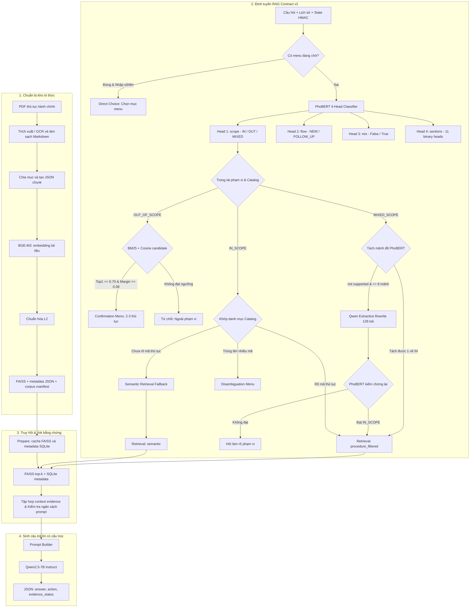

# Hướng dẫn vận hành pipeline RAG

Tài liệu quy định quy trình tạo corpus, khởi tạo hệ thống truy hồi, thực hiện truy
vấn và chạy đánh giá đối với package `vigovbot` phiên bản 0.2.0. Các lệnh được
thực thi từ thư mục gốc repository.

## 1. Tổng quan

ViGovBot là pipeline tra cứu thủ tục hành chính tiếng Việt theo mô hình **Retrieval-Augmented Generation (RAG)**: tìm các đoạn tài liệu liên quan trước, sau đó đưa chúng cùng câu hỏi vào mô hình sinh câu trả lời.

Hệ thống chạy bằng CLI Python, giao diện web cục bộ hoặc notebook Colab; hỗ trợ
hỏi đáp một lượt, hội thoại nhiều lượt và đánh giá theo bộ câu hỏi. Mã xử lý chính
nằm trong `src/vigovbot/`.

| Thành phần | Cách sử dụng hiện tại |
|---|---|
| Nguồn tri thức | PDF thủ tục hành chính, trích xuất thành Markdown; hỗ trợ OCR |
| Chia tài liệu | Chia theo cấu trúc mục, sau đó tách thành các chunk nhỏ có thông tin thủ tục |
| Mô hình embedding | `BAAI/bge-m3`, dùng `SentenceTransformer`, vector dense 1024 chiều (chạy trên CPU/GPU) |
| Chỉ mục tìm kiếm | FAISS `IndexFlatIP`, vector chuẩn hóa L2 |
| Nội dung và metadata khi truy vấn | SQLite, tra theo vị trí vector trong FAISS |
| Bộ phân loại & định tuyến | Mô hình cục bộ **PhoBERT-base fine-tuned 4-head** (`outputs/phobert_v3_finetuned_20261028/checkpoint`) chạy CPU (2 threads) |
| Quản lý trạng thái phiên | State ký HMAC SHA-256, cache bộ nhớ 256 phiên; menu xác nhận thủ tục (BM25 + Cosine) và menu disambiguation |
| Mô hình sinh | `qwen2.5:7b` (chạy qua Ollama hoặc QLoRA local) |
| Tokenizer tính ngân sách prompt | `Qwen/Qwen2.5-7B-Instruct` |
| Cách giao tiếp với LLM | HTTP `POST /api/chat`, `stream: false` (hoặc `/api/chat/stream`) |
| Cơ chế trích xuất Mixed Scope | Trích xuất mệnh đề bằng regex kết hợp PhoBERT; fallback qua Qwen Extractive Rewrite (giới hạn 128 tokens) |
| Dự phòng tìm kiếm ngữ nghĩa | Semantic retrieval fallback (`unresolved_semantic_hits`) khi thiếu mã thủ tục |
| Đầu ra câu trả lời | JSON có câu trả lời, hành động (`action`) và trạng thái bằng chứng (`evidence_status`) |

Hệ thống sử dụng RAG Contract v2 với PhoBERT 4-head làm bộ định tuyến trung tâm.
Quy trình định tuyến hoàn toàn không phụ thuộc LLM cho phân loại nhãn và không dùng
FastText. Runtime online sử dụng trực tiếp FAISS direct top-k retrieval để đảm bảo
độ trễ phản hồi thấp; benchmark thực tế cho thấy mô hình Reranker BGE trên CPU tốn
tới ~12,28s/truy vấn, do đó không kích hoạt trong luồng trực tuyến online.

## 2. Kiến trúc và luồng dữ liệu



### 2.1. Trích xuất và chia chunk

Lệnh `ingest` đọc PDF theo `configs/ingestion/pipeline.yaml`, dùng cấu hình trích xuất tại `configs/ingestion/ingestion.yaml` và cấu hình chia đoạn tại `configs/ingestion/chunking.yaml`.

- PDF đầu vào mặc định: `Data/pdf`; giới hạn kích thước mỗi PDF: 20 MB.
- OCR được bật, ngôn ngữ `vie+eng`, DPI 300, chế độ `full: true`; cần Tesseract/tessdata tương ứng khi thực hiện OCR.
- Markdown được làm sạch rồi chia theo các mục như trình tự thực hiện, thành phần hồ sơ, cách thức/thời hạn/phí và căn cứ pháp lý.
- Cấu hình chunk: mục tiêu 1.200 ký tự, tối đa 1.500 ký tự, overlap 100 ký tự và nội dung tối thiểu 10 ký tự. Việc chia còn phụ thuộc ranh giới mục, khối văn bản và bảng; không phải mọi chunk đều có cùng độ dài.
- Chunk có prefix dạng `[Thủ tục: ... | Mã TTHC: ... | Mục: ...]`. Giới hạn tối đa tính cả prefix; prefix có thể được rút gọn để vừa ngân sách.

Mỗi chunk gồm `chunk_id`, `source_file`, `source_code`, `procedure_name`, `section_type`, `context_prefix`, `text_content` và `parent_section`. Nội dung `text_content` đã chứa prefix. Pipeline embedding chỉ bổ sung prefix nếu chưa có, tránh lặp lại.

Đầu ra bình thường là `outputs/metadata/<tên-PDF>.json`. Báo cáo xử lý nằm trong `outputs/metadata/reports/`; tài liệu cần rà soát được đưa vào `outputs/metadata/review/`. Cần đọc báo cáo và kiểm tra các trường hợp thiếu trang hoặc metadata trước khi đưa vào kho tri thức.

### 2.2. Embedding và tạo chỉ mục

Lệnh `embed` đọc toàn bộ JSON chunk từ một thư mục hoặc ZIP, tạo vector BGE-M3,
chuẩn hóa L2 và xây dựng FAISS `IndexFlatIP` trong cùng một pipeline. Corpus gồm:

```text
Data/vector/unified/
    tthc_unified.index
    tthc_unified_metadata.json
    corpus_manifest.json
```

Với vector tài liệu và câu hỏi đều có độ dài L2 bằng 1, tích vô hướng mà FAISS trả về tương đương cosine similarity. Điểm càng lớn thì vector càng gần nhau; đây không phải xác suất câu trả lời đúng. `IndexFlatIP` thực hiện tìm kiếm chính xác trên các vector trong chỉ mục.

Manifest ghi model, revision thực tế được phân giải thành commit SHA, số bản ghi và
checksum. Ba artifact chỉ được công bố sau khi toàn bộ pipeline hoàn thành.

### 2.3. Chuẩn bị cache truy vấn

Lệnh `rag prepare` xác minh corpus, sao chép index vào cache và chuyển metadata JSON sang SQLite bằng cách đọc theo luồng. Cache nằm dưới `outputs/rag_cache/<định-danh>/`, gồm index, `metadata.sqlite` và `ready.json`.

`row_id` trong SQLite chính là vị trí vector, bắt đầu từ 0. Hệ thống kiểm tra số dòng, chiều vector, loại metric và checksum để tránh dùng nhầm index với metadata. SQLite chỉ giữ các trường cần truy hồi; `parent_section` không được đưa vào cache, nên luồng hỏi đáp không tự mở rộng chunk thành toàn bộ mục cha.

### 2.4. Xử lý câu hỏi và lịch sử hội thoại (RAG Contract v2)

1. Nạp BGE-M3 (chạy trên CPU/GPU) và nạp PhoBERT fine-tuned router checkpoint
   (`outputs/phobert_v3_finetuned_20261028/checkpoint`, 2 CPU intra-op threads).
2. Kiểm tra chữ ký HMAC SHA-256 của state hội thoại. Nếu người dùng nhập lựa chọn
   và phiên đang có menu còn hiệu lực, xử lý trực tiếp (`direct_choice`) mà không
   chạy classifier. Ngược lại, nếu không có menu đang chờ, câu hỏi mới (kể cả có
   chứa số) được chuyển tiếp bình thường vào router.
3. Chuẩn hóa chuỗi văn bản (NFC, gộp khoảng trắng, PyVi word segmentation) và ghép
   chuỗi `<s> question </s></s> previous </s></s> procedure </s>` (tối đa 128 token).
   PhoBERT tính toán đồng thời 4 heads:
   - `scope`: `IN_SCOPE`, `OUT_OF_SCOPE`, `MIXED_SCOPE`.
   - `flow`: `NEW`, `FOLLOW_UP`.
   - `mix`: `False`, `True` (cảnh báo nhiều thủ tục).
   - `sections`: 11 sigmoid binary heads độc lập.
4. Trọng tài phạm vi (Scope Arbitration) & xác định thủ tục:
   - `OUT_OF_SCOPE`: Nếu P(OUT) trong dải `[0.50, 0.85)` và khớp catalog/alias thì kéo về `IN_SCOPE`. Nếu vẫn OUT, tính BM25 + Cosine similarity; nếu Top 1 $\ge 0.70$ và Margin $\ge 0.08$, mở confirmation menu (2-3 thủ tục). Ngược lại, từ chối trả lời.
   - `MIXED_SCOPE`: Tách mệnh đề bằng regex và phân loại độc lập bằng PhoBERT. Nếu không tách được vế hợp lệ ($\le 8$ mảnh), gọi Qwen extractive rewrite (128 token) và bắt buộc PhoBERT kiểm chứng lại thành `IN_SCOPE`.
   - `IN_SCOPE`: Xác định mã thủ tục từ catalog. Nếu trùng tên mở disambiguation menu; nếu thiếu mã cụ thể thì kích hoạt cơ chế dự phòng tìm kiếm ngữ nghĩa (`unresolved_semantic_hits`).
5. Truy hồi (Retrieval):
   - `procedure_direct`: Khi là câu hỏi tiếp theo cùng thủ tục và cùng section.
   - `procedure_filtered`: Lọc vector theo mã thủ tục và nhãn sections dự đoán.
   - `semantic`: Tìm kiếm ngữ nghĩa FAISS khi chưa rõ mã thủ tục (semantic fallback).
6. Ghép prompt trong ngân sách ngữ cảnh token: Cắt gọt chunk theo `max_chunk_tokens`
   để vừa vặn cửa sổ context `num_ctx`.
7. Qwen sinh câu trả lời có cấu trúc JSON gồm: `answer`, `action`, `evidence_status`.
   Hệ thống kiểm tra schema và ghi nhận đầy đủ trace chẩn đoán.

## 3. Tham số RAG đang dùng

`configs/rag/inference.yaml` và `inference-docker.yaml` dùng cho hỏi đáp; các tham số không khai báo lấy mặc định từ `src/vigovbot/rag/config.py`.

| Tham số | Giá trị mặc định / cấu hình hiện tại | Ý nghĩa |
|---|---|---|
| `embedding.model` | `BAAI/bge-m3` | Encoder cho câu hỏi |
| `embedding.device` | `cpu` | Dành VRAM cho Qwen; có thể đổi sang `cuda` khi đủ tài nguyên |
| `llm.model` | `qwen2.5:7b` | Tên model sinh trong Ollama hoặc adapter QLoRA |
| `llm.ollama_url` | `http://localhost:11434` | Địa chỉ Ollama (trên container dùng `http://ollama:11434`) |
| `llm.temperature` | `0.0` | Giảm tính ngẫu nhiên khi sinh văn bản |
| `llm.seed` | `42` | Seed sinh câu trả lời |
| `llm.num_ctx` | `8192` | Cửa sổ ngữ cảnh cho câu trả lời |
| `llm.num_predict` | `512` | Số token sinh tối đa |
| `llm.timeout` | `300` giây | Timeout HTTP khi sinh câu trả lời |
| `retrieval.top_k` | `5` | Số kết quả FAISS tối đa đưa vào LLM |
| `retrieval.max_chunk_tokens` | `1200` | Giới hạn token của mỗi chunk đưa vào prompt |
| `conversation.routing_contract` | `v2` | Hợp đồng định tuyến v2 (mặc định hiện hành) |
| `conversation.routing_backend` | `phobert` | Backend phân loại cục bộ dùng PhoBERT fine-tuned 4-head |
| `conversation.routing_phobert_path` | `outputs/phobert_v3_finetuned_20261028/checkpoint` | Đường dẫn checkpoint PhoBERT local |
| `conversation.routing_phobert_threads` | `2` | Số luồng CPU intra-op cho PhoBERT inference |
| `conversation.procedure_aliases_path` | `configs/rag/procedure-aliases.yaml` | Danh sách alias kiểm duyệt ánh xạ trực tiếp đến mã TTHC |
| `conversation.procedure_confirmation_score_threshold` | `0.70` | Ngưỡng điểm gated tối thiểu mở menu xác nhận thủ tục |
| `conversation.procedure_confirmation_margin_threshold` | `0.08` | Khoảng cách điểm tối thiểu giữa Top 1 và Top 2 |
| `conversation.procedure_confirmation_bm25_weight` | `0.50` | Trọng số BM25 trong xác nhận thủ tục |
| `conversation.procedure_confirmation_cosine_weight` | `0.50` | Trọng số Cosine similarity trong xác nhận thủ tục |
| `conversation.unresolved_semantic_retrieval_enabled` | `true` | Bật tìm kiếm ngữ nghĩa dự phòng khi chưa khớp mã TTHC |
| `data.allow_legacy_corpus` | `false` | Mặc định yêu cầu corpus có provenance/manifest |

> [!NOTE]
> **Về mô hình Reranker:**
> Kết quả đo lường thực nghiệm (`outputs/benchmarks/reranker_latency_10_20261029.json`) cho thấy
> mô hình `BAAI/bge-reranker-v2-m3` chạy trên CPU có độ trễ trung bình **12,28 giây/truy vấn**
> (chậm gấp 48,2 lần so với FAISS thuần 258ms). Do đó, runtime online hiện tại không bật reranker
> (`rerank_s = 0.0`) mà truy xuất trực tiếp top-k từ FAISS để đảm bảo trải nghiệm tương tác trực tuyến.

Ngân sách prompt trả lời là `8192 - 512 - 256 = 7424` token, trong đó 256 token
được dự phòng cho template. Ngân sách này bao gồm system prompt, câu hỏi và trích
đoạn. `max_chunk_tokens` tính bằng **token**, khác với tham số chunking tính bằng **ký tự**.

## 4. Triển khai runtime bằng Docker

### 4.1. Chuẩn bị và khởi động

Runtime hiện hành có thể chạy hoàn toàn qua Docker Compose trên WSL2 backend:

```powershell
docker compose up --build -d
docker compose ps
docker compose exec -T ollama ollama list
```

Service `ollama-model-init` tự tải `qwen2.5:7b` vào Docker volume. Không chạy
`ollama serve` trên host. Lần sau chỉ cần `docker compose up -d`. Xem đầy đủ tại
[Chạy ViGovBot bằng Docker Desktop](../setup/docker.md).

### 4.2. Tạo corpus từ PDF

> Workflow này chưa được đóng gói trong Compose inference hiện tại. Chỉ thực
> hiện sau khi tạo môi trường ingestion chuyên biệt và cấu hình bind mount
> input/output; không chạy các lệnh dưới đây bằng container `web` hiện tại.

Đặt PDF vào `Data/pdf`, rồi chạy:

```powershell
vigov data ingest
```

Có thể xử lý nhiều PDF song song bằng `--workers`. Ví dụ với máy 18 luồng CPU và
28 GB RAM, có thể bắt đầu với 6 worker khi OCR được bật:

```powershell
vigov data ingest --workers 6
```

Giá trị mặc định là 1. File đã hoàn tất vẫn được giữ lại và được bỏ qua khi chạy
lại nếu không dùng `--overwrite`.

Kiểm tra JSON và báo cáo trong `outputs/metadata`. Pipeline embedding có thể nhận
trực tiếp thư mục này hoặc một ZIP chỉ chứa các JSON chunk đã rà soát. Không đưa
`reports/` và `review/` vào nguồn embedding.

```powershell
vigov data embed outputs/metadata --output-dir Data/vector/unified-new
```

Ví dụ sử dụng `unified-new` vì pipeline từ chối ghi đè corpus đã tồn tại. Với dữ
liệu lớn, điều chỉnh `--batch-size`, `--device` và tài nguyên máy. Pipeline nhận
một nguồn dữ liệu và công bố trực tiếp corpus hoàn chỉnh.

Đổi `data.unified_source` trong cấu hình cần chạy thành `../Data/vector/unified-new`. Các đường dẫn trong YAML được tính từ **thư mục chứa YAML**, còn đường dẫn truyền trực tiếp qua CLI được tính theo thư mục làm việc.

### 4.3. Dùng corpus có sẵn trong workspace

Tại thời điểm kiểm tra, `Data/vector/unified/` có đủ `tthc_unified.index`,
`tthc_unified_metadata.json` và `corpus_manifest.json`. Vì vậy cấu hình mặc định
`allow_legacy_corpus: false` có thể xác minh corpus trước khi chuẩn bị cache.

Nếu dùng một corpus cũ khác chưa có manifest, nên tạo lại theo bước 4.2. Chỉ khi
cần tương thích tạm thời mới tạo file riêng `configs/rag/inference-local.yaml`:

```yaml
data:
  unified_source: ../Data/vector/unified
  cache_dir: ../outputs/rag_cache_legacy
  allow_legacy_corpus: true
embedding:
  model: BAAI/bge-m3
  revision: null
  device: cpu
llm:
  model: qwen2.5:7b
  ollama_url: http://localhost:11434
```

Chế độ legacy vẫn kiểm tra cấu trúc index và metadata nhưng không xác minh được model/revision đã tạo vector tài liệu. Khi thiếu manifest, `revision: null` không thể tự khôi phục revision gốc. Chi tiết tại [Migration dữ liệu cũ](../architecture/migration.md).

### 4.4. Chuẩn bị và hỏi đáp trong container

Với corpus đã có trên host và được mount vào container:

```powershell
docker compose exec -T web vigov rag prepare --config configs/rag/inference-docker.yaml
docker compose exec -T web vigov ask "Cần những giấy tờ gì để cấp bản sao hộ tịch?" --config configs/rag/inference-docker.yaml
```

`prepare` chỉ chuẩn bị corpus/cache, chưa gọi LLM; `ask` cũng tự kiểm tra cache
trước khi truy vấn. Cấu hình Docker gọi Ollama bằng tên service
`http://ollama:11434`, không dùng cấu hình local trỏ tới `localhost`.

Để hỏi nối tiếp, lưu các lượt trước vào một mảng JSON gồm message `user` và
`assistant`, rồi truyền file bằng `--history`:

```powershell
docker compose cp history.json web:/tmp/history.json
docker compose exec -T web vigov ask "Còn lệ phí thì sao?" --history /tmp/history.json --config configs/rag/inference-docker.yaml
```

CLI không tự lưu lịch sử giữa hai lần chạy; ứng dụng gọi phải giữ và gửi lại đúng
lịch sử.

Kết quả `ask` được in dưới dạng JSON:

| Trường | Nội dung |
|---|---|
| `prediction` | Câu trả lời của Qwen |
| `action`, `evidence_status` | Hành động và mức bằng chứng do model trả về |
| `routing`, `retrieval_query` | Quyết định định tuyến và truy vấn thực tế |
| `routing_attempts`, `fallback_reason`, `decision_reason` | Số lần phân loại và lý do điều hướng/hỏi làm rõ |
| `retrieved` | Các chunk đã tìm được, kèm ID, điểm, file và mã thủ tục |
| `context_used` | Nguồn và phần văn bản thực sự đưa vào prompt sau khi cắt token |
| `prompt_tokens_estimated` | Số token prompt ước tính bằng tokenizer Qwen |
| `routing_s`, `retrieval_s`, `generation_s`, `latency_s` | Thời gian từng bước và toàn lượt suy luận |
| `retrieval_strategy` | Chiến lược truy hồi (`procedure_direct`, `procedure_filtered`, `semantic`) |

`retrieved` có thể nhiều nội dung hơn `context_used`; khi kiểm tra căn cứ câu trả lời, cần xem phần thực sự được đưa vào prompt.

### 4.5. Chạy giao diện web

Container `web` đã khởi động server HTTP cùng stack. Không chạy thêm `vigov web`:

```powershell
docker compose up -d
docker compose ps
```

Mở `http://localhost:8001`. Server nạp encoder, tokenizer, FAISS và SQLite một
lần, cung cấp `GET /api/health`, `GET /api/models` và `POST /api/chat`. UI giữ
lịch sử riêng cho từng model trong trình duyệt và gửi lại qua mỗi request; server
giữ cache HMAC state tối đa 256 phiên. Các request chat được khóa và xử lý model đã chọn theo
thứ tự để dùng chung tài nguyên an toàn. Retriever mở SQLite ở chế độ read-only
cho thread HTTP và có khóa nội bộ quanh encoder, FAISS, SQLite và thao tác đóng.

`configs/rag/inference-docker.yaml` khai báo sẵn các lựa chọn cùng dùng `qwen2.5:7b`:

- `mode: base`: gửi câu hỏi và lịch sử thẳng tới Qwen, không gọi embedding,
  FAISS/SQLite hoặc prompt RAG; kết quả không có nguồn.
- `mode: rag`: chạy toàn bộ router PhoBERT 4-head, truy hồi và xét bằng chứng; kết quả có các
  nguồn được truy hồi.

API trả thêm `routing_diagnostics` và trace cho nhánh RAG. Để xem JSON gốc, đặt `web.debug_routing: true` trong cấu hình và khởi động lại server.

## 5. Chạy đánh giá

> Evaluation đầy đủ không thuộc Compose inference hiện tại vì dataset, output
> và dependency đánh giá chưa được mount/đóng gói đầy đủ. Tạo môi trường chuyên
> biệt theo [Môi trường và tái lập](../setup/environments.md) trước khi chạy các
> lệnh trong phần này; không chạy chúng bằng container `web` hiện tại.

Các profile `configs/rag/evaluation*.yaml` không gắn cứng dataset. `vigov eva`
chọn dataset v2 bằng `--dataset`. Lệnh legacy `vigov rag evaluate` dùng schema
`question`/`ground_truth`; hãy tạo config riêng với `dataset_path` hoặc
`dataset_zip` đúng schema đó. Không trỏ loader legacy vào
`Data/tthc_test_case_v1/data/test.jsonl` vì đây là schema evaluation v2.

```powershell
vigov rag smoke
vigov rag run
```

`smoke` thử tối đa 5 câu theo cấu hình hiện tại. `run` thực hiện chuẩn bị, smoke test, đánh giá rồi tạo báo cáo. Có thể dùng riêng `evaluate` để sinh kết quả và `report` để tính metric/tạo báo cáo. `max_cases: null` nghĩa là dùng toàn bộ bộ dữ liệu đã nạp; có thể đặt số nhỏ khi thử nghiệm.

Đầu ra mặc định ở `outputs/qwen2_5_7b_rag_results`, có manifest lần chạy, kết quả dự đoán, lỗi nếu có, `case_metrics.jsonl`, `case_metrics.csv`, `summary.json` và báo cáo theo nhóm. Metric gồm exact match, accuracy chuẩn hóa, BLEU-4, ROUGE, BERTScore, source recall@k và thời gian xử lý. BERTScore mặc định dùng `xlm-roberta-large` trên CPU, batch size 1.

## 6. Đối chiếu với mã nguồn

| Nội dung | File chính |
|---|---|
| Entry point CLI | [main.py](../../src/vigovbot/cli/main.py) |
| Trích xuất và xuất JSON | [indexing.py](../../src/vigovbot/pipelines/indexing.py) |
| Chunking theo cấu trúc | [markdown.py](../../src/vigovbot/chunking/markdown.py) |
| Tạo embedding và corpus FAISS | [corpus_builder.py](../../src/vigovbot/embeddings/corpus_builder.py) |
| Cache SQLite | [vector_store.py](../../src/vigovbot/vectordb/vector_store.py) |
| Bộ phân loại PhoBERT 4-Head | [phobert_router.py](../../src/vigovbot/rag/phobert_router.py) |
| Quản lý phiên và điều phối RAG v2 | [conversation.py](../../src/vigovbot/rag/conversation.py) |
| Khám phá thủ tục và confirmation | [procedure_discovery.py](../../src/vigovbot/retrieval/procedure_discovery.py) |
| Nhãn mục và mapping sections | [sections.py](../../src/vigovbot/rag/sections.py) |
| Làm rõ và quản lý Menu | [clarification.py](../../src/vigovbot/rag/clarification.py) |
| Truy hồi kết hợp (Retriever) | [retriever.py](../../src/vigovbot/retrieval/retriever.py) |
| Prompt và ngân sách token | [prompt_templates.py](../../src/vigovbot/prompts/prompt_templates.py) |
| Gọi Ollama / LLM client | [llm_client.py](../../src/vigovbot/llm/llm_client.py) |
| Điều phối RAG cổ điển (legacy) | [pipeline.py](../../src/vigovbot/rag/pipeline.py) |
| Giá trị cấu hình mặc định | [config.py](../../src/vigovbot/rag/config.py) |
| Web server và API cục bộ | [app.py](../../src/vigovbot/server/app.py) |
| Adapter Ollama/OpenAI-compatible | [providers.py](../../src/vigovbot/server/providers.py) |

## 7. Truy xuất nhanh cho câu hỏi nối tiếp

Khi router trả `follow_up`, RAG có thể lấy trực tiếp chunk SQLite theo mã thủ tục
và `section_type` của câu hỏi mới, không tạo embedding hoặc tìm kiếm FAISS.
Ngữ cảnh chỉ được tạo từ các chunk thực sự đưa vào prompt của câu trả lời thành
công (`answer`/`partial`) và cùng một `source_code`.

`answer_question(..., retrieval_context=None)` trả `retrieval_context` mới.
API `/api/chat` và `/api/chat/stream` nhận trường tùy chọn `retrieval_contexts`,
là object ánh xạ model ID sang ngữ cảnh đã trả ở lượt trước. Mỗi kết quả model
trả `retrieval_context`, `retrieval_strategy`, `retrieval_fallback_reason`.
Client cũ không gửi trường mới vẫn hoạt động theo retrieval hiện tại.

Ngữ cảnh gồm `source_code`, `procedure_name`, `chunk_ids`, `corpus_fingerprint`
và `answer_fingerprint`. Client phải gửi lại nguyên object cùng lịch sử tương
ứng; đây là gợi ý truy xuất, không phải token xác thực. Backend đối chiếu fingerprint
corpus, chunk/mã trong SQLite và câu trả lời cuối trong lịch sử. Nội dung bằng
chứng luôn đọc từ corpus, không lấy từ object client hoặc câu trả lời trước.

Nhánh trực tiếp yêu cầu câu hỏi hoặc truy vấn router xác nhận đúng mã/tên đầy đủ,
không có tên trùng hoặc mã khác; phần được hỏi phải xác định và đủ gọn trong
`top_k`. Nếu chưa xác định được phần, thiếu phần hoặc phần vượt `top_k`, retrieval
vector tiếp tục trong đúng mã đã xác nhận. Nếu ngữ cảnh không hợp lệ, chủ đề đổi
hoặc không được xác nhận, dùng retrieval bình thường. Generation vẫn kiểm tra
bằng chứng và áp dụng ngân sách token; nguồn thiếu dữ liệu không được bù bằng
thủ tục khác. Kết quả trực tiếp không có điểm tương đồng vector giả.

`retrieval_strategy` nhận `procedure_direct`, `procedure_filtered` hoặc `semantic`:
- `procedure_direct`: Truy xuất trực tiếp từ cache SQLite theo mã TTHC và section đã xác nhận.
- `procedure_filtered`: Truy xuất vector FAISS có lọc trước theo metadata mã TTHC.
- `semantic`: Tìm kiếm vector FAISS toàn cục (kèm semantic fallback khi catalog chưa giải quyết được tên thủ tục cụ thể nhưng câu hỏi thuộc phạm vi).

## 8. Quản lý trạng thái và menu lựa chọn

Khi bật routing PhoBERT v2, RAG kiểm tra metadata và quản lý trạng thái hội thoại:
- **Menu chọn thủ tục (Disambiguation Menu):** Khi câu hỏi khớp với nhiều mã thủ tục khác nhau trong catalog, hệ thống trả danh sách tối đa 5 lựa chọn để người dùng chọn cụ thể.
- **Menu xác nhận thủ tục (Confirmation Menu):** Khi câu hỏi bị xếp loại `OUT_OF_SCOPE` nhưng thuật toán BM25 + Cosine similarity tìm thấy thủ tục có điểm gated $\ge 0.70$ và margin $\ge 0.08$, hệ thống mở menu 2-3 phương án để người dùng xác nhận. Lượt này không gọi retrieval và không sinh câu trả lời.
- **Menu chọn mục nội dung (Section Menu):** Khi câu hỏi chỉ nêu tên thủ tục chung chung mà chưa nêu rõ nội dung cần tra cứu (ví dụ: *"Thủ tục cấp hộ chiếu"*), hệ thống mở menu danh sách các section khả dụng của thủ tục đó.

Trạng thái được ký bằng HMAC SHA-256 (`state_secret`), lưu trong bộ nhớ server tối đa 256 phiên. Client chỉ cần gửi tin nhắn văn bản và lịch sử; server tự đối chiếu và khôi phục trạng thái an toàn.
