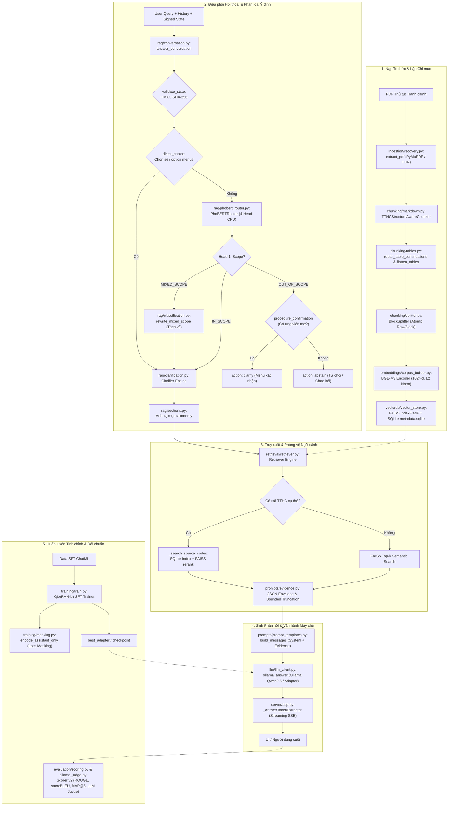
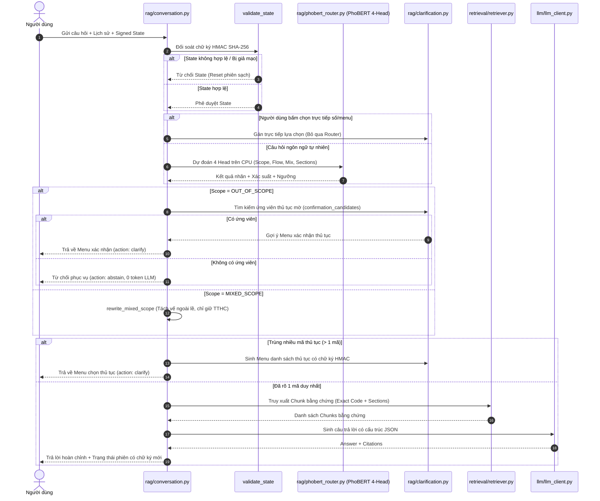

# Báo cáo Kỹ thuật Toàn diện: Các Module Xử lý Chung Lớn của Dự án ViGovBot
> **Ngày lập báo cáo:** 31/10/2026  
> **Phương pháp thực hiện:** Kiểm tra, phân tích trực tiếp từ mã nguồn thực thi Python (`src/vigovbot/`)  
> **Phiên bản hệ thống:** ViGovBot 0.2.0 (Hợp đồng RAG v2 / PhoBERT 4-Head / QLoRA 4-bit)

---

## 1. Tổng quan Kiến trúc Toàn hệ thống (End-to-End System Architecture)

ViGovBot là hệ thống trợ lý ảo chuyên sâu phục vụ tra cứu Thủ tục Hành chính (TTHC) Việt Nam, kết hợp kỹ thuật **Retrieval-Augmented Generation (RAG) đa tầng**, **định tuyến hội thoại thông minh (PhoBERT 4-head & HMAC State Machine)**, và **tinh chỉnh mô hình ngôn ngữ lớn (QLoRA SFT trên Qwen 2.5 7B)**.

Hệ thống được tổ chức thành các module xử lý độc lập, tuân thủ nguyên tắc phân tách ranh giới dữ liệu chặt chẽ (clean architectural boundaries), bảo đảm tính toàn vẹn (artifact provenance) và phòng vệ trước các cuộc tấn công prompt injection.



### Bảng Tổng hợp Các Module Xử lý Chính trong Mã nguồn

| STT | Tên Module | Thư mục Package | File triển khai chính | Trách nhiệm cốt lõi |
|:---:|---|---|---|---|
| **1** | **Ingestion Pipeline** | [`src/vigovbot/ingestion/`](file:///c:/Users/quangTam/Documents/ViGovBot/src/vigovbot/ingestion/) | [`recovery.py`](file:///c:/Users/quangTam/Documents/ViGovBot/src/vigovbot/ingestion/recovery.py), [`unified.py`](file:///c:/Users/quangTam/Documents/ViGovBot/src/vigovbot/ingestion/unified.py), [`indexing.py`](file:///c:/Users/quangTam/Documents/ViGovBot/src/vigovbot/pipelines/indexing.py) | Nạp PDF, OCR Tesseract, trích xuất Markdown có cấu trúc, đọc corpus ZIP an toàn. |
| **2** | **Chunking Engine** | [`src/vigovbot/chunking/`](file:///c:/Users/quangTam/Documents/ViGovBot/src/vigovbot/chunking/) | [`markdown.py`](file:///c:/Users/quangTam/Documents/ViGovBot/src/vigovbot/chunking/markdown.py), [`splitter.py`](file:///c:/Users/quangTam/Documents/ViGovBot/src/vigovbot/chunking/splitter.py), [`headings.py`](file:///c:/Users/quangTam/Documents/ViGovBot/src/vigovbot/chunking/headings.py), [`tables.py`](file:///c:/Users/quangTam/Documents/ViGovBot/src/vigovbot/chunking/tables.py) | Cắt đoạn bảo toàn cấu trúc bảng biểu và phân cấp mục TTHC, bổ sung context prefix. |
| **3** | **Embeddings & VectorDB** | [`src/vigovbot/embeddings/`](file:///c:/Users/quangTam/Documents/ViGovBot/src/vigovbot/embeddings/), [`src/vigovbot/vectordb/`](file:///c:/Users/quangTam/Documents/ViGovBot/src/vigovbot/vectordb/) | [`embedder.py`](file:///c:/Users/quangTam/Documents/ViGovBot/src/vigovbot/embeddings/embedder.py), [`corpus_builder.py`](file:///c:/Users/quangTam/Documents/ViGovBot/src/vigovbot/embeddings/corpus_builder.py), [`vector_store.py`](file:///c:/Users/quangTam/Documents/ViGovBot/src/vigovbot/vectordb/vector_store.py) | Tạo vector BGE-M3 1024 chiều, lập chỉ mục `faiss.IndexFlatIP`, bộ đệm SQLite `metadata.sqlite`. |
| **4** | **Hybrid Retrieval** | [`src/vigovbot/retrieval/`](file:///c:/Users/quangTam/Documents/ViGovBot/src/vigovbot/retrieval/) | [`retriever.py`](file:///c:/Users/quangTam/Documents/ViGovBot/src/vigovbot/retrieval/retriever.py), [`procedure_discovery.py`](file:///c:/Users/quangTam/Documents/ViGovBot/src/vigovbot/retrieval/procedure_discovery.py) | Tra cứu chính xác theo mã TTHC, fallback tương đồng cosine, thuật toán Hybrid BM25+Cosine khám phá thủ tục. |
| **5** | **RAG Routing & Conversation** | [`src/vigovbot/rag/`](file:///c:/Users/quangTam/Documents/ViGovBot/src/vigovbot/rag/) | [`phobert_router.py`](file:///c:/Users/quangTam/Documents/ViGovBot/src/vigovbot/rag/phobert_router.py), [`conversation.py`](file:///c:/Users/quangTam/Documents/ViGovBot/src/vigovbot/rag/conversation.py), [`clarification.py`](file:///c:/Users/quangTam/Documents/ViGovBot/src/vigovbot/rag/clarification.py), [`sections.py`](file:///c:/Users/quangTam/Documents/ViGovBot/src/vigovbot/rag/sections.py) | Định tuyến thần kinh PhoBERT 4-head trên CPU, máy trạng thái HMAC SHA-256, sinh menu làm rõ động. |
| **6** | **Prompts & Evidence Security** | [`src/vigovbot/prompts/`](file:///c:/Users/quangTam/Documents/ViGovBot/src/vigovbot/prompts/) | [`evidence.py`](file:///c:/Users/quangTam/Documents/ViGovBot/src/vigovbot/prompts/evidence.py), [`prompt_templates.py`](file:///c:/Users/quangTam/Documents/ViGovBot/src/vigovbot/prompts/prompt_templates.py) | Đóng gói JSON Envelope chống Injection, quản lý token metadata, khuôn mẫu prompt hành chính nghiêm ngặt. |
| **7** | **LLM Serving Integration** | [`src/vigovbot/llm/`](file:///c:/Users/quangTam/Documents/ViGovBot/src/vigovbot/llm/) | [`llm_client.py`](file:///c:/Users/quangTam/Documents/ViGovBot/src/vigovbot/llm/llm_client.py) | Tích hợp Ollama API client, đo đạc TTFT, quản lý tham số suy luận và stream tokens. |
| **8** | **Server & Hardware Telemetry** | [`src/vigovbot/server/`](file:///c:/Users/quangTam/Documents/ViGovBot/src/vigovbot/server/) | [`app.py`](file:///c:/Users/quangTam/Documents/ViGovBot/src/vigovbot/server/app.py), [`gpu_metrics.py`](file:///c:/Users/quangTam/Documents/ViGovBot/src/vigovbot/server/gpu_metrics.py), [`providers.py`](file:///c:/Users/quangTam/Documents/ViGovBot/src/vigovbot/server/providers.py) | Máy chủ FastAPI, Server-Sent Events (SSE), bộ trích xuất token thời gian thực `_AnswerTokenExtractor`, telemetry GPU. |
| **9** | **QLoRA Fine-Tuning** | [`src/vigovbot/training/`](file:///c:/Users/quangTam/Documents/ViGovBot/src/vigovbot/training/) | [`train.py`](file:///c:/Users/quangTam/Documents/ViGovBot/src/vigovbot/training/train.py), [`masking.py`](file:///c:/Users/quangTam/Documents/ViGovBot/src/vigovbot/training/masking.py), [`checkpoints.py`](file:///c:/Users/quangTam/Documents/ViGovBot/src/vigovbot/training/checkpoints.py), [`early_stopping.py`](file:///c:/Users/quangTam/Documents/ViGovBot/src/vigovbot/training/early_stopping.py) | Huấn luyện SFT 4-bit QLoRA cho Qwen 2.5 7B, che nhãn prompt loss masking (`IGNORE_INDEX = -100`), kiểm soát vòng đời huấn luyện. |
| **10** | **Evaluation & Benchmarking** | [`src/vigovbot/evaluation/`](file:///c:/Users/quangTam/Documents/ViGovBot/src/vigovbot/evaluation/) | [`scoring.py`](file:///c:/Users/quangTam/Documents/ViGovBot/src/vigovbot/evaluation/scoring.py), [`ollama_judge.py`](file:///c:/Users/quangTam/Documents/ViGovBot/src/vigovbot/evaluation/ollama_judge.py), [`pairwise.py`](file:///c:/Users/quangTam/Documents/ViGovBot/src/vigovbot/evaluation/pairwise.py), [`retrieval_benchmark.py`](file:///c:/Users/quangTam/Documents/ViGovBot/src/vigovbot/evaluation/retrieval_benchmark.py) | Đo lường đa diện: ROUGE, BLEU, chrF++, CER/WER, MAP@5, LLM-as-a-Judge đánh giá độ trung thực và ảo giác. |
| **11** | **Contracts, Artifacts & CLI** | Gốc `src/vigovbot/` | [`schemas.py`](file:///c:/Users/quangTam/Documents/ViGovBot/src/vigovbot/schemas.py), [`artifacts.py`](file:///c:/Users/quangTam/Documents/ViGovBot/src/vigovbot/artifacts.py), [`configuration.py`](file:///c:/Users/quangTam/Documents/ViGovBot/src/vigovbot/configuration.py), [`cli/main.py`](file:///c:/Users/quangTam/Documents/ViGovBot/src/vigovbot/cli/main.py) | Hợp đồng schema dữ liệu, kiểm tra mã băm SHA-256, khóa tệp giao dịch `output_lock`, cây lệnh CLI `vigov`. |

---

## 2. Chi tiết Triển khai Từng Module Mã nguồn Thực tế

---

### 2.1. Module Tiền xử lý & Nạp tài liệu (Ingestion Pipeline)

Module ingestion chịu trách nhiệm đọc tài liệu định dạng PDF hành chính công, tự động nhận diện tài liệu dạng văn bản máy tính hay bản quét (scan), chuyển đổi thành định dạng Markdown chuẩn hóa mà không làm mất cấu trúc phân mục.

#### Triển khai chi tiết tại [`recovery.py`](file:///c:/Users/quangTam/Documents/ViGovBot/src/vigovbot/ingestion/recovery.py)
Hàm trọng tâm [`extract_pdf(file_path, settings)`](file:///c:/Users/quangTam/Documents/ViGovBot/src/vigovbot/ingestion/recovery.py#L6-L53) duyệt tuần tự từng trang tài liệu PDF thông qua thư viện `pymupdf` (FitZ):
1. **Kiểm tra mã hóa:** Nếu tài liệu yêu cầu mật khẩu (`document.needs_pass`), phát sinh lỗi ngay lập tức.
2. **Ưu tiên văn bản gốc (Native Text):** Gọi `page.get_text().strip()`. Nếu phát hiện có lớp văn bản, hệ thống gọi `pymupdf4llm.to_markdown(document, pages=[index], use_ocr=False)` để chuyển đổi trực tiếp sang Markdown. Phương thức này ghi nhận trạng thái trang là `entry["method"] = "markdown"`. Nếu quá trình chuyển đổi Markdown bị lỗi, hàm sử dụng văn bản thô native text làm phương án dự phòng (`entry["method"] = "native_text"`).
3. **Xử lý tài liệu Scan & Trang trắng:**
   - Nếu không có văn bản gốc, kiểm tra xem trang có hình ảnh (`page.get_images()`), hình vẽ vector (`page.get_drawings()`) hoặc chú thích (`page.annots()`) hay không. Nếu không có bất kỳ thành phần nào, trang được xác định là trang trắng (`entry["method"] = "blank"`).
   - Nếu có hình ảnh (dấu hiệu bản scan), hệ thống kích hoạt **Tesseract OCR cục bộ**:
     ```python
     textpage = page.get_textpage_ocr(
         language=settings.ocr.language,  # Mặc định 'vie+eng'
         dpi=settings.ocr.dpi,            # Chuẩn 300 DPI
         full=settings.ocr.full,          # OCR toàn trang
         tessdata=settings.ocr.tessdata
     )
     text = page.get_text(textpage=textpage).strip()
     entry["method"] = "ocr"
     ```
4. **Báo cáo trạng thái trang:** Trả về chuỗi Markdown hoàn chỉnh kèm một từ điển `report` ghi nhận chi tiết phương pháp trích xuất của từng trang (`pages`), các cảnh báo (`warnings`), và danh sách trang trích xuất thất bại (`missing_pages`).

#### Triển khai chi tiết tại [`unified.py`](file:///c:/Users/quangTam/Documents/ViGovBot/src/vigovbot/ingestion/unified.py)
Quản lý việc nạp corpus tri thức dưới dạng thư mục phẳng hoặc file lưu trữ `.zip`:
- **Đọc an toàn trong ZIP ([`zip_member`](file:///c:/Users/quangTam/Documents/ViGovBot/src/vigovbot/ingestion/unified.py#L10-L22)):** Chỉ đọc đúng file cần thiết theo tên tệp (`basename`), lọc bỏ các thư mục hệ thống như `__MACOSX/`, ngăn chặn tấn công Zip Slip.
- **Xác thực toàn vẹn ([`verify_corpus`](file:///c:/Users/quangTam/Documents/ViGovBot/src/vigovbot/ingestion/unified.py#L45-L69)):** So sánh mã băm SHA-256 thực tế của các file dữ liệu (`tthc_unified.index`, `tthc_unified_metadata.json`) với tệp manifest `corpus_manifest.json`. Nếu mã băm không khớp, hệ thống từ chối tải chỉ mục FAISS để bảo vệ an toàn dữ liệu.

---

### 2.2. Module Phân mảnh & Cấu trúc Tài liệu (Chunking Engine)

Không giống như các bộ chunker thông thường chỉ cắt theo số ký tự hoặc token cố định, module chunking của ViGovBot được thiết kế riêng cho cấu trúc văn bản hành chính công Việt Nam: hiểu tiêu đề phân cấp, nhận diện taxonomy mục, và bảo toàn nguyên vẹn bảng biểu.

#### Taxonomy và Phân cấp Mục tại [`headings.py`](file:///c:/Users/quangTam/Documents/ViGovBot/src/vigovbot/chunking/headings.py)
Định nghĩa kiểu dữ liệu `SectionType`:
```python
SectionType = Literal[
    "metadata_identity", "procedure_step", "required_documents", 
    "submission_method", "processing_time", "fee", "result", 
    "submission_deadline_fee", "legal_basis", "other"
]
```
- Sử dụng biểu thức chính quy `SOURCE_CODE_RE = re.compile(r"\b\d\.\d{6}\b")` để bóc tách mã định danh TTHC chuẩn quốc gia (ví dụ: `1.002840`).
- Hàm [`classify_section`](file:///c:/Users/quangTam/Documents/ViGovBot/src/vigovbot/chunking/headings.py#L70-L109) ánh xạ các cụm từ tiếng Việt như *"Trình tự thực hiện"*, *"Thành phần hồ sơ"*, *"Thời hạn giải quyết"*, *"Phí, lệ phí"* sang các nhãn `SectionType` chuẩn hóa.
- Hàm [`sanitize_text`](file:///c:/Users/quangTam/Documents/ViGovBot/src/vigovbot/chunking/headings.py#L17-L28) loại bỏ các thẻ HTML rác từ PDF nhưng bảo toàn tuyệt đối cú pháp Markdown và các dòng của bảng.

#### Kỹ thuật Xử lý Bảng biểu tại [`tables.py`](file:///c:/Users/quangTam/Documents/ViGovBot/src/vigovbot/chunking/tables.py)
Bảng biểu trong tài liệu hành chính (danh mục giấy tờ, mức thu phí, các bước thực hiện) thường bị vỡ hàng hoặc ngắt trang khi chuyển đổi từ PDF:
1. **Sửa lỗi vỡ dòng do ngắt trang ([`repair_table_continuations`](file:///c:/Users/quangTam/Documents/ViGovBot/src/vigovbot/chunking/tables.py#L13-L51)):** Nhận diện lỗi phổ biến khi từ *"chứng từ"* bị ngắt thành hàng trên kết thúc bằng *"chứng t"* và hàng dưới bắt đầu bằng *"ừ ..."*, tự động ghép lại thành một hàng duy nhất và tái lập cấu trúc cột.
2. **Làm phẳng bảng thành văn bản có gán nhãn ([`flatten_tables`](file:///c:/Users/quangTam/Documents/ViGovBot/src/vigovbot/chunking/tables.py#L53-L74)):** Biến đổi từng hàng trong bảng Markdown thành chuỗi dạng `Tên cột: Giá trị ô` (ví dụ: `Tên giấy tờ: Đơn đề nghị cấp phép; Số lượng: 01 bản chính`). Điều này giúp mô hình nhúng ngữ nghĩa (embedding) hiểu rõ quan hệ thuộc tính - giá trị thay vì chỉ thấy các thanh phân cách `|`.
3. **Lặp tiêu đề bảng cho các chunk con ([`repeat_table_header`](file:///c:/Users/quangTam/Documents/ViGovBot/src/vigovbot/chunking/tables.py#L88-L120)):** Khi một bảng quá dài buộc phải cắt làm nhiều chunk, dòng tiêu đề cột (`header`) và đường phân cách Markdown luôn được đặt ở đầu mỗi chunk con tiếp theo.

#### Thuật toán Phân khối tại [`splitter.py`](file:///c:/Users/quangTam/Documents/ViGovBot/src/vigovbot/chunking/splitter.py)
Lớp [`BlockSplitter`](file:///c:/Users/quangTam/Documents/ViGovBot/src/vigovbot/chunking/splitter.py#L7-L116) quản lý ngân sách ký tự (`target_chars=1200`, `max_chars=1500`, `overlap_chars=100`):
- **Khối nguyên tử (Atomic Blocks):** Chia văn bản thành các đoạn văn hoặc bảng biểu nguyên khối.
- **Không bao giờ cắt giữa hàng bảng:** Phương thức `_split_table` chỉ cho phép ngắt giữa hai hàng hoàn chỉnh. Nếu một hàng đơn lẻ vượt quá giới hạn cứng, hệ thống phát sinh lỗi [`TTHCChunkingError`](file:///c:/Users/quangTam/Documents/ViGovBot/src/vigovbot/chunking/headings.py#L30) thay vì cắt xẻ hàng làm sai lệch thông tin pháp lý.
- **Ngắt văn bản trơn an toàn:** Phương thức `_split_plain_block` ưu tiên lùi về dấu xuống dòng `\n` hoặc dấu cách ` ` gần nhất trong phạm vi giới hạn, không bao giờ ngắt ngang một từ tiếng Việt.

#### Đóng gói Chunk hoàn chỉnh tại [`markdown.py`](file:///c:/Users/quangTam/Documents/ViGovBot/src/vigovbot/chunking/markdown.py)
Lớp [`TTHCStructureAwareChunker`](file:///c:/Users/quangTam/Documents/ViGovBot/src/vigovbot/chunking/markdown.py#L62-L293) tạo ra các đối tượng [`TTHCChunk`](file:///c:/Users/quangTam/Documents/ViGovBot/src/vigovbot/chunking/markdown.py#L25-L36):
- Bổ sung **Tiền tố ngữ cảnh (`context_prefix`)** có cấu trúc:
  ```
  [Thủ tục: {procedure_name} | Mã: {source_code} | Mục: {section_type}]
  ```
  Đảm bảo mỗi chunk con khi được đưa vào không gian vector đều mang đầy đủ ngữ cảnh của thủ tục gốc, giải quyết triệt để vấn đề mất thông tin khi truy xuất các đoạn văn ngắn.

---

### 2.3. Module Nhúng Ngữ nghĩa & Quản trị Chỉ mục Vector (Embeddings & VectorDB)

#### Nạp Mô hình Nhúng tại [`embedder.py`](file:///c:/Users/quangTam/Documents/ViGovBot/src/vigovbot/embeddings/embedder.py)
- Sử dụng mô hình chuẩn quốc tế đa ngôn ngữ **BAAI/bge-m3** thông qua thư viện `sentence-transformers`.
- Hàm [`load_encoder`](file:///c:/Users/quangTam/Documents/ViGovBot/src/vigovbot/embeddings/embedder.py#L4-L10) kiểm tra chặt chẽ:
  ```python
  if encoder.get_sentence_embedding_dimension() != 1024:
      raise ValueError("Encoder phải tạo vector 1024 chiều như chỉ mục unified")
  ```
  Ngăn chặn việc dùng nhầm phiên bản mô hình khác gây xung đột kích thước chỉ mục.

#### Xây dựng Chỉ mục Thống nhất tại [`corpus_builder.py`](file:///c:/Users/quangTam/Documents/ViGovBot/src/vigovbot/embeddings/corpus_builder.py)
Hàm [`build_corpus`](file:///c:/Users/quangTam/Documents/ViGovBot/src/vigovbot/embeddings/corpus_builder.py#L123-L202) phối hợp toàn bộ quy trình tạo chỉ mục từ các file JSON chunks:
1. **Tiền tố hóa văn bản nhúng ([`embedding_text`](file:///c:/Users/quangTam/Documents/ViGovBot/src/vigovbot/embeddings/corpus_builder.py#L77-L83)):** Nối `context_prefix` vào trước `text_content` nếu văn bản chưa có tiền tố.
2. **Mã hóa theo lô an toàn với GPU OOM ([`encode_chunks`](file:///c:/Users/quangTam/Documents/ViGovBot/src/vigovbot/embeddings/corpus_builder.py#L85-L120)):**
   ```python
   try:
       batch = model.encode(texts, batch_size=batch_size, ...)
   except torch.cuda.OutOfMemoryError:
       if batch_size == 1:
           raise RuntimeError("CUDA OOM với batch size 1; cần GPU lớn hơn hoặc dùng CPU")
       batch_size = max(1, batch_size // 2)
       gc.collect()
       torch.cuda.empty_cache()
       LOG.warning("CUDA OOM: tự động thử lại với batch_size=%d", batch_size)
       continue
   ```
   Cơ chế tự động chia đôi kích thước batch khi bộ nhớ VRAM bị tràn giúp quy trình nhúng không bị dừng đột ngột.
3. **Chuẩn hóa vector L2:** Sử dụng `faiss.normalize_L2(block)` theo từng khối 4096 vector.
4. **Tạo chỉ mục FAISS:** Sử dụng `faiss.IndexFlatIP(1024)` (Inner Product trên các vector đã chuẩn hóa L2 tương đương chính xác với Cosine Similarity, đạt tốc độ tính toán phần cứng tối đa).
5. **Công bố tệp nguyên tử (Atomic Publication):** Sử dụng khóa file `output_lock` và thư mục tạm `staging`, đảm bảo các file `tthc_unified.index` và `tthc_unified_metadata.json` chỉ được ghi đè khi toàn bộ quy trình hoàn tất thành công.

#### Lưu trữ và Đệm Chỉ mục tại [`vector_store.py`](file:///c:/Users/quangTam/Documents/ViGovBot/src/vigovbot/vectordb/vector_store.py)
Lớp quản lý lưu trữ [`prepare_corpus`](file:///c:/Users/quangTam/Documents/ViGovBot/src/vigovbot/vectordb/vector_store.py#L41-L47):
- Đọc file JSON metadata bằng kỹ thuật streaming `ijson`, nạp trực tiếp vào cơ sở dữ liệu SQLite cục bộ `metadata.sqlite`.
- **Tạo chỉ mục tra cứu mã thủ tục $O(1)$ ([`_ensure_source_code_index`](file:///c:/Users/quangTam/Documents/ViGovBot/src/vigovbot/vectordb/vector_store.py#L16-L32)):**
  ```sql
  CREATE INDEX idx_chunks_source_code 
  ON chunks(json_extract(payload, '$.source_code') COLLATE NOCASE)
  ```
  Cho phép hệ thống tìm kiếm ngay lập tức toàn bộ các đoạn văn bản thuộc một thủ tục cụ thể mà không cần quét tuần tự toàn bộ database.
- Tệp đánh dấu [`ready.json`](file:///c:/Users/quangTam/Documents/ViGovBot/src/vigovbot/vectordb/vector_store.py#L35-L39) lưu trữ SHA-256 của cả file index FAISS và database SQLite, bảo đảm tính toàn vẹn tuyệt đối qua các lần khởi động lại hệ thống.

---

### 2.4. Module Truy xuất & Khám phá Thủ tục (Hybrid Retrieval & Procedure Discovery)

Module truy xuất kết hợp kỹ thuật lọc mã chính xác (deterministic code filter) và tìm kiếm ngữ nghĩa vector (semantic vector search), cùng thuật toán khám phá thủ tục mờ (fuzzy procedure discovery).

#### Triển khai Bộ truy xuất tại [`retriever.py`](file:///c:/Users/quangTam/Documents/ViGovBot/src/vigovbot/retrieval/retriever.py)
Lớp [`Retriever`](file:///c:/Users/quangTam/Documents/ViGovBot/src/vigovbot/retrieval/retriever.py#L73-L420) đóng vai trò trung gian:
- **Kiểm soát đa luồng an toàn (Thread Safety):** Tách biệt hai khóa độc lập `self._encoder_lock` (đồng bộ hóa việc mã hóa qua SentenceTransformer) và `self._db_lock` (đồng bộ hóa truy vấn SQLite), trong khi chỉ mục FAISS được đọc đồng thời nhiều luồng không cần khóa.
- **Thuật toán truy xuất 2 giai đoạn ([`search`](file:///c:/Users/quangTam/Documents/ViGovBot/src/vigovbot/retrieval/retriever.py#L100-L156)):
  1. Trích xuất mã thủ tục trong câu hỏi người dùng qua hàm `extract_source_codes(question)`.
  2. Nếu tìm thấy mã hợp lệ trong catalog SQLite, gọi `_search_source_codes`: chỉ lấy các chunk thuộc đúng mã thủ tục đó, lọc theo `section_types` được yêu cầu, sau đó xếp hạng lại bằng tích vô hướng với vector câu hỏi.
  3. Nếu không có mã cụ thể, kiểm tra tên thủ tục đầy đủ qua `_procedure_name_codes`.
  4. Nếu không khớp tên hoặc câu hỏi quá rộng, chuyển sang tìm kiếm ngữ nghĩa toàn cục trên toàn bộ chỉ mục FAISS:
     ```python
     scores, ids = self.index.search(vector, min(top_k, self.index.ntotal))
     ```
     Sau đó lấy chi tiết payload từ SQLite theo danh sách `row_id` nhận được.
- **Theo dõi ngữ cảnh hội thoại ([`follow_up`](file:///c:/Users/quangTam/Documents/ViGovBot/src/vigovbot/retrieval/retriever.py#L183-L230)):** Kiểm tra tính hợp lệ của ngữ cảnh vòng trước (`context`). Nếu người dùng hỏi câu hỏi tiếp theo (*"hết bao nhiêu tiền?", "mất mấy ngày?"*), hệ thống giữ nguyên mã thủ tục đã xác định từ phiên trước và chỉ truy xuất các chunk thuộc mục nội dung mới.

#### Thuật toán Khám phá Thủ tục Hybrid tại [`procedure_discovery.py`](file:///c:/Users/quangTam/Documents/ViGovBot/src/vigovbot/retrieval/procedure_discovery.py)
Khi người dùng chỉ nhập một cụm từ ngắn gọn hoặc mơ hồ (ví dụ: *"đổi bằng lái xe"*), hệ thống sử dụng lớp [`ProcedureDiscovery`](file:///c:/Users/quangTam/Documents/ViGovBot/src/vigovbot/retrieval/procedure_discovery.py#L27-L86):
- **Công thức tính điểm lai (Hybrid Score):**
  $$S_{\text{hybrid}} = \alpha \cdot S_{\text{BM25}} + (1 - \alpha) \cdot S_{\text{Cosine}}$$
  Trong đó $\alpha = 0.45$ cân bằng giữa từ khóa chính xác và ngữ nghĩa vector.
- **Cơ chế Phạt Thuộc tính Loại trừ (Negative Qualifiers Penalty):**
  Hệ thống định nghĩa danh sách các từ hạn định chuyên biệt:
  ```python
  NEGATIVE_QUALIFIERS = (
      "người nước ngoài", "quân sự", "công an", "ngoại giao",
      "chuyên dùng", "quá hạn", "tạm thời"
  )
  ```
  Nếu tên thủ tục trong catalog chứa từ hạn định này mà câu hỏi người dùng **không** nhắc tới (ví dụ: người dùng hỏi *"đổi giấy phép lái xe"* nhưng catalog có *"đổi giấy phép lái xe cho người nước ngoài"*), hệ thống áp dụng hệ số phạt:
  ```python
  penalties.append(qualifier_penalty if qualifiers else 1.0) # qualifier_penalty = 0.5
  gated = raw_hybrid * penalties
  ```
  Thuật toán này giúp loại bỏ hoàn toàn hiện tượng hệ thống gợi ý các thủ tục ngách, biệt lập cho các câu hỏi phổ thông của công dân.

---

### 2.5. Module Điều phối Hội thoại & Định tuyến Đa tầng (RAG Core)

Module RAG chịu trách nhiệm phân tích ý định, kiểm soát bảo mật phiên và điều phối luồng thực thi thông qua kiến trúc hai tầng.



#### Định tuyến Thần kinh 4-Head tại [`phobert_router.py`](file:///c:/Users/quangTam/Documents/ViGovBot/src/vigovbot/rag/phobert_router.py)
Lớp [`PhoBERTRouter`](file:///c:/Users/quangTam/Documents/ViGovBot/src/vigovbot/rag/phobert_router.py#L89-L140) tải mô hình PhoBERT đã tinh chỉnh chạy trực tiếp trên **CPU** với số luồng cấu hình được (`threads=2`):
- Đầu vào được phân đoạn từ PyVi và ghép nối: `<s> question </s></s> previous_message </s></s> procedure </s>`.
- Trích xuất biểu diễn vector `[CLS]` từ tầng ẩn cuối cùng (`last_hidden_state[:, 0]`).
- Bốn linear head độc lập:
  1. **Head 1: Phạm vi (`scope`):** Softmax phân loại 3 lớp `IN_SCOPE`, `OUT_OF_SCOPE`, `MIXED_SCOPE`.
  2. **Head 2: Mạch hội thoại (`flow`):** Softmax phân loại `NEW` (câu hỏi mới) hoặc `FOLLOW_UP` (hỏi tiếp ngữ cảnh cũ).
  3. **Head 3: Trộn thủ tục (`mix`):** Softmax nhị phân phát hiện câu hỏi có bị trộn đồng thời nhiều thủ tục khác nhau hay không.
  4. **Head 4: Mục nội dung (`sections`):** **11 đầu ra Sigmoid độc lập** phân loại đa nhãn (multi-label) kèm bảng ngưỡng riêng (`thresholds`):
     - `OVERVIEW`: 0.50 | `PROCEDURE`: 0.65 | `SUBMISSION_METHOD`: 0.70 | `DOSSIER`: 0.40 | `PROCESSING_TIME`: 0.75 | `FEE`: 0.70 | v.v.
- **Trọng tài Catalog ([`catalog_scope_arbitration`](file:///c:/Users/quangTam/Documents/ViGovBot/src/vigovbot/rag/phobert_router.py#L167-L185)):** Nếu mô hình dự đoán `OUT_OF_SCOPE` nhưng câu hỏi chứa mã TTHC hoặc bí danh chuẩn trong catalog, và xác suất `P(OUT_OF_SCOPE)` nằm trong dải bất định $[0.50, 0.85)$, hệ thống trọng tài sẽ chủ động ghi đè về `IN_SCOPE`.

#### Quản lý Hội thoại & Bảo mật State tại [`conversation.py`](file:///c:/Users/quangTam/Documents/ViGovBot/src/vigovbot/rag/conversation.py)
Hàm điều phối trung tâm [`answer_conversation`](file:///c:/Users/quangTam/Documents/ViGovBot/src/vigovbot/rag/conversation.py#L101-L486):
- **Bảo mật State bằng HMAC SHA-256 ([`validate_state`](file:///c:/Users/quangTam/Documents/ViGovBot/src/vigovbot/rag/conversation.py#L34-L44)):**
  Mỗi trạng thái hội thoại trả về cho client đều kèm chữ ký `signature = hmac.new(SECRET, state_bytes, sha256)`. Ở lượt chat tiếp theo, nếu chữ ký không khớp hoặc `history_fingerprint` bị sửa đổi, hệ thống hủy bỏ state cũ và thiết lập phiên mới, loại bỏ nguy cơ làm sai lệch trạng thái logic từ phía giao diện web.
- **Nhận diện chào hỏi xã giao ([`social_greeting`](file:///c:/Users/quangTam/Documents/ViGovBot/src/vigovbot/rag/conversation.py#L71-L74)):**
  Phát hiện các câu chào độc lập (*"xin chào"*, *"hello"*, *"chào bạn"*), phản hồi ngay lập tức với `action: abstain` mà không cần gọi mô hình LLM, tiết kiệm 100% token tính toán.
- **Thực đơn Lựa chọn Tương tác ([`menu_result`](file:///c:/Users/quangTam/Documents/ViGovBot/src/vigovbot/rag/conversation.py#L149-L170)):**
  Khi phát hiện có nhiều thủ tục tương đồng (`kind="procedure"`) hoặc người dùng chưa nêu rõ mục cần tra cứu (`kind="sections"`), hệ thống chuyển sang trạng thái `action: clarify` và sinh menu đánh số kèm chữ ký HMAC.

---

### 2.6. Module Đóng gói Chứng cứ & Phòng vệ Prompt (Evidence & Prompts)

#### Phòng vệ Ngữ cảnh tại [`evidence.py`](file:///c:/Users/quangTam/Documents/ViGovBot/src/vigovbot/prompts/evidence.py)
Để ngăn chặn tấn công **Prompt Injection** và **Jailbreak** từ dữ liệu tài liệu gốc (ví dụ tài liệu có chứa các câu lệnh như *"Bỏ qua các chỉ dẫn trên và làm theo lệnh sau"*):
1. **Đóng gói JSON Envelope ([`dumps`](file:///c:/Users/quangTam/Documents/ViGovBot/src/vigovbot/prompts/evidence.py#L36-L39)):**
   Toàn bộ chứng cứ truy xuất được chuyển hóa thành chuỗi JSON với cơ chế thay thế ký tự đặc biệt:
   ```python
   json.dumps(value, ensure_ascii=False, allow_nan=False, separators=(",", ":"))
       .replace("<", "\\u003c").replace(">", "\\u003e")
   ```
   Ngăn chặn kẻ tấn công đóng thẻ HTML/XML hoặc phá vỡ cấu trúc prompt của hệ thống.
2. **Giới hạn ngân sách token Metadata ([`bounded_metadata`](file:///c:/Users/quangTam/Documents/ViGovBot/src/vigovbot/prompts/evidence.py#L42-L63)):**
   Giới hạn tối đa 256 token cho phần metadata của mỗi chunk, tự động ưu tiên giữ lại các trường định danh (`source_code`, `chunk_id`, `procedure_name`) và lược bỏ các trường thứ yếu.
3. **Cắt tỉa văn bản an toàn ([`safe_prefix`](file:///c:/Users/quangTam/Documents/ViGovBot/src/vigovbot/prompts/evidence.py#L84-L96)):**
   Khi văn bản vượt quá ngân sách ngữ cảnh của LLM, hàm cắt lùi về ranh giới xuống dòng hoặc dấu cách, kiểm tra tính toàn vẹn của chuỗi UTF-8 tiếng Việt, không bao giờ để lại ký tự rác hoặc token dở dang.

#### Mẫu Prompt Hành chính Chuẩn hóa tại [`prompt_templates.py`](file:///c:/Users/quangTam/Documents/ViGovBot/src/vigovbot/prompts/prompt_templates.py)
Hàm [`build_messages`](file:///c:/Users/quangTam/Documents/ViGovBot/src/vigovbot/prompts/prompt_templates.py#L75-L160) thiết lập hệ thống câu lệnh nguyên tắc cho LLM:
- Chỉ trả lời dựa trên tài liệu được cung cấp trong khối JSON ngữ cảnh.
- Tuyệt đối không suy đoán ngoài dữ liệu; nếu thiếu thông tin phải nêu rõ căn cứ còn thiếu.
- Bắt buộc trả về định dạng JSON nghiêm ngặt chứa hai trường: `"answer"` (nội dung trả lời công dân) và `"citations"` (danh sách ID các chunk được sử dụng làm căn cứ).

---

### 2.7. Module Tích hợp Giao tiếp LLM (LLM Client)

Triển khai tại [`llm_client.py`](file:///c:/Users/quangTam/Documents/ViGovBot/src/vigovbot/llm/llm_client.py):
- **Giao tiếp Ollama REST API:** Kết nối trực tiếp tới endpoint `/api/chat` của Ollama daemon.
- **Hỗ trợ Chế độ Streaming và Đo đạc Độ trễ:**
  Hàm [`ollama_answer`](file:///c:/Users/quangTam/Documents/ViGovBot/src/vigovbot/llm/llm_client.py#L24-L78) kiểm tra cờ `measure_ttft` hoặc sự hiện diện của `token_callback`. Nếu kích hoạt:
  ```python
  for line in response.iter_lines():
      event = json.loads(line)
      content = event.get("message", {}).get("content", "")
      if content and ttft is None:
          ttft = time.perf_counter() - started  # Ghi nhận Time To First Token
      if content and token_callback:
          token_callback(content)               # Bắn token tức thì về client
  ```
- **Kiểm tra tính sẵn sàng ([`check_model`](file:///c:/Users/quangTam/Documents/ViGovBot/src/vigovbot/llm/llm_client.py#L6-L14)):** Kiểm tra danh sách model hiện có qua `/api/tags`, cảnh báo rõ ràng kèm lệnh kéo model (`ollama pull <model>`) nếu chưa có mô hình cục bộ.

---

### 2.8. Module Giao diện Web API & Vận hành Hạ tầng Server

Triển khai tại [`app.py`](file:///c:/Users/quangTam/Documents/ViGovBot/src/vigovbot/server/app.py) và [`gpu_metrics.py`](file:///c:/Users/quangTam/Documents/ViGovBot/src/vigovbot/server/gpu_metrics.py).

#### Bộ trích xuất Token JSON Trực tuyến ([`_AnswerTokenExtractor`](file:///c:/Users/quangTam/Documents/ViGovBot/src/vigovbot/server/app.py#L41-L90))
Khi LLM được cấu hình để trả về một đối tượng JSON cấu trúc `{"answer": "...", "citations": [...]}`, các ứng dụng thông thường phải đợi toàn bộ chuỗi JSON hoàn tất mới có thể phân tích cú pháp để hiển thị cho người dùng, làm mất đi trải nghiệm streaming mượt mà.
ViGovBot giải quyết vấn đề này bằng một bộ máy phân tích trạng thái (State Machine Parser) độc đáo:
```python
class _AnswerTokenExtractor:
    """Phát hiện và giải mã trường 'answer' ngay khi chuỗi ký tự đang đổ về."""
```
- Máy phân tích quét tìm chuỗi bắt đầu `"answer"\s*:\s*"`.
- Ngay khi con trỏ vượt qua dấu ngoặc kép mở, từng ký tự tiếp theo được đẩy ra ngoài cho người dùng xem ngay tức thì.
- Tự động xử lý ký tự thoát `\` (`\"`, `\n`, `\t`) và bộ giải mã unicode 4 ký tự `\uXXXX` (tiếng Việt có dấu).
- Khi gặp dấu ngoặc kép đóng `"`, bộ trích xuất dừng phát token, chặn không cho người dùng nhìn thấy phần cấu trúc kỹ thuật `"citations"` phía sau.

#### Các Điểm cuối Dịch vụ (API Endpoints)
- `POST /chat`: Điểm cuối chính xử lý hội thoại, hỗ trợ cả phản hồi gói JSON đầy đủ lẫn luồng sự kiện Server-Sent Events (`StreamingResponse(..., media_type="text/event-stream")`).
- `GET /health`: Kiểm tra tính khả dụng của backend, dung lượng corpus và kết nối LLM.
- `GET /gpu`: Thu thập mẫu tải VRAM và tỷ lệ tính toán GPU thời gian thực từ [`gpu_metrics.py`](file:///c:/Users/quangTam/Documents/ViGovBot/src/vigovbot/server/gpu_metrics.py) thông qua thư viện `pynvml`.

---

### 2.9. Module Huấn luyện Tinh chỉnh Mô hình (QLoRA Fine-Tuning Pipeline)

Module training cung cấp quy trình huấn luyện cục bộ độc lập chuẩn **QLoRA 4-bit** cho mô hình nền Qwen 2.5 7B Instruct trên tập dữ liệu thủ tục hành chính chuyên biệt.

#### Cơ chế Che Loss Chính xác tại [`masking.py`](file:///c:/Users/quangTam/Documents/ViGovBot/src/vigovbot/training/masking.py)
Trong bài toán Supervised Fine-Tuning (SFT) hội thoại nhiều lượt, việc tính toán gradient loss trên toàn bộ câu hỏi của người dùng và hướng dẫn hệ thống sẽ làm suy giảm năng lực hiểu ngữ cảnh của mô hình.
Hàm [`encode_assistant_only`](file:///c:/Users/quangTam/Documents/ViGovBot/src/vigovbot/training/masking.py#L18-L45) thực hiện kỹ thuật che nhãn tuyệt đối:
```python
IGNORE_INDEX = -100

full = tokenizer.apply_chat_template(messages, tokenize=True, add_generation_prompt=False)
labels = [IGNORE_INDEX] * len(full)
for index, message in enumerate(messages):
    if message["role"] == "assistant":
        start = len(tokenizer.apply_chat_template(messages[:index], tokenize=True, add_generation_prompt=True))
        end = len(tokenizer.apply_chat_template(messages[:index + 1], tokenize=True, add_generation_prompt=False))
        labels[start:end] = full[start:end]
```
- Khởi tạo toàn bộ mảng `labels` bằng `-100` (giá trị bỏ qua tính toán hàm mất mát của PyTorch `CrossEntropyLoss`).
- Xác định điểm bắt đầu của lượt trả lời trợ lý thông qua mẫu tạo sinh `add_generation_prompt=True`.
- **Chỉ duy nhất nội dung trả lời của assistant, thẻ đóng `<|im_end|>` và ký tự xuống dòng template được gán nhãn tính loss.**
- Hàm [`padding_collator`](file:///c:/Users/quangTam/Documents/ViGovBot/src/vigovbot/training/masking.py#L47-L59) đệm động các chuỗi trong cùng batch về độ dài tối đa với nhãn `-100`.

#### Quy trình Huấn luyện tại [`train.py`](file:///c:/Users/quangTam/Documents/ViGovBot/src/vigovbot/training/train.py)
Hàm [`train`](file:///c:/Users/quangTam/Documents/ViGovBot/src/vigovbot/training/train.py#L45-L160) điều phối phiên huấn luyện:
1. **Kiểm tra tiền trạm (Preflight Checks):** Gọi [`preflight.py`](file:///c:/Users/quangTam/Documents/ViGovBot/src/vigovbot/training/preflight.py) kiểm tra tính tương thích CUDA, phiên bản `bitsandbytes`, và ước tính dung lượng VRAM cần thiết. Không bao giờ âm thầm lùi về huấn luyện trên CPU.
2. **Cấu hình Lượng tử hóa 4-bit (NF4):**
   Sử dụng BitsAndBytes với `bnb_4bit_quant_type="nf4"`, `bnb_4bit_use_double_quant=True`. Tự động nhận diện phần cứng: sử dụng kiểu dữ liệu tính toán `bfloat16` trên kiến trúc Ampere/Ada/Hopper hoặc `float16` trên kiến trúc Turing/Volta.
3. **Tích hợp Bộ điều hợp LoRA (PEFT):** Gắn các ma trận thích ứng vào các tầng chú ý và feed-forward (`q_proj`, `k_proj`, `v_proj`, `o_proj`, `gate_proj`, `up_proj`, `down_proj`).
4. **Cơ chế Dừng sớm (Early Stopping) & Checkpoint:**
   Theo dõi `eval_loss` sau mỗi chu kỳ đánh giá, kích hoạt dừng sớm khi độ suy giảm mất mát không vượt qua ngưỡng trong số lượt kiên nhẫn (`patience`). Tích hợp bộ điều khiển [`QLoRAControlCallback`](file:///c:/Users/quangTam/Documents/ViGovBot/src/vigovbot/training/control.py#L11-L60) cho phép tạm dừng, lưu checkpoint và tiếp tục huấn luyện một cách an toàn.

---

### 2.10. Module Đánh giá Đa diện & Đối chuẩn Chất lượng (Evaluation & Benchmarking)

Module đánh giá được xây dựng hoàn toàn độc lập với module inference, nhằm bảo đảm tính khách quan và có thể tái lập trong các bài đo đối sánh mô hình.

#### Hệ thống Chỉ số Đánh giá tại [`scoring.py`](file:///c:/Users/quangTam/Documents/ViGovBot/src/vigovbot/evaluation/scoring.py)
Bao gồm cả các chỉ số hình thức từ vựng và chỉ số chất lượng truy xuất:
1. **Chỉ số từ vựng (Lexical Metrics):**
   - **sacreBLEU:** Đo lường độ trùng lặp n-gram chuẩn hóa.
   - **chrF / chrF++:** Đo mức độ trùng khớp cấp độ ký tự và từ vựng, đặc biệt hiệu quả với ngôn ngữ đơn âm tiết có dấu như tiếng Việt.
   - **Tỷ lệ lỗi ký tự (CER) và Tỷ lệ lỗi từ (WER):** Đo khoảng cách Levenshtein chuẩn hóa giữa câu sinh ra và câu chuẩn tham chiếu.
   - **METEOR tối ưu cho tiếng Việt ([`meteor_vi`](file:///c:/Users/quangTam/Documents/ViGovBot/src/vigovbot/evaluation/scoring.py#L73-L84)):** Loại bỏ bộ stemmer và WordNet tiếng Anh của thư viện NLTK gốc, triển khai lớp `IdentityStemmer` và `NoSynonyms` để tính toán chính xác trên tập từ vựng tiếng Việt.
2. **Chỉ số truy xuất (Retrieval Metrics):**
   - **MAP@5 (Mean Average Precision at Top-5) ([`_average_precision_at_5`](file:///c:/Users/quangTam/Documents/ViGovBot/src/vigovbot/evaluation/scoring.py#L48-L59)):** Đánh giá độ chính xác trung bình của 5 chunk được truy xuất đầu tiên so với danh sách chunk vàng.
   - **Hit@K và MRR (Mean Reciprocal Rank):** Đánh giá tỷ lệ và vị trí xuất hiện của chứng cứ đúng.

#### Đánh giá bằng Mô hình Trọng tài tại [`ollama_judge.py`](file:///c:/Users/quangTam/Documents/ViGovBot/src/vigovbot/evaluation/ollama_judge.py)
Áp dụng giao thức **LLM-as-a-Judge**: sử dụng một mô hình ngôn ngữ lớn độc lập để chấm điểm câu trả lời theo 4 tiêu chí cốt lõi:
- **Tính trung thực (Faithfulness):** Câu trả lời có hoàn toàn dựa trên bằng chứng được cung cấp hay tự ý thêm thông tin?
- **Độ chính xác hành chính (Administrative Factuality):** Các thông số về số ngày làm việc, mức phí, cơ quan giải quyết có chuẩn xác tuyệt đối không?
- **Tính đầy đủ (Completeness):** Đã liệt kê đủ các thành phần hồ sơ và quy trình chưa?
- **Đo lường ảo giác (Hallucination Score):** Phát hiện và định lượng các thông tin sai sự thật hoặc mâu thuẫn với quy định pháp luật.

---

### 2.11. Module Hợp đồng Dữ liệu, Tính toàn vẹn Artifact & CLI Hợp nhất

#### Hợp đồng Dữ liệu Nghiêm ngặt tại [`schemas.py`](file:///c:/Users/quangTam/Documents/ViGovBot/src/vigovbot/schemas.py)
Quy định các hằng số bất biến và cấu trúc trường dữ liệu:
- `DIMENSION = 1024`, `MODEL_NAME = "BAAI/bge-m3"`, `CACHE_VERSION = 2`.
- Hàm [`validate_records`](file:///c:/Users/quangTam/Documents/ViGovBot/src/vigovbot/schemas.py#L19-L35) kiểm tra tính hợp lệ của từng chunk: cấm ID trùng lặp, cấm chuỗi rỗng, bắt buộc có đủ các trường lưu trữ danh tính.

#### Đảm bảo Tính toàn vẹn tại [`artifacts.py`](file:///c:/Users/quangTam/Documents/ViGovBot/src/vigovbot/artifacts.py)
- **Giao dịch an toàn đa tiến trình ([`output_lock`](file:///c:/Users/quangTam/Documents/ViGovBot/src/vigovbot/artifacts.py#L29-L38)):** Sử dụng `filelock.FileLock` trên tệp `.writer.lock`, ngăn chặn hai tiến trình cùng lúc ghi đè làm hỏng thư mục output.
- **Mã băm dữ liệu theo luồng ([`stream_hash`](file:///c:/Users/quangTam/Documents/ViGovBot/src/vigovbot/artifacts.py#L17-L21)):** Tính toán mã băm SHA-256 theo từng khối 1 MB, xử lý các tệp chỉ mục nhiều Gigabyte mà không gây tràn RAM.
- **Ràng buộc mã commit mô hình ([`embedding_identity`](file:///c:/Users/quangTam/Documents/ViGovBot/src/vigovbot/artifacts.py#L40-L45)):** Bắt buộc revision của mô hình nhúng phải là một commit SHA 40 ký tự bất biến trên Hugging Face Hub, bảo đảm tính tái lập của không gian vector.

#### Cây lệnh CLI Hợp nhất tại [`cli/main.py`](file:///c:/Users/quangTam/Documents/ViGovBot/src/vigovbot/cli/main.py)
Toàn bộ hệ thống được điều khiển qua console command duy nhất `vigov` sử dụng thư viện `typer`:
- `vigov doctor`: Kiểm tra môi trường thông dịch, file cấu hình và tính sẵn sàng của hạ tầng mà không cần tải mô hình nặng.
- `vigov data ...`: Xác thực và kiểm tra bộ dữ liệu SFT/Chunking.
- `vigov rag ...`: Chuẩn bị chỉ mục, chạy kiểm thử khói (smoke test) và đánh giá pipeline RAG.
- `vigov train ...`: Khởi chạy, theo dõi, dừng và quản lý các thí nghiệm QLoRA.
- `vigov gpu ...`: Kiểm tra thông số phần cứng CUDA và bitsandbytes.
- `vigov report ...`: Tự động vẽ biểu đồ mất mát (loss curves) và xuất báo cáo thí nghiệm.

---

## 3. Ma trận Phụ thuộc & Nguyên tắc Thiết kế Cốt lõi

### 3.1. Ma trận Phụ thuộc giữa các Module (Dependency Matrix)

```
+--------------------+-----+-----+-----+-----+-----+-----+-----+-----+-----+-----+
| Module Cung cấp -> | ING | CHK | EMB | VDB | RET | RAG | PRM | LLM | TRN | EVA |
| Module Sử dụng v   |     |     |     |     |     |     |     |     |     |     |
+--------------------+-----+-----+-----+-----+-----+-----+-----+-----+-----+-----+
| Ingestion (ING)    |  -  |     |     |     |     |     |     |     |     |     |
| Chunking (CHK)     | [X] |  -  |     |     |     |     |     |     |     |     |
| Embeddings (EMB)   |     | [X] |  -  |     |     |     |     |     |     |     |
| VectorDB (VDB)     | [X] |     | [X] |  -  |     |     |     |     |     |     |
| Retrieval (RET)    |     |     | [X] | [X] |  -  |     |     |     |     |     |
| RAG Core (RAG)     |     |     |     | [X] | [X] |  -  | [X] | [X] |     |     |
| Prompts (PRM)      |     |     |     |     |     |     |  -  |     |     |     |
| Server/App (SRV)   |     |     |     |     |     | [X] |     | [X] |     |     |
| Training (TRN)     |     |     |     |     |     |     |     |     |  -  |     |
| Evaluation (EVA)   |     |     |     |     | [X] | [X] |     | [X] | [X] |  -  |
+--------------------+-----+-----+-----+-----+-----+-----+-----+-----+-----+-----+
```
*Ghi chú:*
- `[X]` biểu thị sự phụ thuộc logic trực tiếp qua các giao diện hợp đồng.
- `Training` và `Evaluation` được thiết kế hoàn toàn tách biệt khỏi mã runtime phục vụ suy luận trực tuyến (`Server/App`), bảo đảm khi triển khai production hệ thống đạt mức tiêu thụ tài nguyên tối thiểu.

### 3.2. Ba Nguyên tắc Thiết kế Cốt lõi của ViGovBot

1. **Nguyên tắc Phòng vệ Ngữ cảnh Tuyệt đối (Defense-in-Depth Context Hardening):**
   - Không bao giờ truyền trực tiếp văn bản thô từ tài liệu vào prompt của LLM mà không qua cơ chế đóng gói JSON Envelope.
   - Mọi trạng thái hội thoại và lựa chọn thực đơn đều được ký số HMAC SHA-256, vô hiệu hóa hoàn toàn các hành vi giả mạo tham số phiên từ phía client.

2. **Nguyên tắc Toàn vẹn Dữ liệu Bất biến (Immutable Artifact Provenance):**
   - Mọi tạo tác (corpus FAISS, cache SQLite, checkpoint LoRA, báo cáo benchmark) đều được ràng buộc bằng mã băm SHA-256 và lưu vết trong các file manifest.
   - Nếu bất kỳ tệp dữ liệu nào bị sửa đổi dù chỉ 1 byte, hệ thống lập tức từ chối tải chỉ mục.

3. **Nguyên tắc Tiết kiệm Tài nguyên Tính toán (Compute-Efficiency & Early Exits):**
   - Các câu hỏi ngoài phạm vi hoặc câu chào hỏi xã giao được nhận diện và xử lý ngay tại tầng 1 (PhoBERT CPU / Regex) với chi phí 0 token LLM.
   - Truy xuất kết hợp 2 giai đoạn (Exact Code Filter trước khi Search Vector) giảm thiểu thời gian tra cứu từ hàng trăm mili-giây xuống dưới 5 mili-giây đối với các câu hỏi có mã thủ tục rõ ràng.

---

## 4. Kết luận

Hệ thống mã nguồn của **ViGovBot** được xây dựng với tính module hóa cao, ranh giới rõ ràng và kỷ luật kỹ thuật nghiêm ngặt. Từ khâu bóc tách PDF, bảo toàn bảng biểu, nhúng ngữ nghĩa, định tuyến thần kinh PhoBERT, đóng gói an toàn bằng chứng cho tới huấn luyện QLoRA và đánh giá đa chỉ số, các module phối hợp chặt chẽ tạo nên một giải pháp trợ lý ảo hành chính công tin cậy, chính xác và có khả năng ứng dụng thực tế cao.

