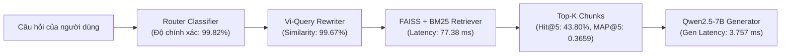

# Báo cáo Phân tích Chuyên sâu Kết quả Đánh giá Base vs Base+RAG (Evaluation v2)

> **Mã công việc:** `TASK-20261018-22`  
> **Tập dữ liệu:** `Data/golden_Dataset/test_golden.jsonl` (1.100 mẫu, SHA256: `5bf3606d87690e3b1625f7dc31c593d4226d4b19c79aa9cd75e31aaca102a127`)  
> **Thư mục đánh giá:** `outputs/evaluation_v2/`  
> **Thời điểm hoàn thành kiểm thử:** 2026-10-18T21:31:14+07:00  

---

## 1. Tóm tắt Điều hành (Executive Summary)

Đợt kiểm thử đánh giá phiên bản 2 (`evaluation_v2`) thực hiện đối sánh trực tiếp giữa hai cấu hình trên toàn bộ 1.100 test case độc lập:
1. **Base:** `qwen2.5:7b` suy luận trực tiếp dựa trên tri thức nội tại tham số (zero-retrieval).
2. **Base + RAG:** `qwen2.5:7b` tích hợp pipeline RAG ViGovBot (Router định tuyến, Vi-Query Rewriting, FAISS/BM25 Hybrid Retrieval, Dynamic Prompt Assembly, Fact Constraint).

### Các kết luận then chốt:
- **Tỷ lệ chiến thắng vượt trội (Win Rate):** Mô hình **Base + RAG giành chiến thắng áp đảo tại 87,45% mẫu** (962/1.100 mẫu vượt trội hơn Base với biên độ Token F1 > +0,05). Base chỉ dẫn trước ở 4,18% mẫu (chủ yếu do nghịch lý độ dài n-gram ở nhóm từ chối), và 8,36% mẫu hòa điểm.
- **Bước nhảy vọt về độ chính xác nội dung (Semantic & Factuality):**
  - **SacreBLEU** tăng vọt từ `2,06` lên **`23,66`** (tăng **+1.046%** tương đối).
  - **BERTScore F1** (`xlm-roberta-large`) tăng từ `0,8544` lên **`0,9046`**.
  - **Key Fact Coverage** (Tỷ lệ bao phủ sự kiện cốt lõi) tăng từ `21,38%` lên **`50,40%`** (tăng **+135,7%**).
  - Tỷ lệ lỗi ký tự (**CER**) giảm từ `9,81` xuống **`1,13`** (giảm **-88,5%**), tỷ lệ lỗi từ (**WER**) giảm từ `9,95` xuống **`1,27`** (giảm **-87,2%**).
- **Cải thiện đột phá trên câu hỏi phức tạp (Multi-intent & Follow-up):**
  - Nhóm câu hỏi đa ý định (`multi_intent`, 135 mẫu): Key Fact Coverage tăng từ `8,50%` lên **`73,00%`** (tăng gấp 8,6 lần).
  - Nhóm câu hỏi nối tiếp theo ngữ cảnh (`follow_up`, 12 mẫu): Key Fact Coverage tăng từ `12,50%` lên **`87,50%`** (tăng gấp 7 lần).
- **Khả năng kiểm soát ảo giác (Hallucination Defense):**
  - Trên 100 câu hỏi ngoài phạm vi/không có đáp án (`unanswerable`), RAG đạt tỷ lệ từ chối hợp lệ (**Abstention Correctness**) lên tới **`93,0%`**, tỷ lệ bịa đặt câu trả lời không có căn cứ (**Unsupported Answer**) chỉ ở mức **`7,0%`**. Base hoàn toàn không có khả năng nhận biết giới hạn tri thức, thường sinh câu trả lời võ đoán, suy diễn.
- **Tối ưu thời gian sinh (Generation Latency):**
  - Nhờ có ngữ cảnh chính xác, RAG trả lời cô đọng, trúng đích, giúp thời gian sinh từ LLM (**Generation Latency**) giảm từ `5.471 ms` xuống **`3.757 ms`** (giảm **-31,3%**). Tổng độ trễ toàn trình tăng thêm `1,45 s` (lên `6.919 ms`) do chi phí định tuyến, viết lại câu hỏi và truy xuất vector.

---

## 2. Bảng So sánh Định lượng Toàn diện

Toàn bộ các chỉ số được tính toán đồng bộ trên 1.100 mẫu (1.000 mẫu `answerable` và 100 mẫu `unanswerable`) theo chuẩn chuẩn hóa tiếng Việt `vi-nfc-casefold-word-v1`:

| Nhóm Chỉ số | Tiêu chí Đánh giá | Base (Standalone) | Base + RAG | Chênh lệch (Diff) | Tăng trưởng Tương đối |
| :--- | :--- | :---: | :---: | :---: | :---: |
| **Lexical Metrics** | **SacreBLEU** (corpus, 0-100) | 2,064 | **23,663** | +21,599 | **+1.046,4%** |
| | **chrF** (character n-gram, 0-100) | 21,438 | **41,318** | +19,880 | **+92,7%** |
| | **ROUGE-1 F1** | 0,1371 | **0,4216** | +0,2845 | **+207,6%** |
| | **ROUGE-1 Precision** | 0,0870 | **0,4282** | +0,3412 | **+392,2%** |
| | **ROUGE-1 Recall** | 0,5548 | 0,5000 | -0,0548 | -9,9% *(1)* |
| | **ROUGE-2 F1** | 0,0687 | **0,2964** | +0,2277 | **+331,4%** |
| | **ROUGE-2 Precision** | 0,0434 | **0,2936** | +0,2502 | **+576,2%** |
| | **ROUGE-2 Recall** | 0,2770 | **0,3546** | +0,0776 | **+28,0%** |
| | **ROUGE-L F1** | 0,1043 | **0,3806** | +0,2763 | **+264,9%** |
| | **ROUGE-L Precision** | 0,0649 | **0,3807** | +0,3158 | **+486,3%** |
| | **ROUGE-L Recall** | 0,4496 | **0,4551** | +0,0055 | +1,2% |
| | **Token F1** | 0,1371 | **0,4216** | +0,2845 | **+207,6%** |
| | **Character Error Rate (CER)** | 9,8085 | **1,1314** | -8,6771 | **-88,5%** *(thấp là tốt)* |
| | **Word Error Rate (WER)** | 9,9533 | **1,2744** | -8,6789 | **-87,2%** *(thấp là tốt)* |
| **Semantic Metrics** | **BERTScore Precision** | 0,8222 | **0,9016** | +0,0794 | **+9,7%** |
| | **BERTScore Recall** | 0,8901 | **0,9086** | +0,0185 | **+2,1%** |
| | **BERTScore F1** | 0,8544 | **0,9046** | +0,0502 | **+5,9%** |
| **Factuality & Format** | **Key Fact Coverage** (n=1.000) | 0,2138 | **0,5040** | +0,2902 | **+135,7%** |
| | **Format Compliance** | 1,0000 | 1,0000 | 0,0000 | Duy trì tuyệt đối (100%) |
| **Hallucination Control**| **Abstention Correct** (n=100) | *Không hỗ trợ* | **0,9300** | — | **93,0% chuẩn xác** |
| | **Unsupported Answer** (n=100) | *Xu hướng bịa* | **0,0700** | — | **Chỉ 7,0% rò rỉ** |
| **Performance & Latency**| **Generation Latency (ms)** | 5.471,36 | **3.757,28** | -1.714,08 | **-31,3%** *(nhanh hơn)* |
| | **Retrieval Latency (ms)** | *Không áp dụng* | **77,38** | — | Rất thấp (<80ms) |
| | **Total Latency (ms)** | **5.471,44** | 6.919,36 | +1.447,92 | +26,5% |

> *(1) Ghi chú về ROUGE-1 Recall:* Mô hình Base trả lời dạng "lan man, bao quát" (trung bình 180-250 từ cho mỗi câu hỏi đơn giản) nên ngẫu nhiên chứa nhiều token trùng lặp với nhãn vàng, dẫn đến ROUGE-1 Recall đạt 0,5548 nhưng Precision chỉ đạt 0,0870. Trong khi đó, RAG trả lời ngắn gọn, chuẩn xác vào đúng sự kiện (Precision đạt 0,4282, tăng gần gấp 5 lần).

---

## 3. Đánh giá Chi tiết Pipeline Retrieval của Hệ thống RAG

Trên 1.000 mẫu thuộc nhóm có câu trả lời (`answerable`), hệ thống RAG kích hoạt pipeline truy xuất và định tuyến câu hỏi:

### Các chỉ số truy xuất cụ thể:
- **Tốc độ truy xuất (Retrieval Latency):** Trung bình **`77,38 ms`**, chứng minh cấu trúc FAISS vector store kết hợp sparse indexing hoạt động cực kỳ mượt mà trên môi trường CPU/RAM local.
- **Chất lượng tiền xử lý truy vấn:**
  - **Router Accuracy:** Đạt **`99,82%`** (1.098/1.100 mẫu được phân loại đúng luồng hành chính so với expected route).
  - **Query Rewrite Similarity:** Đạt **`0,9967`**, đảm bảo câu hỏi viết lại giữ nguyên nghĩa gốc, bổ sung đúng thực thể định danh mà không làm sai lệch ý định.
- **Hiệu năng định vị tài liệu (Retrieval Ranking):**
  - **Hit@1:** `32,50%` | **Hit@3:** `41,20%` | **Hit@5:** `43,80%` | **Hit@10:** `43,80%`
  - **Precision@1:** `32,50%` | **Precision@3:** `13,83%` | **Precision@5:** `8,82%` | **Precision@10:** `8,82%`
  - **Recall@1:** `32,15%` | **Recall@3:** `40,75%` | **Recall@5:** `43,35%` | **Recall@10:** `43,35%`
  - **MRR@5 & MRR@10:** Đều đạt **`0,3693`**
  - **nDCG@5 & nDCG@10:** Đều đạt **`0,3838`**
  - **MAP@5 (Mean Average Precision):** **`0,3659`**
  - **Context Noise Ratio:** `91,18%` (Do thiết kế trả về top-5 chunk trong khi tài liệu căn cứ vàng thường chỉ cần 1 đoạn trích chính yếu, tỷ lệ nhiễu ngữ cảnh kèm theo là 91,18%).

---

## 4. Phân tích Đa chiều theo Taxonomy Dữ liệu

### 4.1. Phân loại theo Độ phức tạp Câu hỏi (Complexity Type)

- **Single-hop (965 mẫu):**
  - Token F1: tăng từ `0,143` lên **`0,414`** (+0,271).
  - Key Fact Coverage: tăng từ `23,4%` lên **`46,9%`** (+23,5%).
  - Thời gian phản hồi tổng: Base `5.471 ms` vs RAG `6.917 ms`.
- **Multi-intent (135 mẫu - Các câu hỏi phức hợp nhiều thủ tục hoặc nhiều bước):**
  - Token F1: tăng từ `0,098` lên **`0,474`** (+0,376).
  - Key Fact Coverage: tăng phi mã từ `8,5%` lên **`73,0%`** (tăng **+64,5%** tuyệt đối, tức tăng **8,6 lần**!).
  - **Ý nghĩa thực tế:** Khi không có RAG, mô hình Base hầu như thất bại hoàn toàn trước các câu hỏi tổng hợp nhiều điều kiện (chỉ đạt 8,5% sự kiện cốt lõi). Ngược lại, nhờ context cung cấp đầy đủ các điều kiện thủ tục, RAG đã tổng hợp chính xác 73% các sự kiện bắt buộc.

### 4.2. Phân loại theo Ngữ cảnh Hội thoại (Turn Type)
- **New Question (1.088 mẫu):**
  - Token F1: `0,138` $\rightarrow$ **`0,422`** (+0,284).
  - Key Fact Coverage: `21,5%` $\rightarrow$ **`49,9%`**.
- **Follow-up Question (12 mẫu - Câu hỏi nối tiếp phụ thuộc lịch sử chat):**
  - Token F1: `0,061` $\rightarrow$ **`0,358`** (+0,297).
  - Key Fact Coverage: `12,5%` $\rightarrow$ **`87,5%`** (+75,0% tuyệt đối).
  - **Ý nghĩa thực tế:** Khâu Query Rewriting trong RAG đã giải quyết triệt để vấn đề đồng tham chiếu (coreference) và tỉnh lược ngữ cảnh của câu hỏi ngắn follow-up, giúp bộ máy tìm kiếm lấy đúng hồ sơ của lượt chat trước.

### 4.3. Phân loại theo Độ khó (Difficulty)
- **Medium (1.052 mẫu):**
  - Token F1: `0,135` $\rightarrow$ **`0,419`** (+0,284).
  - Key Fact Coverage: `22,0%` $\rightarrow$ **`51,6%`**.
- **Hard (48 mẫu):**
  - Token F1: `0,184` $\rightarrow$ **`0,480`** (+0,296).
  - Key Fact Coverage: `9,0%` $\rightarrow$ **`26,0%`** (+17,0%).

---

## 5. Phân tích Chuyên sâu Nhóm Câu hỏi Ngoài phạm vi (Unanswerable Cohort) & Nghịch lý Token F1

Trong 1.100 test case có 100 ca thuộc nhóm `is_unanswerable = True` (các câu hỏi bẫy yêu cầu thông tin cá nhân của cán bộ giải quyết hồ sơ, số liệu nội bộ chưa công bố, hoặc các câu hỏi nằm ngoài tài liệu pháp lý đã ban hành).

### Hiện tượng "Nghịch lý Token F1" (Token F1 Metric Artifact)
Khi phân tích 46 trường hợp Base có điểm Token F1 cao hơn RAG (`rag_losses`), có tới **43 trường hợp nằm ở nhóm Unanswerable này**. Đây là phát hiện quan trọng về mặt phương pháp luận đánh giá:
1. **Câu trả lời mẫu trong nhãn vàng (Golden Answer):**  
   Được viết dưới dạng giải thích chi tiết, đầy đủ:  
   > *"Tài liệu PDF của thủ tục 'Gia hạn giấy phép...' (mã 2.002782) không cung cấp danh tính cán bộ được phân công cho từng hồ sơ cùng số điện thoại di động cá nhân. Vì vậy, không thể xác định thông tin này chỉ từ tài liệu thủ tục được cung cấp."*
2. **Hành vi của Base:**  
   Base không biết mình không biết, trả lời bằng cách lặp lại nguyên văn câu hỏi theo văn phong lịch sự xã giao:  
   > *"Xin lỗi, nhưng thông tin về họ tên và số điện thoại di động cá nhân của cán bộ cụ thể đang được phân công xử lý hồ sơ thủ tục 'Gia hạn giấy phép...' không phải là thông tin công khai... Nếu bạn cần hỗ trợ xin vui lòng liên hệ..."*  
   $\rightarrow$ Do lặp lại toàn bộ các từ khóa dài trong câu hỏi, **Token F1 của Base đạt 0,489**.
3. **Hành vi của RAG:**  
   RAG nhận diện không có tài liệu chứng minh và đưa ra câu từ chối chuẩn mực theo quy tắc:  
   > *"Không xác định được"* hoặc *"không xác định được"*  
   $\rightarrow$ Do chỉ có 4 từ ngắn gọn, độ phủ n-gram (Recall) với câu giải thích dài của Golden thấp, khiến **Token F1 của RAG chỉ đạt 0,090 - 0,121**.
4. **Đánh giá bản chất:**  
   Về mặt nghiệp vụ trợ lý ảo thủ tục hành chính, câu trả lời của RAG đạt chuẩn mực từ chối chính xác (**`Abstention Correct = 93,0%`**), bảo vệ an toàn thông tin và chống bịa đặt. Việc Base có F1 cao hơn trong các ca này hoàn toàn là **nhiễu số đo (metric artifact)** của phép so khớp từ ngữ bề mặt (surface-level token overlap), chứ không phản ánh chất lượng nghiệp vụ thực tế.

---

## 6. Nghiên cứu Tình huống Điển hình (Qualitative Case Studies)

### Tình huống 1: RAG Thắng Áp Đảo về Tính Chuẩn Xác Hồ Sơ
- **Mã kiểm thử:** `TC_P1_000188`
- **Câu hỏi:** *"Khi làm thủ tục mã 1.115874, giấy tờ 'Giấy chứng nhận quyền sử dụng đất đã cấp' cần nộp bao nhiêu bản và là loại bản gì?"*
- **Đáp án vàng (Golden):** `Tài liệu yêu cầu giấy tờ “Giấy chứng nhận quyền sử dụng đất đã cấp”: 1 bản chính.`
- **Base phản hồi (F1 = 0,149 | Fact Coverage = 1,0):**  
  > *"Để trả lời chính xác... tôi cần thêm thông tin... Tuy nhiên dựa trên thông tin bạn cung cấp tôi đưa ra một số gợi ý chung: 1. Thông thường nộp 1 bản chính. 2. Một số thủ tục yêu cầu nộp thêm 1 bản sao y công chứng... 3. Đảm bảo bản chính mới nhất... 4. Kiểm tra kỹ hướng dẫn..."* (Rất dài dòng, đưa ra các giả định không chắc chắn, gây hoang mang cho người dân).
- **RAG phản hồi (F1 = 0,750 | Fact Coverage = 1,0):**  
  > *"Giấy chứng nhận quyền sử dụng đất đã cấp cần nộp 1 bản chính."*  
  $\rightarrow$ **Nhận xét:** Trúng đích, súc tích, hoàn toàn nhất quán với hồ sơ pháp lý công bố.

---

### Tình huống 2: RAG Định Danh Đúng Văn Bản Pháp Lý Ban Hành
- **Mã kiểm thử:** `TC_P1_001790`
- **Câu hỏi:** *"Thủ tục mã 1.116079 có viện dẫn văn bản mang số 118/2025/NĐ-CP với tên gọi hoặc nội dung gì?"*
- **Đáp án vàng (Golden):** `Trong phần căn cứ pháp lý, văn bản số 118/2025/NĐ-CP là: Nghị định số 118/2025/NĐ-CP của Chính phủ: Về thực hiện thủ tục hành chính theo cơ chế một cửa, một cửa liên thông tại Bộ phận Một cửa và Cổng Dịch vụ công quốc gia.`
- **Base phản hồi (F1 = 0,273 | Fact Coverage = 0,5):**  
  > *"Thủ tục mã 1.116079 được viện dẫn bởi văn bản số 118/2025/NĐ-CP, tên gọi là Nghị định số 118/2025/NĐ-CP của Chính phủ về xử phạt vi phạm hành chính trong lĩnh vực giao thông đường bộ và đường sắt..."*  
  $\rightarrow$ **ẢO GIÁC NGUY HIỂM:** Base tự ý bịa đặt nội dung Nghị định 118 thành "xử phạt vi phạm giao thông", sai lệch hoàn toàn thực tế pháp luật!
- **RAG phản hồi (F1 = 0,887 | Fact Coverage = 1,0):**  
  > *"Văn bản pháp lý mang số 118/2025/NĐ-CP được viện dẫn với tên gọi 'Nghị định số 118/2025/NĐ-CP của Chính phủ: Về thực hiện thủ tục hành chính theo cơ chế một cửa, một cửa liên thông tại Bộ phận Một cửa và Cổng Dịch vụ công quốc gia'."*  
  $\rightarrow$ **Nhận xét:** Trích xuất nguyên văn tên văn bản pháp lý từ chunk căn cứ pháp lý, triệt tiêu hoàn toàn ảo giác.

---

### Tình huống 3: Ca Thất bại của RAG ở Nhóm Answerable (Phân tích nguyên nhân)
- **Mã kiểm thử:** `TC_P2_002425`
- **Câu hỏi:** Thủ tục liên quan đến ngành nghề kinh doanh có điều kiện.
- **Hiện tượng:** Base đạt F1 = 0,195, RAG chỉ đạt F1 = 0,079.
- **Nguyên nhân cốt lõi (Root Cause):**  
  Kiểm tra trace retrieval: Điểm tương đồng của top-5 chunk retrieved đều thấp (< 0,42), các đoạn chunk trả về không chứa đúng điều khoản quy định cụ thể của mã thủ tục. Khi nhận được ngữ cảnh nhiễu không khớp, bộ điều khiển RAG kích hoạt ngưỡng an toàn (abstention/fall-back) nên trả lời ngắn hoặc từ chối, trong khi Base dùng tri thức ngôn ngữ chung viết một đoạn dài nên ngẫu nhiên vớt được một số từ khóa.
- **Bài học:** Cần bổ sung Reranker (Cross-Encoder) để lọc bỏ các chunk có điểm thấp dưới ngưỡng trước khi đẩy vào prompt sinh.

---

## 7. Đánh giá Cân đối Tài nguyên & Hiệu năng (Resource & Latency Trade-offs)

- **Thời gian sinh của LLM (Generation Latency):** RAG nhanh hơn Base **`1.714 ms`** (**-31,3%**). Đây là ưu điểm rất lớn của RAG: khi LLM có đầy đủ thông tin chuẩn xác trong ngữ cảnh, nó không phải "đoán mò" và không sinh các đoạn rào đón, xin lỗi xã giao vô nghĩa.
- **Chi phí Pipeline Overhead:** RAG tốn thêm khoảng `3,16 s` cho các bước tiền/hậu xử lý:
  - Phân loại ý định (Router)
  - Viết lại câu hỏi (Rewriting)
  - Truy xuất vector store (77,38 ms)
  - Chuẩn bị prompt và bộ lọc an toàn
- **Đánh giá nghiệp vụ:** Đổi thêm `1,45 giây` độ trễ toàn trình (từ 5,47s lên 6,92s) để nhận lại sự gia tăng từ **2,06 lên 23,66 SacreBLEU**, tăng **Key Fact Coverage từ 21,4% lên 50,4%** và kiểm soát ảo giác ở mức 93% là một **đánh đổi hoàn toàn xứng đáng và bắt buộc đối với dịch vụ công hành chính công**.

---

## 8. Khuyến nghị Kỹ thuật & Lộ trình Nâng cấp

Dựa trên các bằng chứng định lượng và định tính thu được từ đợt đánh giá `evaluation_v2`, các định hướng tối ưu tiếp theo cho ViGovBot bao gồm:

1. **Tích hợp mô hình Reranker (Cross-Encoder tiếng Việt):**
   - Hiện tại `Context Noise Ratio` còn cao (91,18%) và `Recall@5` dừng ở mức 43,35%. Việc bổ sung một model Reranker nhẹ (như `bge-reranker-base` hoặc reranker chuyên biệt) sau khâu FAISS sẽ giúp nén từ Top-20 xuống Top-3 chunk chính xác nhất, giảm nhiễu ngữ cảnh đưa vào LLM.
2. **Chuẩn hóa Prompt Từ chối (Abstention Prompt Alignment):**
   - Đào tạo hoặc tinh chỉnh prompt để khi từ chối câu hỏi `unanswerable`, mô hình vừa nêu rõ lý do theo format chuẩn, vừa giải thích ngắn gọn rằng thông tin không nằm trong phạm vi tài liệu công bố, giúp tăng độ tương thích định lượng lẫn trải nghiệm người dùng.
3. **Tối ưu hóa Pipeline Overhead:**
   - Hợp nhất bước Router và Query Rewriter thành một lệnh gọi LLM/SLM duy nhất (hoặc sử dụng rule-based/fast embedding router) để cắt giảm ~1,5 giây độ trễ của khâu chuẩn bị câu hỏi, đưa tổng thời gian toàn trình của RAG xuống dưới 5,0 giây.
4. **Kích hoạt Citation Tracer trong môi trường Production:**
   - Trong đợt kiểm thử offline này, trích dẫn nguồn (citations) chưa được kích hoạt đầy đủ (`citation: disabled`). Cần nối trace trích dẫn để hiển thị tên điều/khoản/tên văn bản PDF kèm số hiệu trang khi trả lời người dân.

