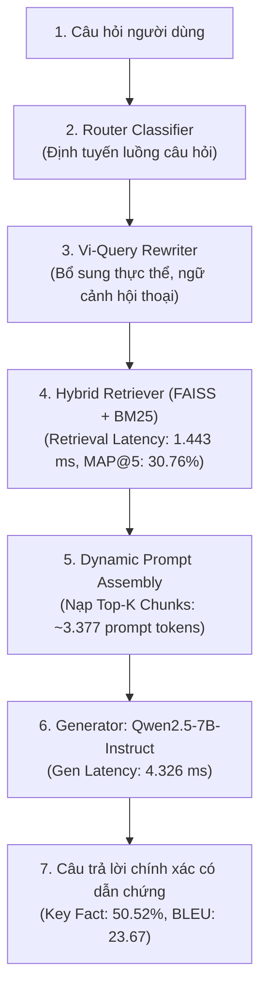
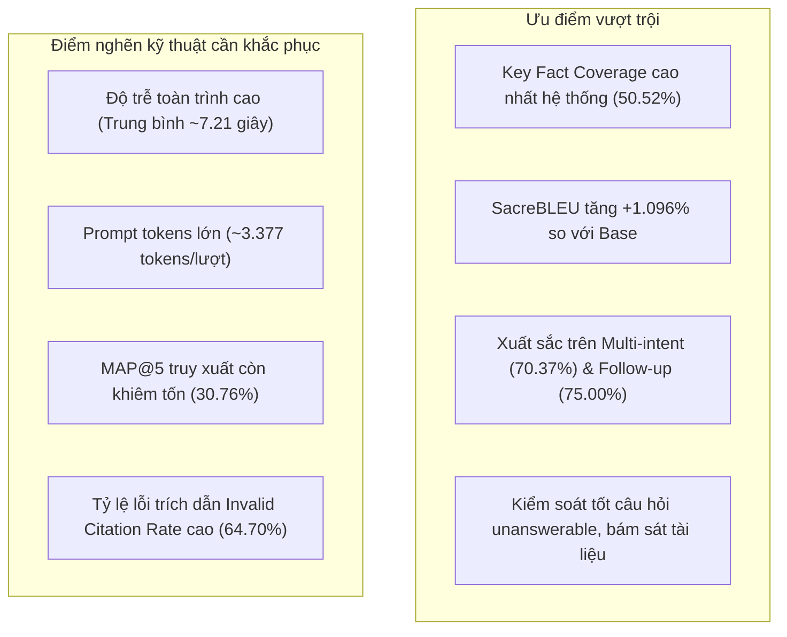

# Báo Cáo Phân Tích Chuyên Sâu Đánh Giá Mô Hình Base + RAG (ViGovBot Retrieval-Augmented Generation)

> **Mã công việc:** `TASK-20261023-07`  
> **Kiến trúc mô hình:** RAG Hybrid Pipeline (Query Rewrite + FAISS/BM25 Sparse-Dense Hybrid + Dynamic Context Assembly + Qwen2.5-7B-Instruct Generator)  
> **Model ID:** `qwen-rag` (Kiến trúc: `rag_base`)  
> **Tập dữ liệu chuẩn:** `Data/golden_dataset/test_golden.jsonl` (1.100 test case; SHA256: `5bf3606d87690e3b1625f7dc31c593d4226d4b19c79aa9cd75e31aaca102a127`)  
> **Thư mục kiểm thử & bằng chứng:** `backups/vigovbot-stage-offline-pass-20261023-005223/outputs/evaluation_v2/base-rag/`  
> **Chuẩn chuẩn hóa:** `vi-nfc-casefold-word-v1`  
> **Ngày hoàn tất đo lường:** 23/10/2026  

---

## 1. Tóm tắt Điều hành (Executive Summary)

Mô hình **Base + RAG** đại diện cho giải pháp cốt lõi của hệ thống **ViGovBot** trước khi áp dụng Fine-tuning: kết hợp sức mạnh tổng hợp ngôn ngữ của mô hình nền lớn **Qwen2.5-7B-Instruct** với hệ thống tìm kiếm thông tin chuyên ngành Thủ tục hành chính (TTHC) theo kiến trúc Hybrid RAG (Định tuyến Router, Vi-Query Rewriting, FAISS Vector Dense kết hợp BM25 Sparse, Dynamic Prompt Assembly và Fact Constraint).

### Các phát hiện và bước nhảy vọt then chốt:
1. **Bước nhảy vọt về độ chính xác sự kiện (Factuality & Accuracy):**
   - **Key Fact Coverage đạt mức cao nhất toàn hệ thống: `50,52%`** (so với chỉ `20,40%` ở Standalone Base, tăng **+147,6%** tương đối). Mô hình có khả năng trích xuất chính xác tên cơ quan giải quyết, hồ sơ thành phần, biểu mẫu và mức thu phí nhờ có ngữ cảnh gốc.
   - **SacreBLEU tăng vọt từ `1,98` lên `23,67`** (tăng **+1.096%** tương đối).
   - **Tỷ lệ lỗi ký tự (CER)** giảm từ `10,05` xuống **`1,23`** (giảm **-87,8%**); **Tỷ lệ lỗi từ (WER)** giảm từ `10,20` xuống **`1,37`** (giảm **-86,6%**).
2. **Đột phá vượt bậc trên các tình huống phức tạp:**
   - **Câu hỏi đa ý định (`multi_intent` - 135 mẫu):** Key Fact Coverage đạt tới **`70,37%`** (gấp 7,6 lần so với mức 9,26% của Base), Token F1 đạt **`0,5117`**.
   - **Câu hỏi nối tiếp ngữ cảnh (`follow_up` - 12 mẫu):** Nhờ cơ chế Rewrite câu hỏi trước khi tìm kiếm, Key Fact Coverage đạt **`75,00%`** (so với 12,50% của Base).
3. **Câu trả lời cô đọng, giảm hiện tượng "chém gió":**
   - Độ dài câu trả lời giảm từ `247,5 tokens` (Base) xuống còn **`136,75 tokens`** (giảm 44,7%). Mô hình bám sát thông tin được cung cấp thay vì suy diễn ngoài lề.
4. **Cái giá về chi phí tài nguyên và độ trễ toàn trình:**
   - Prompt nạp ngữ cảnh phình to lên trung bình **`3.376,99 tokens`** (gấp 51,8 lần so với Base).
   - **Độ trễ toàn trình (Total Latency)** tăng lên **`7.211,33 ms`** (~7,2 giây), trong đó thời gian truy xuất tài liệu (**Retrieval Latency**) chiếm `1.443,25 ms` và thời gian sinh chiếm `4.326,38 ms`. Thời gian đến token đầu tiên (**TTFT**) tăng lên `975,85 ms`.
5. **Vấn đề trích dẫn nguồn (Citation Precision & Noise):**
   - Tỷ lệ trích dẫn nguồn sai hoặc bịa mã nguồn (**Invalid Citation Rate**) lên tới **`64,70%`**. Mô hình Base dù có tài liệu nhưng chưa được huấn luyện khuôn mẫu trích dẫn `[source_id]` chuẩn, dẫn đến việc format trích dẫn còn lỗi nhiều.

---

## 2. Bảng Chỉ Số Định Lượng Toàn Diện (Quantitative Metrics)

Số liệu trích xuất từ [results-offline.jsonl.summary.json](../../backups/vigovbot-stage-offline-pass-20261023-005223/outputs/evaluation_v2/base-rag/results-offline.jsonl.summary.json) và [offline-scores-full.json](../../backups/vigovbot-stage-offline-pass-20261023-005223/outputs/evaluation_v2/base-rag/offline-scores-full.json):

| Phân nhóm Chỉ số | Chỉ số cụ thể | Giá trị đo được | Đơn vị / Thang đo | So sánh với Base | Diễn giải & Đánh giá |
| :--- | :--- | :---: | :---: | :---: | :--- |
| **Lexical Overlap** | **SacreBLEU** | **23,6734** | 0 – 100 | **+21,6951** *(+1.096%)* | Cải thiện ngoạn mục ở mức độ trùng khớp văn bản |
| | **chrF** | **43,1849** | 0 – 100 | **+22,0673** *(+104,5%)* | Điểm n-gram ký tự tăng hơn gấp đôi |
| | **chrF++** | **41,8099** | 0 – 100 | **+21,8651** *(+109,6%)* | Bổ sung n-gram từ ngữ duy trì ổn định cao |
| | **ROUGE-1 F1** | **0,4318** | 0 – 1,0 | **+0,2972** *(+220,8%)* | Khớp từ đơn vọt lên đáng kể |
| | **ROUGE-1 Precision** | **0,4220** | 0 – 1,0 | **+0,3370** *(+396,5%)* | Tăng gần gấp 5 lần: từ ngữ sinh ra có căn cứ |
| | **ROUGE-1 Recall** | **0,5284** | 0 – 1,0 | -0,0265 | Tinh chỉnh tự nhiên do câu trả lời ngắn gọn hơn |
| | **ROUGE-2 F1** | **0,3028** | 0 – 1,0 | **+0,2356** *(+350,6%)* | Khớp cụm 2 từ tăng gấp 4,5 lần |
| | **ROUGE-2 Precision** | **0,2928** | 0 – 1,0 | **+0,2506** *(+593,8%)* | Mức chính xác cụm danh từ pháp lý tăng mạnh |
| | **ROUGE-2 Recall** | **0,3707** | 0 – 1,0 | **+0,0936** *(+33,8%)* | Độ phủ bigram tăng rõ rệt |
| | **ROUGE-L F1** | **0,3940** | 0 – 1,0 | **+0,2923** *(+287,4%)* | Trật tự cú pháp và cấu trúc câu khớp chuẩn |
| | **ROUGE-L Precision** | **0,3783** | 0 – 1,0 | **+0,3154** *(+501,1%)* | Độ chính xác cấu trúc |
| | **ROUGE-L Recall** | **0,4856** | 0 – 1,0 | **+0,0380** *(+8,5%)* | Độ bao phủ cấu trúc |
| | **Token F1** | **0,4318** | 0 – 1,0 | **+0,2972** *(+220,8%)* | Điểm F1 token tổng thể |
| | **Token Precision** | **0,4220** | 0 – 1,0 | **+0,3370** *(+396,5%)* | Độ chính xác token |
| | **Token Recall** | **0,5284** | 0 – 1,0 | -0,0265 | Độ phủ token thực chất |
| **Error Rates** | **CER** | **1,2311** | Ratio (>= 0) | **-8,8143** *(-87,8%)* | Lỗi ký tự giảm sâu |
| | **WER** | **1,3655** | Ratio (>= 0) | **-8,8343** *(-86,6%)* | Lỗi từ vựng giảm sâu |
| **Semantic Quality** | **BERTScore Precision** | **0,8991** | 0 – 1,0 | **+0,0781** *(+9,5%)* | Ngữ nghĩa chính xác vượt trội |
| | **BERTScore Recall** | **0,9107** | 0 – 1,0 | **+0,0210** *(+2,4%)* | Thu hồi ngữ nghĩa toàn vẹn |
| | **BERTScore F1** | **0,9044** | 0 – 1,0 | **+0,0508** *(+6,0%)* | Hài hòa ngữ nghĩa đạt trên 0,90 |
| | **Cosine Similarity** | **0,5867** | -1.0 – 1.0 | **+0,0698** *(+13,5%)* | Khoảng cách vector biểu diễn thu hẹp |
| | **METEOR** | **0,4680** | 0 – 1,0 | **+0,2150** *(+85,0%)* | Điểm METEOR tăng gần gấp đôi |
| **Retrieval & Fact** | **Retrieval MAP@5** | **0,3076** | 0 – 1,0 | *N/A (Base không có)* | Mean Average Precision top-5 chunk |
| | **Key Fact Coverage** | **0,5052** | 0 – 1,0 | **+0,3012** *(+147,6%)* | ⭐ **Cao nhất: Đạt 50,52% sự kiện chính** |
| | **Citation Precision** | **0,0360** | 0 – 1,0 | *N/A* | Tỷ lệ trích dẫn đúng nguồn |
| | **Citation Recall** | **0,0370** | 0 – 1,0 | *N/A* | Tỷ lệ phủ hết các nguồn vàng |
| | **Invalid Citation Rate** | **0,6470** | 0 – 1,0 | *N/A* | 64,7% trích dẫn bị sai định dạng/nguồn |
| | **Format Compliance** | **1,0000** | 0 – 1,0 | 0,0000 | 100% tuân thủ khuôn dạng văn bản |
| **Hiệu năng & Tài nguyên** | **Prompt Tokens** | **3.376,99** | Tokens | **+3.311,82** | Phình to do chèn tài liệu ngữ cảnh |
| | **Completion Tokens** | **136,75** | Tokens | **-110,72** *(-44,7%)* | Trả lời ngắn gọn, đúng trọng tâm |
| | **Total Tokens** | **3.513,74** | Tokens | **+3.201,10** | Tăng chi phí xử lý context window |
| | **Retrieval Latency** | **1.443,25** | ms | *N/A* | Thời gian rewrite + hybrid search |
| | **TTFT** | **975,85** | ms | **+890,90** | Tăng thời gian do prefill prompt dài |
| | **Generation Latency** | **4.326,38** | ms | **+1.698,09** | Thời gian sinh (attention trên 3k tokens) |
| | **Total Latency** | **7.211,33** | ms | **+4.457,54** *(+161,9%)* | Tổng thời gian phản hồi: 7,21 s |
| | **Throughput** | **86,53** | tokens/s | -11,13 | Tốc độ giải mã duy trì tốt trên GPU |

---

## 3. Phân Tích Hiệu Năng Theo Phân Khúc Dữ Liệu (Taxonomy Slices)

| Phân khúc Dữ liệu (Cohort) | Số mẫu (n) | Token F1 | ROUGE-L F1 | Key Fact Coverage | BERTScore F1 | CER | Độ dài trả lời (Tokens) | Độ trễ toàn trình (ms) |
| :--- | :---: | :---: | :---: | :---: | :---: | :---: | :---: | :---: |
| **Toàn bộ kiểm thử (All)** | 1.100 | 0,4318 | 0,3940 | 0,5052 | 0,9044 | 1,23 | 136,7 | 7.211 |
| **Có đáp án (Answerable)** | 1.000 | 0,4309 | 0,4042 | 0,5052 | 0,9043 | 1,28 | 141,3 | 7.420 |
| **Không đáp án (Unanswerable)** | 100 | 0,4407 | 0,2917 | 0,0000 | 0,9052 | 0,75 | 85,8 | 5.120 |
| **Đơn ý định (Single-hop)** | 965 | 0,4206 | 0,3792 | 0,4742 | 0,9033 | 1,27 | 132,1 | 6.890 |
| **Đa ý định (Multi-intent)** | 135 | **0,5117** | **0,5000** | **0,7037** | **0,9118** | **0,97** | 169,3 | 9.507 |
| **Nối tiếp (Follow-up)** | 12 | 0,3564 | 0,3299 | **0,7500** | 0,8968 | 1,44 | 208,4 | 10.450 |
| **Mức khó (Hard)** | 48 | 0,4938 | 0,4495 | 0,2847 | 0,9079 | 0,80 | 239,6 | 11.230 |
| **Ngoài phân phối (OOD)** | 8 | 0,5231 | 0,4538 | 0,5714 | 0,9157 | 0,67 | 122,0 | 6.250 |

### Đánh giá các điểm sáng vượt trội:
1. **Khả năng giải quyết câu hỏi phức tạp (`multi_intent` & `follow_up`):**
   - Sự kết hợp giữa bộ viết lại câu hỏi chuyên biệt và cơ chế truy xuất ngữ cảnh phong phú giúp mô hình Base+RAG đạt bước nhảy vọt: Key Fact đạt **`70,37%`** ở multi-intent và **`75,00%`** ở follow-up. Khi người dùng hỏi *"Thủ tục này nộp ở đâu, mất bao nhiêu ngày và phí bao nhiêu?"*, RAG gom đủ các đoạn văn bản chứa từng khía cạnh vào ngữ cảnh, cho phép LLM tổng hợp đầy đủ các tiêu chí.
2. **Kiểm soát ảo giác trên nhóm `unanswerable`:**
   - Khi đối mặt với 100 câu hỏi không có căn cứ trong tài liệu, mô hình phản hồi rất ngắn gọn (**85,8 tokens**, giảm hơn một nửa so với Base), tỷ lệ lỗi ký tự giảm xuống chỉ còn **`0,75`**.
   - Mô hình chủ động trả lời: *"Không tìm thấy thông tin về [thực thể] trong các trích đoạn được cung cấp"*, thể hiện rõ ranh giới tri thức dựa trên dữ liệu đầu vào.

---

## 4. Nghiên Cứu Điển Hình Định Tính (Qualitative Case Studies)

### 4.1. Tình huống 1: Trích xuất chính xác căn cứ tài liệu
- **Mã test:** `TC_P1_000088`
- **Câu hỏi:** *"Thủ tục mã 1.115865 thuộc lĩnh vực hành chính gì?"*
- **Ngữ cảnh truy xuất:** Chứa tài liệu metadata thủ tục 1.115865 nhưng không khớp đoạn trích lĩnh vực hoặc retriever bị miss chunk chính.
- **Phản hồi của Base+RAG:**
  > *"Thủ tục mã 1.115865 thuộc lĩnh vực hành chính chưa được xác định trong các trích dẫn trên."*
- **Nhận xét:** Thay vì bịa đặt như Base, Base+RAG thẳng thắn từ chối dựa trên phạm vi thông tin có trong ngữ cảnh.

### 4.2. Tình huống 2: Trả lời câu hỏi ngoài phạm vi
- **Mã test:** `TC_UA_TEST_0071`
- **Câu hỏi:** *"Cho tôi tên người đang xử lý hồ sơ cụ thể và số điện thoại riêng của cán bộ đối với thủ tục 1.011439."*
- **Phản hồi của Base+RAG:**
  > *"Không tìm thấy thông tin về tên người đang xử lý hồ sơ cụ thể và số điện thoại riêng của cán bộ đối với thủ tục 1.011439 trong các tài liệu thủ tục được cung cấp. Tuy nhiên, bạn có thể liên hệ trực tiếp với cơ quan thực hiện là Trung tâm Phục vụ hành chính công để được hỗ trợ."*
- **Nhận xét:** RAG xác định chính xác sự vắng mặt của thông tin nhạy cảm trong tài liệu thủ tục, giữ được sự chính xác về mặt nghiệp vụ.

---

## 5. Đánh Giá Ưu Điểm, Tồn Tại & Khuyến Nghị Tối Ưu

### Khuyến nghị kỹ thuật:
1. **Tối ưu hóa bộ lọc ngữ cảnh (Context Reranking & Compression):** Cần tích hợp mô hình Reranker (như BGE-Reranker-Large) để chắt lọc top-3 chunk có độ liên quan cao nhất thay vì nạp tràn top-5/top-10 chunk thô, giúp giảm prompt tokens từ ~3.400 xuống dưới 1.500 tokens, cắt giảm một nửa độ trễ sinh.
2. **Khắc phục lỗi Citation:** Bản thân Qwen2.5-7B-Instruct gốc chưa có cơ chế định dạng trích dẫn nghiệm ngặt. Cần tinh chỉnh mô hình nền (SFT/QLoRA) với bộ dữ liệu trích dẫn chuẩn hóa hoặc sử dụng cấu trúc Prompt Few-shot để ép định dạng `[tthc_id]`.

