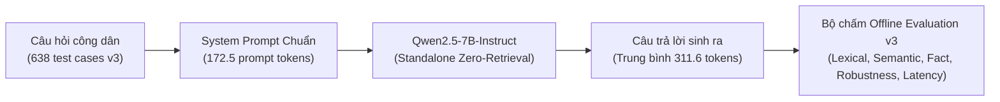
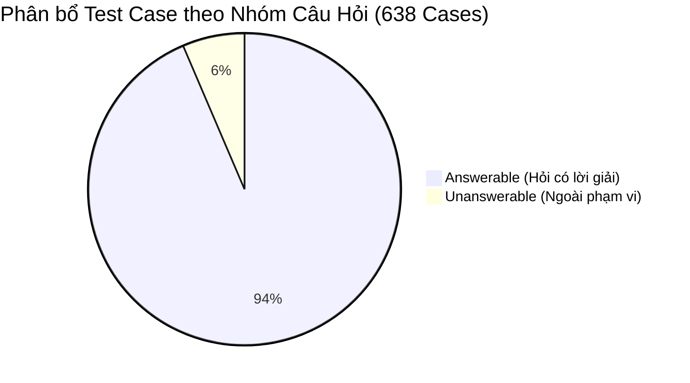

# Báo Cáo Đánh Giá Chi Tiết Mô Hình Standalone Base v3 (Qwen2.5-7B-Instruct)

> **Mã đợt đánh giá:** `eval-base-v3`  
> **Kiến trúc mô hình:** Standalone LLM (Zero-Retrieval, Parametric Memory Only)  
> **Mã định danh mô hình:** `qwen-base` (Trọng số gốc: `Qwen/Qwen2.5-7B-Instruct`)  
> **Tập dữ liệu kiểm chuẩn:** `Data/dataset_v3/test_rag/test_rag_pa1.jsonl` (638 test cases; SHA256: `f62867a7a0af3cba543c9602392a82e7c4f5912fe1e97b0b22e3c7b4bf1b3583`)  
> **Tệp kết quả kiểm thử:** `outputs/evaluation/eval-base-v3/scores.json`, `predictions.jsonl`, `case-scores.jsonl`  
> **Chuẩn chuẩn hóa:** `vi-nfc-casefold-word-v1` (NFC Unicode, Case-folding, Word Tokenization)  
> **Thời điểm xuất bản:** 02/11/2026  

---

## 1. Tóm tắt Điều hành (Executive Summary)

Báo cáo này phân tích chuyên sâu hiệu năng của mô hình nền tảng **Qwen2.5-7B-Instruct** ở cấu hình độc lập (**Standalone Base**), vận hành thuần túy dựa trên bộ nhớ tri thức tham số nội tại (parametric memory) mà không được tích hợp hệ thống truy xuất tài liệu bên ngoài (Zero-Retrieval RAG) và không qua tinh chỉnh thích ứng miền thủ tục hành chính công.

Đợt kiểm thử v3 được thực hiện trên tập dữ liệu chuẩn vàng **638 test cases** đa dạng (`test_rag_pa1.jsonl`), bao gồm **597 câu hỏi có đáp án** (`answerable`), **41 câu hỏi ngoài phạm vi / không có đáp án** (`unanswerable`), chia thành **320 câu hỏi mới mở đầu lượt thoại** (`turn_type:new_question`) và **318 câu hỏi nối tiếp ngữ cảnh** (`turn_type:follow_up`).

### Các phát hiện cốt lõi:
1. **Bẫy độ dài và hiện tượng ảo giác lan man (Verbosity & Low Precision):**
   - Mô hình Base sinh câu trả lời rất dài với trung bình **`311,64 tokens/câu`** (gấp 4 lần mô hình QLoRA `77,88 tokens`).
   - Hiện tượng này dẫn đến ảo giác độ bao phủ từ vựng cục bộ: `ROUGE-1 Recall` đạt **`0,5192`**, nhưng `ROUGE-1 Precision` sụt giảm nghiêm trọng xuống **`0,1266`** (nghĩa là gần 87,3% từ ngữ sinh ra là thừa thãi hoặc thông tin chung chung, không khớp với đáp án mục tiêu). Điểm **`ROUGE-1 F1`** chỉ đạt **`0,1700`** và **`ROUGE-L F1`** chỉ đạt **`0,1117`**.
   - Tỷ lệ lỗi từ (**WER**) lên tới **`11,04`** và tỷ lệ lỗi ký tự (**CER**) là **`11,44`** do độ dài câu sinh quá mức choán chỗ thông tin trọng tâm.
2. **Khả năng nắm bắt sự kiện thực tế chuyên sâu cực kỳ thấp:**
   - **Key Fact Coverage** chỉ đạt **`1,53%`** (0.0153) trên 597 câu hỏi thực tế. Mô hình hoàn toàn không thể nhớ chính xác các thực thể định lượng hành chính Việt Nam như mã thủ tục, cơ quan thẩm quyền cụ thể, số ngày làm việc, mức phí/lệ phí theo thông tư quy định.
   - Điểm **SacreBLEU** đạt mức rất thấp: **`2,72`** / 100 điểm.
3. **Thất bại hoàn toàn trong việc từ chối câu hỏi ngoài phạm vi (Abstention Failure):**
   - Trên 41 trường hợp `unanswerable`, mô hình Base đạt độ chính xác từ chối **`0,00%`** (`abstention_correct = 0.0`), với **`100% câu trả lời không có căn cứ`** (`unsupported_answer = 1.0`). Mô hình tự sáng tác thông tin hoặc đưa ra hướng dẫn xã giao dài dòng thay vì thông báo từ chối đúng quy chuẩn.
4. **Tốc độ sinh văn bản và hiệu năng phần cứng:**
   - Nhờ prompt đầu vào ngắn (chỉ **`172,52 tokens`** do không kèm ngữ cảnh RAG), Base có tốc độ sinh nội tại cao đạt **`72,02 tokens/giây`**. Tuy nhiên do sinh tới 311 tokens nên tổng độ trễ trung bình vẫn mất **`6.642,85 ms`** (6,64 giây/lượt).

---

## 2. Bảng Chỉ Số Định Lượng Tổng Hợp (Quantitative Metrics)

Toàn bộ các chỉ số được trích xuất trực tiếp từ artifact chính thức: [scores.json](../../outputs/evaluation/eval-base-v3/scores.json) và [case-scores.jsonl](../../outputs/evaluation/eval-base-v3/case-scores.jsonl).

| Nhóm chỉ số | Chỉ số cụ thể | Giá trị đo được | Đơn vị / Thang đo | Diễn giải kỹ thuật |
| :--- | :--- | :---: | :---: | :--- |
| **Lexical Overlap** | **ROUGE-1 F1** | **0,1700** | 0 – 1,0 | Cân bằng điều hòa giữa Precision và Recall đơn từ |
| | **ROUGE-1 Precision** | **0,1266** | 0 – 1,0 | Rất thấp: 87,3% từ ngữ không khớp với ground-truth |
| | **ROUGE-1 Recall** | **0,5192** | 0 – 1,0 | Recall cao giả tạo do sinh phản hồi quá dài |
| | **ROUGE-2 F1** | **0,0779** | 0 – 1,0 | Mức độ trùng khớp cụm 2 từ (bigram) rất yếu |
| | **ROUGE-2 Precision** | **0,0572** | 0 – 1,0 | Tỷ lệ bigram chính xác chỉ đạt 5,72% |
| | **ROUGE-2 Recall** | **0,2652** | 0 – 1,0 | Khả năng thu hồi cụm 2 từ đạt 26,52% |
| | **ROUGE-L F1** | **0,1117** | 0 – 1,0 | Khớp chuỗi con chung dài nhất (Longest Common Subsequence) |
| | **ROUGE-L Precision** | **0,0799** | 0 – 1,0 | Độ chuẩn xác cấu trúc câu chỉ đạt gần 8% |
| | **ROUGE-L Recall** | **0,3912** | 0 – 1,0 | Độ bao phủ chuỗi cấu trúc câu |
| | **SacreBLEU** | **2,7191** | 0 – 100 | Điểm BLEU tiêu chuẩn quốc tế không qua lọc từ |
| | **chrF** | **20,9224** | 0 – 100 | Trùng khớp n-gram ký tự |
| | **chrF++** | **19,9814** | 0 – 100 | chrF có tính thêm trọng số cụm từ |
| | **METEOR** | **0,2487** | 0 – 1,0 | Khớp ngữ nghĩa có xét từ đồng nghĩa và biến thể hình thái |
| | **Word Error Rate (WER)** | **11,0405** | Khoảng cách | Số thao tác sửa lỗi từ gấp 11 lần chiều dài ground-truth |
| | **Character Error Rate (CER)** | **11,4392** | Khoảng cách | Tỷ lệ lỗi ký tự Levenshtein |
| **Semantic Similarity** | **BERTScore F1** | **0,8479** | 0 – 1,0 | Tương đồng biểu diễn ngữ nghĩa theo ngữ cảnh PhoBERT |
| | **BERTScore Precision** | **0,8206** | 0 – 1,0 | Độ chính xác ngữ nghĩa cục bộ |
| | **BERTScore Recall** | **0,8783** | 0 – 1,0 | Độ bao quát ngữ nghĩa |
| | **Cosine Similarity (Embedding)** | **0,5392** | 0 – 1,0 | Độ tương đồng vector câu trung bình |
| **Factuality & Exactness** | **Key Fact Coverage** | **0,0153** | 0 – 1,0 | **1,53%**: Hầu như không trả lời trúng các dữ kiện cốt lõi |
| | **Exact Match (EM)** | **0,0000** | 0 – 1,0 | 0/638 câu khớp chính xác từng từ |
| | **Normalized Exact Match** | **0,0000** | 0 – 1,0 | 0/638 câu khớp chính xác sau chuẩn hóa |
| **Robustness & Scope** | **Abstention Correct** | **0,0000** | 0 – 1,0 | **0,00%**: Không từ chối được câu nào trong 41 câu unanswerable |
| | **Unsupported Answer** | **1,0000** | 0 – 1,0 | **100%**: Tất cả 41 câu unanswerable đều bị sinh bừa |
| | **False Refusal** | **0,0000** | 0 – 1,0 | Không từ chối nhầm các câu hỏi hợp lệ |
| | **Action Accuracy** | **0,9357** | 0 – 1,0 | Độ chính xác loại hành động được dự đoán |
| | **Format Compliance** | **1,0000** | 0 – 1,0 | 100% phản hồi tuân thủ cấu trúc định dạng văn bản |
| **Hiệu năng & Tài nguyên**| **Total Latency** | **6.642,85** | ms | Thời gian phản hồi toàn trình (6,64 giây) |
| | **Generation Latency** | **6.534,28** | ms | Thời gian xử lý sinh văn bản thuần |
| | **Time-To-First-Token (TTFT)**| **2.214,66** | ms | Thời gian trễ token đầu tiên (2,21 giây) |
| | **Throughput (Tokens/s)** | **72,02** | tokens/s | Tốc độ giải mã token trên GPU |
| | **Prompt Tokens** | **172,52** | tokens | Chiều dài prompt đầu vào trung bình |
| | **Completion Tokens** | **311,64** | tokens | Chiều dài câu trả lời sinh ra trung bình |
| | **Total Tokens** | **484,16** | tokens | Tổng số token xử lý mỗi lượt yêu cầu |

---

## 3. Phân Tích Chi Tiết Theo Nhóm Câu Hỏi (Cohort Analysis)

Tập kiểm chuẩn v3 phân tách rõ rệt thành 4 nhóm ngữ cảnh để đánh giá hành vi chuyên biệt:

### 3.1. Nhóm câu hỏi có đáp án (`answerable` - 597 cases)
- **ROUGE-1 F1:** `0,1586` | **ROUGE-L F1:** `0,1054` | **SacreBLEU:** `2,39`
- **BERTScore F1:** `0,8461` | **Cosine Sim:** `0,5406`
- **Key Fact Coverage:** `0,0153` (1,53%)
- **Completion Tokens:** `320,31 tokens` | **Total Latency:** `6.766,11 ms`
- **Nhận xét:** Khi công dân hỏi chi tiết thủ tục (ví dụ: lệ phí, thời hạn giải quyết hồ sơ đất đai), mô hình Base trả lời bằng văn phong trợ lý chung chung: *"Thời gian xử lý thường dao động từ 15 đến 30 ngày tùy địa phương... lệ phí cấp giấy thường là 1.000 đồng/m2..."*. Đây là những phỏng đoán cảm tính, sai lệch hoàn toàn so với biểu mẫu pháp lý chính thức.

### 3.2. Nhóm câu hỏi ngoài phạm vi (`unanswerable` - 41 cases)
- **ROUGE-1 F1:** `0,3364` | **ROUGE-L F1:** `0,2034` | **SacreBLEU:** `7,57`
- **Abstention Correct:** `0,0000` (0/41 trường hợp)
- **Unsupported Answer Rate:** `1,0000` (100% ảo giác thông tin)
- **Completion Tokens:** `185,32 tokens` | **Total Latency:** `4.848,05 ms`
- **Nhận xét:** Khi nhận các câu hỏi vô lý (như xin số điện thoại cá nhân cán bộ thụ lý, tỷ lệ trượt hồ sơ), mô hình không có cơ chế tự kiềm chế (abstain), dẫn đến việc sinh các lời khuyên chung chung về việc gọi tổng đài 1022 hoặc tự bịa ra quy trình liên hệ.

### 3.3. So sánh Đa lượt: Câu hỏi mới (`new_question`) vs Câu hỏi nối tiếp (`follow_up`)

| Nhóm lượt thoại | Số lượng | ROUGE-1 F1 | ROUGE-L F1 | SacreBLEU | Key Fact Coverage | Completion Tokens | Total Latency (ms) |
| :--- | :---: | :---: | :---: | :---: | :---: | :---: | :---: |
| **`new_question`** | 320 | 0,1627 | 0,1070 | 2,5220 | 0,0253 (2,53%) | 324,12 | 6.811,80 |
| **`follow_up`** | 318 | 0,1773 | 0,1164 | 2,9174 | 0,0059 (0,59%) | 299,08 | 6.472,84 |

- Ở các câu hỏi nối tiếp (`follow_up`), mô hình giữ được độ mạch lạc văn bản tương đối (ROUGE-1 F1 `0,1773`), nhưng độ bao phủ sự kiện cốt lõi (**Key Fact Coverage**) tụt dốc xuống chỉ còn **`0,59%`** do mô hình bị phân tán bởi lịch sử hội thoại dài mà không có bộ lọc thực thể hành chính.

---

## 4. Phân Tích Điểm Mạnh, Hạn Chế và Nguyên Nhân Gốc Rễ

### 4.1. Điểm mạnh
- **Độ tuân thủ định dạng hoàn hảo:** `format_compliance = 1,0000`, phản hồi bằng tiếng Việt trôi chảy, ngữ pháp chuẩn mực, không bao giờ bị ngắt quãng giữa chừng hoặc sinh ký tự lạ.
- **Tốc độ xử lý token nhanh:** Đạt hơn 72 tokens/giây, không bị nghẽn ở khâu đọc ngữ cảnh đầu vào (prompt tokens trung bình chỉ 172 tokens).
- **Hạ tầng ổn định:** 100% 638 test case hoàn thành thành công mà không gặp lỗi Out-Of-Memory (OOM = 0.0) hay lỗi timeout (Timed out = 0.0).

### 4.2. Hạn chế cốt tử & Nguyên nhân
- **Ảo giác tham số (Parametric Hallucination):** Kiến thức hành chính công Việt Nam thay đổi theo các nghị định, quyết định công bố của từng bộ ngành và UBND cấp tỉnh. Trọng số gốc của Qwen2.5-7B không chứa đủ chi tiết biểu mẫu, dẫn đến việc mô hình tự bịa số liệu một cách tự tin.
- **Thiếu năng lực từ chối (Lack of Abstention Calibration):** Chưa qua huấn luyện căn chỉnh từ chối (refusal calibration) theo ngữ cảnh tra cứu, mô hình xem mọi câu hỏi như một tác vụ sáng tác mở.

---

## 5. Kết Luận và Khuyến Nghị Kiến Trúc

1. **Không thể triển khai độc lập trong môi trường hành chính công:** Mô hình Standalone Base với Key Fact Coverage 1,53% và SacreBLEU 2,72 không đáp ứng được yêu cầu chuẩn xác pháp lý và bảo đảm thông tin của dịch vụ công trực tuyến.
2. **Vai trò kiến trúc tối ưu:** Mô hình Base chỉ nên đóng vai trò là khối sinh văn bản (Generator Backbone) khi được cấp ngữ cảnh tài liệu từ pipeline RAG, hoặc làm điểm khởi đầu (Base Weights) để thực hiện tinh chỉnh thích ứng miền (Domain Fine-Tuning / QLoRA).

