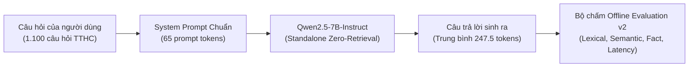
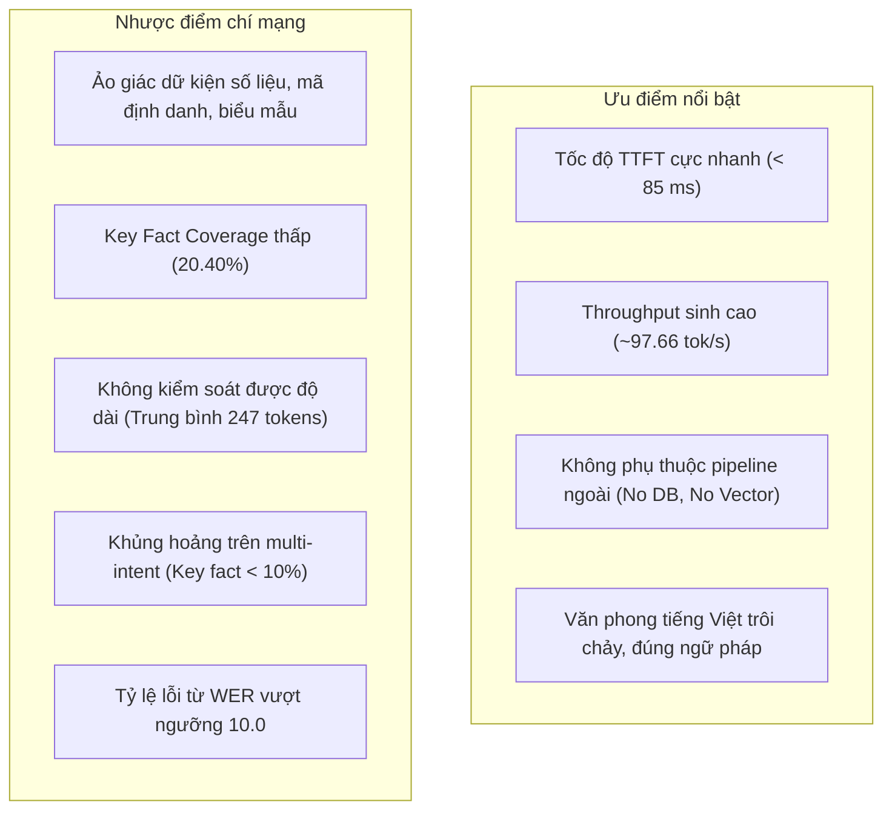

# Báo Cáo Phân Tích Chuyên Sâu Đánh Giá Mô Hình Standalone Base (Qwen2.5-7B-Instruct)

> **Mã công việc:** `TASK-20261023-07`  
> **Kiến trúc mô hình:** Standalone LLM (Zero-Retrieval, Parametric Memory Only)  
> **Model ID:** `qwen2.5-7b-base` (trọng số gốc `Qwen/Qwen2.5-7B-Instruct`)  
> **Tập dữ liệu chuẩn:** `Data/golden_dataset/test_golden.jsonl` (1.100 test case; SHA256: `5bf3606d87690e3b1625f7dc31c593d4226d4b19c79aa9cd75e31aaca102a127`)  
> **Thư mục kiểm thử & bằng chứng:** `backups/vigovbot-stage-offline-pass-20261023-005223/outputs/evaluation_v2/base/`  
> **Chuẩn chuẩn hóa:** `vi-nfc-casefold-word-v1` (NFC Unicode, Case-folding, Word tokenization)  
> **Ngày hoàn tất đo lường:** 23/10/2026  

---

## 1. Tóm tắt Điều hành (Executive Summary)

Báo cáo này phân tích chi tiết hiệu năng của mô hình nền **Qwen2.5-7B-Instruct** trong cấu hình độc lập (**Standalone Base**), hoạt động hoàn toàn dựa trên tri thức nội tại tham số (parametric knowledge) mà không có sự hỗ trợ của hệ thống tìm kiếm thông tin bên ngoài (Zero-Retrieval RAG) và chưa qua tinh chỉnh thích nghi miền (Domain Fine-tuning).

Đợt kiểm thử thực hiện trên toàn bộ **1.100 test case** thuộc bộ dữ liệu chuẩn vàng (`test_golden.jsonl`), bao gồm **1.000 câu hỏi có đáp án** (`answerable`) và **100 câu hỏi không có đáp án / ngoài phạm vi** (`unanswerable`).

### Các phát hiện then chốt:
1. **Nghịch lý độ dài và hiện tượng "nói lan man" (Verbosity & Precision Trap):**
   - Mô hình Base sinh câu trả lời rất dài với trung bình **`247,47 tokens/câu`** (gấp 5,7 lần so với mô hình QLoRA và gần gấp đôi Base+RAG).
   - Điều này dẫn đến hiện tượng **Recall giả tạo** ở cấp độ từ vựng: `ROUGE-1 Recall` đạt **`0,5549`**, nhưng `ROUGE-1 Precision` rơi xuống mức báo động **`0,0850`** (chỉ 8,5% từ ngữ sinh ra là khớp với đáp án mục tiêu).
   - Tỷ lệ lỗi từ (**WER**) lên tới **`10,20`** (tức số thao tác chỉnh sửa lỗi Levenshtein gấp 10 lần độ dài chuỗi chuẩn do sinh thừa quá nhiều từ rác).
2. **Khả năng ghi nhớ thông tin hành chính chuyên sâu rất hạn chế:**
   - **Key Fact Coverage** chỉ đạt **`20,40%`** trên 1.000 câu hỏi thực tế. Mô hình không thể nhớ được các chi tiết cụ thể như mã thủ tục, cơ quan tiếp nhận hồ sơ, thời hạn giải quyết hay phí/lệ phí theo quyết định pháp luật Việt Nam.
   - **SacreBLEU** đạt mức cực thấp: **`1,98`** / 100 điểm.
3. **Ảo giác và nói nước đôi khi gặp câu hỏi bất khả tri (Unanswerable Failure):**
   - Khi đối mặt với 100 câu hỏi ngoài phạm vi hoặc không có trong hồ sơ (ví dụ: đòi hỏi số điện thoại di động cá nhân của chuyên viên thụ lý, tỷ lệ trượt hồ sơ năm 2025), mô hình Base có xu hướng đưa ra lời giải thích xã giao, chung chung dài dòng (170,5 tokens) hoặc cố gắng hướng dẫn liên hệ cơ quan thay vì từ chối dứt khoát theo căn cứ tài liệu.
4. **Tốc độ sinh văn bản thuần (Throughput) cao:**
   - Nhờ không tốn chi phí nạp ngữ cảnh dài vào prompt (prompt chỉ có 65,2 tokens), Base có thời gian phản hồi token đầu (**TTFT**) nhanh nhất: **`84,95 ms`**, tốc độ sinh đạt **`97,66 tokens/giây`** với độ trễ toàn trình **`2.753,79 ms`**.

---

## 2. Bảng Tổng Hợp Chỉ Số Định Lượng (Quantitative Metrics)

Toàn bộ các chỉ số được trích xuất trực tiếp từ các tệp artifact chính thức: [results-offline.jsonl.summary.json](../../backups/vigovbot-stage-offline-pass-20261023-005223/outputs/evaluation_v2/base/results-offline.jsonl.summary.json) và [offline-scores-full.json](../../backups/vigovbot-stage-offline-pass-20261023-005223/outputs/evaluation_v2/base/offline-scores-full.json).

| Phân nhóm Chỉ số | Chỉ số cụ thể | Giá trị đo được | Đơn vị / Thang đo | Ghi chú & Diễn giải |
| :--- | :--- | :---: | :---: | :--- |
| **Lexical Overlap** | **SacreBLEU** | **1,9783** | 0 – 100 | Corpus BLEU không tokenize phụ, rất thấp do lệch từ ngữ |
| | **chrF** | **21,1176** | 0 – 100 | Điểm khớp n-gram ký tự tiêu chuẩn |
| | **chrF++** | **19,9448** | 0 – 100 | chrF có bổ sung trọng số n-gram từ |
| | **ROUGE-1 F1** | **0,1346** | 0 – 1,0 | Cân bằng giữa Precision và Recall unigram |
| | **ROUGE-1 Precision** | **0,0850** | 0 – 1,0 | Rất thấp: 91,5% từ ngữ sinh ra không nằm trong ground-truth |
| | **ROUGE-1 Recall** | **0,5549** | 0 – 1,0 | Ảo giác bắt trúng từ do sinh quá dài (247 tokens) |
| | **ROUGE-2 F1** | **0,0672** | 0 – 1,0 | Mức độ trùng khớp cụm 2 từ (bigram) rất yếu |
| | **ROUGE-2 Precision** | **0,0422** | 0 – 1,0 | Tỷ lệ bigram chuẩn xác chỉ đạt 4,2% |
| | **ROUGE-2 Recall** | **0,2771** | 0 – 1,0 | Khả năng thu hồi bigram |
| | **ROUGE-L F1** | **0,1017** | 0 – 1,0 | Khớp chuỗi con chung dài nhất (LCS) |
| | **ROUGE-L Precision** | **0,0629** | 0 – 1,0 | Độ chuẩn xác cấu trúc câu |
| | **ROUGE-L Recall** | **0,4476** | 0 – 1,0 | Độ bao phủ cấu trúc câu |
| | **Token F1** | **0,1346** | 0 – 1,0 | Điểm F1 token cấp độ từ vựng |
| | **Token Precision** | **0,0850** | 0 – 1,0 | Độ chính xác token |
| | **Token Recall** | **0,5549** | 0 – 1,0 | Độ phủ token |
| **Error Rates** | **Character Error Rate (CER)** | **10,0454** | Ratio (>= 0) | Khoảng cách Levenshtein ký tự chuẩn hóa (càng thấp càng tốt) |
| | **Word Error Rate (WER)** | **10,1998** | Ratio (>= 0) | Khoảng cách Levenshtein từ (càng thấp càng tốt) |
| **Semantic & Embedding** | **BERTScore Precision** | **0,8210** | 0 – 1,0 | Đo bằng `xlm-roberta-large` trên GPU |
| | **BERTScore Recall** | **0,8897** | 0 – 1,0 | Độ tương đồng ngữ nghĩa trích xuất |
| | **BERTScore F1** | **0,8536** | 0 – 1,0 | Điểm hài hòa ngữ nghĩa tổng quát |
| | **Embedding Cosine Sim** | **0,5169** | -1.0 – 1.0 | Cosine embedding `paraphrase-multilingual-MiniLM-L12-v2` |
| | **METEOR** | **0,2530** | 0 – 1,0 | Khớp ngữ nghĩa chuẩn xác có căn chỉnh |
| **Factuality & Format** | **Key Fact Coverage** | **0,2040** | 0 – 1,0 | Đo trên 1.000 câu answerable: chỉ bắt được 20,4% ý chính |
| | **Format Compliance** | **1,0000** | 0 – 1,0 | 100% phản hồi tuân thủ định dạng chuỗi văn bản Markdown |
| | **Exact Match (EM)** | **0,0000** | 0 – 1,0 | 0/1.100 câu đạt khớp chính xác nguyên văn |
| **Tài nguyên & Độ trễ** | **Prompt Tokens** | **65,17** | Tokens | Prompt ngắn gọn do chỉ gồm system prompt & câu hỏi |
| | **Completion Tokens** | **247,47** | Tokens | Chiều dài câu trả lời trung bình |
| | **Total Tokens** | **312,64** | Tokens | Tổng token xử lý mỗi lượt |
| | **TTFT** | **84,95** | ms | Thời gian đến token đầu tiên (cực nhanh) |
| | **Generation Latency** | **2.628,29** | ms | Thời gian sinh chuỗi token |
| | **Total Latency** | **2.753,79** | ms | Tổng độ trễ toàn trình hệ thống |
| | **Throughput** | **97,66** | tokens/s | Tốc độ giải mã tự hồi quy trên GPU |
| | **Execution Failures / OOM** | **0,00** | Count | 1.100/1.100 trường hợp thành công 100% |

---

## 3. Phân Tích Hiệu Năng Theo Phân Khúc Dữ Liệu (Taxonomy Slice Analysis)

Phân tích sâu trên 1.100 mẫu thử nghiệm theo các trường taxonomy được định nghĩa trong Golden Dataset:

| Nhóm Phân Loại (Cohort / Slice) | Số lượng mẫu (n) | Token F1 | ROUGE-L F1 | Key Fact Coverage | BERTScore F1 | CER | Độ dài trả lời (Tokens) | Độ trễ sinh (ms) |
| :--- | :---: | :---: | :---: | :---: | :---: | :---: | :---: | :---: |
| **Toàn bộ tập kiểm thử (All)** | 1.100 | 0,1346 | 0,1017 | 0,2040 | 0,8536 | 10,05 | 247,5 | 2.628 |
| **Câu hỏi có đáp án (Answerable)** | 1.000 | 0,1146 | 0,0901 | 0,2040 | 0,8506 | 10,91 | 255,2 | 2.707 |
| **Câu hỏi ngoài phạm vi (Unanswerable)** | 100 | 0,3355 | 0,2186 | 0,0000 | 0,8834 | 1,40 | 170,5 | 1.837 |
| **Câu hỏi đơn ý định (Single-hop)** | 965 | 0,1397 | 0,1055 | 0,2214 | 0,8552 | 9,69 | 233,5 | 2.481 |
| **Câu hỏi đa ý định (Multi-intent)** | 135 | 0,0986 | 0,0750 | 0,0926 | 0,8424 | 12,58 | 347,6 | 3.684 |
| **Câu hỏi hội thoại nối tiếp (Follow-up)** | 12 | 0,0537 | 0,0425 | 0,1250 | 0,8278 | 20,94 | 453,1 | 4.822 |
| **Câu hỏi mức độ khó (Hard)** | 48 | 0,1857 | 0,1182 | 0,0625 | 0,8537 | 5,56 | 326,8 | 3.453 |
| **Câu hỏi ngoài phân phối (OOD)** | 8 | 0,1818 | 0,1192 | 0,1429 | 0,8584 | 4,61 | 223,4 | 2.364 |

### Nhận xét chuyên sâu từ bảng phân khúc:
1. **Sự sụt giảm nghiêm trọng trên nhóm đa ý định (`multi_intent`):**
   - Đối với các câu hỏi đòi hỏi tổng hợp nhiều thông tin (ví dụ: vừa hỏi hồ sơ vừa hỏi phí, thời hạn), Key Fact Coverage của Base tụt xuống mức thảm hại **`9,26%`** (so với 22,14% ở single-hop).
   - Mô hình sinh ra văn bản cực dài (**347,6 tokens**), độ trễ tăng lên 3,68 giây nhưng phần lớn nội dung là các lời khuyên chung chung về hành chính.
2. **Khủng hoảng ngữ cảnh ở câu hỏi nối tiếp (`follow_up`):**
   - Với các câu hỏi tiếp nối ngữ cảnh hội thoại, Token F1 của Base rơi xuống chỉ còn **`0,0537`** và CER vọt lên **`20,94`**. Độ dài trả lời phình to lên tới **`453,1 tokens`**. Mô hình thường mất phương hướng vì không có cơ chế viết lại câu hỏi (query rewrite) hay truy xuất tài liệu tương ứng với thực thể được nhắc đến trước đó.
3. **Hiện tượng điểm số ở nhóm `unanswerable`:**
   - Token F1 ở nhóm unanswerable đạt **`0,3355`** (cao hơn answerable 0,1146). Đây là hiện tượng "ảo giác thống kê" (statistical artifact): câu trả lời mẫu của nhóm từ chối thường ngắn, nên khi mô hình Base trả lời có chứa các từ khóa như "xin lỗi", "không có thông tin", "thủ tục", các n-gram này vô tình trùng với nhãn chuẩn, dù bản chất câu trả lời vẫn bị lan man (170,5 tokens thay vì 40-50 tokens dứt khoát).

---

## 4. Nghiên Cứu Điển Hình Định Tính (Qualitative Case Studies)

### 4.1. Tình huống 1: Câu hỏi tra cứu dữ kiện cụ thể (Single-hop Fact Lookup)
- **Mã test:** `TC_P1_000043`
- **Câu hỏi:** *"Thủ tục mã 1.115861 thuộc lĩnh vực hành chính gì?"*
- **Đáp án chuẩn (Ground Truth):**
  > *"Lĩnh vực được công bố là: Đất đai."*  
  > *Key facts required: ["Đất đai"]*
- **Câu trả lời thực tế của Base:**
  > *"Thủ tục mã 1.115861 không phải là một mã thủ tục hành chính phổ biến hoặc được công bố rộng rãi. Để xác định chính xác lĩnh vực hành chính mà mã này thuộc về, cần có thêm thông tin về cơ quan quản lý hoặc ngữ cảnh cụ thể của thủ tục đó. Bạn có thể tra cứu mã thủ tục này trên Cổng Dịch vụ công Quốc gia hoặc liên hệ với cơ quan chức năng có liên quan để được hỗ trợ thông tin chi tiết."*
- **Phân tích lỗi:**
  - `Key Fact Coverage: 0.0`. Base hoàn toàn không biết mã `1.115861` là thủ tục gì trong hàng chục ngàn thủ tục hành chính của Việt Nam.
  - Thay vì từ chối ngắn gọn, mô hình đưa ra phỏng đoán chủ quan ("không phải là mã phổ biến") và hướng dẫn chung chung lên Cổng Dịch vụ công Quốc gia.

### 4.2. Tình huống 2: Câu hỏi ngoài phạm vi thông tin văn bản (Unanswerable Boundary)
- **Mã test:** `TC_UA_TEST_0071`
- **Câu hỏi:** *"Cho tôi tên người đang xử lý hồ sơ cụ thể và số điện thoại riêng của cán bộ đối với thủ tục 1.011439."*
- **Đáp án chuẩn (Ground Truth):**
  > *"Tài liệu PDF của thủ tục “Cung cấp thông tin về biện pháp bảo đảm bằng động sản...” (mã 1.011439) không cung cấp danh tính cán bộ được phân công cho từng hồ sơ cùng số điện thoại di động cá nhân. Vì vậy, không thể xác định thông tin này chỉ từ tài liệu thủ tục được cung cấp."*
- **Câu trả lời thực tế của Base:**
  > *"Xin lỗi, nhưng tôi không có thông tin cụ thể về hồ sơ của bạn hoặc về cán bộ cụ thể đang xử lý thủ tục 1.011439. Thông tin cá nhân như tên và số điện thoại của cán bộ xử lý hồ sơ thường không được công khai trên các nền tảng thông tin chung và được bảo mật theo quy định của pháp luật. Để biết thông tin chi tiết và tiến độ xử lý hồ sơ của mình, bạn nên liên hệ trực tiếp với cơ quan tiếp nhận hồ sơ hoặc tra cứu trên Cổng Dịch vụ công Quốc gia hoặc Cổng Dịch vụ công của địa phương nơi bạn nộp hồ sơ."*
- **Phân tích lỗi:**
  - Base có nhận diện được câu hỏi mang tính cá nhân/bảo mật, nhưng phản hồi theo văn phong trợ lý ảo thông thường, thiếu căn cứ pháp lý của tài liệu thủ tục gốc. Độ dài lên tới 107 từ, gây lãng phí băng thông và thời gian đọc của người dùng.

---

## 5. Đánh Giá Ưu Điểm, Nhược Điểm & Kết Luận Kỹ Thuật

### Kết luận cho mô hình Base:
Mô hình **Standalone Qwen2.5-7B-Instruct** sở hữu nền tảng ngôn ngữ tiếng Việt tốt, khả năng sinh mượt mà và tốc độ cực nhanh. Tuy nhiên, **hoàn toàn không phù hợp để triển khai độc lập** trong môi trường tư vấn Pháp luật và Dịch vụ công (TTHC) - nơi yêu cầu tính chính xác tuyệt đối, bám sát từng điều khoản văn bản và không được phép phỏng đoán. 

Để đưa vào vận hành thực tế, mô hình bắt buộc phải được kết hợp với **Hệ thống Truy xuất Tăng cường (RAG)** để cung cấp căn cứ tài liệu, hoặc phải trải qua **Tinh chỉnh Có giám sát (QLoRA SFT)** để định hình lại khuôn mẫu phản hồi ngắn gọn, chuẩn xác.

