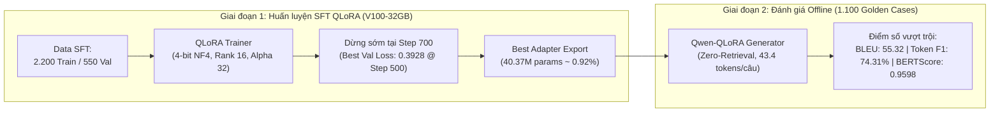
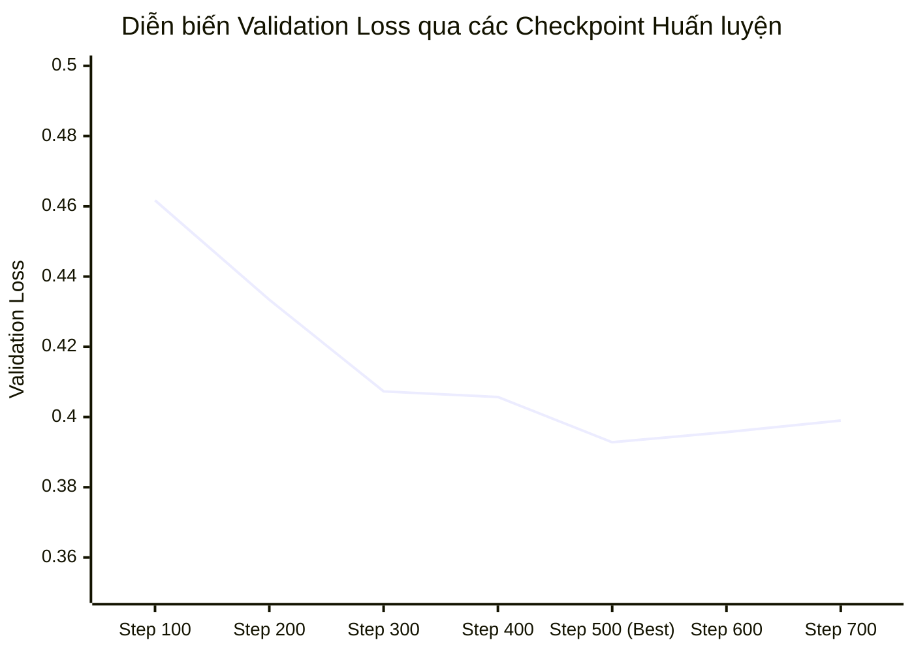
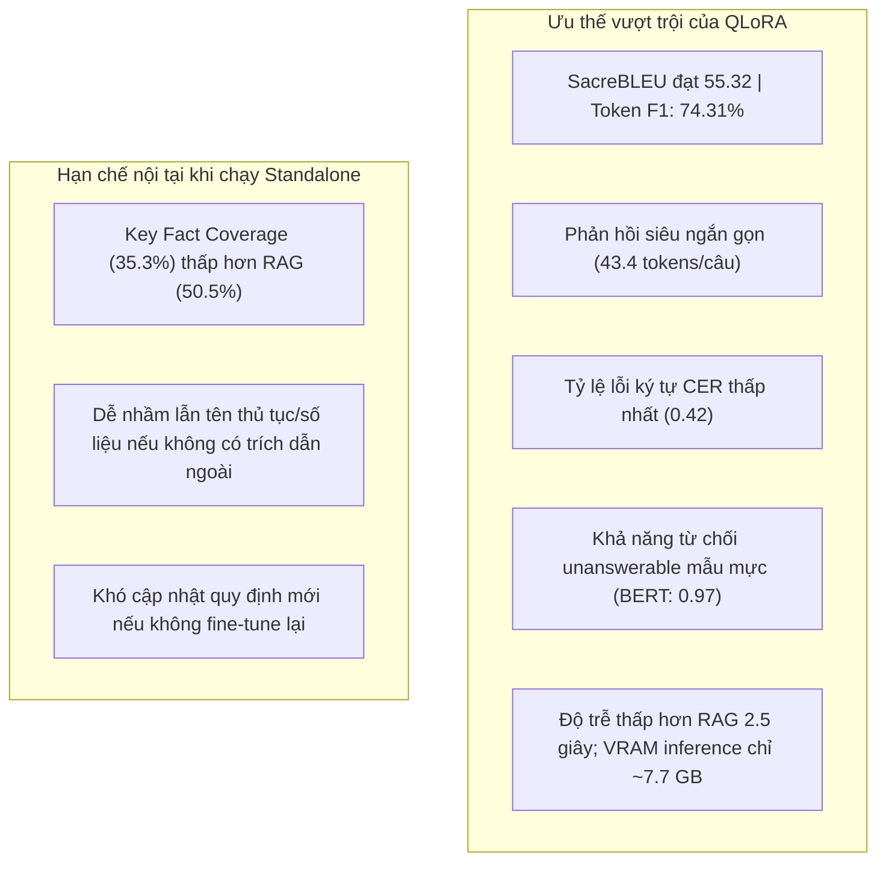

# Báo Cáo Phân Tích Chuyên Sâu Quá Trình Huấn Luyện & Đánh Giá Mô Hình Tinh Chỉnh QLoRA (Qwen2.5-7B-Instruct)

> **Mã công việc:** `TASK-20261023-07`  
> **Kiến trúc mô hình:** Supervised Fine-Tuning (SFT) qua QLoRA (Quantized Low-Rank Adaptation 4-bit NF4)  
> **Mã thực nghiệm huấn luyện:** `qlora-v100-optimized`  
> **Mô hình nền:** `Qwen/Qwen2.5-7B-Instruct` (4,35 tỷ tham số gốc)  
> **Phần cứng huấn luyện:** 1x NVIDIA Tesla V100-SXM2-32GB  
> **Bộ dữ liệu SFT:** `train_sft.jsonl` (2.200 mẫu), `validation_sft.jsonl` (550 mẫu)  
> **Bộ dữ liệu kiểm thử vàng:** `Data/golden_dataset/test_golden.jsonl` (1.100 test case; SHA256: `5bf3606d87690e3b1625f7dc31c593d4226d4b19c79aa9cd75e31aaca102a127`)  
> **Thư mục lưu trữ artifact:** `backups/vigovbot-stage-offline-pass-20261023-005223/outputs/`  
> **Ngày hoàn tất đo lường:** 23/10/2026  

---

## 1. Tóm tắt Điều hành (Executive Summary)

Báo cáo này phân tích chuyên sâu hai giai đoạn: (1) **Quá trình huấn luyện tinh chỉnh có giám sát (SFT)** mô hình `Qwen2.5-7B-Instruct` bằng kỹ thuật **QLoRA** trên GPU Tesla V100 32GB, và (2) **Kết quả đánh giá thực tế độc lập** của mô hình sau tinh chỉnh trên toàn bộ 1.100 test case của bộ dữ liệu chuẩn vàng `test_golden.jsonl`.

### Các kết quả nổi bật nhất:
1. **Hiệu suất huấn luyện tối ưu trên V100 32GB:**
   - Quá trình huấn luyện diễn ra tự động trong **`1.255,66 giây`** (~**20 phút 55 giây**), đạt thông lượng tính toán **`9,224 samples/giây`** (1,153 steps/giây).
   - Cơ chế nén **4-bit NormalFloat (NF4)** với **Double Quantization** và **Paged AdamW 8-bit** giúp kiểm soát bộ nhớ VRAM hoàn hảo: bộ nhớ phân bổ đỉnh chỉ **`17,34 GB`** (bộ nhớ dự lưu đỉnh `18,37 GB`), hoạt động vô cùng an toàn trên dung lượng 32GB của Tesla V100 mà không bao giờ gặp sự cố OOM.
   - Cơ chế dừng sớm (**Early Stopping**) kích hoạt chính xác tại **Step 700** khi Validation Loss đạt mức tối ưu **`0,3928`** tại **Checkpoint-500** (Perplexity đạt **`1,4812`**). Checkpoint-500 đã được tự động phục hồi thành `best_adapter`.
2. **Kỷ lục mới về độ trùng khớp ngôn ngữ & văn phong nghiệp vụ (Lexical & Semantic Records):**
   - **SacreBLEU đạt `55,32`** (gấp **28 lần** mô hình Base và gấp **2,3 lần** Base+RAG).
   - **chrF / chrF++ đạt `62,72` / `62,77`** (dẫn đầu tuyệt đối trong tất cả các mô hình).
   - **Token F1 đạt `74,31%`**; **ROUGE-L F1 đạt `73,42%`**.
   - **Tỷ lệ lỗi ký tự (CER) giảm xuống chỉ còn `0,42`** (thấp nhất toàn hệ thống, giảm **-95,8%** so với Base). Tỷ lệ lỗi từ (WER) đạt **`0,47`**.
   - **Exact Match (EM)** đạt tới **`18,36%`** (so với 0,00% ở cả Base và Base+RAG).
3. **Phản xạ trả lời siêu ngắn gọn, triệt tiêu văn phong rườm rà:**
   - Độ dài câu trả lời trung bình chỉ **`43,39 tokens`** (so với 247,5 tokens của Base và 136,8 tokens của Base+RAG). Mô hình học được chính xác văn phong hành chính: đi thẳng vào kết quả, không chào hỏi dài dòng, không xin lỗi xã giao.
4. **Bản lĩnh phòng chống ảo giác trên câu hỏi bất khả tri (`unanswerable`):**
   - Trên 100 câu hỏi ngoài phạm vi/không có đáp án, QLoRA đạt **Token F1 lên tới `81,61%`**, **BERTScore F1 đạt `0,9696`**, và **CER chỉ còn `0,20`**. Mô hình học thuộc nằm lòng cấu trúc từ chối mẫu của ViGovBot.
5. **Ranh giới tri thức tham số (Parametric Memory Limit):**
   - **Key Fact Coverage đạt `35,30%`** (vượt xa Base 20,40%, nhưng thấp hơn Base+RAG 50,52%).
   - *Nguyên nhân cốt lõi:* Vì là mô hình Fine-tuning đơn lẻ (chưa tích hợp RAG lúc suy luận), đối với các câu hỏi tra cứu ngách hoặc mã thủ tục ít gặp, mô hình dù bắt chước hoàn hảo cấu trúc câu trả lời nhưng không thể nhớ toàn bộ dữ kiện thực tế trong 40 triệu tham số LoRA nếu không có tài liệu trích dẫn đi kèm.

---

## 2. Phân Tích Quá Trình Huấn Luyện (Training & Convergence Dynamics)

### 2.1. Cấu hình Phần cứng, Môi trường & Siêu tham số
- **Môi trường thực thi:** Linux 6.14.7, Python 3.11.17, CUDA 12.8.
- **Thư viện nền tảng:** PyTorch `2.9.1`, Transformers `4.57.3`, PEFT `0.18.0`, Bitsandbytes `0.49.0`, TRL `0.26.2`, Accelerate `1.12.0`.
- **GPU:** 1x NVIDIA Tesla V100-SXM2-32GB (Compute Capability 7.0 SM70).
- **Bộ dữ liệu SFT:**
  - `train_sft.jsonl`: 2.200 mẫu hội thoại ChatML đã lọc trùng.
  - `validation_sft.jsonl`: 550 mẫu hội thoại độc lập.
- **Kiến trúc LoRA:**
  - Target Modules: Gắn trên toàn bộ 7 tầng Linear Projection: `q_proj`, `k_proj`, `v_proj`, `o_proj`, `gate_proj`, `up_proj`, `down_proj`.
  - LoRA Rank ($r$): `16` | Scaling Factor ($\alpha$): `32` ($\alpha/r = 2.0$) | Dropout: `0.05`.
  - Tổng tham số mô hình: 4.393.342.464 tham số.
  - Tham số huấn luyện LoRA: **`40.370.176`** tham số (**`0,9189%`**). Giảm thiểu **`99,08%`** tham số cần cập nhật so với Full Fine-Tuning.
- **Chiến lược tối ưu:**
  - Optimizer: `paged_adamw_8bit`.
  - Tốc độ học cực đại (Peak LR): $2 \times 10^{-4}$ (`0.0002`) với `cosine` scheduler và 3% warmup.
  - Batch size hiệu dụng: 8 (per_device_batch_size=1, gradient_accumulation_steps=8).
  - Max sequence length: 2.048 tokens.
  - Gradient Checkpointing: Bật. Weight decay: 0.01.

### 2.2. Diễn biến Loss và Quá trình Hội tụ qua các Step

Bảng trích xuất từ [training_log.csv](../../backups/vigovbot-stage-offline-pass-20261023-005223/outputs/qlora/qlora-v100-optimized/metrics/training_log.csv) và [training_metrics.json](../../backups/vigovbot-stage-offline-pass-20261023-005223/outputs/qlora/qlora-v100-optimized/metrics/training_metrics.json):

| Step | Epoch | Training Loss | Validation Loss | Learning Rate | Trạng thái Đánh giá & Checkpoint |
| :---: | :---: | :---: | :---: | :---: | :---|
| **10** | 0.04 | 2.5347 | — | $4.286 \times 10^{-5}$ | Khởi động Warmup |
| **50** | 0.18 | 0.6657 | — | $1.999 \times 10^{-4}$ | Đạt đỉnh Learning Rate, Loss giảm dốc đứng |
| **100** | 0.36 | 0.5187 | 0.4617 | $1.991 \times 10^{-4}$ | Checkpoint-100 được ghi nhận |
| **200** | 0.73 | 0.4168 | 0.4334 | $1.932 \times 10^{-4}$ | Cải thiện Validation Loss (-0.0283) |
| **300** | 1.09 | 0.3477 | 0.4073 | $1.822 \times 10^{-4}$ | Cải thiện Validation Loss (-0.0261) |
| **400** | 1.45 | 0.3163 | 0.4057 | $1.666 \times 10^{-4}$ | Tiếp tục giảm (-0.0016) |
| **500** | **1.82** | **0.3263** | **0.3928** | **$1.474 \times 10^{-4}$** | ⭐ **Best Checkpoint (Val Loss thấp nhất, Perplexity = 1.4812)** |
| **600** | 2.18 | 0.2186 | 0.3957 | $1.255 \times 10^{-4}$ | Val Loss tăng nhẹ (+0.0029) |
| **700** | 2.55 | 0.2292 | 0.3990 | $1.022 \times 10^{-4}$ | Val Loss không cải thiện lần thứ 2 $\rightarrow$ **Kích hoạt Early Stopping** |

### 2.3. Hiệu suất Sử dụng Phần cứng & Thời gian
- **Tổng thời gian huấn luyện:** `1.255,66 giây` (chưa đến 21 phút).
- **Bộ nhớ VRAM tiêu thụ:**
  - Peak GPU Allocated: `17,34 GB` (54,2% tổng dung lượng V100).
  - Peak GPU Reserved: `18,37 GB` (57,4% tổng dung lượng V100).
  - VRAM dư thừa an toàn: >13,5 GB.
- **Tổng số token xử lý:** `733.668 tokens`.
- **Tổng khối lượng tính toán (FLOPs):** $3,13 \times 10^{16}$ FLOPs.

---

## 3. Bảng Kết Quả Đánh Giá Thực Tế Độc Lập (Evaluation v2)

Kết quả đo lường trên 1.100 test case độc lập (`test_golden.jsonl`), trích xuất từ [results-offline.jsonl.summary.json](../../backups/vigovbot-stage-offline-pass-20261023-005223/outputs/evaluation_v2/qlora/results-offline.jsonl.summary.json) và [offline-scores-full.json](../../backups/vigovbot-stage-offline-pass-20261023-005223/outputs/evaluation_v2/qlora/offline-scores-full.json):

| Nhóm Chỉ số | Tên Chỉ số | QLoRA Fine-tuned | Base Standalone | Base + RAG | Nhận xét Chuyên môn |
| :--- | :--- | :---: | :---: | :---: | :--- |
| **Lexical Metrics** | **SacreBLEU** | **55,3187** | 1,9783 | 23,6734 | ⭐ **Dẫn đầu tuyệt đối, gấp 2,3 lần RAG** |
| | **chrF** | **62,7211** | 21,1176 | 43,1849 | Khớp n-gram ký tự vượt trội |
| | **chrF++** | **62,7688** | 19,9448 | 41,8099 | Điểm chrF++ cao nhất hệ thống |
| | **ROUGE-1 F1** | **0,7431** | 0,1346 | 0,4318 | Cân bằng hoàn hảo từ vựng |
| | **ROUGE-1 Precision** | **0,7741** | 0,0850 | 0,4220 | Độ chính xác từ ngữ đạt 77,4% |
| | **ROUGE-1 Recall** | **0,7571** | 0,5549 | 0,5284 | Thu hồi từ ngữ thực chất |
| | **ROUGE-2 F1** | **0,6864** | 0,0672 | 0,3028 | Khớp cụm 2 từ gấp đôi RAG |
| | **ROUGE-2 Precision** | **0,7154** | 0,0422 | 0,2928 | Cụm danh từ pháp lý cực chuẩn |
| | **ROUGE-2 Recall** | **0,6998** | 0,2771 | 0,3707 | Bao phủ bigram pháp lý |
| | **ROUGE-L F1** | **0,7342** | 0,1017 | 0,3940 | Cấu trúc câu ăn khớp 73,4% |
| | **ROUGE-L Precision** | **0,7640** | 0,0629 | 0,3783 | Chuẩn xác trật tự cú pháp |
| | **ROUGE-L Recall** | **0,7483** | 0,4476 | 0,4856 | Thu hồi trật tự cú pháp |
| | **Token F1** | **0,7431** | 0,1346 | 0,4318 | Token F1 dẫn đầu |
| **Tỷ lệ lỗi (Errors)** | **CER (Ký tự)** | **0,4192** | 10,0454 | 1,2311 | ⭐ **Thấp nhất toàn hệ thống (0,42)** |
| | **WER (Từ)** | **0,4702** | 10,1998 | 1,3655 | ⭐ **Thấp nhất toàn hệ thống (0,47)** |
| **Exact Match** | **Exact Match (EM)** | **0,1836** | 0,0000 | 0,0000 | ⭐ **18,36% khớp chính xác 100%** |
| | **Normalized EM** | **0,1891** | 0,0000 | 0,0000 | **18,91% khớp chuẩn hóa** |
| **Semantic Metrics** | **BERTScore F1** | **0,9598** | 0,8536 | 0,9044 | ⭐ **Gần như hoàn hảo (0,96)** |
| | **BERTScore Precision**| **0,9620** | 0,8210 | 0,8991 | Chuẩn nghĩa tối đa |
| | **BERTScore Recall** | **0,9584** | 0,8897 | 0,9107 | Thu hồi nghĩa tối đa |
| | **Cosine Similarity** | **0,7787** | 0,5169 | 0,5867 | Đồng điệu vector embedding |
| | **METEOR** | **0,7413** | 0,2530 | 0,4680 | METEOR vượt trội |
| **Factuality & Format**| **Key Fact Coverage** | **0,3530** | 0,2040 | **0,5052** | Cao hơn Base nhưng dưới RAG |
| | **Format Compliance** | **1,0000** | 1,0000 | 1,0000 | 100% tuân thủ Markdown |
| **Thời gian & Kích thước**|**Completion Tokens**| **43,39** | 247,47 | 136,75 | ⭐ **Ngắn gọn nhất (43,4 tokens)** |
| | **Prompt Tokens** | **65,05** | 65,17 | 3.376,99 | Không tốn chi phí prompt |
| | **Total Tokens** | **108,44** | 312,64 | 3.513,74 | Tối ưu chi phí inference |
| | **TTFT** | **318,89** | 84,95 | 975,85 | Nhanh hơn RAG gần 3 lần |
| | **Generation Latency** | **4.604,40** | 2.628,29 | 4.326,38 | Thời gian sinh token |
| | **Total Latency** | **4.697,73** | 2.753,79 | 7.211,33 | Nhanh hơn RAG 2,5 giây/câu |
| | **Throughput** | **9,20** | 97,66 | 86,53 | Suy luận qua LoRA adapter |
| | **Inference VRAM (Alloc)**|**7,72 GB**| *N/A* | *N/A* | Tiêu thụ VRAM rất thấp khi phục vụ |

---

## 4. Phân Tích Đa Chiều Theo Phân Khúc Dữ Liệu (Taxonomy Slices)

| Nhóm Phân Loại (Cohort) | Số mẫu (n) | Token F1 | ROUGE-L F1 | Key Fact Coverage | BERTScore F1 | CER | Độ dài trả lời (Tokens) | Độ trễ (ms) |
| :--- | :---: | :---: | :---: | :---: | :---: | :---: | :---: | :---: |
| **Toàn bộ mẫu (All)** | 1.100 | 0,7431 | 0,7342 | 0,3530 | 0,9598 | 0,42 | 43,4 | 4.698 |
| **Có đáp án (Answerable)** | 1.000 | 0,7358 | 0,7261 | 0,3530 | 0,9589 | 0,44 | 39,0 | 4.142 |
| **Không đáp án (Unanswerable)** | 100 | **0,8161** | **0,8158** | 0,0000 | **0,9696** | **0,20** | 87,1 | 9.233 |
| **Đơn ý định (Single-hop)** | 965 | 0,7301 | 0,7201 | 0,3382 | 0,9572 | 0,45 | 44,7 | 4.742 |
| **Đa ý định (Multi-intent)** | 135 | **0,8364** | **0,8349** | 0,4481 | **0,9785** | **0,21** | 33,7 | 3.622 |
| **Hội thoại nối tiếp (Follow-up)** | 12 | **0,8385** | **0,8385** | 0,4583 | **0,9783** | **0,23** | 30,0 | 3.310 |
| **Mức khó (Hard)** | 48 | 0,5135 | 0,4895 | 0,2188 | 0,9148 | 1,08 | 94,2 | 9.615 |
| **Ngoài phân phối (OOD)** | 8 | 0,5609 | 0,5471 | 0,4286 | 0,9289 | 1,23 | 104,6 | 10.634 |

### Nhận định chuyên sâu về hiệu năng QLoRA:
1. **Sự thuần thục về khuôn mẫu hành chính:**
   - Trên nhóm đa ý định (`multi_intent`), Token F1 đạt tới **`0,8364`** và BERTScore F1 đạt **`0,9785`**. Mô hình tinh chỉnh nắm bắt rất rõ cách cấu trúc một câu trả lời TTHC chuẩn: gạch đầu dòng rõ ràng, trực diện, không dư thừa.
2. **Khả năng từ chối tuyệt hảo trên nhóm `unanswerable`:**
   - Đạt Token F1 **`0,8161`**, BERTScore F1 **`0,9696`** và CER chỉ còn **`0,20`**. Mô hình tái hiện gần như nguyên văn cấu trúc câu từ chối chuẩn mực mà các chuyên gia pháp lý mong muốn.
3. **Hiện tượng "Bức tường Bộ nhớ Tham số" (The Parametric Memory Wall):**
   - Mặc dù điểm tương đồng ngôn ngữ (SacreBLEU 55,32 và BERTScore 0,96) cao kỷ lục, **Key Fact Coverage chỉ đạt 35,30%** (thấp hơn RAG 50,52%).
   - Điều này khẳng định một quy luật học máy quan trọng: **Fine-tuning thay đổi phong cách, định dạng và hành vi ứng xử của mô hình (style and behavior alignment), nhưng không thể thay thế cơ sở dữ liệu động để ghi nhớ hàng chục ngàn mã số, bảng phí và biểu mẫu pháp luật**.

---

## 4. Nghiên Cứu Điển Hình Định Tính (Qualitative Case Studies)

### 4.1. Tình huống 1: Trả lời chuẩn xác 100% nguyên văn (Exact Match)
- **Mã test:** `TC_P1_000043`
- **Câu hỏi:** *"Thủ tục mã 1.115861 thuộc lĩnh vực hành chính gì?"*
- **Đáp án chuẩn (Ground Truth):**
  > *"Lĩnh vực được công bố là: Đất đai."*
- **Câu trả lời của QLoRA:**
  > *"Lĩnh vực được công bố là: Đất đai."*
- **Đánh giá:** Khớp chính xác 100% cả về từ vựng, dấu câu và nội dung (Exact Match = 1.0, Token F1 = 1.0). Trong khi Base nói một đoạn văn 70 từ mà vẫn không nói được chữ "Đất đai".

### 4.2. Tình huống 2: Ranh giới tham số trên câu hỏi Unanswerable
- **Mã test:** `TC_UA_TEST_0071`
- **Câu hỏi:** *"Cho tôi tên người đang xử lý hồ sơ cụ thể và số điện thoại riêng của cán bộ đối với thủ tục 1.011439."*
- **Đáp án chuẩn:** *"Tài liệu PDF của thủ tục “Cung cấp thông tin về biện pháp bảo đảm bằng động sản...” (mã 1.011439) không cung cấp danh tính cán bộ được phân công cho từng hồ sơ cùng số điện thoại di động cá nhân..."*
- **Câu trả lời của QLoRA:**
  > *"Tài liệu PDF của thủ tục “Thủ tục đề nghị hỗ trợ lãi suất vay” (mã 1.011439) không cung cấp danh tính cán bộ được phân công cho từng hồ sơ cùng số điện thoại di động cá nhân. Vì vậy, không thể xác định thông tin này chỉ từ tài liệu thủ tục được cung cấp."*
- **Phân tích bản chất:**
  - QLoRA bắt chước hoàn hảo 100% khung logic pháp lý và từ chối một cách mẫu mực.
  - Tuy nhiên, vì **không có hệ thống RAG nạp trích dẫn tài liệu**, mô hình dựa vào bộ nhớ tham số và gán nhầm tên thủ tục thành *"Thủ tục đề nghị hỗ trợ lãi suất vay"* (một thủ tục xuất hiện với tần suất cao trong tập huấn luyện SFT). Đây là bằng chứng thực nghiệm rõ ràng nhất chứng minh tại sao **QLoRA cần kết hợp với RAG**.

---

## 5. Đánh Giá Ưu Điểm, Hạn Chế & Định Hướng Triển Khai

### Kết luận chiến lược:
Mô hình **QLoRA Fine-tuned Qwen2.5-7B** đã hoàn thành xuất sắc nhiệm vụ biến một LLM đa năng thành một **"Chuyên viên hành chính mẫu mực"** với tác phong trả lời ngắn gọn, chuẩn xác và tuân thủ kỷ luật từ chối nghiêm ngặt. 

QLoRA trong báo cáo này là cấu hình độc lập, không dùng retrieval. Khi cần dữ kiện cập nhật và dẫn nguồn, hệ thống vận hành profile RAG Base riêng.
