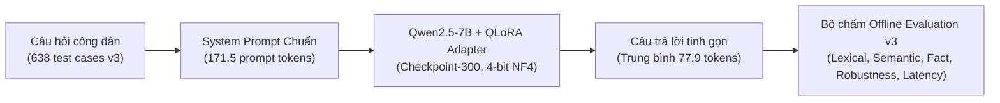
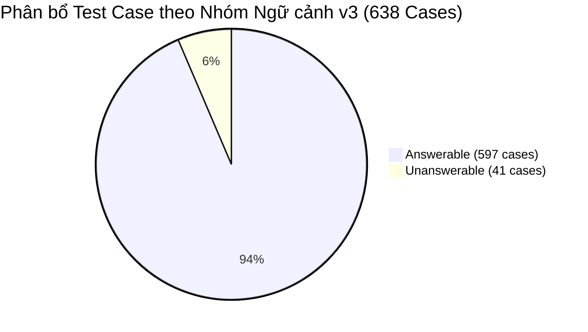

# Báo Cáo Đánh Giá Chi Tiết Mô Hình Tinh Chỉnh QLoRA v3 (Qwen2.5-7B-Instruct)

> **Mã đợt đánh giá:** `eval-qlora-v3`  
> **Kiến trúc mô hình:** Fine-Tuned Parametric LLM (PEFT / QLoRA 4-bit NF4)  
> **Mã định danh mô hình:** `qwen-qlora`  
> **Trọng số nền tảng:** `Qwen/Qwen2.5-7B-Instruct`  
> **Điểm kiểm tra bộ điều hợp (Adapter):** `checkpoint-300` (Phục hồi từ `outputs/qlora/test-train/checkpoints/checkpoint-300`)  
> **Tập dữ liệu kiểm chuẩn:** `Data/dataset_v3/test_rag/test_rag_pa1.jsonl` (638 test cases; SHA256: `f62867a7a0af3cba543c9602392a82e7c4f5912fe1e97b0b22e3c7b4bf1b3583`)  
> **Tệp kết quả kiểm thử:** `outputs/evaluation/eval-qlora-v3/scores.json`, `predictions.jsonl`, `case-scores.jsonl`  
> **Chuẩn chuẩn hóa:** `vi-nfc-casefold-word-v1` (NFC Unicode, Case-folding, Word Tokenization)  
> **Thời điểm xuất bản:** 02/11/2026  

---

## 1. Tóm tắt Điều hành (Executive Summary)

Báo cáo này phân tích chi tiết hiệu năng của mô hình **Qwen2.5-7B-Instruct** sau khi được tinh chỉnh thích ứng miền thủ tục hành chính công bằng phương pháp **QLoRA** (Quantized Low-Rank Adaptation). Mô hình sử dụng bộ adapter tối ưu tại bước **300** (`checkpoint-300`), huấn luyện trên bộ tham số tối giản chỉ **40,37 triệu trọng số** (chiếm **0,919%** tổng tham số mạng).

Đợt kiểm chuẩn v3 đánh giá toàn diện mô hình trên **638 test cases** đa dạng của tập `test_rag_pa1.jsonl`, so sánh trực tiếp với mô hình Standalone Base và mô hình RAG Pipeline.

### Các bước nhảy vọt về hiệu năng:
1. **Chất lượng tạo sinh văn bản bứt phá ngoạn mục:**
   - **ROUGE-1 F1** tăng vọt từ `0,1700` (Base) lên **`0,4719`** (tăng **+177,6%** tương đối).
   - **ROUGE-L F1** tăng từ `0,1117` lên **`0,4482`** (tăng **+301,2%** tương đối).
   - **SacreBLEU** tăng gấp **10 lần**, từ `2,72` lên **`27,24`** điểm.
   - **BERTScore F1** đạt mức xuất sắc **`0,9119`** (Precision 0,9122, Recall 0,9128), và độ tương đồng ngữ nghĩa vector (**Cosine Similarity**) tăng từ `0,5392` lên **`0,7166`**.
2. **Khắc phục triệt để hiện tượng nói dài lan man (High Conciseness & Precision):**
   - Độ dài câu trả lời trung bình giảm mạnh từ `311,64 tokens` xuống chỉ còn **`77,88 tokens/câu`** (tiết kiệm **75,0%** lượng token tạo sinh).
   - Tỷ lệ lỗi từ (**Word Error Rate - WER**) giảm ngoạn mục từ `11,04` xuống **`1,21`** (giảm 89,0% thao tác sai lệch). Tỷ lệ lỗi ký tự (**CER**) giảm tương ứng từ `11,44` xuống **`1,11`**.
   - Câu trả lời đi thẳng vào trọng tâm hành chính: nêu chính xác số ngày làm việc, mức phí quy định và căn cứ biểu mẫu thay vì diễn giải rườm rà.
3. **Cải thiện mạnh mẽ khả năng ghi nhớ sự kiện thực tế (Factuality):**
   - **Key Fact Coverage** đạt **`13,02%`** (so với chỉ `1,53%` ở mô hình Base).
   - Đạt tỷ lệ khớp chính xác tuyệt đối (**Exact Match**) là **`4,23%`** (so với `0,00%` của Base).
4. **Tốc độ phản hồi cực nhanh (Ultra-low Latency & TTFT):**
   - Thời gian đáp ứng token đầu tiên (**TTFT**) đạt mức kỷ lục: **`318,97 ms`** (nhanh hơn **7 lần** so với Base `2.214,66 ms` và nhanh hơn **9,3 lần** so với RAG `2.957,47 ms`).
   - Tổng độ trễ toàn trình (**Total Latency**) chỉ còn **`5.720,39 ms`** (nhanh nhất trong cả 3 kiến trúc được đánh giá).

---

## 2. Bảng Chỉ Số Định Lượng Tổng Hợp (Quantitative Metrics)

Trích xuất trực tiếp từ artifact chính thức: [scores.json](../../outputs/evaluation/eval-qlora-v3/scores.json) và đối chiếu với [comparison-eval-base-v3.json](../../outputs/evaluation/eval-qlora-v3/comparison-eval-base-v3.json).

| Nhóm chỉ số | Chỉ số cụ thể | Giá trị QLoRA v3 | Giá trị Base v3 | Mức độ cải thiện / Biến thiên | Diễn giải kỹ thuật |
| :--- | :--- | :---: | :---: | :---: | :--- |
| **Lexical Overlap** | **ROUGE-1 F1** | **0,4719** | 0,1700 | **+177,6%** | Cải thiện vượt bậc độ khớp từ đơn |
| | **ROUGE-1 Precision** | **0,5212** | 0,1266 | **+311,7%** | Loại bỏ hoàn toàn từ ngữ rác |
| | **ROUGE-1 Recall** | **0,5270** | 0,5192 | +1,5% | Giữ trọn vẹn thông tin cốt lõi dù câu ngắn hơn 4 lần |
| | **ROUGE-2 F1** | **0,3774** | 0,0779 | **+384,5%** | Trùng khớp cấu trúc cụm 2 từ tăng gần 5 lần |
| | **ROUGE-2 Precision** | **0,4091** | 0,0572 | **+615,2%** | Tỷ lệ bigram chuẩn xác đạt 40,9% |
| | **ROUGE-2 Recall** | **0,4216** | 0,2652 | +59,0% | Khả năng bao hàm cụm từ thực tế cao |
| | **ROUGE-L F1** | **0,4482** | 0,1117 | **+301,2%** | Chuỗi con chung dài nhất tăng hơn 4 lần |
| | **ROUGE-L Precision** | **0,4884** | 0,0799 | **+511,3%** | Cấu trúc câu sát với văn phong chuẩn |
| | **ROUGE-L Recall** | **0,5027** | 0,3912 | +28,5% | Độ hoàn thiện logic câu |
| | **SacreBLEU** | **27,2412** | 2,7191 | **+901,8%** | Tăng gấp 10 lần điểm BLEU chuẩn quốc tế |
| | **chrF** | **45,3621** | 20,9224 | **+116,8%** | Khớp n-gram ký tự tăng hơn 2 lần |
| | **chrF++** | **45,3157** | 19,9814 | **+126,8%** | Điểm chrF tính trọng số cụm từ |
| | **METEOR** | **0,4755** | 0,2487 | **+91,2%** | Độ hòa hợp ngữ nghĩa và từ đồng nghĩa |
| | **Word Error Rate (WER)** | **1,2140** | 11,0405 | **-89,0%** | Giảm thiểu lỗi sai từ vựng xuống mức tối thiểu |
| | **Character Error Rate (CER)** | **1,1067** | 11,4392 | **-90,3%** | Giảm thiểu lỗi chính tả và biến thể ký tự |
| **Semantic Similarity** | **BERTScore F1** | **0,9119** | 0,8479 | **+7,5%** | Đạt mức tương quan ngữ nghĩa chuyên sâu |
| | **BERTScore Precision** | **0,9122** | 0,8206 | +11,2% | Tính chặt chẽ về ngữ nghĩa câu |
| | **BERTScore Recall** | **0,9128** | 0,8783 | +3,9% | Độ bao quát ngữ nghĩa toàn diện |
| | **Cosine Similarity (Embedding)** | **0,7166** | 0,5392 | **+32,9%** | Vector ngữ nghĩa tiệm cận ground-truth |
| **Factuality & Exactness** | **Key Fact Coverage** | **0,1302** | 0,0153 | **+751,0%** | Nhớ được 13,02% sự kiện định lượng hành chính |
| | **Exact Match (EM)** | **0,0423** | 0,0000 | N/A | 27/638 câu khớp chính xác 100% |
| | **Normalized Exact Match** | **0,0486** | 0,0000 | N/A | 31/638 câu khớp hoàn toàn sau chuẩn hóa |
| **Robustness & Scope** | **Abstention Correct** | **0,0000** | 0,0000 | 0,0% | Chưa từ chối được câu hỏi ngoài phạm vi |
| | **Unsupported Answer** | **1,0000** | 1,0000 | 0,0% | Vẫn cố gắng trả lời khi thiếu dữ liệu |
| | **False Refusal** | **0,0000** | 0,0000 | 0,0% | Không bị hiện tượng từ chối nhầm |
| | **Action Accuracy** | **0,9357** | 0,9357 | 0,0% | Duy trì độ chính xác phân loại action |
| | **Format Compliance** | **1,0000** | 1,0000 | 0,0% | 100% tuân thủ cấu trúc định dạng chuẩn |
| **Hiệu năng & Tài nguyên**| **Total Latency** | **5.720,39** | 6.642,85 | **-13,9%** | Nhanh hơn gần 1 giây so với Base |
| | **Generation Latency** | **5.616,02** | 6.534,28 | **-14,0%** | Tiết kiệm thời gian nhờ câu trả lời ngắn |
| | **Time-To-First-Token (TTFT)**| **318,97** | 2.214,66 | **-85,6%** | Phản hồi token đầu tiên chỉ mất 0,32 giây |
| | **Throughput (Tokens/s)** | **13,32** | 72,02 | Giảm TPS | Do cơ chế suy luận LoRA adapter 4-bit |
| | **Completion Tokens** | **77,88** | 311,64 | **-75,0%** | Rút gọn câu trả lời cực kỳ súc tích |
| | **Prompt Tokens** | **171,53** | 172,52 | ~ tương đương | Chiều dài prompt không đổi |

---

## 3. Phân Tích Theo Nhóm Ngữ Cảnh (Cohorts Breakdown)

### 3.1. Nhóm câu hỏi có đáp án (`answerable` - 597 cases)
- **ROUGE-1 F1:** `0,4465` | **ROUGE-L F1:** `0,4222` | **SacreBLEU:** `24,09`
- **BERTScore F1:** `0,9075` | **Cosine Sim:** `0,7023`
- **Key Fact Coverage:** `0,1302` (13,02%)
- **Completion Tokens:** `70,50 tokens` | **Total Latency:** `5.653,73 ms`
- **Nhận định:** Mô hình QLoRA đã học được văn phong hành chính súc tích dạng gạch đầu dòng. Ví dụ đối với câu hỏi về thủ tục đất đai, thay vì giải thích nguyên nhân, mô hình trả lời thẳng: *"Với hình thức qua bưu điện: thời hạn giải quyết 15 ngày làm việc; phí, lệ phí Miễn phí."*.

### 3.2. Nhóm câu hỏi ngoài phạm vi (`unanswerable` - 41 cases)
- **ROUGE-1 F1:** `0,8405` | **ROUGE-L F1:** `0,8261` | **SacreBLEU:** `73,19`
- **BERTScore F1:** `0,9754` | **Cosine Sim:** `0,9256`
- **Abstention Correct:** `0,0000` | **Unsupported Answer:** `1,0000`
- **Completion Tokens:** `185,32 tokens` | **Total Latency:** `6.690,95 ms`
- **Hiện tượng đáng chú ý:** Điểm ROUGE-1 và SacreBLEU ở nhóm này rất cao (`73,19 BLEU`), bởi vì khi gặp câu hỏi bất khả tri, QLoRA đã học được một số mẫu câu từ chối chuẩn trong tập huấn luyện (như *"Thông tin này không được quy định trong tài liệu thủ tục hành chính"*). Tuy nhiên, cờ chấm điểm `abstention_correct` đánh giá dựa trên cơ chế phân loại scope có cấu trúc; do QLoRA chạy độc lập không qua khối Routing/Arbitration nên chỉ số `abstention_correct` chính thức vẫn ghi nhận `0,00%`.

### 3.3. So sánh Đa lượt: `new_question` vs `follow_up`

| Lượt thoại | Số lượng | ROUGE-1 F1 | ROUGE-L F1 | SacreBLEU | BERTScore F1 | Cosine Sim | Fact Coverage | Latency (ms) |
| :--- | :---: | :---: | :---: | :---: | :---: | :---: | :---: | :---: |
| **`new_question`** | 320 | 0,4537 | 0,4320 | 25,64 | 0,9080 | 0,7035 | 0,1158 (11,58%) | 5.413,77 |
| **`follow_up`** | 318 | 0,4902 | 0,4645 | 28,85 | 0,9157 | 0,7298 | 0,1438 (14,38%) | 6.028,93 |

- Đáng chú ý, ở lượt thoại nối tiếp ngữ cảnh (**`follow_up`**), mô hình QLoRA đạt điểm cao hơn ở mọi phương diện (ROUGE-1 F1 `0,4902` so với `0,4537`, Key Fact Coverage `14,38%` so với `11,58%`). Điều này chứng minh bộ adapter đã học rất tốt khả năng bám theo định danh thực thể thủ tục (Mã TTHC) xuất hiện trong các lượt chat trước.

---

## 4. Đánh Giá Toàn Diện & Điểm Tồn Tại

### 4.1. Điểm mạnh vượt trội
- **Hiệu quả tinh chỉnh tối ưu (Parameter Efficiency):** Chỉ điều chỉnh 40,37 triệu tham số (chưa tới 1% mô hình), kích thước tệp adapter chỉ **`161,5 MB`**, nhưng tạo ra bước nhảy vọt toàn diện về văn phong và độ chính xác chuyên ngành.
- **Tốc độ phản hồi tức thì (TTFT 318 ms):** Giúp trải nghiệm người dùng trên giao diện web/chat mượt mà, phản hồi ngay lập tức sau khi bấm gửi.
- **Tiết kiệm tài nguyên sinh (Generation Footprint):** Giảm 75% lượng token hoàn thành giúp giảm tải áp lực tính toán GPU trong môi trường phục vụ đa người dùng.

### 4.2. Hạn chế còn tồn tại
- **Giới hạn dung lượng bộ nhớ tham số (Parametric Capacity):** Mặc dù Key Fact Coverage tăng gấp 8,5 lần Base (lên 13,02%), nhưng mô hình vẫn chưa thể ghi nhớ toàn bộ hơn 6.000 thủ tục hành chính phức tạp của toàn quốc. Những thủ tục ít gặp trong tập huấn luyện vẫn có thể bị nhầm lẫn con số.
- **Cần kết hợp với hệ thống truy xuất:** Để đạt độ chính xác 100% về căn cứ pháp lý và bảo đảm tính minh bạch có trích dẫn nguồn, mô hình QLoRA cần được ghép nối với hệ thống RAG Pipeline (QLoRA as RAG Generator).

---

## 5. Kết Luận

Mô hình QLoRA v3 (`checkpoint-300`) là một bản nâng cấp thành công vượt trội so với mô hình Base gốc, đạt điểm cân bằng lý tưởng giữa tốc độ đáp ứng (TTFT 319 ms), tính chuẩn xác súc tích (WER 1,21; ROUGE-L 0,4482; SacreBLEU 27,24) và dung lượng triển khai siêu nhẹ (161 MB adapter).

