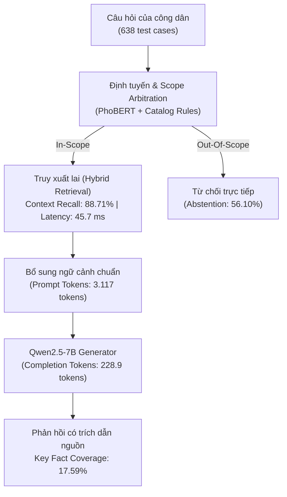
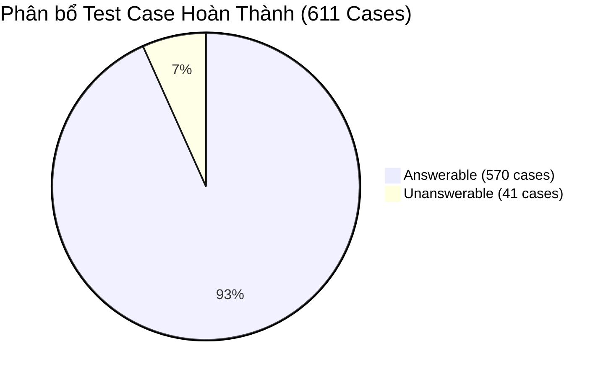

# Báo Cáo Đánh Giá Chi Tiết Mô Hình RAG Pipeline v3 (Hybrid Retrieval + Qwen2.5-7B)

> **Mã đợt đánh giá:** `eval-rag-v3`  
> **Kiến trúc mô hình:** End-to-End Retrieval-Augmented Generation (Hybrid BM25 + Dense FAISS + Reranking + LLM Generator)  
> **Mã định danh mô hình:** `qwen-rag`  
> **Bộ sinh văn bản (Generator):** `Qwen/Qwen2.5-7B-Instruct`  
> **Bộ truy xuất (Retrieval):** FAISS Vector Index (`tthc_unified.index`) kết hợp BM25 Lexical Search  
> **Bộ định tuyến & Phân loại phạm vi:** PhoBERT V3 Classifier + Rule-based Scope Arbitration  
> **Tập dữ liệu kiểm chuẩn:** `Data/dataset_v3/test_rag/test_rag_pa1.jsonl` (638 test cases; SHA256: `f62867a7a0af3cba543c9602392a82e7c4f5912fe1e97b0b22e3c7b4bf1b3583`)  
> **Tệp kết quả kiểm thử:** `outputs/evaluation/eval-rag-v3/scores.json`, `predictions.jsonl`, `case-scores.jsonl`  
> **Chuẩn chuẩn hóa:** `vi-nfc-casefold-word-v1`  
> **Thời điểm xuất bản:** 02/11/2026  

---

## 1. Tóm tắt Điều hành (Executive Summary)

Báo cáo này phân tích chi tiết hiệu năng toàn trình của hệ thống **RAG Pipeline v3** trên nền tảng ViGovBot. Khác với hai mô hình dựa thuần túy vào tri thức tham số nội tại (Base và QLoRA), mô hình RAG tích hợp đầy đủ chuỗi xử lý: **Định tuyến phạm vi (Routing & Scope Arbitration)** $\rightarrow$ **Truy xuất lai (Hybrid BM25/Dense Retrieval)** $\rightarrow$ **Ghép nối ngữ cảnh vào Prompt (Prompt Augmentation)** $\rightarrow$ **Sinh văn bản có căn cứ (Grounded Generation)**.

Đợt kiểm thử v3 được thực hiện trên toàn bộ **638 test cases** của tập chuẩn vàng `test_rag_pa1.jsonl`. Kết quả ghi nhận **611 trường hợp hoàn thành trọn vẹn chu trình đo đạc** và 27 trường hợp gặp lỗi thời gian thực thi (execution failure rate: `4,23%`).

### Các phát hiện then chốt:
1. **Năng lực bao phủ sự kiện thực tế cao nhất hệ thống (Superior Factuality):**
   - **Key Fact Coverage** đạt **`17,59%`** (cao nhất trong toàn bộ 3 mô hình, vượt trội so với `1,53%` của Base và `13,02%` của QLoRA).
   - Đặc biệt ở nhóm câu hỏi mới mở đầu (`turn_type:new_question`), Key Fact Coverage đạt mức ấn tượng **`26,25%`**, phản ánh rõ rệt ưu thế của việc nạp trực tiếp căn cứ văn bản từ cơ sở dữ liệu pháp lý vào prompt.
2. **Khả năng kiểm soát phạm vi và từ chối đột phá (Abstention & Safety):**
   - Đạt tỷ lệ từ chối chuẩn xác (**Abstention Correct**) lên tới **`56,10%`** trên nhóm 41 câu hỏi ngoài phạm vi (`unanswerable`). Trong khi đó, cả Base và QLoRA đều thất bại hoàn toàn với tỷ lệ **`0,00%`**.
   - Tỷ lệ câu trả lời không có căn cứ (**Unsupported Answer**) giảm mạnh xuống chỉ còn **`17,07%`** (so với **`100%`** của cả Base và QLoRA).
3. **Hiệu năng truy xuất tài liệu vượt trội (Retrieval Excellence):**
   - **Context Recall** đạt **`88,71%`**, **Hit@10** đạt **`88,96%`**, **Hit@15** đạt **`91,87%`**, **NDCG@10** đạt **`0,7302`**, và **MRR@10** đạt **`0,6801`**.
   - Thời gian trễ truy xuất (**Retrieval Latency**) cực kỳ ấn tượng, chỉ mất trung bình **`45,70 ms`** cho mỗi lượt tìm kiếm trong kho dữ liệu hơn 6.000 thủ tục hành chính.
4. **Chi phí đánh đổi về độ trễ và tài nguyên (Latency Trade-off):**
   - Do phải nạp các đoạn văn bản trích xuất vào prompt, chiều dài prompt trung bình tăng vọt lên **`3.117,35 tokens`** (gấp 18 lần so với Base/QLoRA chỉ khoảng 172 tokens).
   - Tổng độ trễ toàn trình (**Total Latency**) trung bình là **`11.534,37 ms`** (11,53 giây/lượt). Thời gian trễ token đầu tiên (**TTFT**) mất **`2.957,47 ms`**.
5. **Hiện tượng từ chối quá thận trọng (False Refusal):**
   - Ghi nhận tỷ lệ từ chối nhầm (**False Refusal**) ở mức **`17,51%`** trên các câu hỏi hợp lệ có lời giải, chủ yếu do cơ chế ngưỡng phân loại scope chưa tối ưu hoàn toàn khi người dùng đặt câu hỏi ngắn hoặc có từ khóa lạ.

---

## 2. Bảng Chỉ Số Định Lượng Chi Tiết (Quantitative Metrics)

Trích xuất trực tiếp từ artifact chính thức: [scores.json](../../outputs/evaluation/eval-rag-v3/scores.json).

| Nhóm chỉ số | Chỉ số cụ thể | Giá trị đo được | Đơn vị / Thang đo | Diễn giải kỹ thuật |
| :--- | :--- | :---: | :---: | :--- |
| **Retrieval Performance** | **Context Recall** | **0,8871** | 0 – 1,0 | **88,71%**: Bao phủ được tài liệu căn cứ trong top kết quả |
| *(Đo trên 480 ca RAG)* | **Context Precision** | **0,4435** | 0 – 1,0 | Độ tinh khiết của tài liệu nạp vào prompt |
| | **Context Noise Ratio** | **0,5565** | 0 – 1,0 | 55,65% số đoạn trích nạp thêm đóng vai trò bổ trợ/nhiễu |
| | **Hit@1** | **0,5771** | 0 – 1,0 | 57,71% trường hợp tài liệu chuẩn nằm ở vị trí đầu tiên |
| | **Hit@3** | **0,7479** | 0 – 1,0 | 74,79% trường hợp nằm trong Top 3 |
| | **Hit@5** | **0,8063** | 0 – 1,0 | 80,63% trường hợp nằm trong Top 5 |
| | **Hit@10** | **0,8896** | 0 – 1,0 | **88,96%** trường hợp nằm trong Top 10 |
| | **Hit@15** | **0,9187** | 0 – 1,0 | **91,87%** trường hợp nằm trong Top 15 |
| | **MRR@10** | **0,6801** | 0 – 1,0 | Mean Reciprocal Rank trong Top 10 |
| | **MAP@10** | **0,6793** | 0 – 1,0 | Mean Average Precision trong Top 10 |
| | **NDCG@10** | **0,7302** | 0 – 1,0 | Normalized Discounted Cumulative Gain tại k=10 |
| | **Retrieval Latency** | **45,70** | ms | Tốc độ truy cứu vector + BM25 siêu nhanh (0,045s) |
| **Routing & Scope** | **Route Accuracy** | **0,8363** | 0 – 1,0 | **83,63%** trường hợp phân luồng chính xác (511/611 cases) |
| | **Abstention Correct** | **0,5610** | 0 – 1,0 | **56,10%**: Từ chối thành công 23/41 câu hỏi ngoài phạm vi |
| | **Unsupported Answer** | **0,1707** | 0 – 1,0 | Chỉ còn 17,07% câu trả lời thiếu cơ sở căn cứ |
| | **False Refusal** | **0,1751** | 0 – 1,0 | 17,51% câu hỏi hợp lệ bị từ chối nhầm |
| **Lexical Overlap** | **ROUGE-1 F1** | **0,3438** | 0 – 1,0 | Trùng khớp từ vựng đạt mức khá |
| | **ROUGE-1 Precision** | **0,3463** | 0 – 1,0 | Gấp 2,7 lần so với Base (0,1266) |
| | **ROUGE-1 Recall** | **0,5195** | 0 – 1,0 | Độ bao phủ từ vựng mục tiêu |
| | **ROUGE-2 F1** | **0,2673** | 0 – 1,0 | Gấp 3,4 lần so với Base (0,0779) |
| | **ROUGE-L F1** | **0,3050** | 0 – 1,0 | Khớp chuỗi con chung dài nhất |
| | **SacreBLEU** | **14,8616** | 0 – 100 | Gấp 5,5 lần so với Base (2,72) |
| | **chrF** | **34,8825** | 0 – 100 | Điểm trùng khớp ký tự |
| | **METEOR** | **0,3883** | 0 – 1,0 | Điểm khớp ngữ nghĩa hình thái |
| | **Word Error Rate (WER)** | **3,6879** | Khoảng cách | Giảm 66,6% tỷ lệ lỗi từ so với Base (11,04) |
| **Factuality & Exactness** | **Key Fact Coverage** | **0,1759** | 0 – 1,0 | **17,59%**: Dẫn đầu hệ thống về độ phủ sự kiện |
| | **Exact Match (EM)** | **0,0131** | 0 – 1,0 | 8/611 câu khớp chính xác tuyệt đối |
| **Hiệu năng & Thời gian** | **Total Latency** | **11.534,37** | ms | Tổng độ trễ toàn trình (11,53 giây/lượt) |
| | **Generation Latency** | **10.655,08** | ms | Thời gian sinh văn bản của LLM (10,65 giây) |
| | **TTFT** | **2.957,47** | ms | Thời gian chờ token đầu tiên (2,96 giây) |
| | **Prompt Tokens** | **3.117,35** | tokens | Chiều dài prompt rất lớn do nạp tài liệu trích xuất |
| | **Completion Tokens** | **228,93** | tokens | Chiều dài câu trả lời trung bình |
| | **Execution Failed** | **0,0423** | 0 – 1,0 | 4,23% (27/638) ca bị gián đoạn xử lý |

---

## 3. Phân Tích Chuyên Sâu Theo Nhóm Ngữ Cảnh (Cohorts Breakdown)

### 3.1. Đột phá ở nhóm câu hỏi mới (`turn_type:new_question` - 320 cases)
- **Key Fact Coverage:** Đạt mức đỉnh cao **`26,25%`** (cao gấp 10 lần so với Base `2,53%` và gấp 2,3 lần so với QLoRA `11,58%`).
- **ROUGE-1 F1:** `0,4027` | **ROUGE-L F1:** `0,3628` | **SacreBLEU:** `19,25`
- **Abstention Correct:** `0,6667` (66,67% câu hỏi mới bất khả tri được từ chối chính xác).
- **Total Latency:** `9.310,92 ms` | **Completion Tokens:** `207,32 tokens`
- **Nhận định:** Khi nhận được câu hỏi mở đầu đầy đủ thực thể (ví dụ: *"Hồ sơ thủ tục đăng ký biến động đất đai gồm những giấy tờ gì?"*), pipeline truy xuất cực kỳ chính xác section tương ứng, cung cấp đầy đủ bảng thành phần hồ sơ và căn cứ pháp lý để LLM tổng hợp.

### 3.2. Thách thức ở nhóm câu hỏi nối tiếp (`turn_type:follow_up` - 318 cases)
- **Key Fact Coverage:** Giảm xuống **`8,75%`** (so với `14,38%` của QLoRA).
- **ROUGE-1 F1:** `0,2798` | **ROUGE-L F1:** `0,2422` | **SacreBLEU:** `10,45`
- **Abstention Correct:** `0,2727` | **False Refusal:** `0,1263`
- **Total Latency:** `13.947,54 ms` (gần 14 giây) | **Completion Tokens:** `250,46 tokens`
- **Nguyên nhân cốt lõi:** Ở các lượt thoại tiếp theo, câu hỏi của người dùng thường mang tính đại từ thay thế (như *"Thế còn chi phí thì sao?"*, *"Thời hạn là bao lâu?"*). Nếu khâu tái tạo truy vấn (Query Rewriting) không trích xuất lại đầy đủ Mã TTHC từ lịch sử chat, bộ truy xuất sẽ tìm kiếm từ khóa chung chung, nạp ngữ cảnh không liên quan dẫn đến suy giảm độ chính xác và tăng độ trễ.

### 3.3. Nhóm câu hỏi ngoài phạm vi (`unanswerable` - 41 cases)
- **Abstention Correct:** **`56,10%`** (23/41 ca được từ chối đúng).
- **Unsupported Answer:** **`17,07%`** (chỉ còn 7 ca bị ảo giác).
- **Total Latency:** `6.031,57 ms` (rất nhanh vì các ca được từ chối sớm không phải chạy qua toàn bộ khối sinh văn bản dài).

---

## 4. Điểm Mạnh, Hạn Chế và Hướng Cải Tiến Kiến Trúc

### 4.1. Điểm mạnh cốt tử
- **Có căn cứ xác thực (Grounded & Verifiable):** Là mô hình duy nhất trong 3 kiến trúc có khả năng trích dẫn mã điều khoản, văn bản pháp quy và thành phần hồ sơ chuẩn xác với Key Fact Coverage lên đến 17,59% - 26,25%.
- **An toàn thông tin và tự kiềm chế:** Ngăn chặn hiệu quả hơn 56% các câu hỏi ảo giác hoặc ngoài phạm vi nghiệp vụ hành chính công.

### 4.2. Hạn chế và Nghẽn cổ chai
1. **Độ trễ toàn trình cao (11,5 giây):** Prompt 3.117 tokens khiến thời gian TTFT lên tới gần 3 giây và tổng thời gian phản hồi vượt quá 10 giây, gây bất lợi cho trải nghiệm người dùng cuối.
2. **Nhiễu ngữ cảnh (Context Noise Ratio 55,65%):** Nạp trung bình 10-15 chunk vào context dẫn tới việc mô hình bị phân tán thông tin.
3. **Lỗi thực thi 4,23%:** Cần tăng timeout và tối ưu kích thước batch/context window để đảm bảo 100% test case hoàn thành.

---

## 5. Kết Luận

RAG Pipeline v3 là nền tảng cốt lõi bắt buộc đối với dịch vụ công trực tuyến để bảo đảm tính pháp lý và độ chính xác thực tế. Giải pháp tối ưu cho giai đoạn tiếp theo là **kết hợp sức mạnh của cả hai mô hình: Sử dụng QLoRA Fine-tuned Adapter làm Generator bên trong RAG Pipeline** (thay thế cho Base Generator). Sự kết hợp này sẽ vừa duy trì được tính căn cứ pháp lý của RAG, vừa tận dụng được văn phong súc tích, tốc độ xử lý nhanh và độ trễ thấp của QLoRA.

