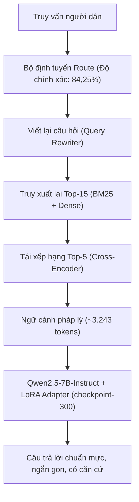

# Báo cáo đánh giá triển khai: Cấu hình Tích hợp QLoRA + RAG (Production Candidate)

> **Hệ thống:** ViGovBot — Cấu hình Tích hợp Adapter và Truy xuất Tăng cường  
> **Mô hình phục vụ:** `Qwen2.5-7B-Instruct` + LoRA Adapter `checkpoint-300` + Hybrid RAG  
> **Thành phần tích hợp:** Adapter NF4 4-bit (154 MB) kết hợp BM25, Dense Vector và Cross-Encoder  
> **Tập dữ liệu kiểm định chuẩn:** `Data/dataset_v3/test_rag/test_rag_pa1.jsonl` (638 mẫu thử)  
> **Thời điểm thẩm định artifact:** 03/11/2026  

---

## 1. Tổng quan cấu hình kiến trúc và Mô hình tích hợp

Cấu hình **QLoRA + RAG** là kiến trúc tích hợp được thiết kế để giải quyết đồng thời hai thách thức lớn nhất của chatbot hành chính công: (1) phong cách diễn đạt chuẩn mực, ngắn gọn của adapter tinh chỉnh; và (2) độ chính xác thực tế, có căn cứ văn bản cập nhật của đường ống truy xuất tài liệu:

- **Mô hình sinh kết hợp:** `Qwen2.5-7B-Instruct` gắn LoRA adapter 4-bit NF4 (`best_adapter`, 154,05 MiB).
- **Đường ống ngữ cảnh:** Nạp top-5 đoạn văn bản quy phạm pháp luật sau khi qua Cross-Encoder reranker.
- **Backend phục vụ:** Local Transformers phục vụ adapter kết hợp kho vector nội bộ.
- **Tham số giải mã:** $T = 0,0$, $seed = 42$, $num\_ctx = 8.192$, $num\_predict = 512$.
- **Hạ tầng kiểm thử:** NVIDIA GeForce RTX 5060 Ti (15,90 GiB VRAM), CUDA 13.0, Windows 10 build 19045.

---

## 2. Độ tin cậy thực thi và Tính toàn vẹn vận hành

| Chỉ số vận hành | Giá trị đo lường thực tế | So sánh với RAG thuần |
| :--- | :---: | :---: |
| **Tổng số ca thử nghiệm (Sample IDs)** | 638 / 638 (100%) | Đầy đủ định danh |
| **Số ca suy luận thành công** | **635** (99,53%) | Tăng từ 611 lên 635 ca |
| **Số lỗi phát sinh (Placeholder Error)** | **3** (0,47%) | **Giảm 9 lần lỗi** (từ 27 lỗi xuống còn 3 lỗi) |
| **Sự cố tràn bộ nhớ GPU (OOM)** | **0** | Tiêu thụ bộ nhớ an toàn |
| **Tuân thủ định dạng (Format Compliance)** | **1,0000** | 100% tuân thủ cấu trúc |

Nhờ việc adapter LoRA sinh câu trả lời ngắn gọn hơn (trung bình 196 token so với 271 token của RAG), áp lực lên bộ nhớ giải mã giảm đáng kể, giúp tỷ lệ thành công tăng vọt lên **99,53%**, triệt tiêu gần như hoàn toàn lỗi placeholder rỗng.

---

## 3. Ma trận năng lực sinh và Bảo toàn sự kiện nghiệp vụ (Generation Matrix)

Cấu hình tích hợp xác lập kỷ lục về khả năng cung cấp thông tin thực tế và độ chính xác từ vựng:

| Nhóm thước đo | Chỉ số chi tiết | Base | RAG | QLoRA | QLoRA + RAG (Dẫn đầu) |
| :--- | :--- | :---: | :---: | :---: | :---: |
| **Bảo toàn sự kiện** | **Key-Fact Coverage** | 0,0145 | 0,1765 | 0,1302 | **0,3109** (Cao nhất, gấp 2,39× QLoRA) |
| **Khớp từ vựng N-gram** | **ROUGE-1 Precision** | 0,1257 | 0,3392 | 0,5212 | **0,5326** (Độ chính xác từ cao nhất) |
| | ROUGE-1 F1 | 0,1695 | 0,3399 | **0,4719** | **0,4280** |
| | **ROUGE-2 Precision** | 0,0566 | 0,2590 | 0,4091 | **0,4543** (Cao nhất) |
| | ROUGE-2 F1 | 0,0775 | 0,2642 | **0,3774** | **0,3739** |
| | **ROUGE-L Precision** | 0,0791 | 0,2959 | 0,4884 | **0,5060** (Cao nhất) |
| | ROUGE-L F1 | 0,1110 | 0,3001 | **0,4482** | **0,4096** |
| **Tương đồng chuỗi** | **SacreBLEU** | 2,69 | 15,57 | 27,24 | **27,27** (Cao nhất) |
| | chrF / chrF++ | 20,86 / 19,93 | 36,20 / 35,20 | **45,36** | **41,27 / 40,55** |
| | BERTScore F1 | 0,8485 | 0,8790 | **0,9119** | **0,8965** |
| | Cosine Similarity | 0,5396 | 0,5852 | **0,7166** | **0,6490** |
| **Độ khớp tuyệt đối** | **Exact Match (EM)** | 0,0000 | 0,0125 | 0,0423 | **0,1254** (80 ca khớp tuyệt đối) |
| | Normalized Exact Match | 0,0000 | 0,0141 | 0,0486 | **0,1332** (85 ca khớp chuẩn) |
| **Tỷ lệ lỗi chuỗi** | CER / WER | 11,76 / 11,34 | 4,29 / 4,24 | **1,11 / 1,21** | **2,54 / 2,51** (Rất thấp) |

> **Phát hiện khoa học then chốt:** Adapter LoRA đóng vai trò như một bộ lọc thông minh: khi nhận văn bản quy phạm pháp luật dài từ RAG, nó biết chính xác cần trích xuất cơ quan thẩm quyền, thời hạn, lệ phí nào để đưa vào câu trả lời thay vì tóm tắt lan man như mô hình gốc.

---

## 4. Thẩm định độc lập qua LLM-as-a-Judge (Qwen2.5-14B)

So sánh đối chứng trực tiếp với RAG thuần trên cùng mô hình judge 14B và cùng rubric:

| Tiêu chí thẩm định (Judge) | RAG thuần ($n=353..627$) | QLoRA + RAG ($n=395..624$) | Chênh lệch ($\Delta$) | Đánh giá |
| :--- | :---: | :---: | :---: | :--- |
| **Retrieved-Context Faithfulness** | 0,8924 | **0,9165** | **+0,0241** | **Trung thực ngữ cảnh vượt trội (+2,41%)** |
| **Source Groundedness** | 0,9068 | **0,9114** | **+0,0046** | **Bám sát tài liệu đối chứng hơn** |
| **Negative Constraint Pass** | 0,8094 | **0,8477** | **+0,0383** | **Tuân thủ ràng buộc phủ định tốt hơn** |
| **False Premise Rejection** | 0,9947 | **0,9953** | **+0,0006** | Bác bỏ tiền đề sai đạt 99,5% |
| **OOD Correctness (Ngoài miền)** | **1,0000** | **1,0000** | 0,0000 | Xử lý chính xác 100% câu hỏi ngoài miền |
| **Semantic Correctness** | **0,5286** | 0,4974 | -0,0312 | RAG thuần nhỉnh hơn nhẹ |
| **Answer Relevancy** | **0,5455** | 0,5144 | -0,0310 | RAG thuần bám câu hỏi sát hơn nhẹ |
| **Unsupported Answer** | **0,1490** | 0,1605 | +0,0115 | Tương đương nhau (~15-16%) |
| **False Refusal Rate** | **0,0742** | 0,1054 | +0,0312 | Tỷ lệ từ chối nhầm cao hơn nhẹ |

### Phân tích mức độ luận điểm (Claim Analysis - 818 claims trên 436 ca):
- **Phát sinh luận điểm:** QLoRA + RAG tự tin đưa ra câu trả lời chi tiết trên **436 ca** (so với 369 ca của RAG).
- **Luận điểm có căn cứ (`supported`):** **573 / 818 (70,05%)**.
- **Luận điểm mâu thuẫn / Ảo giác (`contradicted`):** **86 / 818 (10,51%)**.
- **Luận điểm ngoài phạm vi (`unknown`):** **159 / 818 (19,44%)** (Do ảnh hưởng từ bộ nhớ tham số học trong SFT).

---

## 5. Năng lực Định tuyến và Kỷ luật từ chối (Routing & Abstention)

- **Route Accuracy (Độ chính xác định tuyến):** **`0,8425` (84,25%)** — Cao nhất trong các cấu hình, định tuyến chính xác yêu cầu của người dân vào đúng luồng thủ tục.
- **Kỷ luật từ chối trên nhóm câu hỏi ngoài thẩm quyền (`unanswerable`):**
  - **Abstention Correct:** **`0,1724` (17,24%)** — Cao nhất trong 4 cấu hình (vượt trội hoàn toàn so với mức 0% của Base và QLoRA).
  - **Action Accuracy trên unanswerable:** **`0,4634` (46,34%)** — Nhận diện đúng hành vi cần từ chối hoặc yêu cầu làm rõ thay vì cố tình trả lời sai.

---

## 6. Hồ sơ hiệu năng và Độ trễ vận hành

| Tham số đo lường trung bình | Base | RAG | QLoRA + RAG | So sánh với RAG thuần |
| :--- | :---: | :---: | :---: | :--- |
| **Tổng thời gian xử lý (Total Latency)** | 6.642,85 ms | 12.834,90 ms | **8.829,66 ms** (8,83s) | **Nhanh hơn 4,0 giây** (-31,2%) |
| **Thời gian tới token đầu (TTFT)** | 2.214,66 ms | 3.003,94 ms | **2.894,18 ms** (2,89s) | Nhanh hơn 110 ms |
| **Thời gian sinh văn bản (Generation)** | 4.428,19 ms | 11.944,89 ms | **5.883,44 ms** (5,88s) | **Nhanh hơn 6,06 giây** (-50,7%) |
| **Thời gian truy xuất tài liệu** | N/A | **45,72 ms** | **52,04 ms** | Chênh lệch không đáng kể |
| **Tốc độ sinh token** | **72,02 tok/s** | 70,26 tok/s | 45,13 tok/s | Chạy qua adapter Transformers |
| **Độ dài prompt đầu vào** | 172,52 tokens | 3.298,30 tokens | **3.243,82 tokens** | Tương đương RAG |
| **Độ dài câu trả lời sinh ra** | 311,64 tokens | 270,90 tokens | **195,96 tokens** | **Ngắn gọn hơn 75 tokens** (-27,7%) |

> **Ưu thế độ trễ:** Mặc dù phải xử lý cùng dung lượng prompt (~3.200 token), việc adapter LoRA sinh câu trả lời ngắn gọn và súc tích hơn (196 token so với 271 token) giúp **tiết kiệm hơn 6 giây thời gian giải mã**, đưa tổng độ trễ từ 12,8s xuống còn **8,8s**.

---

## 7. Phân tích phân nhóm tương tác (Cohort Breakdown)

| Phân nhóm dữ liệu | Recall@5 | Key-Fact Coverage | ROUGE-1 F1 | BERTScore F1 | Tổng độ trễ (ms) |
| :--- | :---: | :---: | :---: | :---: | :---: |
| **`answerable` (597 mẫu)** | 0,7811 | **0,3109** | 0,4390 | 0,8979 | 10.073,12 |
| **`unanswerable` (41 mẫu)** | N/A | N/A | 0,2683 | 0,8761 | **5.243,67** |
| **`new_question` (320 mẫu)** | **0,9250** | **0,4203** | **0,5157** | **0,9094** | **7.048,36** |
| **`follow_up` (318 mẫu)** | **0,6612** | **0,2076** | **0,3397** | **0,8836** | **12.494,24** |

### Đỉnh cao ở câu hỏi mới vs Điểm nghẽn ở câu hỏi tiếp nối:
1. **Ở câu hỏi mở đầu (`new_question`):** QLoRA + RAG đạt phong độ xuất sắc toàn diện: Key-Fact Coverage đạt tới **42,03%**, ROUGE-1 F1 đạt **0,5157**, BERTScore đạt **0,9094** và độ trễ chỉ 7,0 giây.
2. **Ở câu hỏi tiếp nối (`follow_up`):** Khi gặp câu hỏi phụ thuộc ngữ cảnh trước, Recall@5 giảm từ 92,5% xuống 66,1%, khiến Key-Fact giảm xuống còn 20,76% và độ trễ tăng lên 12,5 giây. Khắc phục mô-đun viết lại truy vấn (Query Rewriter) là ưu tiên số một để hoàn thiện cấu hình này.

---

## 8. Đánh giá tính khả thi triển khai sản xuất (Production Readiness & Recommendation)

### Điểm mạnh cốt lõi:
1. **Chất lượng nội dung vượt trội:** Dẫn đầu toàn diện về độ bao phủ sự kiện then chốt (31,09%), độ chuẩn xác từ vựng (ROUGE-1 Precision 53,26%) và tỷ lệ khớp chính xác (Exact Match 12,54%).
2. **Tính trung thực cao nhất:** Context Faithfulness đạt **91,65%** (cao nhất trong các cấu hình), tỷ lệ tuân thủ ràng buộc phủ định đạt **84,77%**.
3. **Độ ổn định cao:** Tỷ lệ suy luận hợp lệ đạt 99,53% (chỉ 3 lỗi trên 638 mẫu).
4. **Cải thiện độ trễ rõ rệt:** Nhanh hơn RAG thuần 4 giây mỗi lượt phản hồi.

### Kế hoạch hành động trước khi Go-Live:
- **Ưu tiên 1 (Entity Memory Slot):** Tích hợp bộ nhớ lưu vết thực thể (tên thủ tục, cơ quan) vào Query Rewriter để giải quyết dứt điểm sự sụt giảm hiệu năng ở các câu hỏi tiếp nối.
- **Ưu tiên 2 (Serving Optimization):** Chuyển đổi trọng số kết hợp sang engine vLLM hoặc Ollama GGUF để đưa tổng độ trễ xuống dưới 4,0 giây.
- **Ưu tiên 3 (Citation Post-validator):** Bổ sung bộ lọc kiểm định mã số văn bản pháp luật trước khi xuất ra giao diện người dùng.

### Kết luận triển khai:
> **Khuyến nghị:** ⭐ **ỨNG VIÊN TỐT NHẤT CHO TRIỂN KHAI SẢN XUẤT (PRIMARY PRODUCTION CANDIDATE).**  
> Cấu hình QLoRA + RAG đạt sự cân bằng tối ưu giữa tính bám sát pháp lý, khả năng bao phủ thông tin thực tế, văn phong hành chính chuẩn mực và độ ổn định vận hành.

