# Báo cáo đánh giá triển khai: Cấu hình ViGovBot RAG (Retrieval-Augmented Generation)

> **Hệ thống:** ViGovBot — Kiến trúc Tăng cường Truy xuất (Hybrid RAG Pipeline)  
> **Mô hình phục vụ:** `Qwen2.5-7B` kết hợp Kho tri thức văn bản TTHC  
> **Thành phần truy xuất:** BM25 + Dense Vector Embedding + Cross-Encoder Reranker  
> **Backend phục vụ:** Ollama API (`http://127.0.0.1:8000/api/chat`)  
> **Tập dữ liệu kiểm định chuẩn:** `Data/dataset_v3/test_rag/test_rag_pa1.jsonl` (638 mẫu thử)  
> **Thời điểm thẩm định artifact:** 03/11/2026  

---

## 1. Tổng quan cấu hình kiến trúc và Đường ống phục vụ

Cấu hình **RAG** đại diện cho luồng xử lý thông tin động, bổ sung ngữ cảnh pháp luật chính xác vào mô hình ngôn ngữ lớn để trả lời các câu hỏi thủ tục hành chính công:

```mermaid
flowchart LR
    User["Truy vấn người dùng"] --> Router["Bộ định tuyến (Routing)"]
    Router --> QR["Viết lại câu hỏi (Query Rewriting)"]
    QR --> Hybrid["Tìm kiếm lai (BM25 + Dense Vector)"]
    Hybrid --> Rerank["Tái xếp hạng (Cross-Encoder)"]
    Rerank --> Context["Trích xuất Top-5 Chunks (~3.200 tokens)"]
    Context --> LLM["Qwen2.5-7B Generator (Ollama)"]
    LLM --> Response["Câu trả lời có căn cứ & trích dẫn"]
```

- **Mô hình sinh (Generator):** `Qwen2.5-7B` (phiên bản gốc đóng băng, không adapter).
- **Đường ống truy xuất:** Truy xuất hai giai đoạn (bi-encoder retrieval top-15 kết hợp BM25 $\rightarrow$ cross-encoder reranking lọc top-5).
- **Tham số giải mã:** $T = 0,0$, $seed = 42$, $num\_ctx = 8.192$, $num\_predict = 512$.
- **Hạ tầng kiểm thử:** NVIDIA GeForce RTX 5060 Ti (15,90 GiB VRAM), CUDA 13.0, Windows 10.

---

## 2. Độ tin cậy thực thi và Tính toàn vẹn vận hành

| Chỉ số vận hành | Giá trị đo lường thực tế | Đánh giá kỹ thuật |
| :--- | :---: | :--- |
| **Tổng số ca thử nghiệm (Sample IDs)** | 638 / 638 (100%) | Đầy đủ định danh tập v3 |
| **Số ca suy luận thành công** | **611** (95,77%) | 611 câu trả lời nghiệp vụ hợp lệ |
| **Số lỗi phát sinh (Placeholder Error)** | **27** (4,23%) | **Điểm cần khắc phục**: Lỗi timeout/kết nối nạp prompt dài |
| **Sự cố tràn bộ nhớ GPU (OOM)** | **0** | An toàn bộ nhớ |
| **Sự cố quá hạn kết nối (Timeout)** | 0 ghi nhận cứng | Lỗi thể hiện qua 27 placeholder rỗng |
| **Tuân thủ định dạng (Format Compliance)** | **1,0000** | 100% ca hợp lệ tuân thủ schema |

> **Cảnh báo vận hành:** 27 trường hợp phát sinh lỗi placeholder (4,23%) xuất phát từ khâu ghép nối giữa tầng nạp ngữ cảnh và máy chủ Ollama khi kích thước prompt vượt quá 3.500 token ở các ca truy vấn phức tạp.

---

## 3. Ma trận năng lực truy xuất đa ngưỡng (@k = 1, 3, 5, 10, 15)

Đo lường trên toàn bộ 504 ca kiểm thử có phát sinh truy xuất:

| Thước đo truy xuất | @1 | @3 | @5 | @10 | @15 | Đánh giá |
| :--- | :---: | :---: | :---: | :---: | :---: | :--- |
| **Hit Rate (Tỷ lệ trúng)** | 0,5556 | 0,7262 | 0,7837 | 0,8710 | **0,9067** | Chạm trần 90,7% ở top-15 |
| **Recall (Độ bao phủ)** | 0,5292 | 0,7191 | **0,7811** | 0,8671 | **0,9035** | Điểm uốn tối ưu tại $k=5$ (78,1%) |
| **Precision (Độ chuẩn xác)** | **0,5556** | 0,4613 | 0,4439 | 0,4302 | 0,4276 | Giảm dần theo độ dài danh sách |
| **Mean Reciprocal Rank (MRR)** | N/A | N/A | 0,6474 | 0,6585 | **0,6614** | Vị trí tài liệu liên quan ~hạng 1,5 |
| **Normalized DCG (nDCG)** | N/A | N/A | **0,6812** | 0,7091 | **0,7192** | Trọng số thứ hạng đạt mức tốt |
| **Mean Average Precision (MAP)** | N/A | N/A | 0,5456 | **0,6577** | N/A | |

### Chất lượng ngữ cảnh nạp vào prompt (Context Noise Analysis):
- **Context Precision:** `0,4302` ($n=504$)
- **Context Recall:** `0,8671` ($n=504$)
- **Context Noise Ratio:** **`0,5698` (56,98%)** — Khoảng 57% nội dung văn bản nạp vào mô hình là thông tin nhiễu/phụ trợ, đòi hỏi mô hình sinh phải có năng lực đọc hiểu chọn lọc cao.

---

## 4. Ma trận năng lực sinh và Bảo toàn sự kiện (Generation Matrix)

| Nhóm thước đo | Chỉ số chi tiết | Giá trị đo lường | So sánh với Base |
| :--- | :--- | :---: | :---: |
| **Bảo toàn sự kiện** | **Key-Fact Coverage** | **0,1765** (17,65%) | **Tăng gấp 12,2 lần** (từ 1,45% lên 17,65%) |
| **Tương đồng ngữ nghĩa** | BERTScore F1 | **0,8790** | +0,0305 |
| | BERTScore Precision / Recall | 0,8662 / 0,8939 | Cải thiện đồng đều |
| | Embedding Cosine Similarity | 0,5852 | +0,0456 |
| **Khớp từ vựng N-gram** | ROUGE-1 F1 | **0,3399** | **Tăng gấp 2,0 lần** |
| | ROUGE-2 F1 | **0,2642** | **Tăng gấp 3,4 lần** |
| | ROUGE-L F1 | **0,3001** | **Tăng gấp 2,7 lần** |
| **Độ khớp chuỗi** | chrF / chrF++ | 36,20 / 35,20 | +15,34 điểm |
| | SacreBLEU | 15,57 | Tăng từ 2,69 lên 15,57 |
| | METEOR | 0,4035 | +0,1544 |
| **Tỷ lệ lỗi** | Character Error Rate (CER) | 4,29 | Giảm mạnh từ 11,76 xuống 4,29 |
| | Word Error Rate (WER) | 4,24 | Giảm mạnh từ 11,34 xuống 4,24 |

---

## 5. Thẩm định độc lập qua LLM-as-a-Judge (Qwen2.5-14B)

Được chấm điểm độc lập bởi `Qwen2.5-14B` trên 638 mẫu thử nghiệm:

| Tiêu chí thẩm định (Judge) | Điểm số trung bình | Quy mô mẫu áp dụng ($n$) | Nhận định pháp lý / nghiệp vụ |
| :--- | :---: | :---: | :--- |
| **Source Groundedness** | **0,9068** | 354 | Rất cao: 90,7% câu trả lời có căn cứ tài liệu chuẩn. |
| **Retrieved-Context Faithfulness** | **0,8924** | 353 | Rất cao: 89,2% câu trả lời trung thực với context nạp vào. |
| **Semantic Correctness** | **0,5286** | 560 | Mức khá: 52,9% câu trả lời đúng nghĩa so với đáp án. |
| **Answer Relevancy** | **0,5455** | 627 | Độ bám sát câu hỏi người dân đạt 54,6%. |
| **Intent Coverage Score** | **0,4498** | 618 | Bao phủ được ~45% các yêu cầu chi tiết. |
| **False Premise Rejection** | **0,9947** | 188 | Gần tuyệt đối: 99,5% trường hợp bác bỏ tiền đề sai. |
| **OOD Correctness (Ngoài miền)** | **1,0000** | 179 | Tuyệt đối: 100% nhận diện đúng câu hỏi ngoài thẩm quyền. |
| **Negative Constraint Pass** | **0,8094** | 404 | 80,9% tuân thủ các điều kiện phủ định. |
| **Citation Precision / Recall** | **0,1868 / 0,1937** | 597 | **Điểm yếu lớn**: Chỉ ~18,7% trích dẫn điều khoản đúng. |
| **Invalid Citation Rate** | **0,1147** | 597 | 11,5% trích dẫn số hiệu văn bản không tồn tại. |

### Phân tích mức độ luận điểm (Claim Analysis - 792 claims trên 369 ca):
- Luận điểm có căn cứ chứng minh (`supported`): **610 / 792 (77,02%)**
- Luận điểm mâu thuẫn / Ảo giác (`contradicted`): **61 / 792 (7,70%)**
- Luận điểm chưa đủ căn cứ xác minh (`unknown`): **121 / 792 (15,28%)**

---

## 6. Hồ sơ hiệu năng và Độ trễ vận hành

| Tham số đo lường | Giá trị trung bình | Tác động hiệu năng |
| :--- | :---: | :--- |
| **Tổng thời gian xử lý (Total Latency)** | **12.834,90 ms** (12,83s) | Chậm nhất trong các cấu hình (gấp đôi Base). |
| **Thời gian tới token đầu (TTFT)** | **3.003,94 ms** (3,00s) | Bị trễ do xử lý prefill prompt 3.300 tokens. |
| **Độ trễ truy xuất tài liệu (Retrieval)** | **45,72 ms** | **Rất nhanh**: Chỉ chiếm 0,36% tổng thời gian. |
| **Độ trễ sinh văn bản (Generation)** | **11.944,89 ms** | Chiếm 93,1% tổng thời gian phục vụ. |
| **Tốc độ sinh token** | **70,26 tokens/giây** | Vẫn duy trì tốc độ cao qua Ollama. |
| **Độ dài prompt đầu vào** | **3.298,30 tokens** | Rất dài (nạp 5 đoạn trích văn bản quy phạm). |
| **Độ dài câu trả lời sinh ra** | **270,90 tokens** | Ngắn hơn Base (-40 token) nhưng vẫn còn dài dòng. |

---

## 7. Phân tích phân nhóm tương tác (Cohort Breakdown)

| Phân nhóm dữ liệu | Recall@5 | nDCG@5 | ROUGE-1 F1 | Key-Fact Coverage | Tổng độ trễ (ms) |
| :--- | :---: | :---: | :---: | :---: | :---: |
| **`answerable` (597 mẫu)** | 0,7811 | 0,6812 | 0,3354 | 0,1765 | 13.302,13 |
| **`unanswerable` (41 mẫu)** | N/A | N/A | 0,4060 | N/A | 6.031,57 |
| **`new_question` (320 mẫu)** | **0,9250** | **0,8583** | **0,4049** | **0,2673** | **9.844,10** |
| **`follow_up` (318 mẫu)** | **0,6612** | **0,5337** | **0,2745** | **0,0907** | **15.844,51** |

> **Điểm nghẽn đa lượt (The Multi-turn Bottleneck):** Ở các câu hỏi tiếp nối (`follow_up`), hiệu năng truy xuất Recall@5 tụt dốc từ 92,5% xuống 66,1%, làm Key-Fact Coverage giảm tới 66% (từ 26,7% xuống 9,1%) và độ trễ tăng vọt lên gần 16 giây.

---

## 8. Đánh giá tính khả thi triển khai sản xuất (Production Readiness)

### Điểm mạnh:
1. **Kiểm soát ảo giác tốt:** Tỷ lệ trung thực ngữ cảnh đạt ~89,2%, hallucination rate theo claim chỉ 7,70%, bác bỏ tiền đề sai đạt 99,5%.
2. **Key-Fact cải thiện vượt bậc:** Tăng gấp 12 lần so với Base.
3. **Truy xuất cực nhanh:** Khâu tìm kiếm chỉ mất ~45ms.

### Hạn chế cần tối ưu trước khi triển khai quy mô lớn:
1. **Tổng độ trễ cao (12,8s):** Cần áp dụng Prompt Prefix Caching và cắt tỉa bớt token thừa sau reranking.
2. **Tỷ lệ trích dẫn chuẩn còn thấp (18,7%):** Mô hình thường trích dẫn sai số hiệu nghị định/thông tư; cần lớp kiểm định trích dẫn độc lập.
3. **Tỷ lệ lỗi 4,23% (27 ca):** Cần cấu hình timeout dài hơn và cơ chế retry tự động cho Ollama API.

### Kết luận triển khai:
> **Khuyến nghị:** **ĐỦ ĐIỀU KIỆN THỬ NGHIỆM CÓ KIỂM SOÁT (PILOT TESTING).**  
> Cấu hình RAG phù hợp cho các cổng thông tin tra cứu thủ tục cần độ an toàn căn cứ cao, nhưng cần bổ sung giao diện hiển thị streaming token để người dân không cảm thấy thời gian chờ 3s TTFT quá lâu.

