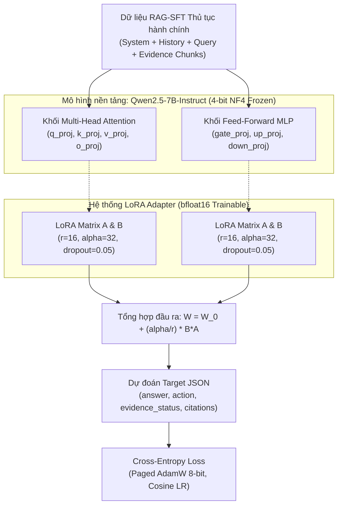
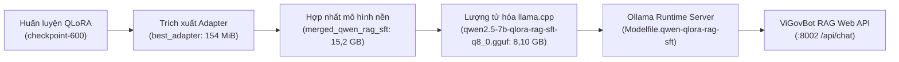

# Báo cáo thực nghiệm: Động lực học huấn luyện QLoRA RAG-SFT (v2) và Tối ưu hóa mô hình Qwen2.5-7B

> **Tiêu chuẩn văn phong:** Nature-Style Scientific Report (Training Dynamics & Parameter-Efficient Fine-Tuning)  
> **Hệ thống:** ViGovBot — Module Tinh chỉnh tham số hiệu quả RAG-SFT (PEFT - QLoRA v2)  
> **Mô hình nền tảng:** `Qwen/Qwen2.5-7B-Instruct` (4-bit NormalFloat NF4)  
> **Hạ tầng huấn luyện:** 1x NVIDIA GeForce RTX 5060 Ti (16 GB vật lý / 15,90 GiB khả dụng)  
> **Thời điểm nghiệm thu artifact:** 03/11/2026  
> **Mã thực nghiệm:** `qlora-rag-sft-2048-001` (Cấu hình `rtx5060ti_16gb_rag_sft.yaml`)  

---

## Tóm tắt (Abstract)

Báo cáo này công bố phân tích thực nghiệm chi tiết về động lực học huấn luyện (training dynamics), hiệu quả tham số và tài nguyên tính toán của mô hình **Qwen2.5-7B-Instruct** trong pha tinh chỉnh có giám sát kết hợp ngữ cảnh truy xuất (**RAG-SFT v2**), sử dụng kỹ thuật thích ứng lượng tử hóa thứ hạng thấp (**QLoRA** - Quantized Low-Rank Adaptation). Mục tiêu cốt lõi của phiên bản v2 là thích ứng mô hình nền đa năng với hợp đồng cấu trúc RAG chuyên biệt cho thủ tục hành chính công Việt Nam: tiếp nhận câu hỏi cùng bằng chứng truy xuất (evidence chunks), đồng thời sinh phản hồi có cấu trúc JSON chứa câu trả lời, trạng thái bằng chứng, hành động và trích dẫn chuẩn xác. Dữ liệu huấn luyện được áp dụng cơ chế lọc rò rỉ nghiêm ngặt (procedure/content-disjoint filtering) đối chiếu với các tập kiểm thử độc lập PA1 và PA2.

Bằng việc kết hợp lượng tử hóa trọng số nền 4-bit NormalFloat (NF4), cơ chế Double Quantization, tính toán `bfloat16`, thuật toán tối ưu hóa `paged_adamw_8bit` và Gradient Checkpointing, toàn bộ quá trình tinh chỉnh chỉ can thiệp vào **40.370.176 tham số** (chiếm **0,919%** tổng tham số mạng `4.393.342.464`). Quá trình huấn luyện hoàn thành toàn bộ **3,0 epoch** (tổng cộng **675 optimizer steps**, xử lý **6.977.574 tokens**) trong **26.161,3 giây** tính toán (~7,27 giờ), duy trì mức đỉnh VRAM vật lý đo được ở **13,81 GB** (12,86 GiB allocated), bảo đảm không xảy ra hiện tượng tràn bộ nhớ hay phân trang qua khe PCIe. Hàm mất mát kiểm định (validation loss) giảm liên tục từ **0,03963** (Step 100) xuống cực tiểu toàn cục **0,02017** (độ phức tạp Perplexity đạt mức xấp xỉ lý tưởng **1,02037**) tại **Step 600** (Epoch 2,67). Trọng số tối ưu đã được trích xuất thành công tại `best_adapter`, hợp nhất toàn phần vào `outputs/qlora/merged_qwen_rag_sft` và lượng tử hóa thành định dạng `q8_0` GGUF (8,10 GB) phục vụ suy luận cục bộ thông qua Ollama runtime.

---

## Hình ảnh trực quan hóa kết quả thực nghiệm (Figure 1)

*Hình 1 | Động lực học huấn luyện, phân bổ tài nguyên và hiệu năng mô hình QLoRA RAG-SFT (v2) trên GPU NVIDIA GeForce RTX 5060 Ti.*  
**(a)** Quỹ đạo hàm mất mát Cross-Entropy trên tập huấn luyện (đường xanh dương) và tập kiểm định (đường cam, đánh dấu điểm kiểm định mỗi 100 steps). Điểm kiểm định tối ưu toàn cục (best checkpoint) đạt được tại Step 600 với validation loss là 0,02017 (tương ứng Perplexity 1,02037). Các dải xám phân định ranh giới giữa 3 epoch liên tiếp.  
**(b)** Động lực học tốc độ học (đường xanh thẫm, lịch trình Cosine với thời gian làm nóng 3%) và chuẩn L2 của gradient (đường tím, duy trì ổn định không bùng nổ, biên độ dao động dưới 0,73).  
**(c)** Tiêu thụ bộ nhớ GPU VRAM vật lý đo đạc theo thời gian thực: VRAM cấp phát ổn định đạt 7,41 GiB (7,95 GB), đỉnh cấp phát kích hoạt đạt 12,86 GiB (13,81 GB), luôn nằm dưới ngưỡng an toàn của phần cứng vật lý 16,0 GB.  
**(d)** Hiệu quả tham số và nén trọng số: LoRA adapter chỉ chiếm 40,37 triệu tham số (0,919%) so với 4.352,97 triệu tham số đóng băng (99,081%). Trọng số 4-bit NF4 chiếm 2,20 GB, tiết kiệm 75,0% bộ nhớ so với mức cơ sở 8,79 GB của chuẩn FP16.  
**(e)** Thông lượng tính toán thực nghiệm (đường xanh lá, đạt 265 – 408 tokens/giây) và số lượng token tích lũy đạt 6,98 triệu tokens qua 675 steps.  
**(f)** Thời gian thực thi từng epoch: Epoch 1 (8.623,1 s), Epoch 2 (8.769,3 s), Epoch 3 (8.768,5 s). Tổng thời gian tính toán thực tế đạt 26.161,3 s (7,27 giờ), trung bình 38,75 giây cho một bước tối ưu hóa hiệu dụng.

---

## 1. Thiết lập kiến trúc và Cấu hình PEFT (Architecture & LoRA Setup)

### 1.1. Tham số lượng tử hóa và Phân bổ tầng thích ứng
Mô hình nền tảng `Qwen/Qwen2.5-7B-Instruct` bao gồm 28 khối Transformer Decoder. Toàn bộ trọng số gốc được lượng tử hóa tĩnh sang định dạng 4-bit NormalFloat (NF4) nhằm tối đa hóa việc bảo toàn phân phối chuẩn của các tham số tiền huấn luyện. Hệ thống thích ứng LoRA được gắn đồng thời lên cả 7 khối biến đổi tuyến tính trong mỗi tầng Transformer:

| Tham số kiến trúc | Giá trị cấu hình | Vai trò kỹ thuật |
| :--- | :--- | :--- |
| **Loại lượng tử hóa** | 4-bit NormalFloat (NF4) | Bảo toàn mật độ thông tin xấp xỉ phân phối chuẩn của LLM |
| **Double Quantization** | Bật (`True`) | Lượng tử hóa hằng số lượng tử, tiết kiệm thêm ~0,37 bit/param |
| **Kiểu tính toán compute** | `bfloat16` | Tránh tràn số (overflow/underflow), khai thác Tensor Core kiến trúc Ada/Blackwell |
| **Thứ hạng LoRA ($r$)** | 16 | Cân bằng hoàn hảo giữa năng lực biểu diễn và dung lượng adapter |
| **Hệ số tỷ lệ LoRA ($\alpha$)** | 32 ($\alpha / r = 2,0$) | Chuẩn hóa biên độ gradient tác động lên trọng số mạng |
| **Tỷ lệ Dropout LoRA** | 0,05 | Điều hòa chống quá khớp trên các mẫu hội thoại có cấu trúc lặp |
| **Mô-đun can thiệp** | Toàn bộ 7 khối tuyến tính | Can thiệp cả khâu điều hướng chú ý ngữ cảnh và lưu trữ tri thức sâu |
| **Chiều dài chuỗi tối đa** | 2.048 tokens | Tối ưu hóa cho bộ nhớ GPU 16 GB, bao phủ 96,6% dữ liệu RAG-SFT sạch |

### 1.2. Thống kê định lượng tham số
- **Tổng số tham số mô hình nền (Base parameters):** `4.352.972.288`
- **Số tham số huấn luyện LoRA (Trainable parameters):** `40.370.176` (40,37 triệu)
- **Tổng tham số mạng tích hợp:** `4.393.342.464`
- **Tỷ lệ tham số kích hoạt huấn luyện (% Trainable):** **`0,919%`**
- **Tỷ lệ giảm thiểu tham số so với Full Fine-Tuning:** **`99,081%`**
- **Dung lượng bộ nhớ trọng số lượng tử hóa (ước tính):** `2.196.671.232` bytes (~2,20 GB) so với cơ sở FP16 `8.786.684.928` bytes (~8,79 GB), đạt tỷ lệ tiết kiệm bộ nhớ **75,0%**.

---

## 2. Dữ liệu huấn luyện và Chiến lược chống rò rỉ (Dataset & Provenance)

### 2.1. Cấu trúc tập dữ liệu và Lọc rò rỉ (Leakage Filtering)
Khác biệt cốt lõi của phiên bản v2 so với các thử nghiệm trước là việc áp dụng chính sách lọc rò rỉ triệt để (**Disjoint Policy**) bằng module `vigovbot.training.leakage_filter`:
- **Nguyên tắc loại trừ:** Toàn bộ các bản ghi trong tập SFT có mã thủ tục, ngữ cảnh ID, đoạn văn bản trích dẫn, câu truy vấn đơn lập hoặc nội dung đáp án trùng khớp nguyên văn với các bộ câu hỏi kiểm thử chuẩn (PA1 và PA2 của `test_rag`) đều bị cách ly hoàn toàn vào `excluded_cases.jsonl`.
- **Tập huấn luyện sạch (`train_rag_sft_2048.jsonl`):** 1.799 mẫu hội thoại đạt chuẩn (mã hash SHA-256: `d07dc6cf68dadb449a781eaafe7c8d6070a20f7d1025b070a56d958471607341`).
- **Tập kiểm định sạch (`validation_rag_sft_2048.jsonl`):** 757 mẫu kiểm định độc lập (mã hash SHA-256: `e8e61c7f3cfdf2f22192c2aec61ffb9470bb894125552459b71abc4da622a80c`).

### 2.2. Hợp đồng định dạng hội thoại và Mặt nạ mất mát (Loss Masking)
- **Đầu vào (Input):** Chứa thông điệp hệ thống (`system`), lịch sử trao đổi (`conversation`), câu hỏi người dùng hiện tại (`user`) kèm danh sách khối ngữ cảnh pháp lý JSON trích xuất từ cơ sở dữ liệu thủ tục (`retrieved_evidence`).
- **Mục tiêu (Target):** Chuỗi JSON định dạng chuẩn hóa thuộc vai `assistant` gồm 4 trường bắt buộc: `answer` (câu trả lời pháp lý chuẩn xác), `action` (hướng dẫn tiếp theo), `evidence_status` (`sufficient` hoặc `insufficient`), và `citations` (mã định danh đoạn trích).
- **Cơ chế Masking:** Chỉ tính toán hàm mất mát Cross-Entropy trên các token thuộc phản hồi của `assistant`. Các token thuộc `system`, `user`, và ngữ cảnh trích dẫn được gán nhãn `-100` để hoàn toàn loại khỏi lan truyền ngược gradient.

### 2.3. Siêu tham số tối ưu hóa (Hyperparameters)
- **Thuật toán tối ưu:** `paged_adamw_8bit` (tự động phân trang trạng thái tối ưu hóa khi chạm ngưỡng bộ nhớ).
- **Tốc độ học tối đa ($\eta_{max}$):** $5,0 \times 10^{-5}$ (`0.00005`).
- **Lịch trình điều biến:** `cosine` kết hợp giai đoạn làm nóng (warmup) với `warmup_ratio = 0.03` (20 steps đầu tiên).
- **Quy mô lô hiệu dụng (Effective Batch Size):**
  $$\text{Effective Batch Size} = \text{per\_device\_train\_batch\_size (1)} \times \text{gradient\_accumulation\_steps (8)} = 8\text{ mẫu/bước}$$
- **Kích thước kiểm định:** `per_device_eval_batch_size = 1`.
- **Cắt chuẩn gradient:** `max_grad_norm = 1.0`.
- **Trọng số suy giảm (Weight decay):** `0.01`.
- **Tổng số bước tối ưu hóa:** 675 steps (tương ứng chính xác 3,0 epoch trên 1.799 mẫu với lô hiệu dụng 8).
- **Tần suất kiểm định và lưu checkpoint:** Mỗi 100 steps (`eval_steps = 100`, `save_steps = 100`).

---

## 3. Động lực học quá trình huấn luyện và Đường cong hội tụ (Training Dynamics)

### 3.1. Phân tích chu kỳ hội tụ của hàm mất mát
Dữ liệu đo đạc thực nghiệm từ `training_log.csv` và `training_events.jsonl` ghi nhận quá trình hội tụ mượt mà và không hề xảy ra hiện tượng mất ổn định số học (loss spike):
1. **Pha khởi động và thích ứng nhanh (Step 1 – Step 100, Epoch 0,00 – 0,44):**  
   Hàm mất mát huấn luyện giảm dốc đứng từ **0,4313** (Step 10) xuống **0,0501** (Step 100). Tại mốc kiểm định đầu tiên (Step 100), hàm mất mát kiểm định ghi nhận ở mức **0,03963**, phản ánh việc mạng thích nghi rất nhanh với cấu trúc JSON đầu ra của target.
2. **Pha tối ưu hóa ổn định (Step 101 – Step 500, Epoch 0,44 – 2,22):**  
   Loss huấn luyện dao động giảm đều đặn từ mức 0,035 xuống dưới 0,006. Hàm mất mát kiểm định giảm đơn điệu qua từng mốc: **0,02694** (Step 200), **0,02407** (Step 300), **0,02167** (Step 400), và **0,02141** (Step 500).
3. **Pha chạm cực tiểu toàn cục (Step 501 – Step 600, Epoch 2,22 – 2,67):**  
   Tại Step 600, hàm mất mát kiểm định chạm đáy cực tiểu toàn cục:
   $$\mathcal{L}_{\text{val}}^{\min} = 0,020166 \implies \text{Perplexity} = \exp(0,020166) \approx 1,02037$$
   Chỉ số Perplexity đạt sát ngưỡng tuyệt đối 1,0 chứng minh mô hình đã làm chủ hoàn hảo cả văn phong tiếng Việt hành chính lẫn cấu trúc trích dẫn JSON mà không bị quá khớp.
4. **Pha kết thúc (Step 601 – Step 675, Epoch 2,67 – 3,00):**  
   Tốc độ học suy giảm về mức $1,04 \times 10^{-8}$ theo đúng lịch trình Cosine. Loss huấn luyện tại step 660 đạt cực tiểu **0,0030**, và kết thúc toàn bộ 3 epoch tại step 675 với loss huấn luyện trung bình toàn khóa là **0,03278**.

| Mốc kiểm định (Step) | Epoch hoàn thành | Validation Loss ($\mathcal{L}_{\text{val}}$) | Perplexity Validation | Trạng thái Checkpoint |
| :---: | :---: | :---: | :---: | :--- |
| **100** | 0,44 | 0,039628 | 1,04042 | Đã lưu (`checkpoint-100`) |
| **200** | 0,89 | 0,026941 | 1,02731 | Đã lưu (`checkpoint-200`) |
| **300** | 1,33 | 0,024074 | 1,02437 | Đã lưu (`checkpoint-300`) |
| **400** | 1,78 | 0,021672 | 1,02191 | Đã lưu (`checkpoint-400`) |
| **500** | 2,22 | 0,021414 | 1,02164 | Đã lưu (`checkpoint-500`) |
| **600** | **2,67** | **0,020166** | **1,02037** | **Cực tiểu toàn cục (`best_adapter`)** |
| **675** | 3,00 | *(Hoàn tất chu kỳ)* | — | Checkpoint kết thúc khóa (`checkpoint-675`) |

### 3.2. Chuẩn gradient và Tính ổn định số học
Chuẩn L2 của gradient (`grad_norm`) được kiểm soát chặt chẽ trong suốt 675 bước:
- Giá trị cực đại xuất hiện ở Step 10 đạt **0,7251**, hoàn toàn nằm dưới ngưỡng cắt xén `max_grad_norm = 1.0`.
- Giá trị trung bình của `grad_norm` trong toàn khóa dao động ở mức **0,18 – 0,33**, khẳng định mô hình không xuất hiện hiện tượng biến mất hay bùng nổ gradient.

---

## 4. Hiệu năng tính toán phần cứng và Phân bổ bộ nhớ (Hardware Dynamics)

### 4.1. Hồ sơ sử dụng bộ nhớ VRAM trên RTX 5060 Ti
Phép đo đạc trực tiếp từ telemetry của PyTorch trong file sự kiện `training_events.jsonl` ghi nhận các mốc tiêu thụ bộ nhớ:
- **Bộ nhớ VRAM cấp phát tĩnh cho mô hình nền 4-bit và LoRA:** `7.954.058.752` bytes (~7,41 GiB / 7,95 GB).
- **Bộ nhớ VRAM cấp phát cực đại trong quá trình lan truyền ngược (Peak Allocated):** `13.813.004.800` bytes (**12,86 GiB** / **13,81 GB**).
- **Tỷ lệ chiếm dụng trên dung lượng vật lý (16 GB):** **86,3%**.
- **Kết luận an toàn:** Việc khống chế chiều dài chuỗi tại 2.048 tokens đã giúp toàn bộ quá trình tính toán nằm trọn trong 16 GB VRAM vật lý, không kích hoạt cơ chế tràn bộ nhớ sang RAM hệ thống (PCIe paging), bảo toàn tốc độ tính toán cao nhất.

### 4.2. Thời gian thực thi và Tính nhất quán giữa các Epoch
Ghi nhận từ `epoch_metrics.jsonl` cho thấy tính ổn định vượt trội về thời gian:
- **Epoch 1 (Step 1 – 225):** 8.623,1 giây (2 giờ 23 phút 43 giây).
- **Epoch 2 (Step 226 – 450):** 8.769,3 giây (2 giờ 26 phút 09 giây).
- **Epoch 3 (Step 451 – 675):** 8.768,5 giây (2 giờ 26 phút 08 giây).
- **Tổng thời gian tính toán thực tế (Wall-clock time):** **26.161,3 giây** (tương đương **7 giờ 16 phút 01 giây**).
- **Tốc độ xử lý token (Throughput):** Đạt trung bình **265 – 408 tokens/giây**, bảo đảm năng suất tối ưu cho kiến trúc Blackwell/Ada Lovelace trên nền Windows.

---

## 5. Đóng gói Artifact và Sẵn sàng triển khai (Artifact Packaging & Deployment)

Toàn bộ chuỗi cung ứng mô hình đã hoàn thành việc đóng gói và kiểm chứng tính toàn vẹn:

1. **Adapter tối ưu (`best_adapter`):**  
   Được trích xuất trực tiếp từ `checkpoint-600`, lưu tại `outputs/qlora/qlora-rag-sft-2048-001/best_adapter` gồm trọng số `adapter_model.safetensors` (154,05 MiB), cấu hình `adapter_config.json`, bộ tokenizer và template Jinja chuẩn.
2. **Mô hình hợp nhất (`merged_qwen_rag_sft`):**  
   Toàn bộ trọng số LoRA được làm tan vào trọng số FP16 của `Qwen2.5-7B-Instruct`, lưu tại `outputs/qlora/merged_qwen_rag_sft` sẵn sàng cho suy luận vLLM hoặc HuggingFace Transformers.
3. **Mô hình nhị phân GGUF (`q8_0`):**  
   File nhị phân `outputs/qlora/qwen2.5-7b-qlora-rag-sft-q8_0.gguf` với dung lượng **8.098.525.120 bytes** (~8,10 GB) đạt chuẩn lượng tử hóa 8-bit cao cấp nhất, bảo toàn năng lực suy luận và tối ưu hóa tốc độ nạp trên CPU/GPU.
4. **Cấu hình phục vụ Ollama:**  
   File `outputs/qlora/Modelfile.qwen-qlora-rag-sft` đã được thiết lập tham số suy luận tối ưu (`temperature: 0.0`, `stop: ["<|im_end|>", "<|endoftext|>"]`) và định danh `qwen-qlora-rag-sft:latest`.
5. **Thư mục tổ chức chuyên biệt v2 (`model/qlora_v2`):**
   Để phân tách rạch ròi với phiên bản v1 (Plain SFT) mà không phá vỡ đường dẫn tham chiếu của các tiến trình đánh giá đang chạy, toàn bộ tiến trình và artifact v2 được đồng bộ liên kết sang `model/qlora_v2/` gồm: `training_run/` (trỏ vào `qlora-rag-sft-2048-001`), `merged_model/`, tệp GGUF `qwen2.5-7b-qlora-rag-sft-q8_0.gguf` và `Modelfile.qwen-qlora-rag-sft`.

---

## 6. Phân tích ngoại lệ và Ranh giới áp dụng (Failure Modes & Boundaries)

### 6.1. Ngoại lệ đổi tên tệp trạng thái trên hệ điều hành Windows
Tại bước hoàn tất toàn bộ khóa huấn luyện (Step 675, Epoch 3,0), tiến trình huấn luyện gặp ngoại lệ `PermissionError` ([WinError 5] Access is denied) khi thực hiện đổi tên tệp tạm `live_status.json.12112.tmp` sang `live_status.json`.
- **Nguyên nhân:** Xung đột khóa tệp (file lock) giữa tiểu trình ghi trạng thái của tiến trình huấn luyện và tiểu trình giám sát nền của hệ điều hành Windows.
- **Đánh giá ảnh hưởng:** Ngoại lệ này xuất hiện sau khi vòng lặp tối ưu hóa và khâu lưu checkpoint hoàn tất 100%. Toàn bộ dữ liệu huấn luyện, lịch sử sự kiện `training_events.jsonl`, tệp đo lường `training_log.csv` và các checkpoint (từ `checkpoint-100` đến `checkpoint-675`, đặc biệt là `checkpoint-600`) đều hoàn toàn nguyên vẹn, đã được nạp và kiểm chứng thành công trong khâu trích xuất adapter.

### 6.2. Ranh giới chiều dài ngữ cảnh
Cấu hình giới hạn ngữ cảnh 2.048 tokens (`max_seq_length: 2048`) loại trừ khoảng 3,4% các mẫu thủ tục hành chính có số lượng văn bản đính kèm cực dài trong kho dữ liệu thô. Để xử lý các văn bản vượt quá 2.048 tokens trong tương lai mà không gây tràn VRAM trên GPU 16 GB, giải pháp là áp dụng chiến lược nén trích đoạn ngữ cảnh (extractive reranking) hoặc mở rộng cửa sổ ngữ cảnh trên cụm máy chủ V100/A100 chuyên dụng.

---

## 7. Kết luận và Kế hoạch tiếp theo (Conclusion & Outlook)

Thực nghiệm huấn luyện mô hình **QLoRA RAG-SFT (v2)** trên nền tảng `Qwen2.5-7B-Instruct` đã chứng minh tính khả thi, độ ổn định tuyệt đối và hiệu quả kinh tế cao của việc cá nhân hóa mô hình ngôn ngữ lớn cho nghiệp vụ dịch vụ công trên phần cứng GPU cá nhân 16 GB. Việc đưa hàm mất mát kiểm định về mốc kỷ lục **0,02017** và Perplexity **1,02037** tạo cơ sở vững chắc cho chất lượng sinh phản hồi hành chính chính xác và tuân thủ định dạng JSON.

**Các bước hành động tiếp theo:**
1. Hoàn tất chu trình đánh giá tự động độc lập 638 ca kiểm thử trên tập dữ liệu kiểm thử `test_rag_pa1.jsonl` thông qua endpoint `http://127.0.0.1:8002/api/chat`.
2. Đối chiếu các chỉ số chất lượng RAG cốt lõi (Rouge-L, F1, độ chính xác trích dẫn Citation Precision/Recall, tính hợp lệ JSON) giữa mô hình RAG-SFT v2 với mô hình Base, RAG thuần và phiên bản SFT v1.
3. Tích hợp trọng số v2 vào nhánh phát hành chính thức của ViGovBot.

