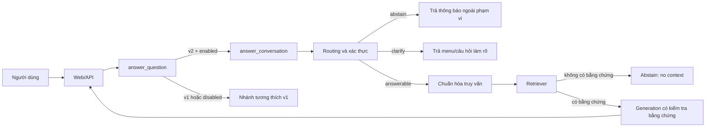
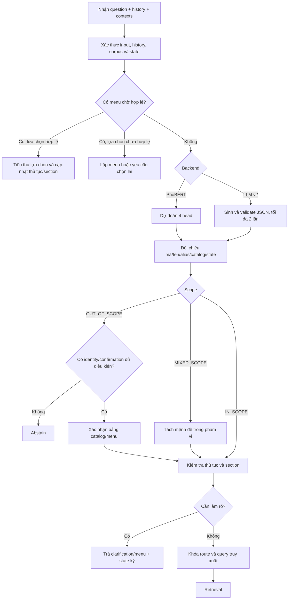

# Báo cáo luồng hoạt động module routing của ViGovBot

## 1. Phạm vi và luận điểm

Báo cáo này mô tả luồng routing của ViGovBot từ lúc Web/API nhận câu hỏi đến
khi hệ thống quyết định từ chối, hỏi làm rõ, truy xuất tài liệu hoặc chuyển bằng
chứng sang mô hình sinh câu trả lời. Phân tích dựa trên mã nguồn và kiểm thử trong
repository tại thời điểm lập báo cáo; không dùng cấu hình tĩnh hoặc mock test để
suy diễn rằng model, Docker, GPU hay API thật đang hoạt động.

Luận điểm chính là routing hiện hành không phải một bộ phân loại đơn lẻ. Đây là
một tầng điều phối an toàn gồm: chọn hợp đồng routing, xác thực lịch sử và state,
dự đoán bốn nhóm nhãn bằng PhoBERT, đối chiếu thực thể với catalog, quản lý menu
làm rõ, xử lý yêu cầu hỗn hợp, xây dựng truy vấn truy xuất, rồi kiểm soát điều kiện
để retrieval và generation được phép chạy.

## 2. Thuật ngữ thống nhất

| Thuật ngữ | Định nghĩa dùng trong báo cáo |
|---|---|
| routing | Toàn bộ quá trình quyết định đường xử lý của một lượt hỏi. |
| route | Kết quả định tuyến có cấu trúc của một lượt hỏi. |
| routing v2 | Hợp đồng gồm `scope`, `conversation`, `mixed_procedures`, `sections`, `query`, `needs_clarification`, `clarification` và `requests`. |
| PhoBERT router | Bộ phân loại cục bộ bốn head, chạy trên CPU và là backend mặc định của routing v2. |
| LLM router | Backend Qwen tương thích của routing v2; không phải fallback tự động khi PhoBERT lỗi. |
| catalog | Danh mục thủ tục và các section được dựng từ corpus hiện hành. |
| conversation state | State có chữ ký dùng để giữ thủ tục đã chọn và menu giữa các lượt. |
| clarification | Cơ chế hỏi làm rõ thủ tục hoặc section bằng lựa chọn văn bản. |
| retrieval context | Dấu vết nguồn đã dùng ở lượt trước, phục vụ truy xuất follow-up có kiểm chứng. |
| semantic fallback | Tìm kiếm vector toàn corpus khi route hợp lệ nhưng chưa xác định chắc mã thủ tục. |

## 3. Vị trí của routing trong hệ thống

Điểm vào miền RAG là `answer_question()` trong
[`src/vigovbot/rag/pipeline.py`](../../src/vigovbot/rag/pipeline.py). Hàm kiểm tra
câu hỏi không rỗng, đọc `routing_contract` và `routing_enabled`, sau đó chuyển
toàn bộ routing v2 sang `answer_conversation()`. Backend chỉ được chấp nhận là
`phobert` hoặc `llm`. Nếu dùng hợp đồng cũ hoặc tắt routing, hàm tiếp tục theo
nhánh v1 tương thích trong cùng pipeline.

Web/API tại [`src/vigovbot/server/app.py`](../../src/vigovbot/server/app.py)
truyền riêng cho từng model các trường `history`, `conversation_state`,
`clarification_context` và `retrieval_context`. Kết quả routing được trả lại cùng
`action`, `decision_reason`, thời gian và trace; raw trace chỉ được công bố theo
chế độ debug/evaluation tương ứng. Vì state và context được phân tách theo
`model_id`, một model không mặc nhiên kế thừa trạng thái của model khác.

## 4. Hợp đồng routing v2

Routing v2 được định nghĩa tại
[`src/vigovbot/rag/classification.py`](../../src/vigovbot/rag/classification.py).
Mỗi route mô tả đồng thời bốn quyết định nghiệp vụ và phần dữ liệu điều phối:

| Trường | Miền giá trị | Vai trò |
|---|---|---|
| `scope` | `IN_SCOPE`, `OUT_OF_SCOPE`, `MIXED_SCOPE` | Xác định phạm vi hỗ trợ. |
| `conversation` | `NEW`, `FOLLOW_UP` | Xác định câu độc lập hay cần ngữ cảnh trước. |
| `mixed_procedures` | Boolean | Cho biết có nhiều thủ tục khác nhau trong cùng yêu cầu. |
| `sections` | Danh sách nhãn section | Xác định loại thông tin được hỏi. |
| `query` | Chuỗi | Truy vấn độc lập hoặc phần trong phạm vi đã được giữ lại. |
| `needs_clarification` | Boolean | Chặn retrieval khi còn thiếu đối tượng bắt buộc. |
| `clarification` | Chuỗi | Câu hỏi làm rõ ngắn. |
| `requests` | Tối đa năm object | Ghép riêng thủ tục, query và section cho từng yêu cầu. |

Validator không chỉ kiểm tra kiểu dữ liệu. `OUT_OF_SCOPE` bắt buộc có query,
requests, sections và clarification rỗng; route có thể trả lời phải có query và
ít nhất một request; tập section cấp ngoài phải bằng hợp các section của từng
request; cờ `mixed_procedures` phải nhất quán với số request. Với LLM router,
JSON sai được phản hồi bằng lỗi cụ thể để model sửa một lần; sau hai lần không
hợp lệ, hệ thống trả route làm rõ an toàn với `fallback_reason` thay vì cho truy
xuất dựa trên dữ liệu không hợp lệ.

## 5. Backend mặc định: PhoBERT bốn head

### 5.1. Đầu vào và tiền xử lý

`PhoBERTRouter` trong
[`src/vigovbot/rag/phobert_router.py`](../../src/vigovbot/rag/phobert_router.py)
nhận ba segment: câu hỏi hiện tại, tin nhắn trước gần nhất và thủ tục đã chọn từ
state hợp lệ. Mỗi segment được chuẩn hóa NFC, gộp khoảng trắng và tách từ bằng
PyVi. Chuỗi đầu vào có dạng `<s> question </s></s> previous </s></s> procedure
</s>`. Nếu vượt `max_len` trong metadata, bộ mã hóa cắt lần lượt segment dài nhất
nhưng vẫn giữ cả ba segment và dấu phân cách.

Checkpoint phải có đủ metadata, tokenizer, encoder và trọng số head. Metadata
phải khớp tên task, thứ tự label, threshold của head đa nhãn, segmenter, chế độ
input và giới hạn độ dài. Model được nạp local, chạy `eval()` trên CPU, dùng CLS
pooling và serialize inference bằng lock. Thiếu hoặc sai checkpoint làm quá trình
nạp thất bại; hệ thống không âm thầm đổi sang LLM router.

### 5.2. Bốn head dự đoán

| Head | Kiểu | Đầu ra chuẩn hóa |
|---|---|---|
| Phạm vi | Softmax/argmax | `IN_SCOPE`, `OUT_OF_SCOPE`, `MIXED_SCOPE` |
| Mạch hội thoại | Softmax/argmax | `NEW`, `FOLLOW_UP` |
| Trộn thủ tục | Softmax/argmax | Boolean |
| Mục nội dung | Sigmoid theo threshold riêng | Tập section như `DOSSIER`, `FEE`, `PROCESSING_TIME` |

Head section là đa nhãn nên một câu có thể hỏi đồng thời hồ sơ, phí và thời hạn.
Nhãn rỗng được giữ rỗng; hệ thống không tự thêm `OVERVIEW`. PhoBERT không sinh
tên thủ tục, không viết lại query và không trích span thực thể. Các trách nhiệm
đó thuộc adapter, catalog và lớp clarification.

### 5.3. Chuyển prediction thành route

`classify_phobert()` kết hợp prediction với state và `Clarifier`. Mã thủ tục được
lấy từ câu hỏi, alias có kiểm duyệt, tên catalog hoặc thủ tục đã chọn hợp lệ trong
state. Section hiển nhiên trong câu hỏi có thể được dùng để đối chiếu/hoàn thiện
ý định, nhưng không thay thế việc nhận diện thủ tục. Nếu chỉ có tên/mã thủ tục
mà chưa có section, hệ thống mở menu section thay vì giả định người dùng muốn
tổng quan.

## 6. State, catalog và menu làm rõ

### 6.1. Xác thực state trước routing

`answer_conversation()` trong
[`src/vigovbot/rag/conversation.py`](../../src/vigovbot/rag/conversation.py)
chuẩn hóa history, dựng fingerprint corpus và kiểm tra `conversation_state`.
State chỉ hợp lệ khi version, scope, corpus, fingerprint history và chữ ký HMAC
đều khớp. State sửa đổi, state thuộc corpus khác hoặc state không khớp lịch sử
không được dùng làm nguồn xác định thủ tục.

Nếu client không gửi state, server có thể tra cache tiến trình theo scope, corpus
và fingerprint history. Cache này chỉ hỗ trợ tính liên tục trong process; restart
có thể làm mất cache. Vì vậy chữ ký và catalog hiện hành, không phải nội dung câu
trả lời cũ, là nguồn tin cậy cho thủ tục đã chọn.

### 6.2. Nhận diện thực thể thủ tục

`Clarifier` tại
[`src/vigovbot/rag/clarification.py`](../../src/vigovbot/rag/clarification.py)
dựng catalog request-local và bổ sung alias từ file cấu hình. Alias phải có ít
nhất hai từ, không trùng giữa hai mã và phải trỏ đến mã tồn tại. Thứ tự nhận diện
chính gồm mã nguồn, alias khớp toàn bộ, alias được nhắc trong câu và tên catalog
đã chuẩn hóa. Cách làm này tách quyết định “câu thuộc phạm vi nào” khỏi quyết
định “câu đang nói đến thủ tục nào”.

### 6.3. Menu thủ tục và menu section

Khi có nhiều thủ tục phù hợp, hệ thống trả danh sách đánh số gồm tên và mã. Khi
đã xác định một thủ tục nhưng chưa có mục nội dung, hệ thống trả các section thực
sự có trong corpus. Người dùng có thể nhập số, tên mục, tên thủ tục hoặc sao chép
nguyên nhãn đánh số. `direct_choice()` chỉ tiêu thụ số khi có menu chờ hợp lệ;
một câu hỏi mới chứa chữ số không bị mặc định hiểu là lựa chọn menu.

Kết quả chọn hợp lệ có thể bỏ qua bước chạy classifier ở lượt đó. Lựa chọn sai
phạm vi, sai chữ ký hoặc không khớp nội dung menu sẽ không được dùng để nâng state.

## 7. Cây quyết định chi tiết của một lượt routing v2

Thứ tự trên quan trọng vì một prediction không tự động trở thành hành động. Mỗi
nhãn còn phải vượt qua kiểm tra state, catalog và điều kiện làm rõ. Hệ thống chỉ
đi tiếp khi đã xác định được một query có thể truy xuất mà không cần bịa đối tượng.

## 8. Xử lý các nhánh nghiệp vụ chính

### 8.1. `OUT_OF_SCOPE`

Route ngoài phạm vi dừng trước retrieval và generation, trả thông báo năng lực
tra cứu thủ tục hành chính. Có hai cơ chế xác nhận có giới hạn trước khi giữ quyết
định này. Thứ nhất, mã/tên/alias catalog có thể điều chỉnh prediction khi thỏa
policy xác suất đã định; alias khớp toàn bộ là ngoại lệ được kiểm duyệt. Thứ hai,
mô tả hành động ngắn có thể được chấm trên catalog và mở menu xác nhận nếu Top 1
đạt ngưỡng điểm và margin. Hai cơ chế chỉ xác nhận identity; chúng không tự gán
section hay sinh câu trả lời.

### 8.2. `MIXED_SCOPE`

Với câu vừa hỏi thủ tục vừa hỏi nội dung ngoài phạm vi, adapter trước hết tách tối
đa tám mảnh bằng dấu câu và liên từ, rồi phân loại từng mảnh bằng PhoBERT. Chỉ một
mảnh `IN_SCOPE` độc lập mới được dùng để truy xuất. Nếu phép tách không tìm được
mảnh hợp lệ, LLM có thể đề xuất đúng một đoạn trích nguyên văn với budget tối đa
128 token; đoạn này bắt buộc được PhoBERT phân loại lại và phải giữ các mã/qualifier
quan trọng. Nếu kiểm chứng thất bại, hệ thống hỏi làm rõ và không retrieval.

Khi trả lời thành công, scope tổng vẫn là `MIXED_SCOPE`, câu trả lời được gắn thông
báo rằng phần ngoài thủ tục hành chính không được hỗ trợ và `action` chuyển thành
`partial`. Như vậy LLM rewrite không có quyền tự loại bỏ nội dung rồi coi kết quả
là yêu cầu thuần trong phạm vi.

### 8.3. Nhiều thủ tục trong cùng câu

PhoBERT có head phát hiện trộn thủ tục nhưng không tạo liên kết section-thủ tục.
Do đó, khi không thể ghép chắc chắn từng mục với từng thủ tục, hệ thống yêu cầu
người dùng hỏi riêng thay vì áp dụng hợp section cho mọi nguồn. Backend LLM v2 có
thể biểu diễn tối đa năm `requests` riêng, nhưng đây là backend cấu hình tường minh,
không phải năng lực fallback của PhoBERT mặc định.

### 8.4. `FOLLOW_UP`

Một follow-up chỉ được tái sử dụng thủ tục khi state hoặc `retrieval_context` vượt
qua kiểm tra. `retrieval_context` phải khớp fingerprint câu trả lời trước và mã
phải còn tồn tại trong catalog. Khi hợp lệ, retriever ưu tiên `procedure_direct`;
nếu section không có trong nguồn đã chọn, hệ thống có thể dùng
`procedure_semantic` nhưng vẫn giữ mã để không mượn bằng chứng của thủ tục khác.

Một câu hỏi ngắn chỉ nêu trường, chẳng hạn hỏi tiếp về hồ sơ, có thể được nâng từ
`NEW` thành `FOLLOW_UP` nếu identity của lượt trước đã được xác thực. Ngược lại,
lịch sử văn bản đơn thuần hoặc mã do client tự gửi không đủ để thiết lập identity.

### 8.5. `NEW`

Câu hỏi mới không được kế thừa chủ đề cũ. Query truy xuất giữ câu hiện tại hoặc
phần trong phạm vi đã được kiểm chứng. Sau khi route được khóa, history bị loại
khỏi prompt retrieval/generation để tránh câu trả lời cũ hoặc chủ đề cũ làm trôi
nguồn. Nếu câu nêu rõ tên thủ tục và mục tiêu, adapter có thể bỏ qua một nhãn
“ambiguous” quá thận trọng và tiếp tục như câu mới.

## 9. Từ route đến retrieval và generation

Sau routing, hệ thống xây `retrieval_query` theo relation. Với câu mới, query là
câu hiện tại; với follow-up, query là câu độc lập đã giải quyết tham chiếu; với
mixed scope, query chỉ là phần trong phạm vi đã kiểm chứng.

Trình tự truy xuất trong nhánh hiện hành gồm:

1. Thử truy xuất trực tiếp theo thủ tục cho follow-up có context hợp lệ.
2. Nếu bật `decompose_queries`, tách tối đa năm sub-query và hợp nhất thứ hạng;
   JSON phụ sai thì quay về query gốc thay vì làm hỏng cả lượt.
3. Nếu chưa có hit, gọi semantic search theo `top_k` cấu hình.
4. Chạy `Clarifier.inspect()` lần nữa trên hit để phát hiện nhiều thủ tục hoặc
   thiếu section trước khi generation.
5. Dựng prompt từ các chunk vừa ngân sách context; nếu không có bằng chứng được
   dùng, trả `no_context` hoặc `unknown_source_code`.
6. Chỉ sau đó gọi `generate_answer()`. Kết quả thành công tạo
   `retrieval_context` mới kèm `answer_fingerprint` cho lượt tiếp theo.

Routing do đó kiểm soát cả đầu vào lẫn điều kiện ra của retrieval. Một nhãn
`IN_SCOPE` không bảo đảm hệ thống sẽ trả lời: nếu thiếu thủ tục, thiếu section,
không có chunk hoặc bằng chứng không đủ, hành động cuối vẫn có thể là `clarify`
hoặc `abstain`.

## 10. Cấu hình và các đường tương thích

Schema cấu hình nằm tại
[`src/vigovbot/rag/config.py`](../../src/vigovbot/rag/config.py). Các profile
`configs/rag/inference*.yaml` hiện chọn `routing_backend: phobert`; `routing_contract`
mặc định là `v2`. PhoBERT bắt buộc đi với v2. Các tham số chính gồm path checkpoint,
số CPU thread, path alias và các ngưỡng xác nhận procedure.

Ba đường cần phân biệt:

| Đường | Điều kiện | Vai trò |
|---|---|---|
| PhoBERT v2 | `routing_contract=v2`, `routing_backend=phobert` | Đường mặc định hiện hành. |
| LLM v2 | `routing_contract=v2`, `routing_backend=llm` | Backend tương thích được chọn tường minh. |
| v1 | Hợp đồng không phải v2 hoặc routing bị tắt | Nhánh tương thích cũ trong `pipeline.py`. |

Không có chuỗi “PhoBERT lỗi → tự dùng LLM v2”. Điều này giữ cho failure dễ quan
sát và tránh thay đổi ngữ nghĩa/chi phí mà cấu hình không yêu cầu.

## 11. Trace, hành động và khả năng quan sát

Kết quả cuối chứa ít nhất route, `routing_backend`, `routing_attempts`,
`routing_s`, `decision_reason`, `action`, chiến lược retrieval và các timing liên
quan. Với PhoBERT, trace có thể chứa xác suất bốn head, threshold, độ dài input,
hash checkpoint và các quyết định adapter. Đây là bằng chứng đường code đã chạy,
không phải metric độ chính xác.

Các action có ý nghĩa vận hành khác nhau:

| Action | Ý nghĩa |
|---|---|
| `answer` | Có bằng chứng và generation tạo câu trả lời hợp lệ. |
| `partial` | Chỉ trả phần trong phạm vi của yêu cầu hỗn hợp. |
| `clarify` | Chưa đủ identity/section hoặc lựa chọn cần xác nhận. |
| `abstain` | Ngoài phạm vi, không có context hoặc mã không có trong dữ liệu. |

Khi `debug_routing` tắt, API không nên để raw routing nội bộ trở thành nội dung
câu trả lời. Token callback của router LLM cũng bị loại để JSON phân loại không
rò vào answer stream.

## 12. Failure mode và cơ chế fail-closed

| Failure mode | Cách hệ thống xử lý |
|---|---|
| Checkpoint PhoBERT thiếu/sai contract | Lỗi tải rõ ràng; không đổi backend âm thầm. |
| State hoặc context bị sửa/không khớp | Loại bỏ, không dùng để xác định thủ tục. |
| JSON LLM router sai | Một lần sửa; sau đó trả clarification an toàn. |
| Mixed-scope rewrite sai/rỗng | Không retrieval; yêu cầu làm rõ. |
| Có nhiều thủ tục nhưng không ghép được section | Yêu cầu tách câu hỏi. |
| Follow-up không có provenance hợp lệ | Semantic fallback có lý do hoặc clarification; không tin mã client. |
| Không có chunk được dùng | `abstain` với `no_context`/`unknown_source_code`. |
| Sub-query JSON sai | Dùng query gốc; không hủy lượt hỏi. |

Những cơ chế này ưu tiên không trả lời sai nguồn hơn là cố tạo câu trả lời cho
mọi input. Đổi lại, chất lượng trải nghiệm phụ thuộc vào độ chính xác của classifier,
độ phủ catalog và policy threshold.

## 13. Bằng chứng kiểm thử trong repository

Các nhóm test liên quan gồm:

- [`tests/test_phobert_router.py`](../../tests/test_phobert_router.py): contract
  checkpoint, prediction, state, alias và arbitration.
- [`tests/test_four_head_routing.py`](../../tests/test_four_head_routing.py):
  hành vi bốn head, nhiều lượt, mixed scope và lựa chọn thủ tục.
- [`tests/test_conversation_routing.py`](../../tests/test_conversation_routing.py):
  route v2, LLM backend, validation, budget và fallback.
- [`tests/test_clarification.py`](../../tests/test_clarification.py): menu, chữ ký,
  context, lựa chọn số/tên và round trip.
- [`tests/test_follow_up_retrieval.py`](../../tests/test_follow_up_retrieval.py):
  provenance và truy xuất follow-up.
- [`tests/test_server.py`](../../tests/test_server.py): hợp đồng API theo model,
  context/state và debug diagnostics.

Các test này chứng minh contract mã nguồn trong môi trường test. Chúng không tự
chứng minh checkpoint thực tế có chất lượng tốt, threshold đã được calibrated,
hay API/Docker hiện đang healthy. Các kết luận đó cần benchmark gán nhãn và smoke
test runtime riêng.

## 14. Giới hạn đã xác định

1. Head section của PhoBERT dự đoán trên toàn câu và không liên kết section với
   từng procedure, nên câu nhiều thủ tục có thể cần làm rõ thêm.
2. Ngưỡng xác nhận catalog là policy cấu hình; nếu chưa có benchmark gán nhãn,
   không nên mô tả chúng là ngưỡng tối ưu hoặc calibrated.
3. State cache trong process không bền qua restart; client phải giữ state/context
   được server trả về để bảo toàn trải nghiệm đa lượt.
4. Semantic fallback giúp giữ khả năng trả lời khi identity chưa phân giải nhưng
   không thay thế kiểm tra bằng chứng và không bảo đảm hit đúng thủ tục.
5. Routing latency và generation latency phụ thuộc provider/runtime; cấu trúc mã
   nguồn không đủ để kết luận hiệu năng thực tế.

## 15. Kết luận

Module routing của ViGovBot là cổng kiểm soát giữa hội thoại tự do và pipeline
RAG. Đường mặc định sử dụng PhoBERT bốn head để dự đoán phạm vi, mạch hội thoại,
trộn thủ tục và section; adapter sau đó xác thực prediction bằng state có chữ ký,
catalog và provenance retrieval. Chỉ route đã vượt qua các kiểm tra này mới được
chuyển thành truy vấn retrieval. Yêu cầu ngoài phạm vi, mơ hồ, thiếu nguồn hoặc
không có provenance bị dừng bằng `abstain`/`clarify`, trong khi mixed scope chỉ
được trả lời một phần sau bước trích xuất và phân loại lại.

Kiến trúc này tách rõ ba trách nhiệm: model phân loại tín hiệu ngôn ngữ, adapter
giải quyết thực thể và policy, còn retriever/generator chỉ hoạt động trên route
đã được kiểm chứng. Ranh giới đó là cơ sở quan trọng để kiểm thử, quan sát lỗi và
thay backend mà không làm lẫn quyết định routing với nội dung câu trả lời.

## 16. Bản đồ claim–evidence

| Claim | Bằng chứng mã nguồn | Trạng thái |
|---|---|---|
| PhoBERT v2 là đường mặc định | `config.py`, `configs/rag/inference*.yaml`, `pipeline.py` | Được hỗ trợ bởi source/config. |
| Router có bốn head và head section là đa nhãn | `phobert_router.py`, metadata contract, test router | Được hỗ trợ bởi source/test. |
| State/menu được kiểm tra bằng chữ ký và fingerprint | `conversation.py`, `clarification.py` | Được hỗ trợ bởi source/test. |
| Mixed-scope rewrite phải được phân loại lại | `classification.py`, `conversation.py` | Được hỗ trợ bởi source/test. |
| Không tự fallback từ PhoBERT sang LLM | `pipeline.py`, `conversation.py`, tài liệu routing | Được hỗ trợ bởi source. |
| Hệ thống đang healthy và model đạt chất lượng mục tiêu | Chưa chạy runtime/benchmark trong báo cáo này | Chưa có bằng chứng. |

