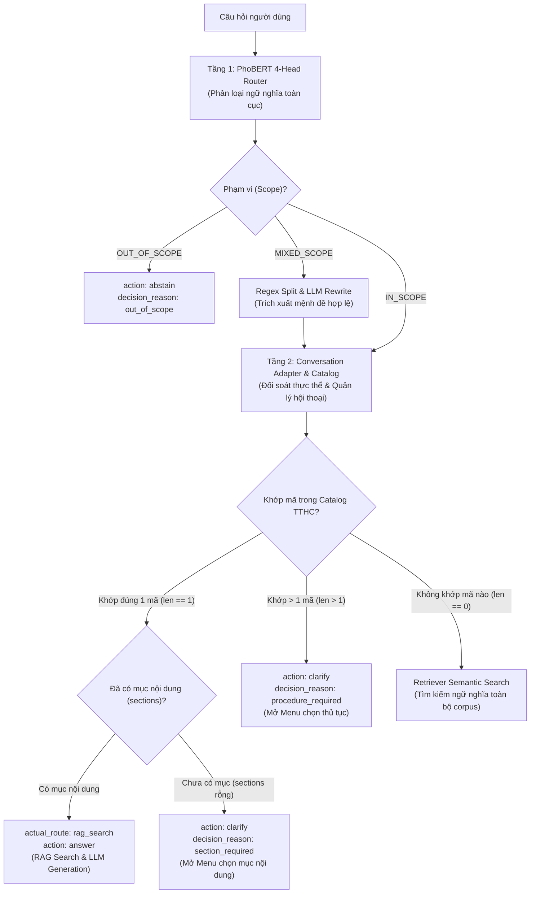
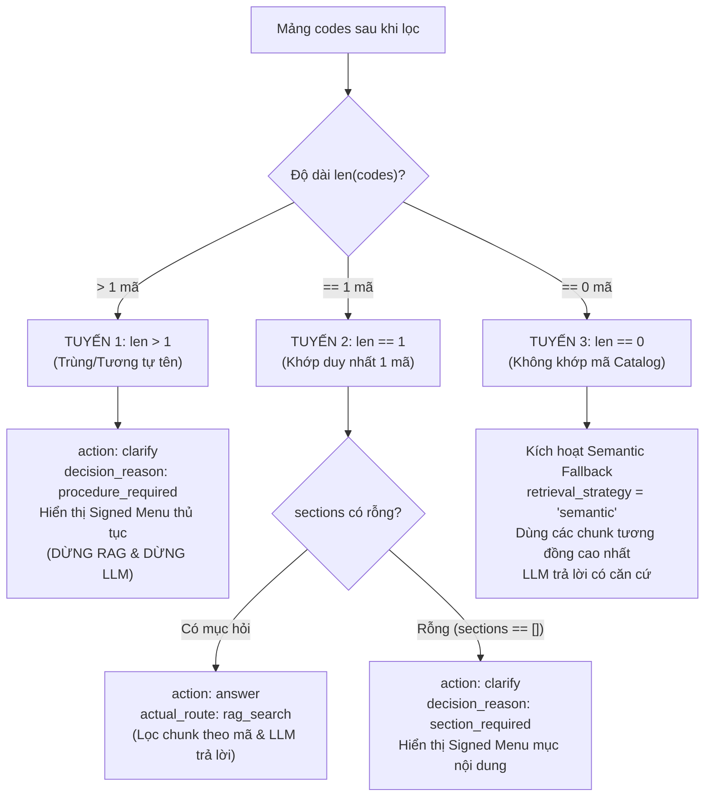

# Báo cáo Chi tiết: Hệ thống Nhãn Phân loại (Routing Labels) & Hành vi Điều phối (Actions) trong ViGovBot

## 1. Tổng quan Kiến trúc Điều phối Hai tầng (Two-Tier Architecture)

Trong hệ thống ViGovBot, quá trình định tuyến câu hỏi và đưa ra quyết định hành động không phụ thuộc đơn lẻ vào mô hình máy học (ML) hay các câu lệnh rẽ nhánh cứng (rules), mà được thiết kế theo **kiến trúc phân tầng chặt chẽ**:



1. **Tầng 1 - Mô hình học máy ([`PhoBERTRouter`](file:///c:/Users/quangTam/Documents/ViGovBot/src/vigovbot/rag/phobert_router.py#L89-L150)):** Phân loại các đặc tính ngữ nghĩa toàn cục (phạm vi, mạch hội thoại, trộn thủ tục, 11 mục nội dung).
2. **Tầng 2 - Tầng điều phối hội thoại ([`conversation.py`](file:///c:/Users/quangTam/Documents/ViGovBot/src/vigovbot/rag/conversation.py#L101-L200) & [`Clarifier`](file:///c:/Users/quangTam/Documents/ViGovBot/src/vigovbot/rag/clarification.py#L82-L135)):** Đối soát với Database Catalog TTHC thực tế, quản lý trạng thái phiên có chữ ký HMAC, phát hiện đa ứng viên và quyết định hành động (`action`) cụ thể.

---

## 2. Tầng 1: Hệ thống 4 Head của PhoBERT Router

Mô hình PhoBERT nhận đầu vào là chuỗi tokenized `<s> question </s></s> previous </s></s> procedure </s>` (tối đa 128 token) và sử dụng 4 linear head riêng biệt được cấu hình trong [`meta.json`](file:///c:/Users/quangTam/Documents/ViGovBot/outputs/phobert_v3_finetuned_20261028/checkpoint/meta.json):

### 2.1. Head 1: Phạm vi (`scope` / `phạm_vi`)
Đánh giá mức độ liên quan tới lĩnh vực Thủ tục hành chính (TTHC) Việt Nam (Softmax):
- **`IN_SCOPE` (`Trong phạm vi`)**: Câu hỏi liên quan đến thủ tục, hồ sơ, thời hạn, phí, cơ quan giải quyết,...
- **`OUT_OF_SCOPE` (`Ngoài phạm vi`)**: Câu hỏi không thuộc phạm vi hỗ trợ (thời tiết, lập trình, trò chuyện tự do,...).
- **`MIXED_SCOPE` (`Hỗn hợp phạm vi`)**: Chứa cả yêu cầu thủ tục lẫn câu hỏi ngoài lề (hệ thống sẽ phân rã regex hoặc dùng LLM trích xuất đoạn nguyên văn liên quan).

### 2.2. Head 2: Mạch hội thoại (`flow` / `mạch_hội_thoại`)
Xác định mức độ phụ thuộc vào ngữ cảnh lịch sử chat (Softmax):
- **`NEW` (`Câu hỏi mới`)**: Câu hỏi độc lập, tự chứa đủ thông tin hoặc chủ động đổi sang thủ tục mới.
- **`FOLLOW_UP` (`Hỏi tiếp`)**: Câu hỏi phụ thuộc vào ngữ cảnh liền trước (ví dụ: *"hết bao nhiêu ngày?", "hồ sơ gồm những gì?"*).

### 2.3. Head 3: Trộn thủ tục (`mix` / `trộn_thủ_tục`)
Dự đoán câu hỏi có chứa đồng thời nhiều thủ tục khác nhau hay không (Softmax):
- **`False` (`Không`)**: Chỉ hỏi về 1 thủ tục hành chính duy nhất (hoặc nêu tên chung chung).
- **`True` (`Có`)**: Cố tình hỏi đồng thời từ 2 thủ tục hành chính khác nhau trong một câu (hệ thống sẽ yêu cầu tách riêng từng thủ tục để tránh ghép nhầm dữ liệu).

### 2.4. Head 4: Mục nội dung (`sections` / `mục_nội_dung`)
Phân loại đa nhãn (multi-label) với cơ chế kích hoạt hàm Sigmoid và bảng ngưỡng riêng (`thresholds`):

| STT | Nhãn tiếng Việt | Mã Enum | Ngưỡng (Threshold) | Ý nghĩa tra cứu |
|:---:|---|---|:---:|---|
| 1 | **Tổng quan** | `OVERVIEW` | 0.50 | Toàn bộ thủ tục hoặc tóm tắt quy trình |
| 2 | **Trình tự thực hiện** | `PROCEDURE` | 0.65 | Các bước thực hiện cụ thể |
| 3 | **Cách thức thực hiện** | `SUBMISSION_METHOD` | 0.70 | Hình thức nộp (trực tuyến, bưu chính, trực tiếp) |
| 4 | **Thành phần hồ sơ** | `DOSSIER` | 0.40 | Danh mục giấy tờ cần chuẩn bị |
| 5 | **Thời hạn giải quyết** | `PROCESSING_TIME` | 0.75 | Thời gian xử lý, số ngày làm việc |
| 6 | **Cơ quan thực hiện** | `AUTHORITY` | 0.70 | Cơ quan tiếp nhận, thẩm quyền giải quyết |
| 7 | **Kết quả thực hiện** | `RESULT` | 0.35 | Văn bản, giấy chứng nhận, quyết định đầu ra |
| 8 | **Phí, lệ phí** | `FEE` | 0.50 | Mức phí, lệ phí giải quyết |
| 9 | **Căn cứ pháp lý** | `LEGAL_BASIS` | 0.40 | Luật, Nghị định, Thông tư quy định |
| 10 | **Điều kiện thực hiện** | `ELIGIBILITY` | 0.50 | Yêu cầu, tiêu chuẩn được thực hiện |
| 11 | **Mẫu đơn, tờ khai** | `FORM` | 0.50 | Biểu mẫu đính kèm |

---

### 2.5. Định dạng dữ liệu đầu ra thực tế của PhoBERT (`PhoBERTRouter.predict`)

Khi gọi hàm [`predict()`](file:///c:/Users/quangTam/Documents/ViGovBot/src/vigovbot/rag/phobert_router.py#L124-L139), đối tượng trả về là một `dict` (JSON format) cấu trúc rõ ràng gồm 3 phần:

```json
{
  /* ================= 1. KẾT QUẢ ĐÃ GIẢI MÃ (DECODED VALUES) ================= */
  "scope": "IN_SCOPE",               // "IN_SCOPE" | "OUT_OF_SCOPE" | "MIXED_SCOPE"
  "flow": "NEW",                     // "NEW" | "FOLLOW_UP"
  "mix": false,                      // false (1 thủ tục) | true (nhiều thủ tục)
  "sections": [                      // Danh sách các mục vượt qua ngưỡng kích hoạt Sigmoid
    "DOSSIER",
    "FEE"
  ],

  /* ================= 2. ĐIỂM XÁC SUẤT CHI TIẾT (PROBABILITIES) ================= */
  "probabilities": {
    "scope": {
      "Trong phạm vi": 0.9852,
      "Ngoài phạm vi": 0.0103,
      "Hỗn hợp phạm vi": 0.0045
    },
    "flow": {
      "Câu hỏi mới": 0.9412,
      "Hỏi tiếp": 0.0588
    },
    "mix": {
      "Không": 0.9921,
      "Có": 0.0079
    },
    "sections": {
      "Tổng quan": 0.0821,
      "Trình tự thực hiện": 0.0435,
      "Cách thức thực hiện": 0.1204,
      "Thành phần hồ sơ": 0.9150,   // >= threshold 0.40 -> Chọn DOSSIER
      "Thời hạn giải quyết": 0.1120,
      "Cơ quan thực hiện": 0.0350,
      "Kết quả thực hiện": 0.0210,
      "Phí, lệ phí": 0.8840,        // >= threshold 0.50 -> Chọn FEE
      "Căn cứ pháp lý": 0.0510,
      "Điều kiện thực hiện": 0.0620,
      "Mẫu đơn, tờ khai": 0.1450
    }
  },

  /* ================= 3. THÔNG TIN KỸ THUẬT & PREPROCESSING ================= */
  "encoded_length": 38,             // Độ dài chuỗi token sau khi tách từ PyVi và BPE
  "thresholds": {                   // Bảng ngưỡng kích hoạt riêng của 11 mục
    "Tổng quan": 0.5,
    "Trình tự thực hiện": 0.65,
    "Cách thức thực hiện": 0.7,
    "Thành phần hồ sơ": 0.4,
    "Thời hạn giải quyết": 0.75,
    "Cơ quan thực hiện": 0.7,
    "Kết quả thực hiện": 0.35,
    "Phí, lệ phí": 0.5,
    "Căn cứ pháp lý": 0.4,
    "Điều kiện thực hiện": 0.5,
    "Mẫu đơn, tờ khai": 0.5
  },
  "preprocessing": {
    "max_len": 128,
    "segmenter": "pyvi",
    "input_mode": "full"
  }
}
```

---

### 2.6. Đối tượng định tuyến chuẩn hóa (`route` & `trace`)
Hàm [`classify_phobert()`](file:///c:/Users/quangTam/Documents/ViGovBot/src/vigovbot/rag/phobert_router.py#L187-L239) bọc kết quả từ model thành định dạng hợp đồng chuẩn cho luồng hội thoại:

```python
route = {
    "scope": "IN_SCOPE",
    "conversation": "NEW",
    "mixed_procedures": False,
    "sections": ["DOSSIER", "FEE"],
    "query": "Hồ sơ và lệ phí làm hộ chiếu?",
    "needs_clarification": False,
    "clarification": "",
    "requests": [
        {
            "procedure": "làm hộ chiếu",
            "query": "Hồ sơ và lệ phí làm hộ chiếu?",
            "sections": ["DOSSIER", "FEE"]
        }
    ]
}
```

---

### 2.7. Phân định ranh giới trách nhiệm của PhoBERT

| PhoBERT ĐẢM NHẬN | PhoBERT KHÔNG ĐẢM NHẬN |
|---|---|
| Phân loại ngữ nghĩa 3 chiều phạm vi (`IN / OUT / MIXED`) | Không trích xuất entity tên/mã thủ tục cụ thể (do Catalog đối soát) |
| Nhận diện mạch hội thoại (`NEW / FOLLOW_UP`) | Không phát hiện số lượng thủ tục trùng/tương tự trong Database |
| Dự đoán câu hỏi gộp 2 thủ tục (`mixed_procedures`) | Không tự ý mở Menu văn bản hay hỏi làm rõ `procedure_required` |
| Phân loại đa nhãn 11 mục nội dung theo ngưỡng Sigmoid | Không sinh câu trả lời trực tiếp (do LLM Qwen đảm nhận) |

---

## 3. Tầng 2: Hệ thống Nhãn Quyết định (Decision Reasons & Actions)

Khi kết quả phân loại của PhoBERT được chuyển tới [`conversation.py`](file:///c:/Users/quangTam/Documents/ViGovBot/src/vigovbot/rag/conversation.py), hệ thống tổng hợp với dữ liệu Catalog để gán các nhãn điều phối cấp cao:

### 3.1. Nhãn hành động tổng quan (`action` & `actual_route`)

| Nhãn `action` | Nhãn `actual_route` | Mục đích |
|---|---|---|
| **`clarify`** | `clarify` | Dừng quy trình RAG; mở menu hoặc gửi câu hỏi yêu cầu người dùng làm rõ. |
| **`answer`** | `rag_search` | Đủ điều kiện truy xuất; thực hiện RAG Search trên vector/BM25 và gọi LLM trả lời. |
| **`abstain`** | `out_of_scope` | Từ chối trả lời vì câu hỏi nằm ngoài phạm vi hoặc chào hỏi xã giao. |
| **`clarify`** | `routing_error` | Xảy ra lỗi phân loại/hết ngân sách token; kích hoạt câu fallback chuẩn. |

---

### 3.2. Chi tiết các nhãn lý do (`decision_reason`)

#### Nhóm 1: Nhánh CLARIFY (Làm rõ)

1. **`procedure_required` (Cần làm rõ thủ tục):**
   - **Kích hoạt khi:** Tên thủ tục trong câu hỏi khớp với $\ge 2$ mã TTHC trong Catalog (`len(codes) > 1`) (ví dụ: cùng một tên nhưng có bản cho *cá nhân* và bản cho *tổ chức*).
   - **Hành vi:** Mở `procedure` menu liệt kê tối đa 5 ứng viên đánh số kèm mã định danh.
2. **`section_required` (Cần chọn mục nội dung):**
   - **Kích hoạt khi:** Đã xác định chính xác duy nhất 1 mã TTHC nhưng người dùng chỉ nêu tên thủ tục trần mà không hỏi rõ mục nào (`sections == []`).
   - **Hành vi:** Mở `section` menu liệt kê các mục nội dung hiện có của thủ tục đó.
3. **`ambiguous_question` (Mơ hồ ngữ cảnh):**
   - **Kích hoạt khi:** Câu hỏi mang tính nối tiếp (`FOLLOW_UP`, vd: *"thế còn hồ sơ?"*) nhưng phiên hội thoại không có mã thủ tục nào được chọn trước đó.
   - **Hành vi:** Yêu cầu người dùng nêu rõ tên thủ tục cần tra cứu.
4. **`invalid_selection` (Lựa chọn không hợp lệ):**
   - **Kích hoạt khi:** Phiên đang mở menu nhưng người dùng nhập số thứ tự vượt quá danh sách hoặc gõ ký tự không hợp lệ.
   - **Hành vi:** In lại menu và yêu cầu người dùng chọn đúng số thứ tự.
5. **`expired_selection` (Menu hết hạn):**
   - **Kích hoạt khi:** Người dùng gửi lựa chọn nhưng chữ ký HMAC của state không khớp hoặc cache phiên đã bị xóa.

#### Nhóm 2: Nhánh ANSWER (Trả lời)

1. **`sufficient` (Đủ bằng chứng):** Chunks tài liệu thu về từ mã TTHC cung cấp đầy đủ thông tin để LLM sinh câu trả lời kèm trích dẫn (`citations`).
2. **`partial` (Thông tin một phần):** Tài liệu chỉ trả lời được một phần yêu cầu; câu trả lời sẽ nêu rõ phần còn thiếu.

#### Nhóm 3: Nhánh ABSTAIN (Từ chối)

1. **`out_of_scope`:** PhoBERT dự đoán câu hỏi ngoài phạm vi và Catalog không tìm thấy thực thể để cứu vớt (override).
2. **`social_greeting`:** Câu hỏi chào hỏi xã giao thuần túy (xin chào, cảm ơn,...).
3. **`confirmation_rejected`:** Người dùng từ chối gợi ý xác nhận thủ tục khi hệ thống hỏi lại.

---

## 4. Phân tích Chuyên sâu: Cơ chế Phân giải Thủ tục & Rẽ 3 Nhánh Quyết định

Cơ chế phân giải danh tính thủ tục (Procedure Identity Resolution) được thực thi trong hàm `answer_conversation()` tại [`src/vigovbot/rag/conversation.py` (dòng 357–392)](file:///c:/Users/quangTam/Documents/ViGovBot/src/vigovbot/rag/conversation.py#L357-L392), kết hợp với đối tượng [`Clarifier`](file:///c:/Users/quangTam/Documents/ViGovBot/src/vigovbot/rag/clarification.py#L82-L135).

### 4.1. Quy trình 4 bước thu thập danh sách mã thủ tục (`codes`)

Trước khi đưa ra quyết định rẽ nhánh, hệ thống tìm danh sách các mã TTHC tiềm năng thông qua 4 cấp lọc từ chặt chẽ đến mở rộng:

1. **Cấp 1 - Khớp mã chính xác hoặc Alias ([`clarifier.matches`](file:///c:/Users/quangTam/Documents/ViGovBot/src/vigovbot/rag/clarification.py#L124)):** Quét regex mã số TTHC (dạng `1.xxxxxx`), quét tên đầy đủ hoặc từ điển bí danh (curated aliases).
2. **Cấp 2 - Quét biến thể số nhiều ([`clarifier.inspect`](file:///c:/Users/quangTam/Documents/ViGovBot/src/vigovbot/rag/clarification.py#L158)):** Bắt các mẫu câu mở đầu như *"các thủ tục..."*, *"những thủ tục..."* hoặc cụm biến thể cùng nhóm.
3. **Cấp 3 - Khớp cụm từ trong Catalog ([`clarifier.discover`](file:///c:/Users/quangTam/Documents/ViGovBot/src/vigovbot/rag/clarification.py#L158-L185)):** Tách từ khóa sau khi loại bỏ stopword và tìm các thủ tục chứa cụm từ khóa có trật tự tương tự trong Catalog.
4. **Cấp 4 - Tìm kiếm tương đồng ngữ nghĩa dự phòng (Retriever Search):** Nếu 3 bước trên không có kết quả, gọi FAISS vector + BM25 trên toàn bộ corpus để lấy Top K tài liệu liên quan nhất.

Sau khi hoàn tất 4 bước, hệ thống thu được mảng danh sách `codes = [...]`.

---

### 4.2. Mã nguồn rẽ 3 nhánh logic (`len(codes)`)

Đoạn mã quyết định rẽ nhánh nằm tại dòng 385–392 của [`conversation.py`](file:///c:/Users/quangTam/Documents/ViGovBot/src/vigovbot/rag/conversation.py#L385-L392):

```python
# -------------------------------------------------------------------------
# TUYẾN 1: Khớp nhiều thủ tục (len(codes) > 1) -> Mở Menu làm rõ
# -------------------------------------------------------------------------
if len(codes) > 1:
    result["retrieval_s"] = time.perf_counter() - retrieval_started
    return menu_result("procedure", index, codes)

# -------------------------------------------------------------------------
# TUYẾN 2: Không khớp mã nào trong Catalog (len(codes) == 0) -> Semantic Fallback
# -------------------------------------------------------------------------
if not codes:
    request["missing"] = True
    unresolved_semantic_hits[index] = hits  # Lưu lại các chunk vector tương đồng

# -------------------------------------------------------------------------
# TUYẾN 3: Khớp duy nhất 1 mã (len(codes) == 1) -> Chốt mã định danh
# -------------------------------------------------------------------------
else:
    request["code"] = codes[0]
```

---

### 4.3. Phân tích chi tiết hành vi của từng tuyến



#### Tuyến 1: `len(codes) > 1` (Trùng hoặc tương tự tên)
- **Hành động:** `action = "clarify"`, `decision_reason = "procedure_required"`.
- **Nguyên lý bảo vệ:** Hệ thống **ngắt ngay lập tức**, không truy xuất văn bản và không gọi LLM Qwen (`answer.assert_not_called()`). Điều này ngăn ngừa hoàn toàn hiện tượng *ô nhiễm ngữ cảnh (Context Pollution)* và *ảo giác (Hallucination)* khi cố ghép nối hai thủ tục khác đối tượng (như cá nhân vs tổ chức).
- **Kết quả:** Hiển thị Menu đánh số (tối đa 5 lựa chọn) kèm chữ ký số HMAC SHA-256 để người dùng bấm chọn số ở lượt sau qua `direct_choice`.

#### Tuyến 2: `len(codes) == 1` (Khớp duy nhất 1 mã)
- **Hành động:** Gán chính thức mã thủ tục vào `request["code"] = codes[0]`.
- **Phân nhánh tiếp theo:**
  - Nếu câu hỏi đã chứa mục nội dung cụ thể (`sections != []`, ví dụ hỏi hồ sơ, lệ phí): Tiến hành truy xuất chính xác các chunk có `source_code == code` và gọi LLM trả lời $\rightarrow$ `action = "answer"`, `actual_route = "rag_search"`.
  - Nếu câu hỏi chỉ nêu tên thủ tục trần (`sections == []`): Dừng lại và mở Menu chọn mục nội dung $\rightarrow$ `action = "clarify"`, `decision_reason = "section_required"`.

#### Tuyến 3: `len(codes) == 0` (Dự phòng ngữ nghĩa - Semantic Fallback)
- **Hành động:** `request["missing"] = True`, lưu `unresolved_semantic_hits`.
- **Nguyên lý linh hoạt:** Mặc dù không khớp mã cụ thể trong catalog nhưng PhoBERT đã xác nhận câu hỏi là `IN_SCOPE`. Hệ thống không vội vàng từ chối (`abstain`) mà chuyển sang chiến lược `retrieval_strategy = "semantic"`.
- **Kết quả:** Dùng các đoạn văn bản tương đồng ngữ nghĩa nhất từ FAISS/BM25 chuyển cho LLM Qwen trả lời có căn cứ kèm ghi chú. Nếu kho dữ liệu hoàn toàn không có chunk nào liên quan (`not hits`), hệ thống mới chuyển sang từ chối với `action = "abstain"` và `decision_reason = "no_context"`.

---

## 5. Bảng Đối soát Toàn diện (Taxonomy & State Mapping)

| Tình huống thực tế | Nhãn PhoBERT Router | Nhãn Hệ thống (`actual_route` / `action`) | `decision_reason` | Trạng thái tiếp theo |
|---|---|---|---|---|
| Hỏi rõ 1 thủ tục + mục hỏi | `IN_SCOPE`, `NEW`, `mix: False`, `sections: [FEE]` | `rag_search` / `answer` | `sufficient` | Kết thúc lượt, trả câu trả lời |
| Tên thủ tục khớp nhiều đối tượng (`len > 1`) | `IN_SCOPE`, `NEW`, `mix: False`, `sections: [...]` | `clarify` / `clarify` | `procedure_required` | Lưu Signed Menu thủ tục |
| Chỉ nêu tên 1 thủ tục duy nhất (`len == 1`) | `IN_SCOPE`, `NEW`, `mix: False`, `sections: []` | `clarify` / `clarify` | `section_required` | Lưu Signed Menu mục nội dung |
| Không khớp mã trong Catalog (`len == 0`) | `IN_SCOPE`, `NEW`, `mix: False`, `sections: [...]` | `rag_search` / `answer` | `sufficient` (semantic) | Sinh câu trả lời qua Semantic Fallback |
| Câu hỏi ngoài lề (thời tiết, code) | `OUT_OF_SCOPE`, `NEW`, `mix: False`, `sections: []` | `out_of_scope` / `abstain` | `out_of_scope` | Trả lời từ chối lịch sự |
| Hỏi tiếp nhưng không có lịch sử | `IN_SCOPE`, `FOLLOW_UP`, `mix: False`, `sections: [...]` | `clarify` / `clarify` | `ambiguous_question` | Yêu cầu nêu tên thủ tục |
| Chào hỏi xã giao | `OUT_OF_SCOPE`, `NEW`, `mix: False`, `sections: []` | `out_of_scope` / `abstain` | `social_greeting` | Phản hồi lời chào |
| Nhập sai số menu | (Bỏ qua Router, xử lý trực tiếp qua `direct_choice`) | `clarify` / `clarify` | `invalid_selection` | Hiển thị lại Menu hiện tại |
