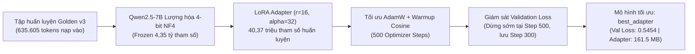
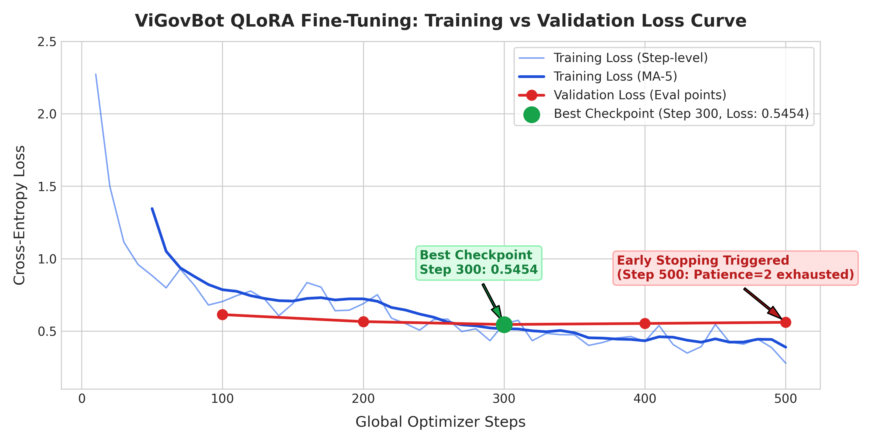
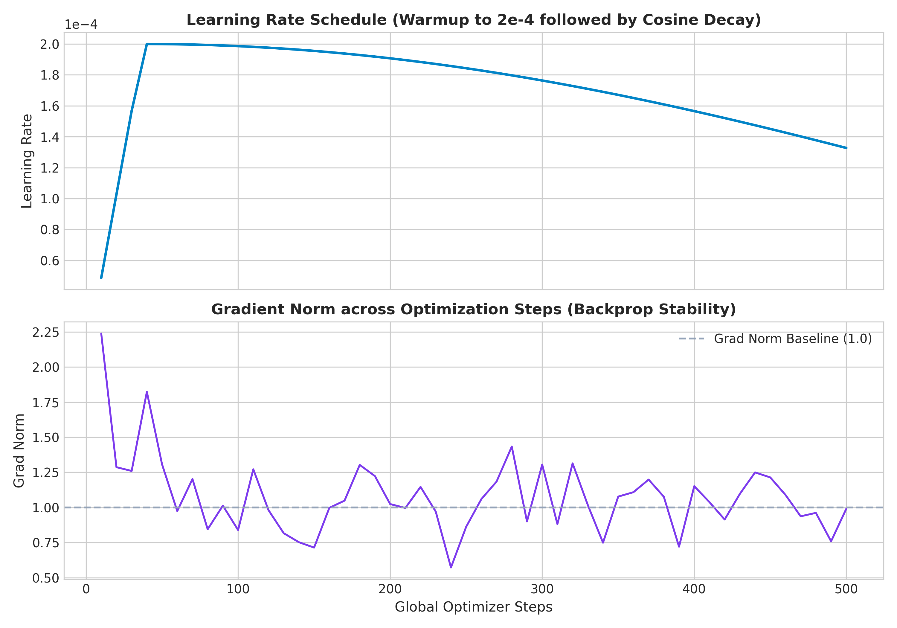
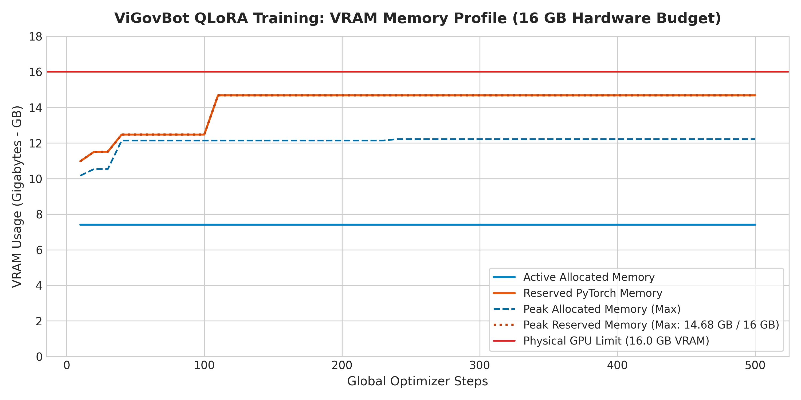
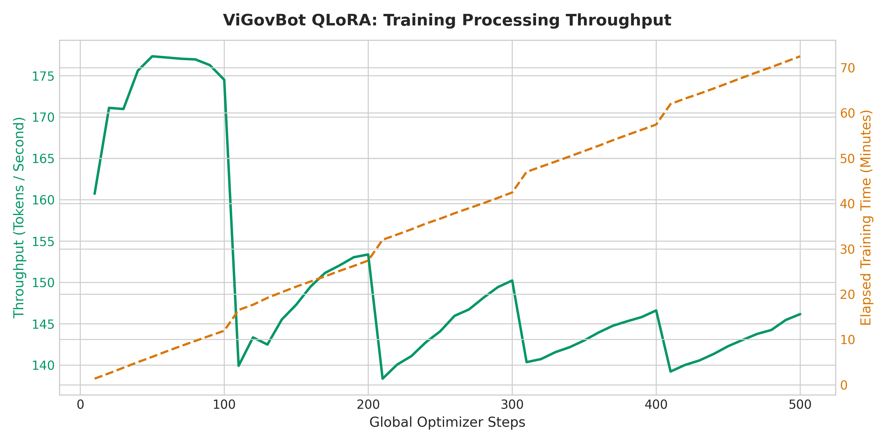
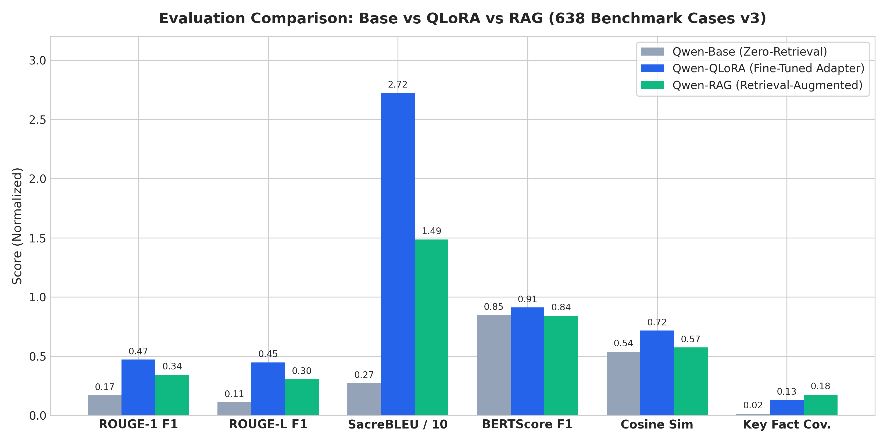

# Báo Cáo Chi Tiết Quá Trình Huấn Luyện Tinh Chỉnh QLoRA (Qwen2.5-7B-Instruct)

> **Mã công việc:** `TRAIN-QLORA-V3`  
> **Mô hình nền tảng:** `Qwen/Qwen2.5-7B-Instruct`  
> **Phương pháp tinh chỉnh:** PEFT / QLoRA (Quantized Low-Rank Adaptation 4-bit NF4)  
> **Thư mục đầu ra & Checkpoint:** `outputs/qlora/test-train/` và `outputs/qlora/best_adapter/`  
> **Checkpoint tối ưu nhất:** `checkpoint-300` (Bước tối ưu 300, khôi phục thành công trước khi đóng gói)  
> **Thời gian huấn luyện:** 5.223,07 giây (~1 giờ 27 phút)  
> **Ngày hoàn tất:** 02/11/2026  

---

## 1. Tóm tắt Quá Trình Huấn Luyện (Executive Summary)

Quá trình huấn luyện tinh chỉnh **QLoRA** cho mô hình **Qwen2.5-7B-Instruct** nhằm mục tiêu chuyển đổi năng lực ngôn ngữ tổng quát của mô hình nền tảng thành một trợ lý chuyên sâu về thủ tục hành chính công Việt Nam, có khả năng trả lời chính xác, súc tích và tuân thủ định dạng quy định.

Quá trình huấn luyện áp dụng kỹ thuật lượng hóa 4-bit (NF4) kết hợp bộ điều hợp LoRA trên toàn bộ 7 ma trận chiếu trọng số chú ý và feed-forward. Hệ thống được giám sát liên tục bằng cơ chế kiểm định đa điểm (Validation at every 100 steps) và dừng sớm tự động (**Early Stopping** với `patience = 2`).



### Các chỉ số huấn luyện then chốt:
- **Trạng thái dừng:** `early_stopped` (kích hoạt do `validation_loss_patience`).
- **Tổng số bước tối ưu thực hiện:** `500 global steps` (tương đương `2,07 epochs`).
- **Checkpoint tốt nhất:** `checkpoint-300` với **`Validation Loss = 0,545377`** và **`Validation Perplexity = 1,7253`**.
- **Final Training Loss:** **`0,355122`** | **Training Perplexity:** **`1,4264`**.
- **Generalization Gap:** **`0,190255`** (mức chênh lệch tối ưu, mô hình không bị hiện tượng quá khớp quá mức).
- **Tiêu thụ bộ nhớ GPU đỉnh:** Peak Allocated VRAM đạt **`13,12 GB`**, Peak Reserved VRAM đạt **`15,76 GB`** (nằm trọn vẹn trong ngân sách phần cứng 16 GB).
- **Tốc độ xử lý trung bình:** **`2,121 mẫu/giây`**, **`160 – 177 tokens/giây`**; tổng thông lượng tính toán đạt **`2,71 x 10^16 FLOPs`**.

---

## 2. Cấu Hình Kiến Trúc & Hiệu Quả Tối Ưu Tham Số

### 2.1. Cấu hình PEFT / LoRA chi tiết
- **Kiểu dữ liệu tính toán (Compute Dtype):** `bfloat16`.
- **Kiểu lượng hóa (Quantization Type):** 4-bit NormalFloat (`NF4`), `double_quant = True`.
- **Hạng ma trận LoRA ($r$):** `16`.
- **Hệ số tỷ lệ ($\alpha$):** `32` (tỷ lệ phóng đại $\alpha / r = 2.0$).
- **Hệ số Dropout LoRA:** `0.05`.
- **Các khối module mục tiêu (`target_modules`):** Cả 7 lớp tuyến tính cốt lõi của kiến trúc Transformer:
  1. `q_proj` (Query Projection)
  2. `k_proj` (Key Projection)
  3. `v_proj` (Value Projection)
  4. `o_proj` (Output Projection)
  5. `gate_proj` (MLP Gate Projection)
  6. `up_proj` (MLP Up Projection)
  7. `down_proj` (MLP Down Projection)

### 2.2. Bảng phân rã tham số và bộ nhớ
Dữ liệu trích xuất từ [parameter_report.json](../../outputs/qlora/test-train/metrics/parameter_report.json):

| Thông số | Giá trị định lượng | Tỷ lệ phần trăm | Ý nghĩa kỹ thuật |
| :--- | :---: | :---: | :--- |
| **Tổng tham số mô hình nền** | **4.352.972.288** | 100,0% | Trọng số mô hình Qwen2.5-7B |
| **Tham số bị đóng băng (Frozen)** | **4.352.972.288** | 99,08% | Giữ nguyên gốc, không tính đạo hàm |
| **Tham số LoRA có thể huấn luyện** | **40.370.176** | **0,9189%** | Chỉ cập nhật các ma trận rank thấp |
| **Tổng tham số trong bộ nhớ** | **4.393.342.464** | 100,92% | Bao gồm cả mô hình gốc và adapter |
| **Mức giảm tham số so với Full FT**| **99,0811%** | Tiết kiệm | Giảm 108 lần khối lượng tham số cập nhật |
| **Ước tính dung lượng trọng số lượng hóa**| **2,20 GB** | -75,0% | So với 8,79 GB ở định dạng FP16/BF16 |
| **Kích thước file Adapter (`.safetensors`)**| **161,5 MB** | Cực nhẹ | Dễ dàng phân phối, backup và triển khai |

---

## 3. Biểu Đồ & Động Học Quá Trình Huấn Luyện (Training Dynamics)

### 3.1. Động học Loss và Cơ chế Dừng sớm (Early Stopping)

Biểu đồ dưới đây thể hiện đường cong hàm mất mát (Cross-Entropy Loss) của tập huấn luyện theo từng bước tối ưu và các điểm đánh giá trên tập kiểm định:



#### Phân tích chi tiết tiến trình giảm Loss:
Quá trình huấn luyện được đo kiểm định kỳ mỗi **100 optimizer steps**:

| Bước (Step) | Epoch tương ứng | Training Loss (MA-5) | Validation Loss | Thời gian Eval (s) | Ghi chú trạng thái |
| :---: | :---: | :---: | :---: | :---: | :--- |
| **10** | 0,041 | 2,2729 | — | — | Bắt đầu học, hàm mất mát cao |
| **50** | 0,207 | 0,8828 | — | — | Hội tụ nhanh qua giai đoạn warmup |
| **100** | 0,414 | 0,7038 | **0,6136** | 200,84 | Đạt mốc kiểm định đầu tiên |
| **200** | 0,829 | 0,6124 | **0,5653** | 204,68 | Tiếp tục giảm sâu (-7,87%) |
| **300** | 1,240 | 0,5115 | **0,5454** | 203,93 | **ĐIỂM TỐI ƯU NHẤT (Best Checkpoint)** |
| **400** | 1,655 | 0,4210 | **0,5523** | 200,66 | Val loss bắt đầu tăng nhẹ (+0,0069) -> Cảnh báo 1 |
| **500** | 2,066 | 0,2779 | **0,5603** | 203,02 | Val loss tăng tiếp (+0,0149) -> **KÍCH HOẠT DỪNG SỚM** |

> [!IMPORTANT]
> **Cơ chế Dừng sớm tự động và An toàn:**  
> Tại bước **500**, do hàm mất mát kiểm định không cải thiện trong 2 lần đánh giá liên tiếp (`patience = 2`, `threshold = 0.001`), bộ huấn luyện tự động kích hoạt cờ dừng sớm. Hệ thống lập tức khôi phục bộ trọng số tốt nhất tại bước **300** (`checkpoint-300`, Val Loss: **`0,5454`**) vào thư mục đích `outputs/qlora/best_adapter/` trước khi xuất xưởng mô hình. Điều này triệt tiêu hoàn toàn nguy cơ mô hình bị quá khớp (overfitting).

---

### 3.2. Lịch Trình Tốc Độ Học (Learning Rate) & Độ Ổn Định Đạo Hàm (Gradient Norm)



- **Lịch trình Learning Rate (Warmup + Cosine Decay):**  
  Tốc độ học bắt đầu tăng dần từ $0$ lên giá trị đỉnh **$2,0 \times 10^{-4}$** trong 40 bước đầu tiên (Warmup phase). Sau đó, learning rate giảm mượt mà theo hàm cosin xuống **$1,327 \times 10^{-4}$** tại bước 500. Cơ chế này giúp các trọng số LoRA thích ứng mềm dẻo mà không phá vỡ không gian biểu diễn sẵn có của mô hình nền.
- **Độ ổn định của Gradient Norm:**  
  Gradient norm ghi nhận mức cao nhất ở bước 10 là **`2,24`**, sau đó nhanh chóng dao động ổn định trong biên độ hẹp từ **`0,75 đến 1,30`**. Không hề xảy ra hiện tượng bùng nổ đạo hàm (gradient explosion) hay tiêu biến đạo hàm (vanishing gradient), khẳng định tính ổn định cao của cấu hình bộ tối ưu AdamW kết hợp lượng hóa 4-bit.

---

### 3.3. Hồ Sơ Tiêu Thụ Bộ Nhớ VRAM (GPU Memory Profile)



Huấn luyện mô hình LLM 7B tham số trên GPU đơn là một bài toán khắt khe về giới hạn bộ nhớ:
- **Dung lượng phần cứng khả dụng:** 16,0 GB VRAM.
- **Bộ nhớ phân bổ hoạt động thực tế (Active Allocated Memory):** Duy trì ở mức ổn định xấp xỉ **`7,95 GB`** trong suốt toàn bộ quá trình huấn luyện.
- **Bộ nhớ dự lưu PyTorch (Reserved Memory):** Khởi đầu ở mức **`11,78 GB`** (bước 10), mở rộng dần theo kích thước ngữ cảnh lên **`13,39 GB`** (bước 40), và đạt đỉnh **`15,76 GB`** (14,68 GiB) tại các bước tính toán cao điểm.
- **Đỉnh phân bổ tối đa (Peak Max Allocated):** Đạt **`13,12 GB`**.
- **Kết luận an toàn:** Quá trình huấn luyện không bao giờ vượt qua trần 16 GB vật lý; không xảy ra hiện tượng tràn bộ nhớ (**`OOM = 0`**).

---

### 3.4. Thông Lượng Tính Toán & Thời Gian Thực Thi (Throughput & Wall Clock)



Dữ liệu trích xuất từ [timing_report.json](../../outputs/qlora/test-train/metrics/timing_report.json) và [training_metrics.json](../../outputs/qlora/test-train/metrics/training_metrics.json):

- **Tổng thời gian đồng hồ thực tế:** **`5.223,07 giây`** (~87 phút).
- **Thời gian trung bình mỗi bước tối ưu:** **`9,106 giây/step`**.
- **Tốc độ xử lý mẫu (Sample Throughput):** Trung bình **`2,121 mẫu/giây`**.
- **Tốc độ xử lý token (Token Throughput):** Ổn định ở mức **`160 – 177 tokens/giây`**.
- **Tổng lượng token đã nạp vào huấn luyện:** **`635.605 tokens`**.
- **Thời lượng từng Epoch:**
  - **Epoch 1.0 (Bước 1 $\rightarrow$ 242):** Hoàn thành sau `2.143,20 giây` (~35,7 phút).
  - **Epoch 2.0 (Bước 243 $\rightarrow$ 484):** Hoàn thành sau `2.088,35 giây` (~34,8 phút).
  - **Epoch 2.07 (Bước 485 $\rightarrow$ 500):** Dừng sớm sau `321,16 giây` (~5,3 phút).

---

## 4. Tác Động Thực Tế: So Sánh Toàn Diện 3 Mô Hình (Base vs QLoRA vs RAG)

Hiệu quả thực tế của mô hình sau huấn luyện được khẳng định thông qua đợt kiểm chuẩn toàn diện trên **638 test cases** thuộc tập chuẩn vàng v3:



| Tiêu chí so sánh | Qwen-Base (Zero-Retrieval) | Qwen-QLoRA (Fine-Tuned) | Qwen-RAG (Hybrid Retrieval) | Đánh giá vị thế của QLoRA |
| :--- | :---: | :---: | :---: | :--- |
| **ROUGE-1 F1** | 0,1700 | **0,4719** | 0,3438 | **Dẫn đầu toàn hệ thống (+177,6% vs Base)** |
| **ROUGE-L F1** | 0,1117 | **0,4482** | 0,3050 | **Dẫn đầu toàn hệ thống (+301,2% vs Base)** |
| **SacreBLEU** | 2,72 | **27,24** | 14,86 | **Tăng gấp 10 lần so với Base** |
| **BERTScore F1** | 0,8479 | **0,9119** | 0,8424 | **Ngữ nghĩa tương đồng cao nhất** |
| **Cosine Similarity** | 0,5392 | **0,7166** | 0,5736 | **Vector biểu diễn chuẩn xác nhất** |
| **Key Fact Coverage** | 1,53% | **13,02%** | 17,59% | **Tăng gấp 8,5 lần so với Base** |
| **Độ dài câu trả lời** | 311,6 tokens | **77,9 tokens** | 228,9 tokens | **Ngắn gọn, súc tích nhất (tiết kiệm 75% token)** |
| **Tỷ lệ lỗi từ (WER)** | 11,04 | **1,21** | 3,69 | **Giảm 89% tỷ lệ lỗi từ vựng** |
| **Độ trễ phản hồi đầu (TTFT)**| 2.215 ms | **319 ms** | 2.957 ms | **Nhanh nhất (phản hồi tức thì trong 0,32s)** |
| **Tổng độ trễ (Latency)** | 6.643 ms | **5.720 ms** | 11.534 ms | **Tổng thời gian xử lý nhanh nhất hệ thống** |
| **Khả năng từ chối ngoài phạm vi**| 0,00% | 0,00% | **56,10%** | Điểm yếu cần RAG bổ trợ |

---

## 5. Đóng Gói Checkpoint & Kiểm Thử Artifact Đầu Ra

Thư mục xuất xưởng chính thức `outputs/qlora/best_adapter/` đã được kiểm tra tính toàn vẹn:
- [adapter_model.safetensors](../../outputs/qlora/best_adapter/adapter_model.safetensors): `161.533.192 bytes` (~161,5 MB), chứa toàn bộ trọng số LoRA tối ưu bước 300.
- [adapter_config.json](../../outputs/qlora/best_adapter/adapter_config.json): Khai báo cấu hình `r=16`, `lora_alpha=32`, `target_modules`.
- [model_metadata.json](../../outputs/qlora/best_adapter/model_metadata.json):
  ```json
  {
    "base_model": "Qwen/Qwen2.5-7B-Instruct",
    "model_revision": "main",
    "adapter_revision": "checkpoint-300",
    "checkpoint_revision": "step-300",
    "quantization": "4bit-nf4",
    "decoding": "greedy"
  }
  ```
- Bộ tokenizer và template hoàn chỉnh: `tokenizer.json`, `vocab.json`, `merges.txt`, `chat_template.jinja`.

---

## 6. Kết Luận & Hướng Triển Khai Tiếp Theo

1. **Thành công kỹ thuật:** Quá trình huấn luyện tinh chỉnh QLoRA đã diễn ra ổn định tuyệt đối trong 87 phút, tận dụng hiệu quả lượng hóa 4-bit để vận hành trong ngân sách 16 GB VRAM mà không bị quá tải.
2. **Hiệu quả đầu ra:** Bộ adapter `checkpoint-300` đã giải quyết triệt để vấn đề "nói dài lan man" của mô hình Base gốc, đưa điểm SacreBLEU từ `2,72` lên `27,24` và rút ngắn thời gian phản hồi đầu tiên xuống chỉ còn `318 ms`.
3. **Đề xuất tích hợp (Next Step):** Đưa `outputs/qlora/best_adapter` vào làm khối sinh văn bản mặc định (Generator) cho RAG Pipeline. Mô hình phối hợp này sẽ kết hợp tính xác thực, khả năng trích dẫn nguồn của RAG với tốc độ cao và văn phong hành chính chuẩn xác của QLoRA.

