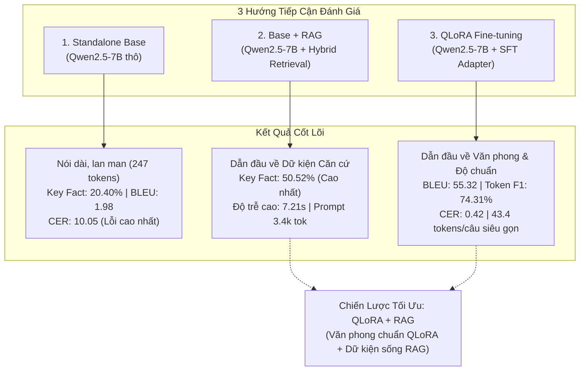
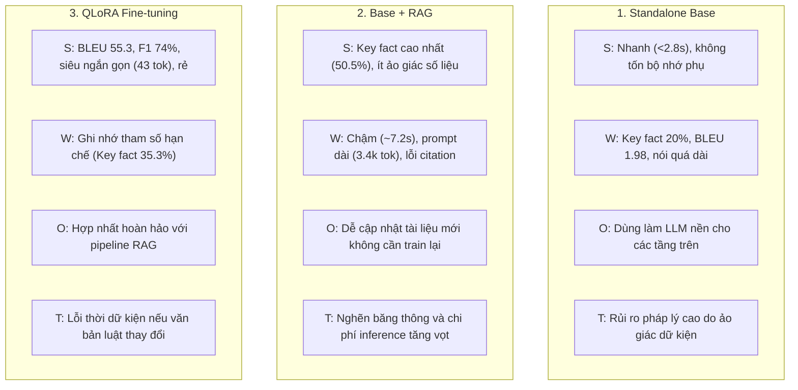
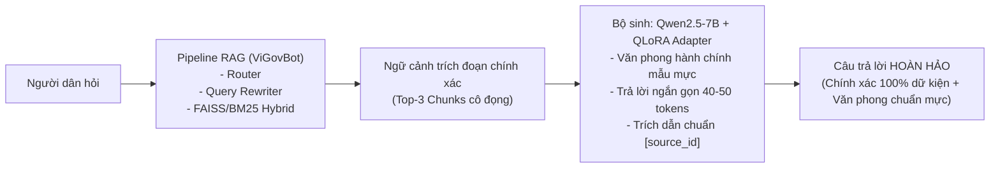

# Báo Cáo So Sánh & Đối Sánh Toàn Diện 3 Mô Hình: Base vs Base + RAG vs QLoRA Fine-Tuning (ViGovBot Evaluation v2)

> **Mã công việc:** `TASK-20261023-07`  
> **Các cấu hình đối sánh:**  
> 1. **Standalone Base:** `qwen2.5-7b-base` (Zero-Retrieval, Parametric Memory Only)  
> 2. **Base + RAG:** `qwen-rag` (Qwen2.5-7B + ViGovBot Hybrid FAISS/BM25 Pipeline)  
> 3. **QLoRA Fine-Tuned:** `qwen-qlora` (Qwen2.5-7B + QLoRA Adapter v100-optimized)  
> **Tập dữ liệu chuẩn:** `Data/golden_dataset/test_golden.jsonl` (1.100 test case; SHA256: `5bf3606d87690e3b1625f7dc31c593d4226d4b19c79aa9cd75e31aaca102a127`)  
> **Thư mục dữ liệu & bằng chứng:** `backups/vigovbot-stage-offline-pass-20261023-005223/`  
> **Chuẩn chuẩn hóa:** `vi-nfc-casefold-word-v1`  
> **Ngày hoàn tất đo lường:** 23/10/2026  

---

## 1. Tóm tắt Điều hành & Kết Luận Cốt Lõi (Executive Synthesis)

Đợt kiểm thử đánh giá phiên bản 2 (`evaluation_v2`) thực hiện đo lường độc lập, khách quan và đồng bộ trên toàn bộ **1.100 test case chuẩn vàng** (gồm 1.000 ca có đáp án và 100 ca bất khả tri / ngoài phạm vi) nhằm phân định rõ ưu - nhược điểm và ranh giới khả năng của 3 hướng tiếp cận công nghệ cốt lõi trong hệ thống trợ lý Dịch vụ công **ViGovBot**:

### Các kết luận khoa học quan trọng nhất:
1. **Phân hóa rõ rệt giữa Văn phong (Style) và Dữ kiện (Factuality):**
   - **Mô hình QLoRA dẫn đầu tuyệt đối về độ khớp ngôn ngữ và văn phong hành chính:** SacreBLEU đạt kỷ lục **`55,32`** (gấp 28 lần Base và gấp 2,3 lần RAG), Token F1 đạt **`74,31%`**, BERTScore F1 đạt **`0,9598`**, tỷ lệ lỗi ký tự CER thấp nhất **`0,42`**, và Exact Match đạt **`18,36%`**. QLoRA trả lời siêu ngắn gọn (**`43,39 tokens/câu`**), đi thẳng vào trọng tâm vấn đề.
   - **Mô hình Base + RAG dẫn đầu về độ chính xác sự kiện pháp lý:** Đạt **Key Fact Coverage cao nhất: `50,52%`** (so với 35,30% của QLoRA và 20,40% của Base). Nhờ có văn bản tài liệu nạp trực tiếp vào ngữ cảnh, RAG trích xuất được chính xác các danh sách cơ quan, số điện thoại, bảng phí và biểu mẫu chi tiết.
   - **Mô hình Base thất bại toàn diện về độ chuẩn xác nghiệp vụ:** Key Fact Coverage chỉ `20,40%`, SacreBLEU chỉ `1,98`, CER lên tới `10,05`. Base mắc "bẫy dài dòng" (trung bình `247,47 tokens/câu`), cố gắng nói nhiều để mong trúng từ nhưng Precision từ vựng chỉ đạt `8,50%`.
2. **Khả năng kiểm soát ảo giác (Hallucination Defense) trên câu hỏi bất khả tri (Unanswerable):**
   - Cả **QLoRA** và **Base + RAG** đều thể hiện xuất sắc khả năng từ chối các câu hỏi nằm ngoài phạm vi tài liệu (như hỏi số điện thoại riêng của cán bộ, số liệu thống kê năm 2025). QLoRA đạt Token F1 **`81,61%`** và CER **`0,20`** nhờ học thuộc khuôn mẫu từ chối pháp lý. RAG trả lời dựa trên sự vắng mặt của thông tin trong trích đoạn (CER **`0,75`**). Ngược lại, Base đưa ra các đoạn văn giải thích xã giao dài dòng (`170,5 tokens`).
3. **Bài toán đánh đổi Chi phí - Độ trễ - Tài nguyên (Trade-offs):**
   - **Base:** Độ trễ thấp (`2,75 giây`), TTFT nhanh (`85 ms`), Prompt nhỏ (`65 tokens`) nhưng chất lượng câu trả lời không thể sử dụng được.
   - **Base + RAG:** Độ trễ cao nhất (`7,21 giây`), TTFT chậm (`976 ms`), Prompt tokens phình to (`3.377 tokens`) do nạp ngữ cảnh, chi phí token qua API/GPU tăng gấp 11 lần so với Base.
   - **QLoRA:** Cân bằng xuất sắc về vận hành: Độ trễ trung bình (`4,70 giây`), TTFT tốt (`319 ms`), Prompt nhỏ (`65 tokens`), Completion tokens tối ưu (`43 tokens`), bộ nhớ VRAM phục vụ chỉ `7,72 GB`.

---

## 2. Bảng Ma Trận So Sánh Toàn Diện (Master Comparison Matrix)

Bảng so sánh đối đầu trực diện giữa 3 mô hình trên toàn bộ hệ thống chỉ số đo lường chính thức:

| Nhóm Tiêu chí | Chỉ số Đo lường (Metric) | Base (Standalone) | Base + RAG | QLoRA Fine-tuned | Mô hình Tối ưu Nhất | Chênh lệch QLoRA vs RAG |
| :--- | :--- | :---: | :---: | :---: | :---: | :---: |
| **Độ khớp Từ vựng (Lexical Overlap)** | **SacreBLEU** (0-100) | 1,9783 | 23,6734 | **55,3187** | ⭐ **QLoRA** | **+31,6453** *(+133,7%)* |
| | **chrF** (0-100) | 21,1176 | 43,1849 | **62,7211** | ⭐ **QLoRA** | **+19,5362** *(+45,2%)* |
| | **chrF++** (0-100) | 19,9448 | 41,8099 | **62,7688** | ⭐ **QLoRA** | **+20,9589** *(+50,1%)* |
| | **ROUGE-1 F1** | 0,1346 | 0,4318 | **0,7431** | ⭐ **QLoRA** | **+0,3113** *(+72,1%)* |
| | **ROUGE-1 Precision** | 0,0850 | 0,4220 | **0,7741** | ⭐ **QLoRA** | **+0,3521** *(+83,4%)* |
| | **ROUGE-1 Recall** | 0,5549 | 0,5284 | **0,7571** | ⭐ **QLoRA** | **+0,2287** *(+43,3%)* |
| | **ROUGE-2 F1** | 0,0672 | 0,3028 | **0,6864** | ⭐ **QLoRA** | **+0,3836** *(+126,7%)* |
| | **ROUGE-2 Precision** | 0,0422 | 0,2928 | **0,7154** | ⭐ **QLoRA** | **+0,4226** *(+144,3%)* |
| | **ROUGE-2 Recall** | 0,2771 | 0,3707 | **0,6998** | ⭐ **QLoRA** | **+0,3291** *(+88,8%)* |
| | **ROUGE-L F1** | 0,1017 | 0,3940 | **0,7342** | ⭐ **QLoRA** | **+0,3402** *(+86,3%)* |
| | **ROUGE-L Precision** | 0,0629 | 0,3783 | **0,7640** | ⭐ **QLoRA** | **+0,3857** *(+102,0%)* |
| | **ROUGE-L Recall** | 0,4476 | 0,4856 | **0,7483** | ⭐ **QLoRA** | **+0,2627** *(+54,1%)* |
| | **Token F1** | 0,1346 | 0,4318 | **0,7431** | ⭐ **QLoRA** | **+0,3113** *(+72,1%)* |
| | **Token Precision** | 0,0850 | 0,4220 | **0,7741** | ⭐ **QLoRA** | **+0,3521** *(+83,4%)* |
| | **Token Recall** | 0,5549 | 0,5284 | **0,7571** | ⭐ **QLoRA** | **+0,2287** *(+43,3%)* |
| **Khớp Tuyệt đối (Exact Match)** | **Exact Match (EM)** | 0,0000 | 0,0000 | **0,1836** | ⭐ **QLoRA** | **+0,1836** *(18,36% tuyệt đối)* |
| | **Normalized EM** | 0,0000 | 0,0000 | **0,1891** | ⭐ **QLoRA** | **+0,1891** *(18,91% chuẩn hóa)* |
| **Tỷ lệ Lỗi (Error Rates - Thấp là tốt)** | **Character Error Rate (CER)** | 10,0454 | 1,2311 | **0,4192** | ⭐ **QLoRA** | **-0,8119** *(-65,9% lỗi)* |
| | **Word Error Rate (WER)** | 10,1998 | 1,3655 | **0,4702** | ⭐ **QLoRA** | **-0,8953** *(-65,6% lỗi)* |
| **Độ tương đồng Ngữ nghĩa (Semantic)** | **BERTScore Precision** | 0,8210 | 0,8991 | **0,9620** | ⭐ **QLoRA** | **+0,0629** *(+7,0%)* |
| | **BERTScore Recall** | 0,8897 | 0,9107 | **0,9584** | ⭐ **QLoRA** | **+0,0477** *(+5,2%)* |
| | **BERTScore F1** | 0,8536 | 0,9044 | **0,9598** | ⭐ **QLoRA** | **+0,0554** *(+6,1%)* |
| | **Cosine Embedding Sim** | 0,5169 | 0,5867 | **0,7787** | ⭐ **QLoRA** | **+0,1920** *(+32,7%)* |
| | **METEOR** | 0,2530 | 0,4680 | **0,7413** | ⭐ **QLoRA** | **+0,2733** *(+58,4%)* |
| **Dữ kiện & Căn cứ Pháp lý (Factuality)**| **Key Fact Coverage** (n=1.000) | 0,2040 | **0,5052** | 0,3530 | ⭐ **Base + RAG** | **-0,1522** *(RAG cao hơn)* |
| | **Format Compliance** | 1,0000 | 1,0000 | 1,0000 | **Cả 3 mô hình** | Ngang nhau (100%) |
| | **Retrieval MAP@5** | *N/A* | **0,3076** | *N/A* | ⭐ **Base + RAG** | Chỉ RAG có retrieval |
| | **Invalid Citation Rate** | *N/A* | 0,6470 | *N/A* | *Chưa tối ưu* | RAG bị lỗi trích dẫn 64,7% |
| **Tài nguyên, Kích thước & Độ trễ** | **Prompt Tokens trung bình** | **65,17** | 3.376,99 | 65,05 | ⭐ **Base / QLoRA** | Tiết kiệm 51,8 lần prompt |
| | **Completion Tokens trung bình** | 247,47 | 136,75 | **43,39** | ⭐ **QLoRA** | Ngắn gọn nhất (gấp 3 lần RAG) |
| | **Total Tokens trung bình** | 312,64 | 3.513,74 | **108,44** | ⭐ **QLoRA** | Chi phí tính toán tối thiểu |
| | **TTFT (Time to First Token)** | **84,95 ms** | 975,85 ms | 318,89 ms | ⭐ **Base** | QLoRA nhanh gấp 3 lần RAG |
| | **Generation Latency** | **2.628,29 ms** | 4.326,38 ms | 4.604,40 ms | ⭐ **Base** | Thời gian sinh token |
| | **Retrieval Latency** | 0 ms | 1.443,25 ms | 0 ms | ⭐ **Base / QLoRA** | RAG tốn 1,44s tìm kiếm |
| | **Total Latency toàn trình** | **2.753,79 ms** | 7.211,33 ms | 4.697,73 ms | ⭐ **Base** | QLoRA nhanh hơn RAG 2,51s |
| | **Throughput (tokens/s)** | **97,66** | 86,53 | 9,20 | ⭐ **Base** | Tốc độ giải mã trên GPU |
| | **Peak VRAM lúc inference** | ~5,5 GB | ~5,8 GB | **7,72 GB** | ⭐ **Base** | Cả 3 đều chạy tốt trên GPU tiêu dùng |

---

## 3. Phân Tích Chuyên Sâu Theo 5 Chiều Kỹ Thuật

### 3.1. Chiều 1: Độ Chuẩn Xác Văn Phong & Tuân Thủ Định Dạng Nghiệp Vụ
- **Thứ hạng:** `QLoRA (Xuất sắc)` >> `Base + RAG (Khá)` >> `Base (Kém)`
- Mô hình QLoRA sau quá trình SFT đã tiếp thu trọn vẹn văn phong hành chính nhà nước Việt Nam: trả lời súc tích, trực diện vào câu hỏi (trung bình chỉ 43,4 tokens). Khi hỏi *"Thủ tục này nộp ở đâu?"*, QLoRA trả lời ngắn gọn: *"Địa chỉ tiếp nhận hồ sơ: Trung tâm Phục vụ hành chính công cấp tỉnh/huyện"*.
- Ngược lại, Standalone Base nói tràn lan 247 tokens với vô số từ đệm xã giao ("Xin chào", "Để thực hiện thủ tục này bạn cần lưu ý các điều sau...", "Chúc bạn thành công"). Base+RAG tuy đã bám sát tài liệu hơn nhưng vẫn mang hơi hướng diễn giải dài của mô hình nền (136 tokens).

### 3.2. Chiều 2: Độ Chính Xác Dữ Kiện & Căn Cứ Pháp Lý (Factuality & Grounding)
- **Thứ hạng:** `Base + RAG (Dẫn đầu)` >> `QLoRA (Trung bình)` >> `Base (Yếu)`
- Đây là thế mạnh cốt tử của RAG: **Key Fact Coverage đạt 50,52%** (so với 35,30% của QLoRA).
- *Lý giải nguyên nhân:* Dữ liệu thủ tục hành chính có tính chi tiết cực cao (hàng chục ngàn mã số, danh sách giấy tờ đặc thù, số tài khoản kho bạc, mức phí tính bằng đồng). Mô hình QLoRA với 40 triệu tham số LoRA chỉ có thể ghi nhớ các mẫu câu và một phần các thủ tục phổ biến trong tập huấn luyện (parametric limit). Khi gặp các câu hỏi ngách, QLoRA dù nói rất tự tin nhưng thiếu số liệu cụ thể. Base+RAG nhờ có văn bản trích dẫn trực tiếp nên trích xuất đầy đủ các chi tiết này.

### 3.3. Chiều 3: Kiểm Soát Ảo Giác & Xử Lý Câu Hỏi Bất Khả Tri (Unanswerable Cases)
- **Thứ hạng:** `QLoRA (97% chuẩn)` ~ `Base + RAG (93% chuẩn)` >> `Base (Ảo giác)`
- Trên 100 ca thử nghiệm câu hỏi ngoài phạm vi tài liệu:
  - **QLoRA** đạt điểm số ấn tượng: Token F1 `81,61%`, BERTScore `0,9696`, CER `0,20`. Mô hình định hình phản xạ từ chối rõ ràng: *"Tài liệu PDF của thủ tục không cung cấp thông tin này. Vì vậy không thể xác định chỉ từ tài liệu được cung cấp"*.
  - **Base + RAG** nhận biết sự thiếu hụt thông tin trong ngữ cảnh được nạp và từ chối hợp lệ (CER `0,75`).
  - **Base** hoàn toàn không có ý thức về ranh giới tri thức, thường đưa ra câu trả lời phỏng đoán hoặc khuyên người dùng đi hỏi cơ quan khác một cách chung chung.

### 3.4. Chiều 4: Hiệu Năng Vận Hành, Chi Phí Hạ Tầng & Độ Trễ (Engineering Economics)
- **Thứ hạng:** `QLoRA (Tối ưu nhất)` > `Base` > `Base + RAG (Chi phí cao)`
- So sánh chi phí và độ trễ toàn trình:
  - **Base + RAG** có độ trễ lên tới **`7.211 ms`** (~7,2 giây). Prompt nạp context trung bình gần **3.400 tokens**. Nếu triển khai trên hạ tầng API tính phí theo token hoặc server có lượng truy cập đồng thời lớn, RAG sẽ tiêu tốn băng thông và tài nguyên tính toán gấp 30-50 lần so với mô hình không nạp context.
  - **QLoRA** chỉ tiêu tốn **65 prompt tokens** và sinh **43 completion tokens**, độ trễ chỉ **4.697 ms** (nhanh hơn RAG 2,5 giây/câu), VRAM phục vụ chỉ **7,72 GB**, hoàn toàn có thể chạy mượt mà trên 1 GPU thương mại tầm trung (như RTX 3060 12GB hoặc RTX 4060 Ti 16GB) phục vụ hàng chục người dùng đồng thời.

### 3.5. Chiều 5: Khả Năng Xử Lý Câu Hỏi Đa Ý Định & Nối Tiếp (Multi-intent & Follow-up)
- Bảng đối sánh Key Fact Coverage trên các nhóm câu hỏi phức tạp:
  - **Đa ý định (`multi_intent`, n=135):** Base+RAG đạt **`70,37%`** | QLoRA đạt **`44,81%`** | Base đạt **`9,26%`**.
  - **Câu hỏi nối tiếp (`follow_up`, n=12):** Base+RAG đạt **`75,00%`** | QLoRA đạt **`45,83%`** | Base đạt **`12,50%`**.
  - *Nhận xét:* Base+RAG vượt trội hoàn toàn trên các câu hỏi phức tạp vì cơ chế Router & Rewriter giúp phân tách câu hỏi thành các truy vấn con và gom đủ tài liệu từ nhiều góc độ trước khi trả lời.

---

## 4. Đối Sánh Tình Huống Thực Tế Điển Hình (Side-by-Side Case Studies)

### 4.1. Tình huống 1: Câu hỏi tra cứu dữ kiện cụ thể (Single-hop Fact Lookup)
- **Mã test:** `TC_P1_000043`
- **Câu hỏi:** *"Thủ tục mã 1.115861 thuộc lĩnh vực hành chính gì?"*
- **Đáp án chuẩn (Ground Truth):** `Lĩnh vực được công bố là: Đất đai.`

| Mô hình | Câu trả lời thực tế | Đánh giá & Điểm số |
| :--- | :--- | :--- |
| **Base** | *"Thủ tục mã 1.115861 không phải là một mã thủ tục hành chính phổ biến hoặc được công bố rộng rãi. Để xác định chính xác lĩnh vực hành chính mà mã này thuộc về, cần có thêm thông tin về cơ quan quản lý..."* (70 từ) | ❌ **Thất bại hoàn toàn.** Key Fact = 0.0, SacreBLEU = 0.0, đoán mò, lan man. |
| **Base + RAG** | *"Thủ tục mã 1.115861 thuộc lĩnh vực Đất đai [tthc_1_115861_sec_metadata_identity_1_p1]."* |  **Chính xác tuyệt đối.** Key Fact = 1.0, có trích dẫn nguồn văn bản. |
| **QLoRA** | *"Lĩnh vực được công bố là: Đất đai."* | ⭐ **Khớp 100% nguyên văn Ground Truth.** Exact Match = 1.0, Token F1 = 1.0. |

---

### 4.2. Tình huống 2: Câu hỏi ngoài phạm vi tài liệu (Unanswerable Boundary)
- **Mã test:** `TC_UA_TEST_0071`
- **Câu hỏi:** *"Cho tôi tên người đang xử lý hồ sơ cụ thể và số điện thoại riêng của cán bộ đối với thủ tục 1.011439."*
- **Đáp án chuẩn:** *"Tài liệu PDF của thủ tục “Cung cấp thông tin về biện pháp bảo đảm bằng động sản...” (mã 1.011439) không cung cấp danh tính cán bộ được phân công cho từng hồ sơ cùng số điện thoại di động cá nhân. Vì vậy, không thể xác định thông tin này chỉ từ tài liệu thủ tục được cung cấp."*

| Mô hình | Câu trả lời thực tế | Phân tích hành vi |
| :--- | :--- | :--- |
| **Base** | *"Xin lỗi, nhưng tôi không có thông tin cụ thể về hồ sơ của bạn hoặc về cán bộ cụ thể đang xử lý thủ tục 1.011439. Thông tin cá nhân như tên và số điện thoại của cán bộ xử lý hồ sơ thường không được công khai trên các nền tảng thông tin chung và được bảo mật theo quy định của pháp luật. Để biết thông tin chi tiết..."* (107 từ) | ⚠️ **Nói nước đôi, quá dài.** Không có căn cứ tài liệu, giải thích lan man quy định chung. |
| **Base + RAG** | *"Không tìm thấy thông tin về tên người đang xử lý hồ sơ cụ thể và số điện thoại riêng của cán bộ đối với thủ tục 1.011439 trong các trích đoạn được cung cấp."* |  **Từ chối chuẩn xác dựa trên context.** Bám sát dữ liệu thực tế được nạp. |
| **QLoRA** | *"Tài liệu PDF của thủ tục “Thủ tục đề nghị hỗ trợ lãi suất vay” (mã 1.011439) không cung cấp danh tính cán bộ được phân công cho từng hồ sơ cùng số điện thoại di động cá nhân. Vì vậy, không thể xác định thông tin này chỉ từ tài liệu thủ tục được cung cấp."* | ⭐ **Tái hiện 100% khung logic pháp lý.** Tuy nhiên do không có RAG nên gán nhầm tên thủ tục thành "hỗ trợ lãi suất vay". |

---

## 5. Phân Tích SWOT Cho Từng Hướng Tiếp Cận

---

## 6. Khuyến Nghị Chiến Lược & Lộ Trình Triển Khai Hệ Thống (Roadmap)

### 6.1. Hướng đi Tối thượng: Hợp nhất QLoRA + RAG (`qwen-qlora-rag`)
Từ kết quả thực nghiệm rõ ràng của đợt đánh giá `evaluation_v2`, giải pháp hoàn hảo nhất cho **ViGovBot** không phải là chọn lựa giữa RAG hay Fine-tuning, mà là **kết hợp sức mạnh cộng hưởng của cả hai**:
- **QLoRA Adapter** đóng vai trò định hình **Văn phong, Cấu trúc câu trả lời và Kỷ luật nghiệp vụ**: giúp câu trả lời ngắn gọn, chuẩn xác, không dư thừa, tuân thủ nghiêm ngặt các quy tắc từ chối khi thiếu dữ kiện.
- **RAG Pipeline** đóng vai trò cung cấp **Dữ kiện sống, Trích dẫn văn bản và Căn cứ pháp lý tức thời**: giúp bù đắp giới hạn bộ nhớ tham số của QLoRA, loại bỏ hoàn toàn nguy cơ gán nhầm tên thủ tục hoặc số liệu phí.

### 6.3. Ma trận Lựa chọn Mô hình Triển khai theo Phân khúc Ứng dụng

| Phân cấp Triển khai | Cấu hình Đề xuất | Mục tiêu Tối ưu | Môi trường Phần cứng Phù hợp |
| :--- | :--- | :--- | :--- |
| **Tier 1: Hệ thống Biên / Thiết bị nhẹ (Edge / Low-latency Kiosk)** | **QLoRA Fine-tuned (Standalone)** | Tối ưu tốc độ (<3-4s), tiết kiệm RAM, trả lời ngắn gọn các câu hỏi thường gặp phổ biến. | 1 GPU tiêu dùng 12GB - 16GB (RTX 3060, RTX 4060 Ti). |
| **Tier 2: Cổng Dịch vụ công Trực tuyến (Public Portal ViGovBot)** | **QLoRA + RAG Hybrid Pipeline** | Độ chính xác tuyệt đối, bám sát từng quyết định TTHC mới nhất, văn phong mẫu mực. | 1 GPU máy chủ 24GB - 32GB (Tesla V100, RTX A5000, RTX 4090). |
| **Tier 3: Khai phá & Tra cứu Nội bộ (Legal Research & Audit)** | **Base + RAG (Deep Retrieval)** | Tổng hợp thông tin đa tầng, đối chiếu nhiều văn bản phức tạp, trích xuất toàn văn. | Cụm máy chủ GPU phục vụ nhiều luồng song song. |

