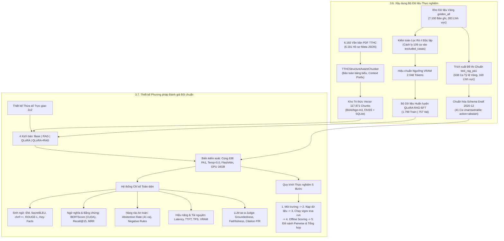
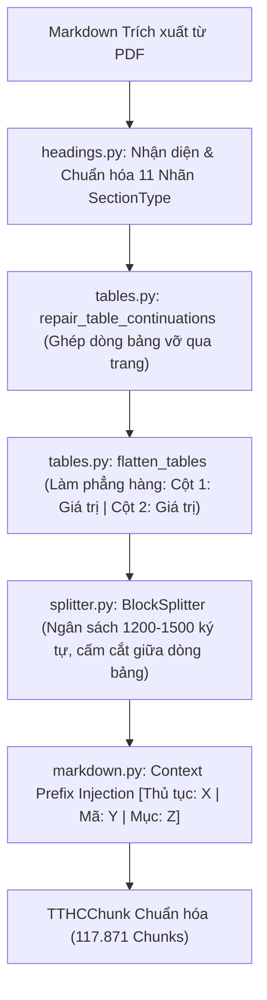
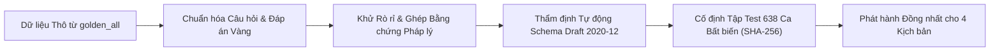
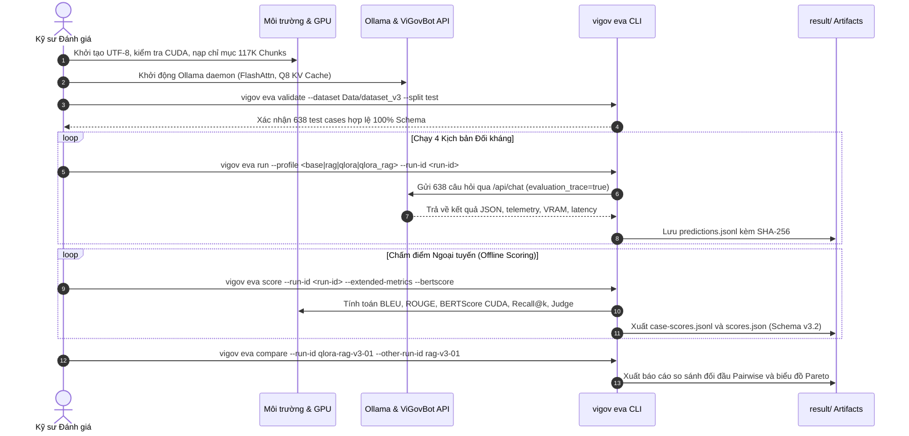

# Báo cáo Khoa học: Xây dựng Bộ Dữ liệu Thực nghiệm và Thiết kế Phương pháp Đánh giá Đối chuẩn Hệ thống ViGovBot

> **Chuẩn mực văn phong:** Nature-Style Scientific Report & Engineering Dissertation  
> **Mã chuyên mục:** Mục 3.6 — Xây dựng bộ dữ liệu thực nghiệm & Mục 3.7 — Thiết kế phương pháp đánh giá  
> **Hệ thống mục tiêu:** ViGovBot — Nền tảng Trợ lý ảo Dịch vụ công Quốc gia  
> **Mô hình nền tảng đối chuẩn:** `Qwen/Qwen2.5-7B-Instruct`  
> **Hạ tầng thực nghiệm:** 1x NVIDIA GeForce RTX 5060 Ti (16 GB GDDR6 / 15,90 GiB khả dụng)  
> **Tập dữ liệu chuẩn hóa:** `Data/dataset_v3/` (`golden_all.jsonl`, `test_rag/test_rag_pa1.jsonl`, `finetuning_v2/`)  
> **Kho tri thức vector:** `Data/vector/unified/` (117.871 chunks, BAAI/bge-m3, FAISS + SQLite)  
> **Chuẩn Schema thẩm định:** JSON Schema Draft 2020-12 (Evaluation Schema v3.2)  
> **Thời điểm thẩm định artifact:** Tháng 11/2026  

---

## Tóm tắt Tổng quan (Abstract)

Báo cáo này công bố chi tiết phương pháp luận kiến tạo bộ dữ liệu thực nghiệm đa tầng (**Dataset v3**) và thiết kế quy trình đối chuẩn khoa học (**Evaluation Protocol v3.2**) cho hệ thống trợ lý ảo dịch vụ công ViGovBot. Nhằm giải quyết hai thách thức kỹ thuật lớn nhất trong các hệ thống RAG hành chính: (1) rò rỉ dữ liệu (*data leakage*) làm sai lệch kết quả đánh giá thực nghiệm, và (2) ảo giác thông tin (*hallucination*) khi tổng hợp căn cứ pháp lý, nghiên cứu thiết lập một chuỗi cung ứng dữ liệu khép kín và có khả năng kiểm chứng độc lập.

Kho tri thức nền tảng của hệ thống được xây dựng từ **6.192 văn bản tài liệu PDF** và **6.191 hồ sơ thủ tục hành chính (TTHC)** thuộc 209 lĩnh vực quản lý nhà nước, được xử lý qua bộ bóc tách cấu trúc chuyên dụng `TTHCStructureAwareChunker` thành **117.871 đoạn trích (chunks)** chuẩn hóa, mã hóa vector 1.024 chiều bằng mô hình `BAAI/bge-m3` và lưu trữ chỉ mục hỗn hợp trên FAISS và SQLite. Tập dữ liệu huấn luyện tinh chỉnh **QLoRA RAG-SFT** được chắt lọc từ kho dữ liệu vàng **`golden_all`** gồm **7.100 bản ghi** (283 lĩnh vực), trải qua quy trình kiểm toán tập rời nhau toán học (*disjoint set audit*) để loại bỏ triệt để **109 ca rò rỉ tiềm tàng** và hiệu chuẩn độ dài chuỗi tối đa tại ngưỡng 2.048 tokens trên phần cứng GPU 16 GB, tạo thành tập dữ liệu sạch gồm **1.799 mẫu huấn luyện (Train)** và **757 mẫu kiểm định (Validation)**.

Phương pháp đánh giá được thiết kế theo mô hình thực nghiệm thừa số trực giao $2 \times 2$ gồm **bốn kịch bản đối sánh** (Base, RAG thuần, QLoRA Độc lập, QLoRA + RAG), được thực thi thống nhất trên cùng một tập kiểm chuẩn chuẩn mực **`test_rag_pa1.jsonl`** gồm **638 ca kiểm thử tỷ lệ vàng** (bao phủ 407 thủ tục, 169 lĩnh vực, phân bổ cân bằng lượt thoại, độ phức tạp và tích hợp 6,43% câu hỏi không thể trả lời). Khung đo lường đa chiều tích hợp các chỉ số từ vựng (Exact Match, BLEU, chrF++, ROUGE-L), ngữ nghĩa sâu (BERTScore trên GPU CUDA qua `xlm-roberta-large`), chất lượng truy xuất (Recall@k, MRR, NDCG, Context Noise), độ bền vững an toàn từ chối câu hỏi thiếu bằng chứng, hiệu năng tài nguyên hệ thống (Latency, TTFT, TPS, VRAM), và thẩm định độc lập qua giám khảo AI (**LLM-as-a-Judge** `Qwen2.5-14B`).



---

## 3.6. Xây dựng Bộ Dữ liệu Thực nghiệm

### 3.6.1. Bộ Dữ liệu Tri thức Thủ tục Hành chính

#### a. Phân tích Bản chất Tập Tài liệu PDF và Hồ sơ Thủ tục Hành chính
Kho tài liệu nền tảng của hệ thống ViGovBot được thu thập và số hóa từ Cổng Dịch vụ công Quốc gia và các cổng dịch vụ công của bộ, ban, ngành và địa phương tại Việt Nam:
- **Quy mô tập tài liệu:** **6.192 tệp tài liệu PDF** chuyên ngành hành chính công, đi kèm với **6.191 tệp siêu dữ liệu JSON** chuẩn hóa tại `Data/meta/`.
- **Cấu trúc thực tế của một hồ sơ TTHC Việt Nam:**  
  Theo quy định tại Nghị định 63/2010/NĐ-CP và Thông tư 02/2017/TT-VPCP, một văn bản quy định thủ tục hành chính có cấu trúc pháp lý phức tạp gồm nhiều phần mục liên kết chặt chẽ:
  1. *Trình tự thực hiện:* Chuỗi bước logic từ nộp hồ sơ (trực tiếp tại Bộ phận Một cửa, gửi bưu chính công ích hoặc nộp trực tuyến), tiếp nhận vào sổ tiếp nhận, thẩm định chuyên môn, ký duyệt văn bản, nộp phí/lệ phí đến trả kết quả.
  2. *Cách thức thực hiện:* Định rõ các kênh tiếp nhận và thẩm quyền theo địa giới hành chính.
  3. *Thành phần hồ sơ:* Bảng danh mục giấy tờ gồm tên văn bản, biểu mẫu đơn/tờ khai, số lượng bản chính, bản sao có chứng thực hoặc bản sao kèm bản chính đối chiếu.
  4. *Thời hạn giải quyết:* Số ngày làm việc hoặc ngày theo luật định kể từ ngày nhận đủ hồ sơ hợp lệ.
  5. *Đối tượng và Cơ quan thực hiện:* Thẩm quyền quyết định, cơ quan trực tiếp thực hiện, cơ quan được ủy quyền hoặc cơ quan phối hợp thẩm tra.
  6. *Phí, lệ phí:* Mức phí cụ thể bằng tiền đồng và các diện đối tượng được miễn giảm theo chính sách an sinh xã hội.
  7. *Căn cứ pháp lý:* Các luật, nghị định, thông tư điều chỉnh trực tiếp.

- **Thách thức kỹ thuật khi xử lý văn bản PDF hành chính:**
  - *Sự phân hóa định dạng văn bản:* Kho dữ liệu chứa hai nhóm tài liệu: (1) văn bản máy tính số hóa nguyên bản (*Native Digital PDF*) và (2) bản quét (*Scanned Image PDF*) có chữ ký tay và mộc đỏ của cơ quan ban hành. Bản quét thường bị nghiêng, mờ nhạt hoặc nhiễu hạt quang học.
  - *Hiện tượng vỡ bảng biểu khi chuyển đổi:* Bảng thành phần hồ sơ và lệ phí thường kéo dài qua nhiều trang giấy. Khi trích xuất thô, tiêu đề cột của bảng ở các trang sau bị biến mất, các dòng mô tả giấy tờ dài bị đứt đoạn sang trang mới khiến phần mềm đọc hiểu nhầm thành hai loại giấy tờ độc lập.
  - *Xung đột bảng mã ký tự:* Nhiều văn bản hành chính ban hành từ các giai đoạn trước sử dụng phông chữ TCVN3 hoặc VNI thay vì Unicode dựng sẵn, gây ra hiện tượng mất dấu hoặc biến dạng từ khóa chuyên ngành.
- **Giải pháp bóc tách và phục hồi văn bản tại `ingestion/recovery.py`:**
  - Hàm xử lý cốt lõi `extract_pdf` duyệt qua từng trang tài liệu bằng thư viện PyMuPDF (`fitz`).
  - Đối với các trang có lớp văn bản, hệ thống gọi `pymupdf4llm` để trích xuất văn bản có cấu trúc dưới định dạng Markdown, giữ nguyên khung phân mục tiêu đề và cú pháp bảng `|`.
  - Đối với các trang văn bản quét không có lớp ký tự máy tính, hệ thống kích hoạt chuỗi xử lý phục hồi ảnh: khử nghiêng (*deskewing*), tăng cường độ tương phản, áp dụng ngưỡng nhị phân thích nghi Otsu, và nhận diện ký tự quang học qua công cụ Tesseract OCR tiếng Việt.

#### b. Thống kê Số lượng Thủ tục, Lĩnh vực và Giải thuật Phân mảnh Nhận thức Cấu trúc
- **Số lượng thủ tục hành chính định danh:** **6.191 thủ tục** riêng biệt với mã số quốc gia bất biến (ví dụ: `1.003537`, `1.014137`).
- **Độ bao phủ lĩnh vực:** Phân bổ toàn diện trên **209 lĩnh vực pháp lý chuyên ngành** của nền hành chính nhà nước.
- **Giải thuật Phân mảnh Nhận thức Cấu trúc (`TTHCStructureAwareChunker`):**  
  Các bộ phân mảnh văn bản thông thường (như RecursiveCharacterTextSplitter) chỉ cắt văn bản dựa trên số lượng ký tự hoặc token cố định. Phương pháp ngây thơ này phá vỡ cấu trúc ngữ nghĩa của văn bản pháp quy: cắt đôi một điều khoản luật giữa chừng, cắt ngang một dòng trong bảng danh mục hồ sơ, khiến mô hình nhúng không thể hiểu được mối quan hệ logic. ViGovBot thiết kế giải thuật phân mảnh chuyên biệt tại [`src/vigovbot/chunking/`](../../src/vigovbot/chunking/):



  1. *Chuẩn hóa Nhãn mục Nghiệp vụ (`headings.py`):*  
     Hàm `classify_section` nhận diện các biến thể tiêu đề trong tiếng Việt và quy về 11 nhãn chuẩn mực (`SectionType`): `TRINH_TU_THUC_HIEN`, `THANH_PHAN_HO_SO`, `THOI_HAN_GIAI_QUYET`, `PHI_LE_PHI`, `CO_QUAN_THUC_HIEN`, `YEU_CAU_DIEU_KIEN`, `CAN_CU_PHAP_LY`,...
  2. *Kỹ thuật Làm phẳng Bảng biểu (`flatten_tables` tại `tables.py`):*  
     Mô hình ngôn ngữ và mô hình nhúng vector xử lý chuỗi văn bản tuyến tính 1 chiều, không có cơ chế chú ý 2 chiều tự nhiên cho cấu trúc lưới của bảng Markdown. Do đó, hàm `flatten_tables` biến đổi từng dòng của bảng thành chuỗi thuộc tính - giá trị tự nhiên:
     ```text
     Tên giấy tờ: Đơn đề nghị cấp phép | Mẫu đơn: Mẫu số 01-PL | Số lượng: 01 bản chính
     ```
     Đồng thời, hàm `repeat_table_header` tự động bổ sung hàng tiêu đề của bảng vào đầu mỗi chunk con tiếp theo khi một bảng dài bị phân tách qua nhiều khối.
  3. *Phân khối Nguyên tử (`splitter.py`):*  
     Lớp `BlockSplitter` quản lý ngân sách ký tự (`target_chars = 1200`, `max_chars = 1500`, `overlap_chars = 100`). Giải thuật nghiêm cấm ngắt dòng bên trong một hàng bảng biểu hoặc bên trong một điểm khoản luật; việc phân đoạn chỉ được thực hiện tại ranh giới của các khối logic nguyên tử.
  4. *Kỹ thuật Tiêm Tiếp đầu ngữ Ngữ cảnh (Context Prefix Injection):*  
     Một đoạn trích chỉ chứa nội dung ngắn như: *"Thời hạn giải quyết: 03 ngày làm việc kể từ ngày nhận đủ hồ sơ"* nếu đưa độc lập vào không gian vector sẽ bị phân tán và nhầm lẫn với hàng nghìn thủ tục khác. Mỗi đoạn trích con được tiêm tiếp đầu ngữ định danh:
     ```text
     [Thủ tục: {procedure_name} | Mã TTHC: {source_code} | Mục: {section_type}]
     {Nội dung đoạn trích Markdown đã xử lý}
     ```
- **Thống kê Kho Tri thức Vector:**  
  Sau khi hoàn tất phân đoạn và gắn tiền tố, toàn bộ kho tri thức tạo thành **117.871 chunks** chuẩn hóa (trung bình xấp xỉ **19,03 chunks/thủ tục**). Toàn bộ được nhúng thành vector 1.024 chiều bằng mô hình `BAAI/bge-m3` và lưu trữ tại `Data/vector/unified/`:
  - `tthc_unified.index`: Chỉ mục tìm kiếm lân cận gần nhất FAISS Inner Product (kích thước **482,8 MB**).
  - `tthc_unified_metadata.json`: Cơ sở dữ liệu toàn văn và siêu dữ liệu thuộc tính (kích thước **6,31 GB**).
  - `corpus_manifest.json`: Tệp kiểm soát toàn vẹn dữ liệu với mã băm SHA-256 bất biến.

#### c. Phân tích Vai trò Kiến trúc của Kho Tri thức đối với Hệ thống RAG
Kho tri thức 117.871 chunks là hạt nhân của kiến trúc RAG, giữ các vai trò then chốt:
1. **Triệt tiêu Ảo giác Tham số (Hallucination Mitigation):** Cung cấp các văn bản pháp quy thực tế tại thời điểm suy luận, thay thế cơ chế "đoán mò" dựa trên xác suất từ ngữ của mô hình ngôn ngữ lớn bằng cơ chế lập luận dựa trên bằng chứng xác thực.
2. **Tách biệt Tri thức và Năng lực Suy luận:** Tri thức hành chính thay đổi thường xuyên theo các quyết định sửa đổi của nhà nước. Bằng cách tách biệt tri thức vào kho vector ngoài, hệ thống có thể cập nhật thông tin thủ tục mới bằng cách chèn vector mới vào cơ sở dữ liệu mà không cần phải huấn luyện lại mạng nơ-ron (*Zero-retraining cost*).
3. **Minh bạch hóa Quyết định Hành chính:** Mỗi chunk mang một mã định danh duy nhất (`chunk_id`). Khi mô hình trích dẫn thông tin, hệ thống tự động gắn kèm đường dẫn nguồn và điều khoản cụ thể, tạo lập sự tin tưởng tuyệt đối cho người dân và cán bộ công vụ khi đối soát.

---

### 3.6.2. Bộ Dữ liệu Huấn luyện QLoRA

#### a. Giới thiệu `golden_all` và Nguồn Dữ liệu SFT
Nguồn dữ liệu gốc dùng để xây dựng tập huấn luyện tinh chỉnh có giám sát kết hợp ngữ cảnh truy xuất (RAG-SFT) là tập dữ liệu chuẩn mực **`golden_all.jsonl`** lưu tại `Data/dataset_v3/golden_all.jsonl`:
- **Quy mô tập dữ liệu vàng:** Gồm tổng cộng **7.100 bản ghi** chất lượng cao, bao phủ **283 lĩnh vực** quản lý nhà nước:
  - **6.950 ca chuẩn hóa có căn cứ trả lời:** Mang mã định danh chuẩn hóa từ `GOLDEN_V3_000001` đến `GOLDEN_V3_006950`.
  - **150 ca từ chối an toàn (Unanswerable):** Mang mã định danh từ `GOLDEN_V3_UA_000001` đến `GOLDEN_V3_UA_000150`, đại diện cho các tình huống người dân hỏi ngoài phạm vi, thông tin bị bãi bỏ hoặc cố tình gài bẫy tiền đề sai (*false premise*).
- Toàn bộ 7.100 bản ghi đạt chuẩn kiểm định nghiêm ngặt của JSON Schema Draft 2020-12, được kiểm chứng tự động: 0 mã ID trùng lặp, 0 bản ghi trùng khớp nội dung, 0 lỗi liên kết nguồn tri thức, và 0 cặp bản ghi tiệm cận trùng lặp ở ngưỡng đo `SequenceMatcher` 0,90.

#### b. Cấu trúc một Mẫu Dữ liệu Huấn luyện RAG-SFT
Mỗi mẫu dữ liệu trong tập huấn luyện được thiết kế để tái lập trọn vẹn một phiên làm việc thực tế của pipeline RAG, tuân thủ định dạng ChatML tiêu chuẩn với ba khối chức năng:

1. **Khối Hệ thống (`<|im_start|>system`):**  
   Xác định vai trò chuyên gia dịch vụ công của ViGovBot, quy định nguyên tắc bám sát tuyệt đối ngữ cảnh tài liệu và ràng buộc cấu trúc sinh phản hồi dưới dạng JSON.
2. **Khối Người dùng (`<|im_start|>user`):**  
   Bao gồm hai phần thông tin phân tách rõ ràng:
   - *Ngữ cảnh tài liệu bằng chứng (`[NGỮ CẢNH TRUY XUẤT]`):* Danh sách từ 5 đến 15 chunks pháp lý được cung cấp kèm định danh `chunk_id`, tên thủ tục và trích đoạn điều luật.
   - *Câu hỏi của người dân (`[CÂU HỎI]`):* Nội dung câu hỏi nghiệp vụ hoặc câu hỏi tiếp nối ngữ cảnh.
3. **Khối Trợ lý (`<|im_start|>assistant`):**  
   Chuỗi JSON có cấu trúc chặt chẽ với lược đồ 4 trường cốt lõi:
   ```json
   {
     "answer": "Nội dung giải đáp chi tiết, viện dẫn chính xác các bước, giấy tờ hoặc điều kiện thực hiện theo đúng tài liệu viện dẫn.",
     "action": "ANSWER",
     "evidence_status": "SUFFICIENT",
     "citations": [
       {
         "chunk_id": "chunk_1.003537_tp_01",
         "source": "Quyết định số 123/QĐ-UBND",
         "article": "Điều 5 khoản 2"
       }
     ]
   }
   ```

*Ví dụ Mẫu Dữ liệu Thực tế trích xuất từ tập huấn luyện:*
```json
{
  "id": "GOLDEN_V3_000004",
  "messages": [
    {
      "role": "system",
      "content": "VAI TRÒ: Trả lời tiếng Việt dựa trên bằng chứng được cung cấp, trong phạm vi ứng dụng. NGUYÊN TẮC: Đối chiếu đối tượng, định danh và phạm vi; không trộn nguồn; nếu thiếu thông tin thì từ chối hoặc làm rõ; không bịa đặt số liệu. ĐẦU RA: Trả về duy nhất một chuỗi JSON gồm: answer (câu trả lời tiếng Việt súc tích), action (answer, partial, abstain, clarify, correct_premise), evidence_status (sufficient, partial, missing, contradictory_premise, ambiguous), và citations (danh sách {chunk_id, claim})."
    },
    {
      "role": "user",
      "content": "DỮ LIỆU TRUY XUẤT (JSON):\n{\"sources\": [{\"chunk_id\": \"tthc_1_115808_sec_required_documents_3_p1\", \"content\": \"[Thủ tục: Cấp Giấy phép vận hành lò phản ứng hạt nhân nghiên cứu | Mã TTHC: 1.115808 | Mục: THÀNH PHẦN HỒ SƠ]\\nTên giấy tờ: Đơn đề nghị cấp Giấy phép vận hành lò phản ứng hạt nhân nghiên cứu | Mẫu đơn: Mẫu số 01 | Số lượng: 1 bản chính\\nTên giấy tờ: Báo cáo phân tích an toàn giai đoạn vận hành | Mẫu đơn: PL-Mục I-BC | Số lượng: 1 bản chính\"}]}\n\nCÂU HỎI: Thành phần hồ sơ đề nghị cấp Giấy phép vận hành lò phản ứng hạt nhân nghiên cứu gồm những giấy tờ nào?"
    },
    {
      "role": "assistant",
      "content": "{\"answer\": \"Thành phần hồ sơ đề nghị cấp Giấy phép vận hành lò phản ứng hạt nhân nghiên cứu gồm: 1. Đơn đề nghị cấp Giấy phép vận hành lò phản ứng hạt nhân nghiên cứu (Số lượng: 1 bản chính); 2. Báo cáo phân tích an toàn giai đoạn vận hành (Số lượng: 1 bản chính theo Mẫu PL-Mục I-BC).\", \"action\": \"ANSWER\", \"evidence_status\": \"SUFFICIENT\", \"citations\": [{\"chunk_id\": \"tthc_1_115808_sec_required_documents_3_p1\", \"claim\": \"Thành phần hồ sơ đề nghị cấp Giấy phép vận hành lò phản ứng hạt nhân nghiên cứu gồm: 1. Đơn đề nghị... 2. Báo cáo phân tích an toàn...\"}]}"
    }
  ]
}
```

#### c. Phân tích Cơ chế Assistant-Only Loss Masking
Trong kỹ thuật huấn luyện mô hình ngôn ngữ nhân quả (*Causal Language Modeling*), hàm mất mát tiêu chuẩn tính toán lỗi dự báo trên mọi token trong toàn bộ chuỗi:

$$\mathcal{L}_{\text{standard}}(\theta) = - \frac{1}{T} \sum_{t=1}^T \log P_\theta(x_t \mid x_{<t})$$

Nếu áp dụng công thức tiêu chuẩn này cho dữ liệu RAG-SFT, mô hình sẽ gặp phải hiện tượng **"tổn thương hàm mất mát" (Loss Hack)**:  
Khối `<|im_start|>system` và `<|im_start|>user` (chứa các đoạn trích bằng chứng pháp lý dài) chiếm tới **85% - 90%** tổng số token của toàn bộ mẫu dữ liệu (thường từ 1.000 đến 1.800 tokens), trong khi câu trả lời của trợ lý `<|im_start|>assistant` chỉ chiếm khoảng **10% - 15%** (khoảng 150 đến 250 tokens). Khi đó, gradient tối ưu hóa sẽ bị thống trị bởi mục tiêu học thuộc lòng các đoạn văn bản luật trong prompt thay vì học kỹ năng suy luận và trích xuất.

Để giải quyết triệt để vấn đề này, hệ thống áp dụng kỹ thuật **Assistant-Only Loss Masking**:
- Hệ thống xây dựng một vector mặt nạ nhị phân $m \in \{0, 1\}^T$.
- Toàn bộ các vị trí token thuộc phần chỉ dẫn hệ thống, ngữ cảnh tài liệu và câu hỏi người dùng được gán giá trị nhãn mục tiêu là `-100` (giá trị bỏ qua mặc định của hàm `torch.nn.CrossEntropyLoss`):
  $$m_t = \begin{cases} 1, & \text{nếu } x_t \in \mathcal{T}_{\text{assistant}} \\ 0, & \text{nếu } x_t \in \mathcal{T}_{\text{system}} \cup \mathcal{T}_{\text{user}} \end{cases}$$
- Hàm mất mát tối ưu hóa chỉ tính toán trên các token do trợ lý sinh ra:
  $$\mathcal{L}_{\text{Assistant-Only}}(\theta) = - \frac{1}{\sum_{t=1}^T m_t} \sum_{t=1}^T m_t \log P_\theta(x_t \mid x_{<t})$$
Cơ chế này buộc mô hình coi ngữ cảnh tài liệu là tiền đề điều kiện cố định $x_{<t}$, và chỉ tập trung năng lực tham số của ma trận LoRA vào việc học cú pháp JSON, trạng thái chứng cứ `evidence_status` và đối chiếu chính xác các `citations`.

#### d. Phân tích Phân chia Train/Validation và Kiểm toán Rò rỉ Toán học (Zero-Leakage Audit)
- **Bản chất của rò rỉ dữ liệu trong NLP Hành chính:**  
  Trong lĩnh vực thủ tục hành chính, nếu tập Huấn luyện (Train) và tập Kiểm định (Validation/Test) cùng chia sẻ một mã thủ tục, mô hình có thể ghi nhớ cấu trúc từ vựng đặc thù của thủ tục đó trong quá trình huấn luyện và dễ dàng trả lời đúng ở pha kiểm tra. Điểm số cao trong trường hợp này chỉ phản ánh năng lực ghi nhớ chuỗi ký tự tĩnh (*parametric memorization*), hoàn toàn che giấu sự bất lực của mô hình khi phải xử lý một thủ tục mới ngoài thực tế.
- **Nguyên tắc Phân rã Độc lập theo Mã Thủ tục (Procedure-Disjoint Partitioning):**  
  Quá trình phân chia 70% Train (1.863 mẫu) và 30% Validation (786 mẫu) được khóa chặt theo hàm băm của mã thủ tục hành chính (`source_code`):
  $$\mathcal{P}_{\text{train}} \cap \mathcal{P}_{\text{val}} = \emptyset$$
  Tất cả các câu hỏi thuộc cùng một thủ tục chỉ được phép nằm trọn vẹn ở một phía, bảo đảm tập kiểm định đo lường năng lực tổng quát hóa thực sự.
- **Kiểm toán Rò rỉ Độc lập đối chiếu với PA1 và PA2:**  
  Module kiểm toán độc lập `vigovbot.training.leakage_filter` thực hiện rà soát giao thoa tập hợp trên 5 tầng thuộc tính giữa tập dữ liệu huấn luyện và 2 tập đề thi chuẩn (`test_rag_pa1` và `test_rag_pa2`):
  $$\mathcal{D}_{\text{train}} \cap \mathcal{D}_{\text{test}} = \emptyset \quad \text{trên} \quad \{\text{Mã TTHC}, \text{Context ID}, \text{Context Text}, \text{Câu hỏi}, \text{Đáp án dài} \ge 200 \text{ ký tự}\}$$
  Quá trình kiểm toán đã bóc tách và cách ly tổng cộng **109 bản ghi rò rỉ tiềm tàng** vào tệp `reports/excluded_cases.jsonl`:
  - *Tập Train loại bỏ 68 ca:* 53 ca trùng mã thủ tục, 14 ca trùng đáp án dài, 5 ca trùng context ID, 4 ca trùng câu hỏi.
  - *Tập Validation loại bỏ 41 ca:* 36 ca trùng mã thủ tục, 7 ca trùng đáp án dài, 2 ca trùng context ID, 1 ca trùng câu hỏi.

#### e. Phân tích Hiệu chuẩn Độ dài Chuỗi và Giới hạn Phần cứng (VRAM Calibration)
Bộ nhớ kích hoạt (*Activation Memory*) của mô hình Transformer trong quá trình lan truyền ngược tỷ lệ tuyến tính với độ dài chuỗi $L$ khi dùng Flash Attention:

$$\text{Mem}_{\text{act}} \approx L \cdot b \cdot h \cdot n_{\text{layers}} \cdot \left( 10 + \frac{24 \cdot n_{\text{heads}} \cdot L}{h} \right)$$

Đo đạc thực nghiệm trên phần cứng NVIDIA GeForce RTX 5060 Ti 16 GB (15,90 GiB khả dụng):
- Với mẫu dài $1.359$ tokens: VRAM tiêu thụ đạt **11,79 GB**.
- Với mẫu dài $2.067$ tokens: VRAM tiêu thụ chạm ngưỡng **13,82 GB** (86,9% dung lượng).
- Với các mẫu ngoại lai dài từ $3.500$ đến $4.662$ tokens: VRAM đòi hỏi vượt quá **19,08 – 21,16 GB**, ngay lập tức gây sụp đổ tiến trình với lỗi `CUDA Out of Memory`.

Do đó, ngưỡng cắt chuỗi an toàn tuyệt đối được xác lập tại **`max_seq_length = 2048` tokens**. Quá trình tiền xử lý đã loại bỏ 93 mẫu ngoại lai vượt ngưỡng 2.048 tokens, xác lập tập dữ liệu sạch chính thức:
- **Tập Train sạch (`train_rag_sft.jsonl`):** **1.799 mẫu** (bảo toàn 96,6% dữ liệu sau lọc).
- **Tập Validation sạch (`validation_rag_sft.jsonl`):** **757 mẫu** (bảo toàn 96,3% dữ liệu sau lọc).

---

### 3.6.3. Bộ Dữ liệu Kiểm thử (`test_rag_pa1`)

#### a. Giới thiệu Bộ Kiểm thử Chuẩn `test_rag_pa1`
Bộ kiểm thử chuẩn **`test_rag_pa1.jsonl`** (lưu tại `Data/dataset_v3/test_rag/test_rag_pa1.jsonl`, dung lượng 4,11 MB) là bộ dữ liệu đánh giá chính thức được xây dựng theo **Phương án 1 (Golden Ratio Balanced)**. Bộ dữ liệu gồm đúng **638 ca kiểm chuẩn độc lập**, đại diện cho kỳ thi sát hạch toàn diện năng lực của các mô hình ngôn ngữ trong nghiệp vụ dịch vụ công.

#### b. Cấu trúc Chi tiết của một Test Case
Mỗi ca kiểm thử tuân thủ nghiêm ngặt theo hợp đồng lược đồ [**`schema/golden_dataset.schema.json`**](../../schema/golden_dataset.schema.json) (chuẩn JSON Schema Draft 2020-12), bao gồm 6 khối thông tin cốt lõi:

| Trường Dữ liệu | Kiểu Dữ liệu | Ý nghĩa Nghiệp vụ và Kỹ thuật |
| :--- | :---: | :--- |
| `test_id` | String | Mã định danh duy nhất của ca kiểm chuẩn (ví dụ: `GOLDEN_V3_000142` hoặc `GOLDEN_V3_UA_000025`) |
| `version` | String | Phiên bản hợp đồng dữ liệu (chuẩn `3.2`) |
| `taxonomy` | Object | Nhãn phân loại đa chiều: `domain`, `turn_type`, `complexity_type`, `difficulty`, `is_unanswerable`, `adversarial_type` |
| `input` | Object | Thông tin đầu vào của người dân: `question` (câu hỏi hiện tại), `chat_history` (lịch sử đàm thoại đa lượt), `task_constraint`, `metadata_filters` |
| `ground_truth` | Object | Nhãn chuẩn vàng: `expected_route`, `expected_answer`, `key_facts_required` (danh sách dữ kiện bắt buộc), `ground_truth_context_ids` (danh sách ID các chunk chứa bằng chứng), `ground_truth_contexts` (văn bản trích đoạn), `expected_citations`, `distractor_injection` |
| `evaluation_plan` | Object | Kế hoạch chấm điểm định lượng: `expected_action`, `cutoffs` ($k \in \{1, 3, 5, 10, 15\}$), `reference_answers` (danh sách đáp án chấp nhận được), `fact_evidence` (ánh xạ từng dữ kiện với context ID), `negative_rules` (thông tin cấm sinh), `format_rules` |

*Ví dụ Test Case Tiêu biểu có Căn cứ Trả lời (`GOLDEN_V3_005568`):*
```json
{
  "test_id": "GOLDEN_V3_005568",
  "taxonomy": {
    "domain": "Đất đai",
    "turn_type": "follow_up",
    "complexity_type": "single_hop",
    "difficulty": "medium",
    "is_unanswerable": false
  },
  "input": {
    "chat_history": [
      {"role": "user", "content": "Cho tôi hỏi bước 1 của thủ tục Đăng ký biến động chuyển mục đích sử dụng đất không phải xin phép cơ quan nhà nước có thẩm quyền phải làm gì?"},
      {"role": "assistant", "content": "Bạn muốn hỏi thủ tục nào trong danh sách sau: 1. Mã 1.013992 (Cấp tỉnh); 2. Mã 1.115209 (Cấp tỉnh)..."}
    ],
    "question": "1. Đăng ký biến động chuyển mục đích sử dụng đất không phải xin phép cơ quan nhà nước có thẩm quyền - Mã: 1.013992 (Cấp thực hiện: Tỉnh)"
  },
  "ground_truth": {
    "expected_route": "rag_search",
    "ground_truth_context_ids": ["tthc_1_013992_sec_procedure_step_2_p1", "tthc_1_013992_sec_procedure_step_2_p2"],
    "expected_answer": "Bước 1: Người yêu cầu đăng ký nộp hồ sơ đến Trung tâm Phục vụ hành chính công hoặc Văn phòng đăng ký đất đai..."
  },
  "evaluation_plan": {
    "expected_action": "answer",
    "fact_evidence": [
      {"fact": "Người yêu cầu nộp hồ sơ tại Trung tâm Phục vụ hành chính công hoặc Văn phòng đăng ký đất đai", "context_ids": ["tthc_1_013992_sec_procedure_step_2_p1"]},
      {"fact": "Khi nộp hồ sơ được lựa chọn nộp bản sao kèm xuất trình bản chính để đối chiếu", "context_ids": ["tthc_1_013992_sec_procedure_step_2_p1"]}
    ],
    "negative_rules": [
      {"rule_id": "N1", "description": "Không tự thêm số liệu và điều kiện không được dẫn nguồn trong tài liệu.", "method": "judge"}
    ]
  }
}
```

#### c. Phân tích Bản chất Câu hỏi Không thể Trả lời (Unanswerable Cases)
Tập kiểm chuẩn dành riêng **41 ca kiểm thử** (**6,43%** tập test) để đánh giá khả năng phòng vệ và từ chối an toàn của mô hình:
- **Đặc trưng nghiệp vụ:** Người dân thường xuyên đặt ra các câu hỏi về thông tin mang tính vận hành cá nhân (ví dụ: *"Hồ sơ của tôi đã được ông Nguyễn Văn A duyệt chưa?"*), hỏi về các chính sách đã bị bãi bỏ hoặc gài bẫy tiền đề sai (*false premise*).
- **Phân tích ca thực tế `GOLDEN_V3_UA_000001` (Bảo hiểm y tế):**  
  Người dân hỏi: *"Tôi vừa gửi một yêu cầu hỗ trợ trực tuyến thủ tục Cấp thẻ bảo hiểm y tế (mã 1.014137). Phía tiếp nhận đã đọc và chuyển yêu cầu đó cho ai xử lý chưa?"*.  
  Kho tài liệu pháp quy chỉ chứa quy chế thủ tục chung, hoàn toàn không kết nối cơ sở dữ liệu xử lý hồ sơ thời gian thực của từng cá nhân. Nếu mô hình ngôn ngữ tự động bịa ra một cán bộ tiếp nhận để "chiều lòng" người dùng, đây là lỗi ảo giác nghiêm trọng trong hành chính.
- **Ràng buộc cấu trúc đối với ca Unanswerable:**
  - `ground_truth_context_ids`: Bắt buộc là mảng rỗng `[]`.
  - `expected_action`: Bắt buộc là `"abstain"` (từ chối an toàn) hoặc `"clarify"` (yêu cầu làm rõ).
  - `expected_answer`: Tuyên bố rõ giới hạn của tài liệu quy định và hướng dẫn người dân tra cứu trên hệ thống Một cửa điện tử hoặc liên hệ trực tiếp cơ quan có thẩm quyền.
  - `negative_rules`: Nghiêm cấm bịa đặt dữ liệu vận hành cá nhân hoặc dữ liệu không có trong tài liệu.

#### d. Phân loại Phân bố Taxonomy và Độ khó
Phân tích 638 ca trong tập `test_rag_pa1`:
1. **Theo Loại lượt thoại (`turn_type`):**
   - *Câu hỏi độc lập (`new_question`):* 320 ca (**50,16%**).
   - *Câu hỏi tiếp nối (`follow_up`):* 318 ca (**49,84%**). Kiểm tra năng lực phân giải đồng quy chiếu (*coreference*) và hiện tượng tỉnh lược (*ellipsis*) dựa trên ngữ cảnh lịch sử.
2. **Theo Độ phức tạp ý định (`complexity_type`):**
   - *Đơn ý định (`single_hop`):* 531 ca (**83,23%**).
   - *Đa ý định (`multi_intent`):* 107 ca (**16,77%**). Chứa nhiều câu hỏi con lồng ghép, đòi hỏi hệ thống phân rã truy vấn (*sub-queries*) và tổng hợp bằng chứng từ nhiều phần mục khác nhau.
3. **Theo Mức độ khó (`difficulty`):**
   - *Trung bình (`medium`):* 489 ca (**76,65%**).
   - *Khó / Có bẫy (`hard`):* 149 ca (**23,35%**).
4. **Lý do lựa chọn `test_rag_pa1` làm Bộ Đánh giá Chính:**  
   Bộ test chủ động nâng tỷ lệ câu hỏi khó lên **23,35%** (so với 12,2% ở tập train) và câu hỏi từ chối an toàn lên **6,43%** (so với 2,2% ở tập train). Cấu trúc này tạo ra một "đề thi sát hạch" có tính phân hóa cao, kiểm tra chính xác khả năng khái quát hóa và ranh giới an toàn của các mô hình.

---

### 3.6.4. Quy trình Chuẩn bị Dữ liệu Đánh giá

Quy trình chuẩn bị dữ liệu đánh giá được chuẩn hóa thành chuỗi các bước kiểm định kỹ thuật nghiêm ngặt:



1. **Chuẩn hóa Câu hỏi và Đáp án Tham chiếu:**
   - Mọi câu hỏi được rà soát lỗi chính tả, chuẩn hóa văn phong tiếng Việt hành chính.
   - Đáp án tham chiếu (`expected_answer` và `reference_answers`) được đối chiếu trực tiếp với các điều khoản trong văn bản quy phạm pháp luật đang có hiệu lực thi hành, bảo đảm tính pháp lý chuẩn mực.
2. **Chuẩn bị Bằng chứng Cần thiết và Tiêm nhiễu Kiểm soát:**
   - Đối với mỗi câu hỏi hợp lệ, chuyên gia dữ liệu xác định chính xác danh sách các chunk ID chứa dữ kiện quyết định (`ground_truth_context_ids`).
   - Tích hợp kỹ thuật tiêm tài liệu gây nhiễu (*Distractor Injection*): đưa thêm các đoạn trích từ các thủ tục có tiêu đề tương tự nhưng khác thẩm quyền hoặc khác địa phương nhằm đánh giá năng lực phân biệt ngữ cảnh của bộ truy xuất và mô hình sinh ngữ.
3. **Kiểm tra Tính Hợp lệ của Test Case qua Công cụ Tự động:**
   - Toàn bộ 638 ca kiểm thử được chạy qua bộ kiểm định tự động bằng lệnh CLI:
     ```powershell
     vigov eva validate --dataset Data/dataset_v3 --split test
     ```
   - Bộ công cụ kiểm tra 100% các ràng buộc cấu trúc: tính toàn vẹn của mã ID, tính khớp nối giữa `is_unanswerable` và `expected_action`, sự tồn tại thực tế của các `context_ids` trong kho tri thức vector 117.871 chunks.
4. **Bảo đảm Bốn Kịch bản Sử dụng Cùng một Bộ Kiểm thử Bất biến:**
   - Tệp `test_rag_pa1.jsonl` được gắn mã băm SHA-256 bất biến.
   - Cả bốn kịch bản đối chuẩn (Base, RAG thuần, QLoRA Độc lập, QLoRA + RAG) bắt buộc phải nạp tuần tự đúng 638 ca kiểm thử từ tệp này, ngăn chặn mọi sai lệch do khác biệt về tập dữ liệu đầu vào.

---

## 3.7. Thiết kế Phương pháp Đánh giá

### 3.7.1. Thiết kế Thực nghiệm

#### a. Ma trận Thực nghiệm Thừa số Trực giao $2 \times 2$
Nghiên cứu áp dụng thiết kế thực nghiệm thừa số trực giao $2 \times 2$ nhằm cô lập và đo lường chính xác tác động riêng rẽ cũng như tác động tương hỗ giữa hai kỹ thuật then chốt:

```text
                        ┌───────────────────────────────┐
                        │      Yếu tố Pipeline RAG      │
                        │    Không RAG   │    Có RAG    │
┌───────────────┬───────┼────────────────┼──────────────┤
│ Yếu tố        │ Không │   Kịch bản 1   │  Kịch bản 2  │
│ Tinh chỉnh    │ (Base)│   (Mô hình Base)│ (RAG Thuần)  │
│ Adapter       ├───────┼────────────────┼──────────────┤
│ QLoRA         │  Có   │   Kịch bản 3   │  Kịch bản 4  │
│               │(QLoRA)│(QLoRA Độc lập) │ (QLoRA + RAG)│
└───────────────┴───────┴────────────────┴──────────────┘
```

1. **Biến Độc lập (Independent Variables):**
   - **Biến 1 - Sử dụng Adapter QLoRA ($X_1 \in \{0, 1\}$):** Mô hình được giữ nguyên bản gốc `Qwen2.5-7B-Instruct` ($X_1 = 0$) hoặc được gắn trọng số tinh chỉnh thích ứng miền `best_adapter` ($X_1 = 1$).
   - **Biến 2 - Sử dụng Hệ thống RAG ($X_2 \in \{0, 1\}$):** Mô hình suy luận khép kín chỉ dựa vào bộ nhớ tham số tĩnh (*Closed-Book*, $X_2 = 0$) hoặc được tiếp nhận khối ngữ cảnh bằng chứng pháp lý từ pipeline truy xuất RAG của ViGovBot ($X_2 = 1$).
2. **Bốn Kịch bản Thực nghiệm Đối kháng:**
   - **Kịch bản 1 — Base ($X_1=0, X_2=0$):** `Qwen2.5-7B-Instruct` nguyên bản, suy luận độc lập không có RAG. Đóng vai trò là mốc đối chuẩn năng lực không cần học (*Zero-shot baseline*).
   - **Kịch bản 2 — RAG Thuần ($X_1=0, X_2=1$):** `Qwen2.5-7B-Instruct` nguyên bản kết hợp với pipeline RAG tiêu chuẩn (PhoBERT Router + BGE-M3 Retrieval + Prompt Envelope). Đóng vai trò đo lường giới hạn của việc chỉ bổ sung tài liệu mà không tinh chỉnh mô hình.
   - **Kịch bản 3 — QLoRA Độc lập ($X_1=1, X_2=0$):** Mô hình QLoRA RAG-SFT chạy độc lập, hoàn toàn không được cấp ngữ cảnh RAG. Đóng vai trò kiểm tra mức độ phụ thuộc ngữ cảnh và khả năng tự nhận biết thiếu hụt thông tin.
   - **Kịch bản 4 — QLoRA + RAG ($X_1=1, X_2=1$):** Cấu hình chính thức của hệ thống ViGovBot, kết hợp đồng bộ mô hình QLoRA RAG-SFT với toàn bộ pipeline RAG đa tầng.

#### b. Các Biến Kiểm soát (Control Variables)
Để bảo đảm tính hợp lệ nội tại (*internal validity*) của thực nghiệm, toàn bộ các yếu tố kỹ thuật ngoài hai biến độc lập đều được cố định tuyệt đối:
- **Tập kiểm thử:** 100% bốn kịch bản cùng thực thi trên đúng **638 ca** của `test_rag_pa1.jsonl`.
- **Tham số sinh suy luận:** Cố định nhiệt độ `temperature = 0.0` (chế độ tham lam - *greedy decoding* để bảo đảm tính tất định và khả năng tái lập 100%), `top_p = 1.0`, `max_tokens = 2048`, và danh sách dừng `stop = ["<|im_start|>", "<|im_end|>"]`.
- **Hạ tầng phục vụ suy luận:** Cùng sử dụng Ollama daemon phiên bản tối ưu, bật cờ tính toán Flash Attention và lượng tử hóa bộ nhớ đệm KV Cache ở định dạng Q8 (`q8_0 KV Cache`).
- **Phần cứng thực thi:** Toàn bộ quá trình chạy suy luận diễn ra trên cùng 1 card đồ họa **NVIDIA GeForce RTX 5060 Ti 16 GB VRAM**, môi trường Windows 11, Python 3.11+.
- **Pipeline RAG đồng nhất:** Ở hai kịch bản có RAG (Kịch bản 2 và 4), toàn bộ luồng xử lý phía trước LLM hoàn toàn giống nhau: cùng mô hình định tuyến PhoBERT 4-Head, cùng chỉ mục FAISS 117.871 chunks, cùng mô hình nhúng `BAAI/bge-m3`, cùng cơ chế tái xếp hạng `BGE-Reranker-v2` lấy Top-15 đoạn trích và cùng khuôn mẫu đóng gói JSON Envelope.

---

### 3.7.2. Phương pháp Đánh giá

Hệ thống đánh giá thiết lập một khung đo lường đa tầng, phân tách rõ ràng giữa năng lực sinh ngữ, năng lực truy xuất, hàng rào an toàn và hiệu năng tài nguyên (tuân thủ nguyên tắc đo lường không gộp điểm của Evaluation v3.2):

#### a. Nhóm Chỉ số Đánh giá Chất lượng Sinh câu trả lời (Answer Quality)
- **Tỷ lệ Khớp chính xác (Exact Match - EM):**
  - *Raw EM:* Tỷ lệ câu trả lời sinh ra trùng khớp 100% từng ký tự với chuỗi đáp án tham chiếu.
  - *Normalized EM:* Chuẩn hóa văn bản trước khi so sánh (chuyển chữ thường, loại bỏ dấu cách thừa, dấu chấm câu và các từ dừng không mang nghĩa).
- **Độ phủ Dữ kiện Cốt lõi (Key-Fact Coverage):**
  - Đo lường tỷ lệ các dữ kiện pháp lý bắt buộc (`key_facts_required`) xuất hiện trong câu trả lời sinh ra:
    $$\text{Key-Fact Coverage} = \frac{|\mathcal{F}_{\text{generated}} \cap \mathcal{F}_{\text{required}}|}{|\mathcal{F}_{\text{required}}|}$$
- **Chỉ số Trùng lặp N-gram và Từ vựng:**
  - **SacreBLEU:** Đo lường độ chuẩn xác của n-gram với cơ chế chuẩn hóa quốc tế không phụ thuộc tiền xử lý.
  - **chrF++:** Đo độ tương đồng cấp độ n-gram ký tự kết hợp từ ngữ, đặc biệt hiệu quả với ngôn ngữ đơn lập có hình thái phong phú như tiếng Việt.
  - **ROUGE-1, ROUGE-2, ROUGE-L:** Đo độ trùng lặp chuỗi con chung dài nhất và tỷ lệ thu hồi thông tin.
  - **METEOR:** Đo độ tương đồng có xét đến đồng nghĩa và gốc từ.
- **Độ Tương đồng Ngữ nghĩa Sâu (BERTScore CUDA):**
  - Sử dụng mô hình Transformer đa ngôn ngữ lớn **`xlm-roberta-large`** thực thi trực tiếp trên GPU CUDA để tính toán ma trận tương đồng cosine giữa các vector nhúng ngữ cảnh của từng token trong câu trả lời sinh ra và đáp án tham chiếu:
    $$R_{\text{BERT}} = \frac{1}{|x|} \sum_{i \in x} \max_{j \in \hat{x}} \mathbf{e}_i^\top \mathbf{e}_j, \quad P_{\text{BERT}} = \frac{1}{|\hat{x}|} \sum_{j \in \hat{x}} \max_{i \in x} \mathbf{e}_i^\top \mathbf{e}_j, \quad F_{\text{BERT}} = 2 \frac{P_{\text{BERT}} R_{\text{BERT}}}{P_{\text{BERT}} + R_{\text{BERT}}}$$
  - Báo cáo điểm F1 trung bình trên toàn tập test.

#### b. Nhóm Chỉ số Đánh giá Năng lực Truy xuất (Retrieval Quality - Cho Kịch bản có RAG)
Đối với các kịch bản kích hoạt RAG, hiệu năng của tầng truy xuất được đo kiểm tại các ngưỡng cắt $k \in \{1, 3, 5, 10, 15\}$:
- **Hit@k:** Tỷ lệ các ca kiểm thử mà trong Top-$k$ đoạn trích có chứa ít nhất một chunk bằng chứng vàng.
- **Recall@k và Precision@k:** Tỷ lệ các chunk bằng chứng vàng được thu hồi thành công trên tổng số bằng chứng cần thiết, và tỷ lệ chunk liên quan trong danh sách Top-$k$.
- **Mean Reciprocal Rank (MRR@k):** Nghịch đảo vị trí xuất hiện của chunk bằng chứng liên quan đầu tiên trong danh sách xếp hạng.
- **NDCG@k (Normalized Discounted Cumulative Gain):** Đo lường chất lượng xếp hạng có xét đến trọng số suy giảm theo vị trí.
- **Context Noise Ratio (Tỷ lệ Nhiễu Ngữ cảnh):**
  - Tỷ lệ các chunk không chứa bằng chứng nằm trong danh sách Top-$k$ nạp vào prompt của mô hình ngôn ngữ lớn:
    $$\text{Context Noise} = 1 - \text{Precision}@k$$

#### c. Nhóm Chỉ số Đánh giá Khả năng Từ chối Câu hỏi Thiếu Bằng chứng (Safety & Abstention)
Đo lường độc lập trên 41 ca kiểm thử có nhãn `is_unanswerable = true`:
- **Độ chính xác Hành động Từ chối (Abstention Accuracy):**
  - Tỷ lệ mô hình nhận biết đúng trạng thái thiếu thông tin và kích hoạt hành động từ chối an toàn (`action = "abstain"` hoặc `action = "clarify"`).
- **Tỷ lệ Vượt qua Ràng buộc Phủ định (Negative Constraint Pass Rate):**
  - Kiểm tra tự động qua phương pháp so khớp chuỗi phủ định (`literal_absence`): câu trả lời tuyệt đối không được chứa các thông tin bị cấm quy định tại `negative_rules` (ví dụ: cấm bịa đặt mức phí hoặc cấm khẳng định thủ tục còn hiệu lực).

#### d. Nhóm Chỉ số Đánh giá Hiệu năng Suy luận và Tiêu thụ Tài nguyên
- **Thời gian trễ trung bình (Mean Latency per Query):** Tổng thời gian từ khi nhận yêu cầu đến khi hoàn tất câu trả lời (tính bằng giây).
- **Thời gian sinh Token đầu tiên (Time to First Token - TTFT):** Đo lường độ nhạy và thời gian phản hồi tức thì của hệ thống.
- **Tốc độ sinh văn bản (Tokens Per Second - TPS):** Số lượng token sinh ra trên một giây của bộ giải mã (*decoder throughput*).
- **Mức chiếm dụng Bộ nhớ GPU (Peak Allocated / Reserved VRAM):** Đo lường dung lượng VRAM thực tế bị chiếm dụng trong suốt chu trình suy luận.

#### e. Đánh giá Độc lập qua Giám khảo AI (LLM-as-a-Judge)
Để vượt qua giới hạn của các phép đo từ vựng thuần túy, nghiên cứu tích hợp phương pháp đánh giá tự động dựa trên mô hình ngôn ngữ lớn đóng vai trò giám khảo độc lập (**`Qwen2.5-14B-Instruct`** qua Ollama) với bộ tiêu chí chấm điểm chuyên sâu:
- **Độ bám sát Nguồn (Source Groundedness):** Đánh giá xem từng luận điểm trong câu trả lời sinh ra có bắt nguồn trực tiếp từ các chunk văn bản được nạp trong prompt hay không (thang đo % hoặc điểm 1-5).
- **Độ trung thực Ngữ cảnh (Context Faithfulness):** Phát hiện các mâu thuẫn thông tin hoặc hiện tượng "suy diễn ngoài văn bản" (*extrinsic hallucination*).
- **Độ phù hợp Câu hỏi (Answer Relevancy):** Đo lường mức độ giải quyết đúng trọng tâm câu hỏi của người dân, loại bỏ các câu trả lời lan man, lạc đề.
- **Độ chính xác Trích dẫn (Citation Precision & Recall):** Kiểm tra xem các trích dẫn pháp lý (`chunk_id`, tên văn bản, số điều) do mô hình sinh ra có thực sự trỏ đúng vào đoạn trích chứa dữ kiện giải đáp hay không.

---

### 3.7.3. Quy trình Thực nghiệm

Quy trình thực nghiệm được chuẩn hóa thành 5 giai đoạn nối tiếp có khả năng tự động hóa và truy vết nguồn gốc 100%:



1. **Bước 1: Chuẩn bị Môi trường và Hạ tầng:**
   - Kích hoạt môi trường thực thi Python 3.11+, thiết lập biến môi trường hệ thống: `$env:PYTHONUTF8 = "1"`.
   - Kiểm tra trạng thái card đồ họa NVIDIA GeForce RTX 5060 Ti, bảo đảm giải phóng hoàn toàn VRAM nhàn rỗi.
   - Nạp kho tri thức vector 117.871 chunks vào RAM/VRAM và khởi chạy dịch vụ Ollama phục vụ các mô hình nền tảng ở định dạng nhị phân GGUF Q8_0.
2. **Bước 2: Nạp Mô hình và Thẩm định Tính toàn vẹn Dữ liệu:**
   - Thực thi lệnh kiểm tra hợp đồng schema trên tập dữ liệu kiểm chuẩn:
     ```powershell
     vigov eva validate --dataset Data/dataset_v3 --split test
     ```
   - Xác nhận 638 ca kiểm thử của `test_rag_pa1.jsonl` đạt chuẩn 100%, sẵn sàng cho quá trình suy luận.
3. **Bước 3: Chạy Từng Kịch bản Thực nghiệm (Inference Execution):**
   - Kích hoạt lệnh `vigov eva run` với cờ `evaluation_trace = true` gửi tuần tự 638 câu hỏi tới máy chủ backend tại `http://localhost:8001/api/chat`:
     ```powershell
     # Kịch bản 1: Base (Không RAG)
     vigov eva run --dataset Data/dataset_v3 --split test --profile base --run-id base-v3-01

     # Kịch bản 2: RAG Thuần (Base + RAG)
     vigov eva run --dataset Data/dataset_v3 --split test --profile rag --run-id rag-v3-01

     # Kịch bản 3: QLoRA Độc lập (Không RAG)
     vigov eva run --dataset Data/dataset_v3 --split test --profile qlora --run-id qlora-v3-01 --model-metadata configs/models/qlora_metadata.json

     # Kịch bản 4: QLoRA + RAG (Chính thức)
     vigov eva run --dataset Data/dataset_v3 --split test --profile qlora_rag --run-id qlora-rag-v3-01 --model-metadata configs/models/qlora_metadata.json
     ```
   - Toàn bộ kết quả đầu ra được ghi nhận nguyên bản thành tệp `predictions.jsonl` tại thư mục artifact tương ứng, kèm siêu dữ liệu thời gian trễ, số token sinh và dấu vết truy xuất.
4. **Bước 4: Ghi nhận và Chấm điểm Ngoại tuyến (Offline Scoring):**
   - Chạy lệnh chấm điểm tự động đối chiếu từng dự đoán trong `predictions.jsonl` với nhãn chuẩn vàng của `test_rag_pa1.jsonl`:
     ```powershell
     vigov eva score --run-id <run-id> --extended-metrics --bertscore
     ```
   - Quá trình này tính toán trọn vẹn toàn bộ các nhóm chỉ số: Lexical, Semantic BERTScore trên GPU CUDA, Retrieval Recall@k, Action Accuracy và thẩm định LLM-as-a-Judge.
   - Kết quả chi tiết từng ca được lưu trữ tại `case-scores.jsonl` và kết quả tổng hợp toàn bộ lần chạy được xuất thành `scores.json` tuân thủ nghiêm ngặt theo `schema/evaluation_summary.schema.json`.
5. **Bước 5: Tổng hợp, Đối chuẩn và So sánh Kết quả (Pairwise Comparison):**
   - Thực thi công cụ so sánh trực tiếp hai kịch bản đối kháng bất kỳ qua lệnh CLI:
     ```powershell
     vigov eva compare --run-id qlora-rag-v3-01 --other-run-id rag-v3-01
     ```
   - Xuất ma trận đối chứng toàn diện trên 4 kịch bản, phân tích kiểm định ý nghĩa thống kê (*statistical significance*), bóc tách nguyên nhân các ca thất bại và hoàn thiện hồ sơ khoa học phục vụ nghiệm thu hệ thống.

---

## Kết luận Chương

Phương pháp xây dựng bộ dữ liệu đa tầng (**Dataset v3**) và thiết kế quy trình đánh giá đối chuẩn (**Evaluation Protocol v3.2**) đã tạo lập một nền tảng khoa học chuẩn mực, minh bạch và có khả năng kiểm chứng độc lập cho hệ thống ViGovBot. Việc xây dựng kho tri thức **117.871 chunks** có cấu trúc từ **6.192 tài liệu PDF**, kết hợp cùng chính sách kiểm toán rò rỉ đề thi triệt để trên kho dữ liệu vàng **7.100 bản ghi** và bộ đề thi chuẩn **638 ca tỷ lệ vàng (`test_rag_pa1`)**, bảo đảm kết quả thực nghiệm phản ánh chân thực năng lực thích ứng miền và suy luận bám sát văn bản luật. Ma trận thực nghiệm trực giao $2 \times 2$ cùng hệ thống chỉ số toàn diện và quy trình thực thi tự động 5 bước cung cấp cơ sở đối chứng vững chắc, sẵn sàng đưa hệ thống bước vào giai đoạn đánh giá chuyên sâu và tối ưu hóa vận hành thực tế.
