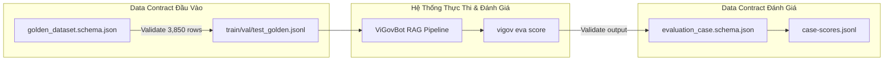

# Báo Cáo Hoàn Thiện Đánh Giá Schema ViGovBot

> **Phạm vi thẩm định**: Toàn bộ thư mục [`schema/`](file:///c:/Users/quangTam/Documents/ViGovBot/schema)  
> **Tệp tin trọng tâm**: [`golden_dataset.schema.json`](file:///c:/Users/quangTam/Documents/ViGovBot/schema/golden_dataset.schema.json) và [`evaluation_case.schema.json`](file:///c:/Users/quangTam/Documents/ViGovBot/schema/evaluation_case.schema.json)  
> **Thời điểm thẩm định**: 28/10/2026 | **Chuẩn xác thực**: JSON Schema Draft 2020-12

---

## 1. Phân Tích Kiến Trúc Kỹ Thuật Schema

Cả hai schema trong `schema/` đóng vai trò là "Data Contract" cốt lõi cho hai giai đoạn quan trọng nhất của hệ thống:
1. **`golden_dataset.schema.json`**: Xác thực tính chuẩn mực của tập dữ liệu vàng (Dataset Input Contract).
2. **`evaluation_case.schema.json`**: Xác thực kết quả đánh giá chi tiết theo từng ca kiểm thử (Evaluation v2 Output Contract - `case-scores.jsonl`).



### So sánh Đặc tính Kỹ thuật

| Tiêu chí | `golden_dataset.schema.json` | `evaluation_case.schema.json` | Đánh giá & Rủi ro |
|---|---|---|---|
| **Draft Version** | Draft 2020-12 | Draft 2020-12 | Hiện đại, tương thích tốt với các validator chuẩn (Python `jsonschema`, Rust `jsonschema`, v.v.). |
| **Khai báo Root** | `additionalProperties: false` | `additionalProperties: false` | Tốt, ngăn chặn các trường lạ rò rỉ ở tầng root. |
| **Tính khép kín của Nested Objects** | Toàn bộ nested đều `additionalProperties: false` | Nhiều khối con để `additionalProperties: true` (e.g. `golden`, `model_config`, `provenance`) | `evaluation_case` bị giảm độ chặt chẽ (weak contract), đặc biệt là khối `golden` bên trong bị buông lỏng. |
| **Tái sử dụng mã (DRY)** | Định nghĩa 8 `$defs` nội bộ | Copy nguyên văn 8 `$defs` vào thân schema | ⚠️ **Schema Drift**: Nếu sửa đổi một kiểu dữ liệu ở `golden_dataset` mà quên cập nhật `evaluation_case`, hai schema sẽ lệch chuẩn. |

---

## 2. Các Lỗ Hổng Ràng Buộc & Logic Nghiệp Vụ (False Negatives)

Mặc dù cả 3,850 dòng dữ liệu hiện tại đều pass schema meta-validation, việc phân tích sâu cấu trúc schema cho thấy tồn tại **7 kẽ hở lớn về logic ràng buộc**:

### 🔴 Lỗ hổng 1: Thiếu ràng buộc 2 chiều cho ca trả lời được (`is_unanswerable: false`)
- **Hiện trạng**: Schema chỉ định nghĩa `if is_unanswerable = true` thì ép `context_ids`, `contexts`, `citations` có `maxItems: 0`.
- **Rủi ro (False Negative)**: Nếu một mẫu dữ liệu có `is_unanswerable = false` nhưng vô tình bị rỗng context (`ground_truth_context_ids: []`) hoặc thiếu trích dẫn, schema **vẫn coi là hợp lệ**.
- **Giải pháp**: Cần bổ sung nhánh `else` (hoặc rule riêng) bắt buộc `minItems: 1` cho `ground_truth_context_ids`, `ground_truth_contexts` và `expected_citations` khi `is_unanswerable = false`.

### 🔴 Lỗ hổng 2: Ca hội thoại tiếp nối (`turn_type: follow_up`) không ép buộc lịch sử
- **Hiện trạng**: `chat_history` cho phép mảng rỗng ở mọi trường hợp.
- **Rủi ro**: Một ca kiểm thử được dán nhãn `turn_type: "follow_up"` nhưng hoàn toàn không có lịch sử hội thoại (`chat_history: []`) vẫn hợp lệ.
- **Giải pháp**: Ràng buộc điều kiện: `if turn_type == "follow_up" then chat_history: { minItems: 1 }`.

### 🟠 Lỗ hổng 3: Ca đa ý định (`complexity_type: multi_intent`) không kiểm soát sub-queries
- **Hiện trạng**: `ground_truth_sub_queries` chỉ định nghĩa là `stringArray` (cho phép rỗng).
- **Rủi ro**: Ca `multi_intent` nhưng không tách sub-query nào (`ground_truth_sub_queries: []`) vẫn được chấp nhận.
- **Giải pháp**: Ràng buộc `if complexity_type == "multi_intent" then ground_truth_sub_queries: { minItems: 2 }`.

### 🟠 Lỗ hổng 4: Ràng buộc nhiễu (`distractor_injection`) không nhất quán
- **Hiện trạng**: `injected_noise_ratio` là số thực $0 \le x \le 1$, `conflict_type` là `string`.
- **Rủi ro**: Khi `injected_noise_ratio > 0`, schema không ép buộc phải có `distractor_context_ids`. Ngược lại khi `injected_noise_ratio == 0.0`, `conflict_type` có thể nhận bất kỳ chuỗi nào thay vì chuẩn hóa `"none"`.

### 🟡 Lỗ hổng 5: Thiếu chuẩn hóa Enum cho các trường định tuyến & định dạng
- `expected_route`: Hiện 100% bản ghi là `"rag_search"`, nhưng schema chỉ định nghĩa `nonEmptyString`. Cần chuẩn hóa enum: `["rag_search", "direct_answer", "clarification_request", "refusal"]`.
- `expected_format`: Hiện chỉ nhận `nonEmptyString`. Cần enum: `["markdown_text", "bullet_points", "table", "step_by_step"]`.
- `taxonomy.domain`: Hiện dùng string tự do (`nonEmptyString`). Điều này tiềm ẩn nguy cơ lệch chuẩn (chẳng hạn gõ `"Đất Đai"` thay vì `"Đất đai"`).

### 🟡 Lỗ hổng 6: Ma trận chỉ số cứng nhắc (Rigid Metric Explosion) trong `evaluation_case`
- Trong `evaluation_results`, schema định nghĩa tới **43 chỉ số bắt buộc** (`required`) từ ROUGE, BLEU, chrF, BERTScore đến độ trễ chi tiết, và cho phép nhận `null`.
- **Nhược điểm**: Mỗi dòng kết quả đánh giá sinh ra payload rất lớn chứa đầy giá trị `null` đối với các evaluator không chạy. Khi muốn thử nghiệm thêm 1 chỉ số mới (ví dụ Ragas Faithfulness, LLM-as-a-judge Reasoning Score), bắt buộc phải sửa schema v2.0 và re-score toàn bộ các run cũ.

### 🟡 Lỗ hổng 7: Không ràng buộc tương quan trạng thái thực thi (`execution_status`)
- Nếu `execution_status` là `"oom"`, `"timeout"` hay `"error"`, thì `actual_output` có được phép tồn tại không, hay bắt buộc phải là `null`? Hiện tại schema cho phép bất kỳ trạng thái nào cũng có thể có `actual_output`.

---

## 3. Bảng Điểm Đánh Giá Kỹ Thuật Schema (Scorecard)

| # | Tiêu chí đánh giá | Điểm (/10) | Trọng số | Điểm trọng số | Chi tiết đánh giá |
|---|---|:---:|:---:|:---:|---|
| **1** | **Tính hợp lệ & Tuân thủ Chuẩn** *(Draft 2020-12 Compliance)* | **10.0** | 15% | **1.50** | Đạt 100% chuẩn Draft 2020-12, không lỗi cú pháp, tương thích hoàn toàn validator hiện đại. |
| **2** | **Độ chặt chẽ ràng buộc** *(Validation Tightness & Guardrails)* | **6.5** | 25% | **1.63** | Có `if/then` cho unanswerable nhưng thiếu chiều ngược lại; bỏ lọt các ca follow_up rỗng history, multi_intent rỗng sub-queries. |
| **3** | **Tính nhất quán & Chống trôi dạt** *(Consistency & Anti-Drift)* | **6.5** | 15% | **0.98** | `$defs` bị nhân bản giữa 2 schema; `evaluation_case` nới lỏng `additionalProperties: true` trong object `golden`. |
| **4** | **Tính module hóa & Tái sử dụng** *(Modularity & DRY)* | **6.0** | 15% | **0.90** | Chưa tách file định nghĩa dùng chung (`common_defs`); khó bảo trì khi mở rộng nghiệp vụ. |
| **5** | **Khả năng mở rộng & Phiên bản** *(Extensibility & Versioning)* | **7.5** | 15% | **1.13** | Đã có `schema_version` rõ ràng ở eval case, có `$id` phân giải. Tuy nhiên metric tree trong eval còn quá tĩnh. |
| **6** | **Tài liệu & Mô tả Schema** *(Schema Documentation)* | **7.0** | 15% | **1.05** | Có file README hướng dẫn cơ bản, nhưng từng thuộc tính bên trong thiếu `description` chi tiết giải thích ý nghĩa nghiệp vụ. |
| **TỔNG ĐIỂM** | **ĐÁNH GIÁ KỸ THUẬT SCHEMA** | | **100%** | **7.19 / 10** | **Xếp loại: KHÁ (Bền vững nhưng cần thắt chặt ràng buộc)** |

---

## 4. Đề Xuất Schema Cải Tiến (Schema Patch v1.1 / v2.1)

Dưới đây là khối cấu hình `allOf` cải tiến giải quyết triệt để các lỗ hổng ràng buộc (False Negatives) cho [`golden_dataset.schema.json`](file:///c:/Users/quangTam/Documents/ViGovBot/schema/golden_dataset.schema.json):

```json
{
  "allOf": [
    {
      "comment": "Rule 1: Unanswerable cases MUST have zero contexts and citations, Answerable cases MUST have at least 1 context and citation",
      "if": {
        "properties": {
          "taxonomy": {
            "properties": { "is_unanswerable": { "const": true } },
            "required": ["is_unanswerable"]
          }
        }
      },
      "then": {
        "properties": {
          "ground_truth": {
            "properties": {
              "ground_truth_context_ids": { "maxItems": 0 },
              "ground_truth_contexts": { "maxItems": 0 },
              "expected_citations": { "maxItems": 0 }
            }
          }
        }
      },
      "else": {
        "properties": {
          "ground_truth": {
            "properties": {
              "ground_truth_context_ids": { "minItems": 1 },
              "ground_truth_contexts": { "minItems": 1 },
              "expected_citations": { "minItems": 1 }
            }
          }
        }
      }
    },
    {
      "comment": "Rule 2: Follow-up questions MUST have non-empty chat history",
      "if": {
        "properties": {
          "taxonomy": {
            "properties": { "turn_type": { "const": "follow_up" } },
            "required": ["turn_type"]
          }
        }
      },
      "then": {
        "properties": {
          "input": {
            "properties": {
              "chat_history": { "minItems": 1 }
            }
          }
        }
      }
    },
    {
      "comment": "Rule 3: Multi-intent complexity MUST provide at least 2 sub-queries",
      "if": {
        "properties": {
          "taxonomy": {
            "properties": { "complexity_type": { "const": "multi_intent" } },
            "required": ["complexity_type"]
          }
        }
      },
      "then": {
        "properties": {
          "ground_truth": {
            "properties": {
              "ground_truth_sub_queries": { "minItems": 2 }
            }
          }
        }
      }
    }
  ]
}
```

---

## 5. Lộ Trình Chuẩn Hóa Schema Kế Tiếp

1. **Giai đoạn 1 (Ngay lập tức)**:
   - Thêm nhánh `else` vào Rule `is_unanswerable` trong `golden_dataset.schema.json` để ngăn chặn lỗi dữ liệu thiếu context âm thầm pass validation.
   - Bổ sung ràng buộc `chat_history: { minItems: 1 }` cho các ca `follow_up`.
2. **Giai đoạn 2 (Tái cấu trúc bảo trì)**:
   - Đưa các kiểu cơ bản dùng chung (`message`, `taxonomy`, `citation`, `input`, `groundTruth`) vào tệp [`common_defs.schema.json`](file:///c:/Users/quangTam/Documents/ViGovBot/schema) và tham chiếu qua `$ref`.
   - Chuyển `golden` trong `evaluation_case.schema.json` về chế độ chặt chẽ (`additionalProperties: false`).
3. **Giai đoạn 3 (Mở rộng đánh giá linh hoạt)**:
   - Trong `evaluation_case.schema.json`, chuyển đổi cấu trúc metric từ dạng trường tĩnh bắt buộc sang mô hình **Metric Registry** (`metric_name: { score, status, evidence }`) để hệ thống dễ dàng tích hợp các scorer mới mà không làm vỡ schema hợp đồng cũ.
