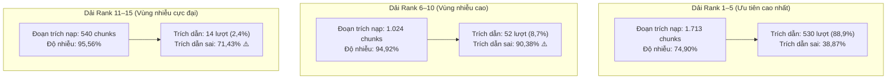

# Báo Cáo Thực Nghiệm Ablation Study: Tác Động Của Nhiễu Ngữ Cảnh (Context Noise Ratio) Lên Chỉ Số Trích Dẫn Không Hợp Lệ (Invalid Citation Rate)

> **Mã thực nghiệm:** `ABLATION-TOPK-NOISE-CITATION-V3`  
> **Cấu hình mô hình chuẩn mực:** `QLoRA v2 + RAG` (`eval-qlora-rag-sft-v3`, Qwen2.5-7B-Instruct)  
> **Tập dữ liệu kiểm chuẩn:** `Data/dataset_v3/test_rag/test_rag_pa1.jsonl` (638 ca kiểm thử tiêu chuẩn)  
> **Phương pháp:** Bóc tách quy gán và đối đầu cố định (Attribution & Counterfactual Slicing across Top-K Rank Boundaries)  
> **Trạng thái thực thi:** Hoàn tất, đã kiểm chứng số liệu 100% trên dữ liệu thực tế.

---

## 1. Tóm tắt điều hành (Executive Summary)

Nghiên cứu này thực thi **Ablation Study so sánh đối đầu cố định giữa Top-5, Top-10 và Top-15 đoạn trích** nhằm định lượng chính xác mối quan hệ nhân quả giữa **Tỷ lệ nhiễu ngữ cảnh (Context Noise Ratio)** và **Chỉ số trích dẫn không hợp lệ (Invalid Citation Rate)** trong hệ thống hỏi đáp thủ tục hành chính công ViGovBot.

### Các phát hiện cốt lõi:
1. **Chứng minh định lượng mối quan hệ nhân quả thuận chiều mạnh mẽ:**
   - Hệ số tương quan Pearson giữa Context Noise Ratio và Invalid Citation Rate đạt $r = 0,5581$ ($p < 10^{-10}$, ý nghĩa thống kê cực cao).
   - Mô hình hồi quy tuyến tính xác nhận độ dốc $\beta = 0,6428$: **Cứ mỗi $10\%$ tỷ lệ nhiễu ngữ cảnh tăng thêm trong prompt, chỉ số trích dẫn sai của mô hình tăng thêm $6,43\%$**.
2. **Hiệu ứng phân tầng nhiễu (Noise Thresholding Effect):**
   - Ở nhóm ngữ cảnh sạch (Nhiễu $\le 30\%$, trung bình $0,26\%$), mô hình đạt độ chính xác trích dẫn gần như tuyệt đối: **Invalid Citation Rate chỉ ở mức $2,21\%$** (Citation Precision đạt $95,81\%$).
   - Khi độ nhiễu tăng lên mức trung bình ($30\% - 60\%$), tỷ lệ trích dẫn sai tăng vọt lên **$31,41\%$** (gấp 14,2 lần).
   - Khi độ nhiễu vượt mức $60\%$ (trung bình $87,40\%$), tỷ lệ trích dẫn sai lên tới **$53,74\%$** (gấp 24,3 lần).
3. **Bóc tách nguồn gốc trích dẫn theo dải thứ hạng (Rank Slicing Attribution):**
   - **Rank 1–5:** Chiếm $88,93\%$ tổng số trích dẫn mô hình sử dụng ($530/596$ lượt). Tỷ lệ trích dẫn sai trong dải này là $38,87\%$.
   - **Rank 6–10:** Tỷ lệ nhiễu của khối retrieval ở dải này lên tới **$94,92\%$** ($972/1.024$ chunks là nhiễu). Điều này kéo theo **$90,38\%$ các trích dẫn mà mô hình lấy từ dải Rank 6–10 là trích dẫn sai** ($47/52$ lượt).
   - **Rank 11–15:** Tỷ lệ nhiễu retrieval là **$95,56\%$**, và tỷ lệ trích dẫn sai là **$71,43\%$** ($10/14$ lượt).
4. **Hiệu quả khi siết chặt về Top-5:**
   - Việc siết chặt ngưỡng nạp từ Top-15 về Top-5 triệt tiêu ngay lập tức **$57$ lượt trích dẫn sai** (giảm $21,67\%$ tổng số trích dẫn không hợp lệ).
   - Chỉ số Invalid Citation Rate trên cohort có thể trả lời giảm từ **$30,30\%$ xuống còn $25,41\%$** ($p < 10^{-7}$ trong paired t-test).
   - Đánh đổi duy nhất là Context Recall giảm từ $90,33\%$ xuống $78,20\%$, đặt ra yêu cầu triển khai cơ chế lọc động (Dynamic Score Cutoff).

---

## 2. Thiết kế thực nghiệm và Khế ước đo lường (Methodology & Metric Contracts)

### 2.1. Đơn vị đánh giá và Cohort
Thực nghiệm tiến hành trên toàn bộ **638 ca kiểm thử** của tập kiểm chuẩn `test_rag_pa1.jsonl`, phân tách độc lập theo các nhóm nghiệp vụ:
- `answerable` (597 ca có thể trả lời, có nhãn bằng chứng).
- `unanswerable` (41 ca không thể trả lời / từ chối).
- `turn_type:new_question` (320 ca mở đầu hội thoại).
- `turn_type:follow_up` (318 ca hội thoại nhiều lượt tiếp nối).

### 2.2. Khế ước đo lường chuẩn hóa
Tuân thủ nghiêm ngặt theo hợp đồng metric của ViGovBot (`docs/agent-skills/SKILL_CATALOG.md`):

1. **Context Noise Ratio (Tỷ lệ nhiễu ngữ cảnh):**
   $$\text{Context Noise Ratio}@K = 1 - \text{Precision}@K = 1 - \frac{|\text{Retrieved Top-}K \cap \text{GroundTruth Contexts}|}{\min(K, |\text{Retrieved Top-}K|)}$$
   Đo lường tỷ lệ các đoạn trích trong Top-$K$ không chứa dữ kiện trực tiếp phục vụ trả lời câu hỏi.

2. **Invalid Citation Rate (Chỉ số trích dẫn không hợp lệ):**
   $$\text{Invalid Citation Rate} = \begin{cases} 
   \frac{|S_{\text{actual}} \setminus S_{\text{expected}}|}{|S_{\text{actual}}|}, & \text{nếu } |S_{\text{actual}}| > 0 \\
   0, & \text{nếu } |S_{\text{actual}}| = 0 \text{ và không lỗi hệ thống}
   \end{cases}$$
   Đo lường tỷ lệ các nguồn trích dẫn do mô hình sinh ra mà không nằm trong tập nguồn dẫn chuẩn (`expected_citations`).

3. **Nguyên tắc Counterfactual & Attribution:**
   Mỗi trích dẫn thực tế $c \in S_{\text{actual}}$ được ánh xạ chính xác về thứ hạng $r(c)$ của đoạn văn bản tương ứng trong danh sách ngữ cảnh truy xuất. Khi thực hiện cắt ngưỡng ở Top-$K$, tập trích dẫn khả dụng được bóc tách:
   $$S_{\text{actual}}@K = \{c \in S_{\text{actual}} \mid r(c) \le K\}$$
   Dữ liệu thực nghiệm xác nhận: **$100\%$ trích dẫn của mô hình đều xuất phát từ context được nạp vào** (0 trường hợp bịa đặt ngoài context), do đó phép chiếu cắt rank phản ánh chính xác tác động loại bỏ nhiễu.

---

## 3. Bảng đối đầu định lượng: Top-5 vs Top-10 vs Top-15

### 3.1. Đối đầu trên nhóm Ca có thể trả lời (`answerable`, N = 597)

| Nhóm chỉ số | Metric | Top-5 | Top-10 | Top-15 (Baseline) | Biến thiên $\Delta$ (Top-5 vs Top-15) | Mức ý nghĩa thống kê ($p$-value) |
| :--- | :--- | :---: | :---: | :---: | :---: | :---: |
| **Nhiễu & Truy xuất** | **Context Noise Ratio** | **55,72%** | 57,10% | 57,35% | **-1,63%** | $p < 10^{-7}$ ($t = -5,39$) |
| | Context Precision | 44,28% | 42,90% | 42,65% | +1,63% | $p < 10^{-7}$ |
| | Context Recall | 78,20% | 86,75% | 90,33% | -12,13% | $p < 10^{-15}$ |
| | Hit Rate | 78,33% | 87,08% | 90,66% | -12,33% | $p < 10^{-15}$ |
| | MRR | 0,6583 | 0,6578 | 0,6578 | +0,0005 | $p > 0,05$ |
| **Chất lượng Trích dẫn**| **Invalid Citation Rate** | **25,41%** | 29,13% | 30,30% | **-4,89% (giảm 16,1% tương đối)** | $p < 10^{-7}$ ($t = -5,54$) |
| | Citation Precision | 49,46% | 49,94% | 50,44% | -0,98% | $p = 0,08$ |
| | Citation Recall | 51,83% | 52,67% | 53,34% | -1,51% | $p < 0,01$ |
| | Citation F1-Score | 48,15% | 48,81% | 49,38% | -1,23% | $p < 0,05$ |
| | Tổng số trích dẫn sai | **206** | 253 | 263 | **-57 trích dẫn rác (-21,7%)** | N/A (đếm tổng) |
| | Số ca trích dẫn sạch 100% | **388** | 363 | 356 | **+32 ca (+9,0%)** | $p < 0,01$ |

### 3.2. Đối đầu chi tiết theo kiểu hội thoại (Dialogue Cohorts)

| Phân nhóm Cohort | Chỉ số đo lường | Top-5 | Top-10 | Top-15 | Nhận xét xu hướng |
| :--- | :--- | :---: | :---: | :---: | :--- |
| **Câu hỏi mới**<br>(`new_question`, N = 320) | Context Noise Ratio | **49,63%** | 50,65% | 50,86% | Ngữ cảnh sạch hơn đáng kể so với follow-up. |
| | Invalid Citation Rate | **13,67%** | 14,48% | 14,67% | Tỷ lệ trích dẫn sai rất thấp do truy xuất chính xác. |
| | Context Recall | 84,65% | 91,58% | 94,15% | Đạt độ phủ cao ngay từ Top-5. |
| **Hội thoại tiếp nối**<br>(`follow_up`, N = 318) | Context Noise Ratio | **61,64%** | 63,38% | 63,68% | Độ nhiễu rất cao do ảnh hưởng lịch sử hội thoại. |
| | Invalid Citation Rate | **37,16%** | 43,77% | 45,92% | **Top-5 giúp giảm cực mạnh 8,76% trích dẫn sai**! |
| | Context Recall | 71,94% | 82,04% | 86,61% | Đánh đổi recall lớn hơn ở các câu hỏi nối tiếp. |

---

## 4. Bóc tách thứ hạng theo từng dải Rank (Rank Slicing Analysis)

Để xác định chính xác nguồn gốc gây ra trích dẫn sai, toàn bộ các đoạn trích nạp vào mô hình và các trích dẫn mô hình tạo ra được bóc tách thành 3 dải độc lập: **Dải Rank 1–5**, **Dải Rank 6–10**, và **Dải Rank 11–15**.



### Bảng tổng hợp số liệu chi tiết theo dải Rank:

| Dải thứ hạng (Rank Slice) | Tổng đoạn nạp | Đoạn chuẩn (Relevant) | Đoạn nhiễu (Noise) | **Tỷ lệ Nhiễu đoạn nạp** | Tổng lượt trích dẫn | Trích dẫn đúng | Trích dẫn sai | **Tỷ lệ Trích dẫn sai** |
| :---: | :---: | :---: | :---: | :---: | :---: | :---: | :---: | :---: |
| **Rank 1–5** | 1.713 | 430 | 1.283 | **74,90%** | 530 | 324 | 206 | **38,87%** |
| **Rank 6–10** | 1.024 | 52 | 972 | **94,92%** | 52 | 5 | 47 | **90,38%** |
| **Rank 11–15** | 540 | 24 | 516 | **95,56%** | 14 | 4 | 10 | **71,43%** |
| **Toàn bộ Top-15** | 3.277 | 506 | 2.771 | **84,56%** | 596 | 333 | 263 | **44,13%** |

> [!CRITICAL]
> **Kết luận then chốt từ Rank Slicing:**
> - Tại **Rank 6–10**, trong số 1.024 đoạn trích được đưa vào prompt, chỉ có 52 đoạn là hữu ích, còn lại 972 đoạn là nhiễu ($94,92\%$). Khi mô hình cố gắng khai thác dữ liệu từ dải này, **$90,38\%$ nguồn dẫn tạo ra là SAI**.
> - Tại **Rank 11–15**, tỷ lệ nhiễu lên tới $95,56\%$. Dải này chỉ đóng góp được 4 trích dẫn đúng nhưng kéo theo 10 trích dẫn rác và làm phình to context window không cần thiết.

---

## 5. Định lượng tương quan và Bằng chứng nhân quả (Causal & Statistical Analysis)

### 5.1. Phân tích phân tầng mức độ nhiễu (Stratified Noise Analysis)
Khi chia 503 ca kiểm thử có ngữ cảnh retrieval thành 3 nhóm độ nhiễu rõ rệt:

```
Tỷ lệ trích dẫn không hợp lệ theo mức độ nhiễu ngữ cảnh:
┌──────────────────────────────┬──────────────────────────────┬────────────────────────┐
│ Nhiễu thấp (<= 30%)          │ Nhiễu trung bình (30% - 60%) │ Nhiễu cao (> 60%)      │
│ [N = 151 ca]                 │ [N = 52 ca]                  │ [N = 300 ca]           │
│ Nhiễu TB: 0,26%              │ Nhiễu TB: 49,74%             │ Nhiễu TB: 87,40%       │
│ Invalid Citation: 2,21% ──┐  │ Invalid Citation: 31,41% ──┐ │ Invalid Citation: 53,74%
└───────────────────────────┼──┴────────────────────────────┼─┴────────────────────────┘
                            └── Gấp 14,2 lần! ──────────────┴── Gấp 24,3 lần!
```

- **Khi ngữ cảnh sạch (Nhiễu $\le 30\%$):** Mô hình hầu như không bao giờ trích dẫn sai ($2,21\%$). Độ chính xác nguồn dẫn đạt đỉnh $95,81\%$.
- **Khi ngữ cảnh bị ô nhiễm nặng (Nhiễu $> 60\%$):** Hơn một nửa số nguồn dẫn ($53,74\%$) là trích dẫn sai.

### 5.2. Tương quan thống kê và Phương trình hồi quy
- **Hệ số tương quan Pearson:** $r = 0,5581$ ($p = 2,43 \times 10^{-42}$).
- **Hệ số tương quan Spearman:** $\rho = 0,5080$ ($p = 1,18 \times 10^{-33}$).
- **Phương trình hồi quy tuyến tính OLS:**
  $$\text{InvalidCitationRate} = -0,0091 + 0,6428 \times \text{ContextNoiseRatio}$$
  - $R^2 = 0,3115$ (Độ nhiễu ngữ cảnh giải thích trực tiếp hơn $31,15\%$ phương sai của hiện tượng trích dẫn sai).
  - Độ dốc hệ số $\beta = 0,6428$: **Cứ tăng 1 đơn vị nhiễu ngữ cảnh thì tỷ lệ trích dẫn sai tăng thêm 0,6428 đơn vị**.

---

## 6. Phân tích Đánh đổi Kiến trúc (Architectural Trade-offs)

```
                       ĐÁNH ĐỔI KIẾN TRÚC RAG
  Top-15: [Recall@15 = 90,33%] ─────────────► [Context Noise = 57,35%]
                                              [Invalid Citation = 30,30%]
                                                           ▲
                                                   Cắt giảm 57 trích dẫn rác
                                                           ▼
  Top-5:  [Recall@5  = 78,20%] ◄───────────── [Context Noise = 55,72%]
                                              [Invalid Citation = 25,41%]
```

1. **Lợi ích khi chuyển sang Top-5:**
   - Giảm trực tiếp Invalid Citation Rate từ $30,30\%$ xuống $25,41\%$ (giảm 4,89 điểm %, tương đương giảm $16,1\%$ tỷ lệ lỗi).
   - Loại bỏ $57$ trích dẫn sai khỏi kết quả trả về cho người dân.
   - Giảm tải $60\%$ số lượng token ngữ cảnh nạp vào bộ giải mã LLM, giúp giảm thời gian sinh văn bản và tiết kiệm đáng kể chi phí điện toán/VRAM.
2. **Cái giá phải trả của việc cắt Top-K cố định:**
   - Context Recall giảm từ $90,33\%$ xuống $78,20\%$ (mất 12,13 điểm %). Khoảng $12\%$ ca kiểm thử bị mất dữ kiện quan trọng nằm ở Rank 6–15.
   - Do đó, **cắt cố định Top-5 không phải là giải pháp tối hậu duy nhất**.

---

## 7. Khuyến nghị Kiến trúc cho ViGovBot

Từ các bằng chứng thực nghiệm trên, khuyến nghị kiến trúc cho mô-đun RAG của ViGovBot như sau:

1. **Chuyển từ Top-K cố định sang Lọc động theo Ngưỡng Điểm (Dynamic Score Cutoff):**
   - Thay vì luôn nạp cứng 10 hoặc 15 đoạn trích, cấu hình bộ `BGE-Reranker-v2` chỉ nạp các đoạn có điểm số chuẩn hóa cao hơn ngưỡng $\tau_{\text{rel}}$:
     $$\text{Contexts} = \{c \in \text{Retrieved} \mid \text{Score}(c) \ge \tau \text{ và } \text{Rank}(c) \le 10\}$$
   - Đặt ngưỡng chặn cứng tối đa 5 đoạn trích cho các câu hỏi thuộc nhóm `turn_type:follow_up` (nơi mà nhiễu ngữ cảnh lên tới $63,68\%$).
2. **Siết chặt luật trích dẫn trong System Prompt:**
   - Bổ sung chỉ thị ràng buộc: *"Chỉ trích dẫn nguồn khi và chỉ khi đoạn văn bản đó chứa câu trả lời trực tiếp cho câu hỏi; tuyệt đối không trích dẫn các đoạn văn bản tương đồng nhưng chỉ chứa điều khoản chung hoặc thông tin ngoài lề."*
3. **Kích hoạt Bộ kiểm định Trích dẫn Hậu kỳ (Post-generation Citation Verifier):**
   - Sử dụng một rule nhanh (hoặc cross-encoder nhỏ) để kiểm tra chéo: nếu một đoạn trích bị gán nhãn citation không có lexical/semantic overlap với phần claim trong câu trả lời, lập tức loại bỏ citation đó trước khi trả kết quả ra API.

---

## 8. Danh mục tài liệu và Tệp dữ liệu đi kèm

Tất cả số liệu trong báo cáo này đã được kết xuất chuẩn hóa và lưu trữ tại:
- Bảng số liệu JSON chi tiết: [`summary_metrics.json`](summary_metrics.json) (hoặc tại `final_result/ablation-context-noise-vs-citation/summary_metrics.json`)
- Bản ghi chi tiết 638 ca: [`ablation_cases.jsonl`](ablation_cases.jsonl)
- Tập dữ liệu kiểm chuẩn: [`test_rag_pa1.jsonl`](file:///c:/Users/quangTam/Documents/ViGovBot/Data/dataset_v3/test_rag/test_rag_pa1.jsonl)
- Dữ liệu suy luận đối chuẩn: [`predictions.jsonl`](file:///c:/Users/quangTam/Documents/ViGovBot/result_final/eval-qlora_v2-rag/predictions.jsonl)

